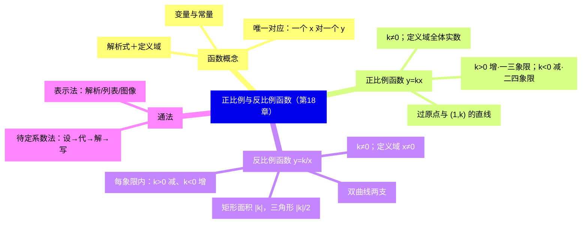
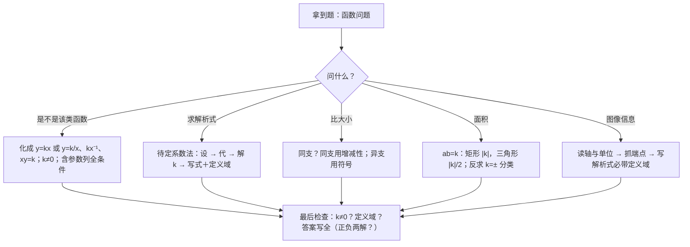

# 正比例函数与反比例函数（详解版）

> [!note] 使用说明
> 本文是详解版，从"为什么"讲起供从头自学；考前速查和掌握度跟踪在概要版：[[03-数学/知识点/八年级/正比例函数与反比例函数]]。

## 0️⃣ 这章学什么 & 中考怎么考

- **这章解决什么问题**：生活中很多量是一起变的——售出的水笔支数变，营业额跟着变；占地面积固定，长方形的长变，宽就反着变。**函数**就是刻画"两个变量之间确定的依赖关系"的数学工具。本章先立函数的概念，再研究两个最基础的函数：$y=kx$（正比例函数，图像是过原点的直线）和 $y=\dfrac kx$（反比例函数，图像是双曲线）。
- **和前后章节的关系**：往前，你要会平面直角坐标系、比例、解一元一次方程；往后，九年级二次函数走的是**同一条研究路径**——概念 → 图像 → 性质 → 待定系数法 → 应用，本章是把这条路径走通的第一遍（[[03-数学/知识点/九年级/二次函数]]）。
- **中考怎么考**（依据概要版，不编造分值）：
  - 函数概念（含"唯一对应"）、待定系数法是二次函数与函数综合题的入场券；
  - ==反比例函数"每象限内"的增减性==与 ==k 的几何意义==是选择填空的常客；
  - 图像信息读取（线段型实际问题）考定义域意识。
- 一句话总结：**判别看形式（$k\ne0$）、求式用待定系数、比大小先分象限、算面积想 $\lvert k\rvert$；解析式和定义域永远成对出现。**

### 学完本章，你应该能做到

1. 用"唯一对应"判断一个依赖关系是不是函数，并写出解析式与定义域。
2. 判别一个式子是不是正比例/反比例函数（含参数时列出全部条件）。
3. 用待定系数法四步（设、代、解、写）求解析式，定义域不落单。
4. 画出 $y=kx$ 与 $y=\dfrac kx$ 的图像，按 $k$ 的符号说出象限与增减性。
5. 用 $\lvert k\rvert$ 求双曲线上一点与坐标轴围成的矩形、三角形面积。

### 本章知识地图

## 🧭 先修自检（学不下去先回到这里）

> [!note] 先修自检怎么用
> 下面每一项都是本章的地基。做不出就先去补对应知识，硬学只会更挫败。

| # | 你应该会的 | 自查题（先做再看答案） | 答案 | 不会去哪补 |
| - | ---------- | ---------------------- | ---- | ---------- |
| 1 | 坐标系 | 点 $(2,-3)$、$(-1,4)$ 各在第几象限？ | 第四；第二（上正下负，右正左负） | [[03-数学/知识点/00-六至八年级核心公式定理总表]] |
| 2 | 比值 | 买 5 支笔付 25 元，单价是多少？营业额与支数的比呢？ | 5 元/支；比值恒为 5——"正比例"的种子 | 小学比例 |
| 3 | 解方程 | 由 $3t=12$、$2y=\dfrac13$ 解出未知数 | $t=4$；$y=\dfrac16$ | 同上 |
| 4 | 分式有意义 | $y=\dfrac{2}{x-1}$ 中 $x$ 有什么限制？ | $x\ne1$（分母不为零） | 同上 |
| 5 | 代入求值 | $y=-3x$，当 $x=-2$ 时 $y=$？ | $6$（负负得正） | 同上 |

**自查题做错的，先把那一项补上再往下读。第 2、4 项分别是正比例、反比例两节的地基。**

## 🌱 概念从头讲

> [!note] 概念讲法约定
> 每个概念按"**为什么需要它 → 它是什么 → 符号与记号含义 → 容易想错的地方**"四步讲。

### 概念 1：变量与常量

- **为什么需要**：研究一个变化过程，第一步是分清"谁在变、谁不动"，否则无从谈"依赖关系"。
- **定义**：在某个变化过程中，数值发生变化的量叫**变量**；保持不变的量叫**常量（常数）**。
- **符号/记号**：油箱问题（18.1 例）里，汽车行驶路程 $x$、剩余油量 $y$ 是变量；油箱容量 120 升、每 10 千米耗油 2 升是常量。
- **容易想错**：❌ 以为"常量一定是数"。 → 也可以是固定的关系式（如"每千米耗油率固定"）。判断关键是**在指定过程中它变不变**。

### 概念 2：函数（本章一切的根）

- **为什么需要**：光说"$y$ 随 $x$ 变"太模糊——铅球运动员的年龄变了成绩也变，但毫无规律可言。数学要的是**可计算、可预测**的依赖，所以定义里必须钉死"每取一个 $x$，$y$ 唯一确定"。
- **定义**：在某个变化过程中有两个变量 $x$ 和 $y$，如果在变量 $x$ 的**允许取值范围内**，变量 $y$ 随着 $x$ 的变化而变化，它们之间存在**确定的依赖关系**——$x$ 每取一个确定的值，$y$ 都有**唯一**确定的值与之对应——那么 $y$ 叫做 $x$ 的**函数**，$x$ 叫做**自变量**。
- **拆解三个关键词**：
  - **允许取值范围**：$x$ 不能乱取（分母非零、实际意义限制），这是"定义域"的来源；
  - **确定的依赖关系**：给定 $x$，有办法**算出** $y$（解析式、表格或图像）；
  - **唯一**：一个 $x$ 只配一个 $y$。
- **反例帮理解**：
  - "汽车行驶的速度 $y$ 与驾驶员的年龄 $x$"——同岁的人速度五花八门，$x$ 定了 $y$ 不定，**不是函数**；
  - "$y$ 是 $x$ 的平方根"（在实数范围内）——$x=4$ 对应 $y=\pm2$ 两个值，**不唯一，不是函数**；而 "$y=x^2$" 一个 $x$ 配一个 $y$，**是**函数；
  - 正例：某天"时刻 $t$ → 气温 $T$"的图像，每个时刻只有一条温度读数，$T$ 是 $t$ 的函数（18.1 例题 2 就是考这个）；甚至 "$x+2$" 也是 $x$ 的函数——依赖关系不必"复杂"。
- **容易想错**：❌"图像上下起伏的就不是函数"。 → 判断标准是**竖直线检验**：任画一条竖直线，与图像至多交一点就是函数。正弦式起伏的气温图照样是函数；圆（一个 $x$ 配上下两个 $y$）的完整曲线才不是。

### 概念 3：函数解析式与定义域

- **是什么**：表示依赖关系的数学式子叫**函数解析式**；自变量的取值范围叫**定义域**。两者是一对——**写解析式必须连定义域一起写**，尤其实际问题里（时间从 0 到油尽、人数是正整数）。
- **符号/记号**：如汽车油箱 $Q=60-5t$，解析式给"怎么算"，定义域 $0\le t\le12$ 给"t 能取哪些值"——没有定义域的 $Q=60-5t$ 会荒谬地给出"$t=20$ 时油量为 $-40$ 升"。
- **容易想错**：❌ 把定义域当摆设。 → 定义域直接参与答案：图像是**线段**而不是直线、函数值超范围没有意义、应用题里淘汰假解，全靠它。

### 概念 4：正比例关系与正比例函数

- **为什么需要**：水笔销售表（18.2 问题）里，营业额与支数的比值始终是 5——"比值恒定"是最简单也最常见的依赖，值得给它命名并系统研究。
- **定义**：
  - 如果 $\dfrac yx=k$（$k$ 是不等于零的常数），就说 $y$ 与 $x$ **成正比例**；
  - 解析式形如 $y=kx$（$k$ 是常数，$k\ne0$）的函数叫**正比例函数**，$k$ 叫**比例系数**；定义域是**一切实数**。
- **为什么 $k\ne0$**：$k=0$ 时 $y=0$，"比例"失去意义（比值不再是固定的非零常数），图像与 $x$ 轴重合也不再是研究对象的形状。判别题里 $k\ne0$ 与"$x$ 的系数"两条件要同时查。
- **为什么图像是直线**：$y=kx$ 上任取两点，比如 $(0,0)$ 与 $(1,k)$；反过来，"过原点与点 $(1,k)$ 的直线"上每一点 $(x,y)$ 都满足 $\dfrac yx=k$。七年级几何告诉我们**两点确定一条直线**，所以图像就是这条直线——这也是"两点法"画图的依据。
- **容易想错**：
  - ❌ "$y=3(x+1)$、$y=\dfrac5x$、$y=3x^2$ 是正比例函数"。 → 化简后对照 $y=kx$：$3(x+1)=3x+3$ 多了常数项；$\dfrac5x$ 是除式；$3x^2$ 是二次。**都只有"一次、无常数项"才合格**。
  - ❌ 含参数只查一个条件。 → $y=(k-2)x+k^2-5k-6$ 是正比例函数，需**同时** $k^2-5k-6=0$（常数项为 0）且 $k-2\ne0$（系数非零），解得 $k=6$（$k=-1$ 因系数为 0 舍去）。

### 概念 5：反比例关系与反比例函数

- **为什么需要**：面积固定 100 平方米的长方形，长 $x$ 越大宽 $y$ 越小，且 $xy$ 恒等于 100——"乘积恒定"与"比值恒定"正好互补，是另一类基本依赖。
- **定义**：
  - 如果 $xy=k$（$k$ 是不等于零的常数），就说 $y$ 与 $x$ **成反比例**；
  - 解析式形如 $y=\dfrac kx$（$k$ 是常数，$k\ne0$）的函数叫**反比例函数**，$k$ 也叫比例系数；定义域是 $x\ne0$。
  - 三种等价形式：$y=\dfrac kx\iff y=kx^{-1}\iff xy=k$，判别时任选其一化一化再看。
- **为什么定义域是 $x\ne0$**：分母不能为零——$x=0$ 时 $\dfrac kx$ 无意义。这条限制让图像**断成两支**（$x=0$ 即 $y$ 轴处没有图像），正是"双曲线"名字的由来。
- **谁与谁成反比例要照题意写**："$y$ 与 $2x+7$ 成反比例"应设 $y=\dfrac{k}{2x+7}$；"$y$ 与 $x^2$ 成反比例"应设 $y=\dfrac{k}{x^2}$——**比例关系的对象是题里说的那个量**，别惯性写成 $\dfrac kx$。
- **容易想错**：
  - ❌ "$y=\dfrac1x+1$ 是反比例函数"。 → 多了常数项 1，不合 $y=\dfrac kx$ 形（$xy=k$ 化不出它）；$y=-4x^{-1}$ 倒**是**（即 $y=-\dfrac4x$）。
  - ❌ 含参数只解一个方程。 → $y=\dfrac{k+1}{x}+k^2-1$ 是反比例函数，需同时 $k^2-1=0$（尾巴为 0）且 $k+1\ne0$（系数非零），得 $k=1$（$k=-1$ 舍去）。

### 概念 6：图像与增减性——"每象限"三个字的分量

- **是什么**：$y=\dfrac kx$ 的图像叫**双曲线**，由两支组成：

| $k$ 的符号 | 所在象限 | 增减性（**每一支/每一象限内**） |
| ---- | ---- | ---- |
| $k>0$ | 第一、三象限 | $y$ 随 $x$ 增大而**减小** |
| $k<0$ | 第二、四象限 | $y$ 随 $x$ 增大而**增大** |

（正比例函数对照：$k>0$ 过一三象限、$y$ 随 $x$ 增大而增大；$k<0$ 过二四象限、减小。图像只由 $k$ 的符号决定。）

- **为什么反比例的增减性必须加"每象限内"**：拿 $k=1$ 看两支上的点——$x=-1$ 时 $y=-1$；$x=1$ 时 $y=1$。$x$ 从 $-1$ 增到 $1$，$y$ 从 $-1$ 涨到 $1$，要是跨着两支套"减小"，立刻自相矛盾。**"减小"只在同一支内成立**；跨支比较要靠符号（正半支的 $y$ 永远大于负半支的 $y$）。
- **为什么说图像"无限接近坐标轴但不相交"**：$x$ 越大，$y=\dfrac kx$ 越接近 0 却永不为 0（$k\ne0$）；$x$ 越接近 0，$\lvert y\rvert$ 越大却取不到 $x=0$。这就是双曲线"贴近而不过"的渐近形态。
- **容易想错**：❌ 比较双曲线上两点纵坐标，直接套增减性。 → 先看两点**是否同支（同象限）**：同支用增减性；异支用符号定胜负（$k>0$ 时一、三象限的 $y$ 为正，二、四象限的 $y$ 为负）。

### 概念 7：k 的几何意义（反比例函数最常考的"隐藏面积"）

- **是什么**：过双曲线上任一点 $P(a,b)$ 向两坐标轴作垂线：
  - 与坐标轴围成的**矩形**面积 $=\lvert k\rvert$；
  - 与原点连线构成的**直角三角形**面积 $=\dfrac{\lvert k\rvert}{2}$。
- **为什么成立（推导）**：$P(a,b)$ 在 $y=\dfrac kx$ 上 $\Rightarrow ab=k$。矩形两邻边长分别是 $\lvert a\rvert$、$\lvert b\rvert$，面积 $=\lvert a\rvert\cdot\lvert b\rvert=\lvert ab\rvert=\lvert k\rvert$；三角形是矩形沿对角线 $OP$ 一分为二的一半，面积 $\dfrac{\lvert k\rvert}{2}$。**关键就一句：双曲线上点的横、纵坐标之积恒为 $k$。**
- **一个推论**：同一双曲线上任取两点作这样的矩形，面积都相等（都是 $\lvert k\rvert$）——单元讲评练习 1 考的就是它。
- **容易想错**：❌ 由面积直接写 $k=$ 面积。 → 面积给的是 $\lvert k\rvert$，**要分 $k=\pm$ 两种**（除非题目另有象限信息），这是单元讲评例题 4 的设错点。

## 🧮 公式逐个拆解

> [!note] 公式拆解约定
> 每个公式都必须能回答四件事：每个符号是什么？什么时候能用？怎么变形？配一个一步能算的最小例子。

### 公式 1：正比例函数 $y=kx$（$k\ne0$）

| 符号 | 含义 | 注意 |
| ---- | ---- | ---- |
| $k$ | 比例系数 | $k\ne0$；符号定象限与增减 |
| 定义域 | 一切实数 | 实际问题中常被压缩成区间 |

- **成立条件**：$k$ 为非零常数。**判别口诀**：化简后"一次项、无尾巴、系数非零"。
- **待定系数法**（求解析式的通法第一步）：设 $y=kx$ → 代一组对应值 $(x_0,y_0)$（$x_0\ne0$）→ 解 $k=\dfrac{y_0}{x_0}$ → 写解析式（连定义域）。
- **最小例子**：$y$ 与 $x$ 成正比例，$x=3$ 时 $y=24$：$24=3k$，$k=8$，$y=8x$（定义域一切实数）。**验算**：$x=3$ 代回得 24 ✓。

### 公式 2：正比例函数图像——过 $(0,0)$ 与 $(1,k)$ 的直线

- **成立条件**：$k\ne0$；实际定义域受限时图像是**线段、射线或离散点**（如"售出水笔数 $x$ 是正整数"时，图像是一串点）。
- **常用变形（图像 ↔ 性质互译）**：$k>0$：过一、三象限，左低右高（增）；$k<0$：过二、四象限，左高右低（减）。$\lvert k\rvert$ 越大直线越"陡"。
- **画图两步**：描 $(0,0)$ 与 $(1,k)$，过两点作直线（两点定线）。
- **最小例子**：画 $y=-2x$：取 $(0,0)$、$(1,-2)$，连线是过二、四象限的下降直线；$x=2$ 时 $y=-4$，点 $(2,-4)$ 应落在线上，可作检验点。

### 公式 3：反比例函数 $y=\dfrac kx$（$k\ne0$）

| 符号 | 含义 | 注意 |
| ---- | ---- | ---- |
| $k$ | 比例系数 | $k\ne0$；符号定象限与增减 |
| 定义域 | $x\ne0$ | 图像因此断成两支 |

- **成立条件**：$k\ne0$。判别三形式任化其一：$\dfrac kx$、$kx^{-1}$、$xy=k$。
- **待定系数法**：设 $y=\dfrac kx$ → 代对应值 → $k=x_0y_0$ → 写解析式（带定义域 $x\ne0$）。
- **常用变形**："$y$ 与 $\square$ 成反比例"设 $y=\dfrac k{\square}$，$\square$ 照题意抄（$2x+7$、$x^2$ 都行）。
- **最小例子**：$x=2$ 时 $y=9$：$9=\dfrac k2$，$k=18$，$y=\dfrac{18}{x}$（$x\ne0$）。**验算**：$x=2$ 代回得 9 ✓。

### 公式 4：增减性对照表（数形结合核心表）

| 函数 | $k>0$ | $k<0$ |
| ---- | ---- | ---- |
| $y=kx$ | 过一、三象限；$y$ 随 $x$ 增大而**增大** | 过二、四象限；$y$ 随 $x$ 增大而**减小** |
| $y=\dfrac kx$ | 两支在一、三象限；**每支内** $y$ 随 $x$ 增大而**减小** | 两支在二、四象限；**每支内** $y$ 随 $x$ 增大而**增大** |

- **成立条件**：反比例的增减性**只对同一支**有效，跨支比较先比符号。
- **怎么用**：比较 $y_1,y_2$ 的大小——①定 $k$ 的符号；②看点是否同支；③同支套表、异支比正负。
- **最小例子**：$y=\dfrac1x$ 上 $A(-3,y_1)$、$B(3,y_2)$：异支，$y_1=-\dfrac13<0<y_2=\dfrac13$，故 $y_1<y_2$——**不是**"增大"口诀能直接给的。

### 公式 5：k 的几何意义

$$S_{\text{矩形}}=\lvert k\rvert,\qquad S_{\triangle OPQ}=\dfrac{\lvert k\rvert}{2}$$

| 符号 | 含义 | 注意 |
| ---- | ---- | ---- |
| $P(a,b)$ | 双曲线上任一点 | $ab=k$ |
| 矩形 | 以 $P$ 向两轴作垂线围成的矩形 | 边长 $\lvert a\rvert$、$\lvert b\rvert$ |
| $\triangle OPQ$ | 原点与两垂足构成的直角三角形 | $OP$ 为斜边 |

- **成立条件**：点在 $y=\dfrac kx$ 上且 $k\ne0$。
- **怎么用**：已知面积反求解析式时，由 $S=\dfrac{\lvert k\rvert}{2}$ 得 $\lvert k\rvert=2S$，**解出 $k=\pm2S$ 两个候选**，再按图像所在象限定正负。
- **最小例子**：$S_{\triangle}=3$：$\lvert k\rvert=6$，$k=\pm6$，解析式 $y=\dfrac6x$ 或 $y=-\dfrac6x$（图像在第一、三象限则取 $+$）。

### 公式 6：函数的三种表示法

| 表示法 | 优点 | 局限 |
| ---- | ---- | ---- |
| **解析法** | 关系明确，可算任意自变量的函数值 | 抽象，有的函数写不出解析式 |
| **列表法** | 一目了然，直接查对应值 | 只能列有限个值 |
| **图像法** | 直观呈现变化趋势 | 读出的值往往是近似的 |

- **读图三步**：先看两轴含义与单位 → 再抓起点、转折点、终点（端点值）→ 最后看"平段 = 不变、越陡 = 变化越快"。
- **最小例子**：$Q=60-5t$（$0\le t\le12$）的图像是连 $(0,60)$ 与 $(12,0)$ 的**线段**——图像的"断头"正是定义域的形状。

## 🪜 例题阶梯

> [!note] 例题怎么用
> 四级台阶，每一级都要动笔跟着算，不许只看。题源均为备课包任务单与课后练习原题。

### 第 1 级 · 入门（求函数值 + 增减性）

> **题目**（18.2 学习任务单 例题 1）：已知正比例函数 $y=-4x$，说出 $y$ 与 $x$ 之间的比例系数，并求当变量 $x$ 分别取 $-5$、$-2$、$0$、$3$ 时的函数值。
>
> **每一步为什么这么做**：
> - 比例系数就是 $y=kx$ 里的 $k$，照式即读；
> - 求函数值 = 把 $x$ 的值**代入解析式算 $y$**，符号是唯一易错点。
>
> **完整解答**：比例系数 $k=-4$。
> $x=-5$：$y=-4\times(-5)=20$；$x=-2$：$y=-4\times(-2)=8$；$x=0$：$y=0$；$x=3$：$y=-12$。
> （每个都是"负系数 × 负自变量 = 正"或"× 正 = 负"——**先定符号再算绝对值**，不跳步。）
> **验算与发现**：四点 $(-5,20)$、$(-2,8)$、$(0,0)$、$(3,-12)$ 都在过原点的下降直线上，且 $x$ 增大 $y$ 减小——正是 $k<0$ 增减性"增大而减小"的活例子。
>
> **变式提醒**：18.2 课后练习第 4 题反向操作："$y$ 与 $x$ 成正比例，$x=-1$ 时 $y=\dfrac32$，求解析式并求 $y=-4$ 时的 $x$"——先待定系数得 $y=-\dfrac32x$，再由 $-4=-\dfrac32x$ 解出 $x=\dfrac83$。**正向代值、反向解方程，一来一回都要会。**

### 第 2 级 · 标准（待定系数法三连问）

> **题目**（18.3 学习任务单 例题 2）：已知 $y$ 是 $x$ 的反比例函数，且当 $x=2$ 时，$y=9$。
> (1) 求 $y$ 关于 $x$ 的函数解析式；(2) 当 $x=\dfrac32$ 时，求 $y$ 的值；(3) 当 $y=5$ 时，求 $x$ 的值。
>
> **思路从哪来**：三问一条链——先用一组对应值定 $k$（待定系数法），再"代 $x$ 求 $y$"、"代 $y$ 求 $x$"，正反两用。
>
> **完整解答**：
> (1) 设 $y=\dfrac kx$（$k\ne0$）。把 $x=2$、$y=9$ 代入：$9=\dfrac k2$，得 $k=18$。
> 所以 $y=\dfrac{18}{x}$（$x\ne0$）。
> （**定义域写上**——它是解析式的一半，丢了要扣分。）
> (2) 代 $x=\dfrac32$：$y=\dfrac{18}{3/2}=18\times\dfrac23=12$。
> （除以分数 = 乘它的倒数，别翻错。）
> (3) 代 $y=5$：$5=\dfrac{18}{x}$，$5x=18$，$x=\dfrac{18}{5}$。
> （两边同乘 $x$：$x\ne0$ 保证合法；也可以直接用 $xy=k$ 反读：$x=\dfrac{18}{5}$。）
> **验算**：$\dfrac32\times12=18=k$ ✓，$\dfrac{18}{5}\times5=18=k$ ✓——**横纵坐标之积恒等于 $k$，三个答案互相咬合**。
>
> **变式提醒**：18.3 课后练习第 3 题同型但带根式：$x=-\dfrac{\sqrt2}{2}$ 时 $y=2\sqrt2$，求 $k$ 并求 $x=\sqrt6$ 时的 $y$。$k=x_0y_0=2\sqrt2\times\Big(-\dfrac{\sqrt2}{2}\Big)=-2$，$y=-\dfrac{2}{\sqrt6}=-\dfrac{\sqrt6}{3}$——**根式运算要分母有理化**（见[[03-数学/知识点/八年级/二次根式]]），两章知识在这里会师。

### 第 3 级 · 中档（跨象限比较大小）

> **题目**（函数单元讲评 例题 3）：已知点 $A(3,y_1)$、$B(7,y_2)$、$C(-3,y_3)$、$D(-8,y_4)$ 是反比例函数 $y=\dfrac kx$（$k>0$）图像上的点。
> (1) $y_1$ 与 $y_2$；(2) $y_3$ 与 $y_4$；(3) $y_1$ 与 $y_4$；(4) $y_1$、$y_3$ 与 $y_4$ 的大小关系。
>
> **思路从哪来**：比较大小两把尺——**同支（同象限）用增减性，异支用符号**。先把四个点按象限分堆：$A$、$B$ 横坐标为正 → 第一象限支（$y>0$）；$C$、$D$ 横坐标为负 → 第三象限支（$y<0$）。
>
> **完整解答**：
> (1) $A$、$B$ 同在第一象限支，$k>0$ 每支内 $y$ 随 $x$ 增大而减小；$3<7$，所以 $y_1>y_2$。
> （口诀方向别背反——"减小"是"y 随 x 增大而减小"，$x$ 小的那个 $y$ 反而大。）
> (2) $C$、$D$ 同在第三象限支；$-3>-8$，$x$ 增大 $y$ 减小，所以 $y_3<y_4$。
> （也可以硬算验证：取 $k=1$，$y_3=-\dfrac13$，$y_4=-\dfrac18$，$-\dfrac13<-\dfrac18$ ✓。）
> (3) $A$ 在第一象限 $y_1>0$，$D$ 在第三象限 $y_4<0$，正 $>$ 负，所以 $y_1>y_4$。
> （**跨支比较不用增减性**——符号一锤定音。）
> (4) 综合前三个结论：$y_1$ 最大（正数）；$y_3$、$y_4$ 都为负且 $y_4>y_3$，所以 $y_1>y_4>y_3$。
> **验算**：取 $k=1$：$y_1=\dfrac13$，$y_2=\dfrac17$，$y_3=-\dfrac13$，$y_4=-\dfrac18$。$\dfrac13>\dfrac17$ ✓；$-\dfrac13<-\dfrac18$ ✓；$\dfrac13>- \dfrac18$ ✓；整体 $\dfrac13>-\dfrac18>-\dfrac13$ ✓。
>
> **变式提醒**：单元讲评例题 2 是正比例版同型题：$A(5,y_1)$、$B(x_2,y_2)$ 在 $y=kx$（$k<0$）上比较 $y_1,y_2$——正比例图像**不分支**，直接"$k<0$ 减：$x$ 大 $y$ 小"。反比例比正比例多一道"先分象限"的工序，这正是易错点所在。

### 第 4 级 · 提高（k 的几何意义 + 分类）

> **题目**（函数单元讲评 例题 4）：点 $A(a,b)$ 是反比例函数 $y=\dfrac kx$（$k\ne0$）图像上的一点，$AE\perp x$ 轴，垂足为点 $E$，$S_{\triangle AOE}=3$。求这个反比例函数的解析式。
>
> **思路从哪来**：面积 → $\lvert k\rvert$ → $k$ 要分类。链条：点在曲线上 $\Rightarrow ab=k$；三角形面积 $\Rightarrow \dfrac{\lvert ab\rvert}{2}=3$。
>
> **完整解答**：
> 第一步：翻译面积。$AE$ 是点 $A$ 到 $x$ 轴的垂线段，长为 $\lvert b\rvert$；$OE$ 长为 $\lvert a\rvert$。
> $S_{\triangle AOE}=\dfrac12\times\lvert a\rvert\times\lvert b\rvert=\dfrac{\lvert ab\rvert}{2}=\dfrac{\lvert k\rvert}{2}=3$。
> （用了"点在 $y=\frac kx$ 上则 $ab=k$"——**k 的几何意义不是背出来的公式，是 $ab=k$ 一行推导**。）
> 第二步：解出 $\lvert k\rvert=6$，所以 $k=6$ 或 $k=-6$。
> 第三步：写出全部答案：$y=\dfrac6x$ 或 $y=-\dfrac6x$（定义域 $x\ne0$）。
> （题目没给点所在象限，**两种可能都成立，都要写**——只写一个等于丢一半分。）
> **验算**：$k=6$ 时取 $A(2,3)$：$S=\dfrac12\times2\times3=3$ ✓；$k=-6$ 时取 $A(2,-3)$：$AE=3$，$S=3$ ✓。
>
> **变式提醒**：单元讲评练习 1 的"变"法：$A$、$B$ 同在 $y=-\dfrac5x$ 上，各自向两轴作垂线，问两个矩形面积关系——同一个 $k$，面积同为 $\lvert k\rvert=5$，答案是"$=$"。**换个点不换 $k$，面积就不变**；例题 4 则提醒：换不出符号信息时，$k$ 的正负是悬而未决的分类变量。另外单元讲评例题 1 是全套联动：图像过二、四象限 $\Rightarrow k+2<0$ 定参数，再连点求双解析式、比大小——判别、待定系数、比较大小三件事串成一道题。

## 🗺️ 解题流程图

## 🔥 易错点：为什么会错

| ❌ 常见错误想法 | 为什么会这样想 | ✅ 正确理解 / 自救方法 |
| -------------- | -------------- | ---------------------- |
| "$y=3(x+1)$、$y=\dfrac5x$ 是正比例函数" | 只看"带 $x$"没看形状 | 化简后对照 $y=kx$：一次、无尾巴、$k\ne0$。口诀"化简再判" |
| 含参数判别只解一个方程 | 忘了系数还要非零 | 两条件并列：尾巴（常数/多余项）$=0$ **且** 系数 $\ne0$，缺一不可 |
| 反比例比大小直接套增减性 | 把"每象限内"省略了 | 先分象限：同支用增减性，异支比正负。$y=\frac1x$ 上 $-1$ 与 $1$ 的反例背下来 |
| 面积题只给一个 $k$ | 由 $S=\frac{\lvert k\rvert}{2}$ 求出正数就收工 | 绝对值开出来是 $\pm$；题目没限定象限就**两解都写** |
| 解析式不写定义域 | 把定义域当格式分 | 反比例 $x\ne0$、实际问题的区间，都参与答案（图像是线段/点、淘汰假解） |
| "谁与谁成反比例"想当然 | 惯性写 $y=\frac kx$ | 照题意设：$y$ 与 $2x+7$ 成反比例 → $y=\frac{k}{2x+7}$ |
| 求函数值符号出错 | 负系数连乘心算跳步 | 先定符号、再算数值；代回原式验算一行字的事 |
| 图像"断成两支"画成连体 | 忘了 $x\ne0$ | $y$ 轴上没有图像；两支无限贴近坐标轴但不相交 |

## 📝 本讲小结

- **函数**：一个 $x$ 对唯一一个 $y$；判断靠"竖直线检验"，反例（年龄 vs 车速、平方根）要能说一个。
- **正比例函数** $y=kx$（$k\ne0$）：定义域一切实数；过 $(0,0)$、$(1,k)$ 的直线；$k>0$ 增过一三象限，$k<0$ 减过二四象限。
- **反比例函数** $y=\dfrac kx$（$k\ne0$）：定义域 $x\ne0$，双曲线两支；==每象限内== $k>0$ 减、$k<0$ 增；三种等价形式互化判别。
- **k 的几何意义**：$ab=k$ 一行推导出矩形 $\lvert k\rvert$、三角形 $\dfrac{\lvert k\rvert}2$；反求 $k$ 记得 $\pm$。
- **表示法**：解析/列表/图像各有优劣；读图先读轴、再读端点。
- **通法**：待定系数法四步"设、代、解、写"，写 = 解析式 + 定义域。

## ✅ 自测清单（能独立做到才打勾）

- [ ] 1. 能给"为什么不是函数"举一个反例，并说出"唯一对应"三个字的意义
- [ ] 2. 能对 $y=(k-2)x+k^2-5k-6$ 型判别题列出两个条件并求出 $k$
- [ ] 3. 能用待定系数法在两分钟内完成"给一组对应值求正比例/反比例解析式"（含定义域）
- [ ] 4. 能默画 $y=\dfrac kx$（$k>0$、$k<0$）两图并标出象限与增减方向
- [ ] 5. 能独立做出例题阶梯第 3 级（跨象限比较）并说清"为什么先分象限"
- [ ] 6. 能独立做出第 4 级（$S_\triangle$ 反求解析式）且两解不漏
- [ ] 7. 能说出本章 4 个易错点及自救方法

## 🔗 关联

- 概要版：[[03-数学/知识点/八年级/正比例函数与反比例函数]]（掌握度在这边更新）
- 前置知识：[[03-数学/知识点/00-六至八年级核心公式定理总表]]（坐标系、比例、解方程） · [[03-数学/知识点详解/八年级/二次根式]]（根式型待定系数的计算）
- 后续：[[03-数学/知识点/九年级/二次函数]]（同一条研究路径的进阶版）；k 的几何意义在九年级综合题中继续出现
