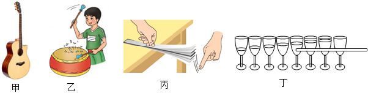
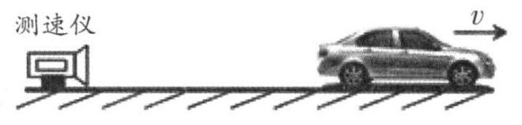

# 物-01 真题精讲 · 声现象基础

> 本讲选 2 题：一道声音三特性辨析选择题 + 一道超声波测速计算题，覆盖"声音的特性"与"声速计算"两大必考点。两题配图均已从题源原卷（51jiaoxi 一轮·声现象专题 docx）内嵌图提取入库。

**1.**（原卷单选第 8 题）声音特性辨析

如题图所示，下列有关声音的特性，说法正确的是（　　）

- （A）图甲中，改变吉他弦的松紧程度可以改变声音的音色
- （B）图乙中，敲击鼓面所用的力不同，发出的声音的响度不同
- （C）图丙中，钢尺伸出桌面的长度越长，拨动它时发出的声音的音调越高
- （D）图丁中，用相同大小的力敲击不同水量的杯子，发出的声音的音色不同

> [!tip]- 💡 思路导航
> 四个情境各对应"改变振动的什么"：弦的松紧、尺的伸出长度改变的是振动**快慢**；用力大小改变**振幅**；音色由发声体的材料结构决定。逐项走"操作 → 振动要素 → 对应特性"再比对结论。

> [!success]- ✅ 详解 · 评分点 · 易错 · 关联
> **详解**：（A）弦的松紧改变振动快慢（频率），改变的是**音调**而非音色，✗；（B）用力不同 → 鼓面**振幅**不同 → **响度**不同，✓；（C）钢尺伸出越长越难振动，频率越**低**，音调越**低**（选项说"越高"），✗；（D）用力相同 → 振幅相同；水量不同改变的是杯与水振动的**频率**（音调），音色由材料结构决定、基本不变，✗。选 **B**。
>
> **易错**：三特性口诀——**音调**看频率（长短、松紧、粗细、水量、快慢），**响度**看振幅（用力大小、轻重、震耳欲聋），**音色**看材料结构（辨人辨乐器、"闻其声知其人"）；"松紧/伸出长度"类操作最易误答成音色。
>
> **关联**：[[04-物理/知识点/01-声与光]]（声音三特性）。

**2.**（原卷计算第 25 题）超声波测速

汽车驶出高速公路后进入某国道，如图为该国道某直线路段的一处测速仪，测速仪内有能发射和接收超声波的传感器。当汽车以速度 $v$ **远离**测速仪、与测速仪相距 $L=64\ \text{m}$ 时，测速仪发出超声波，经汽车反射后被接收，全程共历时 $t_{总}=0.4\ \text{s}$。已知此路段限速为 $80\ \text{km/h}$，超声波速度为 $340\ \text{m/s}$。试计算并说明汽车在此路段是否超速。

> [!tip]- 💡 思路导航
> 见"发射—反射—接收"+"限速判断"是回声测距模型，且目标汽车在**远离**：$0.4\ \text{s}$ 是往返总时间，声波遇车处到测速仪的距离去、回相同，先定单程时间；列声的单程路程与汽车位移的关系解出车速，换算单位后与限速比较。

> [!success]- ✅ 详解 · 评分点 · 易错 · 关联
> **详解**：**设**超声波从发出到遇到汽车的时间为 $t$，汽车速度为 $v_车$。**列**声波遇到汽车处到测速仪的距离去程与回程相等，故单程时间 $t=\dfrac{t_{总}}{2}=\dfrac{0.4\ \text{s}}{2}=0.2\ \text{s}$；汽车在远离，声的单程路程 = 初始距离 + 汽车这段时间前进的距离：$v_声 t = L + v_车 t$。**算** $v_车=\dfrac{v_声 t-L}{t}=\dfrac{340\times0.2-64}{0.2}=20\ \text{m/s}$，换算 $20\ \text{m/s}=72\ \text{km/h}$。**验**：若误把 $0.4\ \text{s}$ 当单程会得 $180\ \text{m/s}$（$648\ \text{km/h}$），明显荒谬，说明取半程正确；$20\ \text{m/s}$ 符合国道车速量级 ✓。**答**：汽车速度为 $72\ \text{km/h}$，小于限速 $80\ \text{km/h}$，汽车在此路段**没有超速**。
>
> **评分点**：往返时间除以 2（回声测距 $s=\dfrac{v_声 t_{总}}{2}$ 是基本功）；列对位移关系（远离时声要"追赶"，$s=L+v_车 t$）；比较前完成单位换算（$1\ \text{m/s}=3.6\ \text{km/h}$）；结论成句（"比较结果 + 没有超速"），只给数字拿不到满分。
>
> **易错**：汽车**远离**时声路程 $=L+v_车 t$，若**靠近**则为 $L-v_车 t$，方向搞反全盘皆错；直接拿 20 与 80 比较是高频失分点。备查声速：空气（15 ℃）约 $340\ \text{m/s}$、水约 $1500\ \text{m/s}$、钢约 $5200\ \text{m/s}$——固体中最快、气体中最慢，真空不能传声。
>
> **关联**：[[04-物理/知识点/01-声与光]]（回声测距、声速）、[[04-物理/知识点/02-运动与力]]（速度公式与单位换算）、同类题 [[04-物理/专题/真题精讲/物-02-光现象与透镜]]（同为"辨析 + 应用"组合）。

## 🔗 关联

- [[04-物理/知识点/01-声与光]]（声的产生、三特性、噪声控制）
- [[04-物理/知识点/02-运动与力]]（速度公式 $v=s/t$ 与单位换算）
- 同类题：[[04-物理/专题/真题精讲/物-02-光现象与透镜]]（同为"辨析 + 应用"组合）
