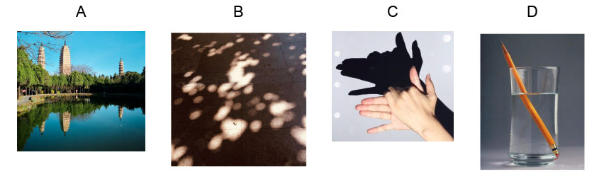

# 物-02 真题精讲 · 光现象与透镜

> 本讲选 2 道选择题：现象辨析 + 成像规律应用，重点训练"直线传播 / 反射 / 折射"三分法与"一倍焦距分虚实、二倍焦距分大小"的成像口诀。题1 的四幅选项情境图已自题源原卷 docx 内嵌图提取、拼接为一张选项图入库；题2 原卷即纯文字题、无配图。

**1.**（原卷单选第 4 题）光现象辨析

下列现象中由于光的反射形成的是（　　）

- （A）水面倒影
- （B）树下光斑
- （C）墙上留影
- （D）杯中"折"笔

> [!tip]- 💡 思路导航
> 四个选项是四类常见光现象，按"直线传播 / 反射 / 折射"三分类归位：影子、小孔成像、日食月食 → 直线传播；倒影、平面镜成像 → 反射；池水变浅、筷子弯折、透镜成像 → 折射。抓"光返回原介质还是进入新介质"定反射与折射。

> [!success]- ✅ 详解 · 评分点 · 易错 · 关联
> **详解**：（A）平静的水面相当于平面镜，倒影是平面镜成像——光的**反射**形成的等大**虚像**，✓；（B）树下圆形光斑是太阳经树叶缝隙（小孔）所成的像——小孔成像，由光的**直线传播**形成（实像），✗；（C）墙上留影即影子，光被身体挡住——光的**直线传播**，✗；（D）光从水中斜射入空气发生偏折，笔在水面处"折断"——光的**折射**，✗。选 **A**。
>
> **易错**：三分类速查——**直线传播**：影子、日食月食、小孔成像；**反射**：倒影、平面镜、后视镜；**折射**：池底变浅、折笔、海市蜃楼、透镜成像。光**返回原介质**是反射，光**进入另一种介质**且方向偏折是折射，同种均匀介质中方向不变才是直线传播；"水中倒影"与"潭清疑水浅"两句古诗常合并对照考，勿混。
>
> **关联**：[[04-物理/知识点/01-声与光]]（光的直线传播、反射、折射）。

**2.**（原卷单选第 3 题）凸透镜成像规律应用

把凸透镜正对着太阳，在距凸透镜 $10\ \text{cm}$ 的光屏上得到一个最小、最亮的光斑。若将一支点燃的蜡烛放在此凸透镜前 $30\ \text{cm}$ 处，在凸透镜另一侧调节光屏的位置，可得到烛焰清晰的（　　）

- （A）倒立、缩小的实像
- （B）倒立、放大的实像
- （C）倒立、等大的实像
- （D）正立、放大的虚像

> [!tip]- 💡 思路导航
> "正对太阳 + 最小最亮光斑"是**测焦距**的标志情境——平行于主光轴的光会聚于焦点；第二步拿物距与 $f$、$2f$ 比大小定像的性质；题干"在光屏上得到"提示只能承接实像，可快速排除一项。

> [!success]- ✅ 详解 · 评分点 · 易错 · 关联
> **详解**：第一步求焦距：太阳光可视为平行于主光轴的平行光，经凸透镜会聚于焦点，"最小、最亮的光斑"就是焦点，故 $f=10\ \text{cm}$，$2f=20\ \text{cm}$。第二步比物距：$u=30\ \text{cm}>2f$，成**倒立、缩小的实像**（照相机原理），像距满足 $f<v<2f$，光屏应移到透镜后 $10\sim20\ \text{cm}$ 之间。逐项：（A）$u>2f$ → 倒立缩小实像，✓；（B）倒立放大实像需 $f<u<2f$，✗；（C）倒立等大实像需 $u=2f=20\ \text{cm}$，✗；（D）正立放大虚像需 $u<f$，且**虚像不能呈现在光屏上**，与题干矛盾，✗。选 **A**。
>
> **易错**：**光斑 ≠ 像距**——"最小最亮光斑"确定的是**焦距**，把 10 cm 当像距代入则全题崩盘；实像虚像快速判据：题干出现"在光屏上得到"必为实像，虚像只能用眼睛通过透镜观察；口诀"一倍焦距分虚实，二倍焦距分大小"要配区间，判断完像的性质顺手写出像距区间；实像范围内"物近像远像变大"是最常考的后续追问。
>
> **关联**：[[04-物理/知识点/01-声与光]]（凸透镜成像规律）、[[04-物理/专题/真题精讲/物-09-能源信息与电磁]]（摄像机/照相机成像的应用迁移）。

凸透镜成像规律速查表（$f$ 为焦距）：

| 物距 $u$ | 像的性质 | 像距 $v$ | 应用 |
| ---- | ---- | ---- | ---- |
| $u>2f$ | 倒立、缩小、实像 | $f<v<2f$ | 照相机、摄像头 |
| $u=2f$ | 倒立、等大、实像 | $v=2f$ | 测焦距 |
| $f<u<2f$ | 倒立、放大、实像 | $v>2f$ | 投影仪 |
| $u=f$ | 不成像（平行光射出） | / | 探照灯 |
| $u<f$ | 正立、放大、虚像 | 与物同侧 | 放大镜 |

## 🔗 关联

- [[04-物理/知识点/01-声与光]]（光的直线传播、反射、折射、透镜）
- 同类题：[[04-物理/专题/真题精讲/物-09-能源信息与电磁]]（摄像机/照相机成像的应用迁移）
