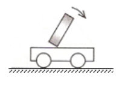

# 物-03 真题精讲 · 运动与力

> 本讲选 2 题：一道惯性情境选择题 + 一道"速度计算 + 二力平衡"综合计算题。题1 配图已自题源原卷 docx 内嵌图提取入库；题2 原卷即纯文字题、无配图。

**1.**（原卷单选第 5 题）小车减速与惯性

如图所示，小车运动时，车上木块向右倾倒，则小车运动状态变化的情况是（　　）

- （A）一定向左加速
- （B）一定向右加速
- （C）可能向左减速
- （D）可能向右减速

> [!tip]- 💡 思路导航
> 见"突然变速时物体倾倒"考**惯性**——分上下两段看木块：下端随车一起改变运动状态，上端因惯性"来不及变"；由倾倒方向反推下端（车）相对"落后"的情形，再盯紧选项里"一定 / 可能"的措辞。

> [!success]- ✅ 详解 · 评分点 · 易错 · 关联
> **详解**：木块随车运动，车速改变时，木块**下端**随车改变，**上端**由于惯性保持原来的速度，于是相对下端"超前"。木块向右倾倒 = 上端相对下端向右偏 = 下端（车）相对"落后"，允许的情形有两种：**车向右减速**（右行变慢，上端继续快）或**车向左加速**（左行变快，下端先走）。逐项：（A）"一定"向左加速——还有"向右减速"同样可行，"一定"太绝对，✗；（B）"一定"向右加速——向右加速时上端应向**左**倾，方向也不对，✗；（C）可能向左减速——向左减速时上端保持较大的向左速度，应向**左**倾倒，✗；（D）可能向右减速——符合分析，✓。选 **D**。
>
> **易错**：**惯性不是力**——只能说"由于惯性""具有惯性"，禁止写"受到惯性作用/惯性力"；倾倒问题的分段法是"下端随车变、上端保持原状"，先定相对偏向再反推车的运动；"一定/可能"的措辞本身就是选项陷阱。
>
> **关联**：[[04-物理/知识点/02-运动与力]]（惯性、二力平衡）、[[04-物理/专题/实验操作考点-物理]]（摩擦力实验的平衡条件）。

**2.**（原卷计算第 26 题）降落伞匀速下落

航天迷小伟用自制降落伞模拟返回舱降落：带有降落伞的重物从高处释放，一段时间后打开降落伞，随后重物在离地 $4\ \text{m}$ 处开始**匀速**下落，速度为 $5\ \text{m/s}$。打开降落伞后，降落伞和重物受到的阻力 $f$ 与速度 $v$ 满足关系 $f=kv^{2}$，其中 $k=3\ \text{N}\cdot\text{s}^{2}/\text{m}^{2}$。求：

（1）重物从开始匀速下落到落地所用的时间；

（2）降落伞和重物的总重。

> [!tip]- 💡 思路导航
> 两问分别是速度公式 $v=s/t$ 的变形和"匀速下落 → 二力平衡"：第（1）问直接 $t=s/v$；第（2）问质量未知、别硬套 $G=mg$，从平衡条件入手——匀速时 $G=f$，而 $f=kv^{2}$ 可代入求出。

> [!success]- ✅ 详解 · 评分点 · 易错 · 关联
> **详解**：（1）**设**重物匀速下落的时间为 $t$。**列**由速度公式 $v=\dfrac{s}{t}$ 得 $t=\dfrac{s}{v}$。**算** $t=\dfrac{4\ \text{m}}{5\ \text{m/s}}=0.8\ \text{s}$。**验**：落地用时不到 1 秒，符合"匀速下落 4 m"的情境 ✓。（2）**设**降落伞和重物的总重为 $G$，所受阻力为 $f$。**列**重物匀速直线下落处于平衡状态，由二力平衡条件 $G=f$，又 $f=kv^{2}$。**算** $f=3\ \text{N}\cdot\text{s}^{2}/\text{m}^{2}\times(5\ \text{m/s})^{2}=75\ \text{N}$，故 $G=f=75\ \text{N}$。**验**：阻力与总重等大反向（阻力竖直向上），合力为零才能匀速下落，自洽 ✓。**答**：（1）$0.8\ \text{s}$；（2）总重 $75\ \text{N}$。
>
> **评分点**：带单位分步书写（设列算验答）；第（2）问必须从"匀速 → 合力为零 → $G=f$"切入，$k$ 的单位保证代入 $v^{2}$（m²/s²）后结果为牛顿，速度必须用 m/s。
>
> **易错**：**打开伞前后分两段**——释放到开伞前是加速段，两问都只针对之后的匀速段，时间别从释放瞬间算起；质量未知的题不要硬套 $G=mg$。
>
> **关联**：[[04-物理/知识点/02-运动与力]]（惯性、二力平衡、摩擦力）、[[04-物理/专题/大题规范书写-设列算验答]]（本题即按五步书写示范）、同类题 [[04-物理/专题/真题精讲/物-01-声现象基础]]（同样含速度公式计算）。

## 🔗 关联

- [[04-物理/知识点/02-运动与力]]（惯性、二力平衡、摩擦力）
- [[04-物理/专题/大题规范书写-设列算验答]]（本题即按五步书写示范）
- 同类题：[[04-物理/专题/真题精讲/物-01-声现象基础]]（同样含速度公式计算）
