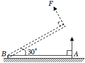
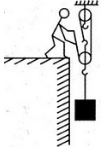
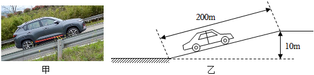

# 物-04 真题精讲 · 机械与功

> 本讲选 3 道计算题：杠杆（水泥杆）→ 滑轮组（机械效率）→ 功功率（汽车爬坡），三题配图均已自题源原卷 docx 内嵌图提取入库，全部按"设列算验答"五步示范。

**1.**（原卷计算第 22 题）抬水泥杆（杠杆）

一块重为 $200\ \text{N}$ 的质地均匀水泥杆 $AB$ 水平放在地面上，杆长 $4\ \text{m}$。用始终与杆垂直的拉力 $F$ 将 $A$ 端缓慢抬起，杆绕 $B$ 端转动，如图所示。求：

（1）水泥杆 $A$ 端即将脱离地面时拉力 $F$ 的大小；

（2）当杆被抬起与地面成 $30^{\circ}$ 角时共用时 $100\ \text{s}$，拉力 $F$ 做功的功率。

> [!tip]- 💡 思路导航
> "绕 B 端转动 + 缓慢抬起"是杠杆平衡问题，"缓慢"还暗示动能不变、为第（2）问的功铺路：$F$ 始终垂直于杆 → 动力臂恒为杆长，均匀杆重心在中点；第（2）问用"功的原理"——拉力做的功等于克服重力做的功，重心升高量按几何关系算。

> [!success]- ✅ 详解 · 评分点 · 易错 · 关联
> **详解**：（1）**设** $A$ 端即将离地时拉力为 $F$。**列**支点为 $B$；$F$ 始终垂直于杆，动力臂 $l_1=AB=4\ \text{m}$；均匀杆重心在中点，杆水平时阻力臂 $l_2=\dfrac{AB}{2}=2\ \text{m}$；由杠杆平衡条件 $Fl_1=Gl_2$。**算** $F=\dfrac{Gl_2}{l_1}=\dfrac{200\times2}{4}=100\ \text{N}$。**验**：动力臂是阻力臂的 2 倍，$F$ 恰为 $G$ 的一半，符合省力杠杆判断 ✓。（2）**设**拉力做功 $W$，功率 $P$。**列**抬起过程"缓慢"，动能不变，由功的原理 $W=G\cdot\Delta h_{重}$，重心升高 $\Delta h_{重}=\dfrac{AB}{2}\sin30^{\circ}=2\times0.5=1\ \text{m}$。**算** $W=200\times1=200\ \text{J}$，$P=\dfrac{W}{t}=\dfrac{200}{100}=2\ \text{W}$。**验**：题源另用 $W=Fs=100\times2=200\ \text{J}$，数值一致；$P=2\ \text{W}$ 数量级合理 ✓。**答**：（1）$F=100\ \text{N}$；（2）功率 $P=2\ \text{W}$。
>
> **评分点**：力臂是支点到力的作用线的**垂直距离**，"$F$ 始终垂直于杆 → 动力臂恒为杆长"是本题少算出错的关键设置；第（2）问推荐写"功的原理" $W_F=W_{克服重力}=G\Delta h_{重}$。
>
> **易错**：题源直接用 $W=Fs$（$F$ 取 $100\ \text{N}$、$s$ 取 $A$ 端升高的 $2\ \text{m}$）得 $200\ \text{J}$，数值正确；但抬起过程中保持平衡所需的 $F$ 实际在减小，$F$ 取初值乘位移依据不严，考场上按"功的原理"写更稳妥。
>
> **关联**：[[04-物理/知识点/03-机械与功]]（杠杆平衡条件、力臂作图）、同类题 [[04-物理/专题/真题精讲/物模26-宝山-上]] 题5（书架杠杆与力臂作图）。

**2.**（原卷计算第 24 题）滑轮组提升（$n=3$）

用如图所示的滑轮组（由图知承担重物的绳子段数 $n=3$）将重为 $300\ \text{N}$ 的物体从地面**匀速**送到 $2\ \text{m}$ 高处，所用拉力为 $150\ \text{N}$。此过程中克服摩擦做功 $180\ \text{J}$，不计绳重。求：

（1）工人做的有用功；

（2）该装置的机械效率；

（3）动滑轮的自重。

> [!tip]- 💡 思路导航
> 见"匀速提升 + 拉力 + 机械效率"是滑轮组标准四件套 $W_有$、$W_总$、$\eta$、$G_动$：先由图定 $n=3$、则 $s=nh$；额外功有两部分——摩擦与动滑轮重，$W_{动}=W_总-W_有-W_{摩}$ 再除以 $h$ 倒出 $G_动$。

> [!success]- ✅ 详解 · 评分点 · 易错 · 关联
> **详解**：**设**有用功 $W_有$，总功 $W_总$，机械效率 $\eta$，动滑轮重 $G_动$。**列** $W_有=Gh$；$s=nh=3\times2=6\ \text{m}$；$W_总=Fs$；$\eta=\dfrac{W_有}{W_总}\times100\%$；动滑轮部分 $W_{动}=W_总-W_有-W_{摩}=G_动 h$。**算**：$W_有=300\times2=600\ \text{J}$；$W_总=150\times6=900\ \text{J}$，$\eta=\dfrac{600}{900}\times100\%\approx66.7\%$；$W_{动}=900-600-180=120\ \text{J}$，$G_动=\dfrac{120}{2}=60\ \text{N}$。**验**：$\eta<100\%$ ✓；$F=150\ \text{N}>\dfrac{G}{3}=100\ \text{N}$，多出的力恰用于提动滑轮和克服摩擦，合理 ✓。**答**：（1）$600\ \text{J}$；（2）$66.7\%$；（3）动滑轮重 $60\ \text{N}$。
>
> **评分点**：滑轮组先数绳段数（本题 $n=3$，图给出），绳端距离 $s=nh$；额外功要拆两份——摩擦（180 J）与动滑轮（120 J），漏掉摩擦会算出 $G_动=150\ \text{N}$ 的错解。
>
> **易错**：用 $h$ 冒充 $s$ 是滑轮组计算的最高频错误；机械效率必须乘 100% 写成百分数。
>
> **关联**：[[04-物理/知识点/03-机械与功]]（有用功、机械效率、滑轮组）、同类题 [[04-物理/专题/真题精讲/物模26-宝山-上]] 题9（小型起重机求机械效率）、[[04-物理/专题/真题精讲/物模26-徐汇-下]] 题7（动滑轮作图与机械效率）。

**3.**（原卷计算第 25 题）汽车爬坡（功与功率）

如图甲所示，总重为 $1.5\times10^{4}\ \text{N}$ 的汽车经水平路面后，发动机以 $9\times10^{4}\ \text{W}$ 的恒定功率匀速爬上长 $200\ \text{m}$、高 $10\ \text{m}$ 的斜坡（图乙），用时 $20\ \text{s}$。求此过程中：

（1）汽车克服重力所做的功；

（2）汽车发动机牵引力做的功；

（3）汽车所受的阻力。

> [!tip]- 💡 思路导航
> "恒定功率 + 时间"提示总功用 $W=Pt$ 而不是 $Fs$；克服重力做功只看**高度** $Gh$；"总功 = 有用 + 额外"的能量账本是通用骨架，两者之差即克服阻力做的功，再除以坡长得阻力。

> [!success]- ✅ 详解 · 评分点 · 易错 · 关联
> **详解**：**设**克服重力做功 $W_1$，牵引力做功 $W_2$，阻力 $f$。**列** $W_1=Gh$；功率恒定则 $W_2=Pt$；牵引力做的功 = 克服重力功 + 克服阻力功：$W_2=W_1+fs$。**算**：$W_1=1.5\times10^{4}\times10=1.5\times10^{5}\ \text{J}$；$W_2=9\times10^{4}\times20=1.8\times10^{6}\ \text{J}$；$fs=1.8\times10^{6}-1.5\times10^{5}=1.65\times10^{6}\ \text{J}$，$f=\dfrac{1.65\times10^{6}}{200}=8250\ \text{N}$。**验**：另解交叉验证——$v=s/t=10\ \text{m/s}$，$F=P/v=9000\ \text{N}$；沿坡匀速时 $F=f+G\cdot\dfrac{h}{s}=f+750\ \text{N}$，得 $f=8250\ \text{N}$，两法一致 ✓。**答**：（1）$1.5\times10^{5}\ \text{J}$；（2）$1.8\times10^{6}\ \text{J}$；（3）阻力 $8250\ \text{N}$。
>
> **评分点**：恒定功率用 $W=Pt$；克服重力做功用**高度**；"总功 = 有用 + 额外"的能量账本列式清晰即可得分。
>
> **易错**：匀速但沿坡牵引力 ≠ 水平阻力，$W_2$ 不能用 $Fs$ 硬凑；斜坡上牵引力要同时负担阻力和重力分量（$G\cdot h/s$）。
>
> **关联**：[[04-物理/知识点/03-机械与功]]（功、功率、机械能）、同类题 [[04-物理/专题/真题精讲/物模26-浦东]] 题11（储能量化起重机：功、功率与机械效率）。

## 🔗 关联

- [[04-物理/知识点/03-机械与功]]（杠杆平衡条件、滑轮组、机械能）
- [[04-物理/专题/大题规范书写-设列算验答]]（三题均按五步示范）
- 同类题：[[04-物理/专题/真题精讲/物-05-密度压强浮力综合]]（力学综合的另一座大山）
