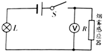
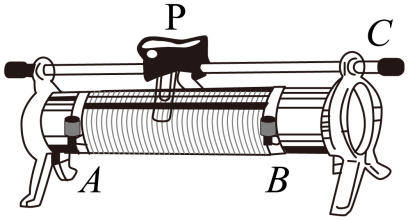

# 物-06 真题精讲 · 欧姆定律综合

> 本讲选 3 题：串并联规律辨析 + 动态电路分析 + 伏安法数据处理。题 2、题 3 配图自题源原卷 docx 内嵌图提取入库；题 1 原卷即纯文字题、无配图。

**1.**（原卷单选第 1 题）串并联电流比较

将甲、乙两根长度相同、粗细不同的锰铜丝（甲比乙粗）以某种方式同时接入电路中。关于通过它们的电流 $I_{甲}$、$I_{乙}$ 的大小关系，下列说法正确的是（　　）

- （A）若甲、乙串联，则 $I_{甲}>I_{乙}$
- （B）若甲、乙串联，则 $I_{甲}<I_{乙}$
- （C）若甲、乙并联，则 $I_{甲}>I_{乙}$
- （D）若甲、乙并联，则 $I_{甲}<I_{乙}$

> [!tip]- 💡 思路导航
> 先把"粗细"翻译成电阻——同材料、等长，粗者横截面积大、电阻小；再对串联（电流处处相等）与并联（分流与电阻成反比）两种情形逐一判断。

> [!success]- ✅ 详解 · 评分点 · 易错 · 关联
> **详解**：先译电阻：同材料、等长，甲粗（$S_{甲}>S_{乙}$）→ $R_{甲}<R_{乙}$。（A）（B）串联电路中**电流处处相等**，$I_{甲}=I_{乙}$，与电阻粗细无关，均 ✗；（C）并联各支路电压相等，$I=U/R$，$R_{甲}<R_{乙}$ → $I_{甲}>I_{乙}$，✓；（D）与 C 相反，✗。选 **C**。
>
> **易错**：**串联电流与电阻无关**——串联只看"处处相等"，别把"粗的电流大"的生活直觉带进来；并联才是"电阻小的分电流大"。
>
> **关联**：[[04-物理/知识点/06-电学基础]]（串并联电流、电压规律）。

**2.**（原卷单选第 8 题）烟雾报警器动态分析

如图所示为某烟雾报警器的电路简图，烟雾感应器 $R$ 的阻值随烟雾浓度的增大而**减小**。当烟雾浓度增大时，电路中电压表的示数和灯泡亮度的变化情况是（　　）

- （A）电压表示数变大，灯泡变亮
- （B）电压表示数变小，灯泡变亮
- （C）电压表示数变小，灯泡变暗
- （D）电压表示数变大，灯泡变暗

> [!tip]- 💡 思路导航
> 自变量是"烟雾浓度 → $R$"，按动态电路固定流程走：$R$ 变 → 总电阻 → 电流（定灯亮度）→ 串联分压（定电压表示数）。

> [!success]- ✅ 详解 · 评分点 · 易错 · 关联
> **详解**：烟雾浓度增大 → $R$ 减小。**电流**：总电阻 $R_{总}=R+R_L$ 减小，$I=U/R_{总}$ **变大** → 实际功率 $P_L=I^{2}R_L$ 变大 → **灯泡变亮**，据此排除 C、D。**电压表示数**（测 $R$ 两端）：串联分压，$R$ 减小则分得电压减小；或 $U_R=U-U_L$，$U_L=IR_L$ 变大，$U_R$ **变小**，排除 A。选 **B**。
>
> **易错**：**动态分析答题模板**——先写自变量（$R\downarrow$）→ 总电阻 → 电流 → 各表/灯逐一判，跳步直接写结论要扣过程分。
>
> **关联**：[[04-物理/知识点/06-电学基础]]（串联分压动态电路）、同类题 [[04-物理/专题/真题精讲/物模26-宝山-上]] 题8、[[04-物理/专题/真题精讲/物模26-奉贤-下]] 题13（烟雾报警器，其光敏电阻随烟雾浓度增大而**增大**，自变量方向与本题相反）。

**3.**（原卷填空第 25 题）伏安法测电阻的数据处理

小明做"伏安法测电阻"实验：电源（电压为 $1.5\ \text{V}$ 的整数倍且保持不变）、开关、滑动变阻器（标有"$20\ \Omega\ 1\ \text{A}$"字样）、待测电阻 $R_x$、电流表串联，电压表并联在 $R_x$ 两端。连接电路时发现滑片被卡在图示位置无法移动，小明经过思考，改接变阻器的接线柱完成实验：他首先连接变阻器的 A、C 接线柱，闭合开关，电压表、电流表示数分别为 $3.5\ \text{V}$ 和 $0.32\ \text{A}$；接着分别改接 A、B 接线柱和 B、C 接线柱，闭合开关后，其中一次电压表示数为 $4.5\ \text{V}$，另一次电流表示数为 $0.24\ \text{A}$。

（1）写出"伏安法测电阻"的实验原理；
（2）完成实验数据记录表（含表头栏目与全部数据，电阻计算结果保留到 $0.1\ \Omega$）。

> [!tip]- 💡 思路导航
> 滑片卡死 = 变阻器只剩"三个定值"（全阻值与 A、C 两段）。先由第一组数据锁定 $R_x$，再由"接入阻值最大时电流最小"判定 $0.24\ \text{A}$ 的归属，把电源电压归到 $1.5\ \text{V}$ 的整数倍，补齐表格后按精确值求平均。

> [!success]- ✅ 详解 · 评分点 · 易错 · 关联
> **详解**：（1）实验原理：$R=\dfrac{U}{I}$（欧姆定律变形）。
> （2）第一步，第 1 组（接 AC）：$R_x=\dfrac{3.5\ \text{V}}{0.32\ \text{A}}\approx10.9\ \Omega$。第二步，定电源电压：接 AB 时变阻器全阻值 $20\ \Omega$ 接入、电流最小，故 $0.24\ \text{A}$ 是接 AB 情形，此时 $U=I_{2}R_{滑大}+I_{2}R_x=0.24\times20+0.24\times10.9375=7.425\ \text{V}$；电源电压为 $1.5\ \text{V}$ 的整数倍，取 $U=7.5\ \text{V}$。第三步，补第 2 组：$U_{x2}=U-4.8=2.7\ \text{V}$，$R_{x2}=\dfrac{2.7}{0.24}=11.3\ \Omega$。第四步，补第 3 组（接 BC）：接 AC 时变阻器接入 $R_{AC}=\dfrac{7.5-3.5}{0.32}=12.5\ \Omega$，故接 BC 时 $R_{BC}=20-12.5=7.5\ \Omega$；电压表示数 $U_{x3}=4.5\ \text{V}$，则 $I_{3}=\dfrac{7.5-4.5}{7.5}=0.40\ \text{A}$，$R_{x3}=\dfrac{4.5}{0.40}=11.3\ \Omega$。
>
> | 实验序号 | 电压（伏） | 电流（安） | 电阻（欧） |
> | ---- | ---- | ---- | ---- |
> | 1 | 3.5 | 0.32 | 10.9 |
> | 2 | 2.7 | 0.24 | 11.3 |
> | 3 | 4.5 | 0.40 | 11.3 |
>
> 电阻平均值（按精确值平均后再取位）：$\bar{R_x}=\dfrac{10.9375+11.25+11.25}{3}\approx11.1\ \Omega$。**验**：三次电流均小于变阻器额定 $1\ \text{A}$ ✓；$R_{AC}=12.5\ \Omega$、$R_{BC}=7.5\ \Omega$ 均不超过 $20\ \Omega$ 且之和恰为 $20\ \Omega$，自洽 ✓。
>
> **评分点**：**判断示数归属要给理由**——"接 AB 时接入阻值最大、电流最小，故 $0.24\ \text{A}$ 为接 AB 时的示数"；不写这句，后面的 $7.5\ \text{V}$ 就成了无源之水。
>
> **易错**：**电源电压必须回整数倍**——算出 $7.425\ \text{V}$ 后要写"$1.5\ \text{V}$ 的整数倍 → $7.5\ \text{V}$"，并用 $7.5\ \text{V}$ 重算后续各组，而不是带着近似值往下走；**平均值先精确后取位**——若用已四舍五入的 $10.9/11.3/11.3$ 平均得 $11.2\ \Omega$，属于二次舍入误差；**测电阻取平均、测灯泡功率不取平均**——灯丝电阻随温度变化，定值电阻才可多次测量取平均减小偶然误差。
>
> **关联**：[[04-物理/知识点/06-电学基础]]（伏安法测电阻）、[[04-物理/专题/实验操作考点-物理]]（电学实验操作细节）、[[04-物理/专题/电学四大题型]]（题型四伏安法方法策略）。

## 🔗 关联

- [[04-物理/知识点/06-电学基础]]（欧姆定律、串并联规律）
- [[04-物理/专题/电学四大题型]]（题型二故障判断、题型四伏安法方法策略）
- [[04-物理/专题/实验操作考点-物理]]（电学实验操作细节）
- 同类题：[[04-物理/专题/真题精讲/物-07-探究电路与故障]]
