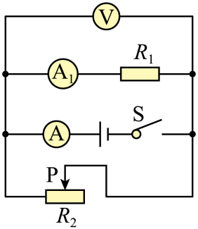
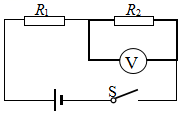
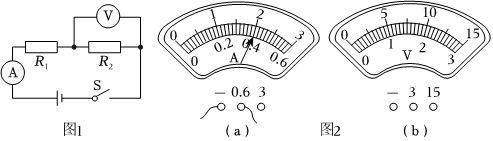

# 物-07 真题精讲 · 探究电路与故障

> 本讲选 3 题：电路识别 + 故障判断 + 变阻器量程压轴。三题配图均自题源原卷 docx 内嵌图提取入库，电路连接与电表量程信息见图。

**1.**（原卷单选第 5 题）电路识别与动态判断

在如图所示的电路中，电源电压保持不变。闭合开关 S，当滑动变阻器 $R_2$ 的滑片 P 向右移动时，变大的是（　　）

- （A）电压表 V 的示数
- （B）电流表 A 的示数
- （C）电压表 V 示数与电流表 $\text{A}_1$ 示数的比值
- （D）电流表 $\text{A}_1$ 示数与电流表 A 示数的比值

> [!tip]- 💡 思路导航
> 先认清三只表各测谁；并联各支路独立，$R_2$ 的变化只影响本支路和干路；两个"比值"先翻译成物理量再判变化。

> [!success]- ✅ 详解 · 评分点 · 易错 · 关联
> **详解**：由图，$R_1$ 与 $R_2$ 并联，V 测电源电压，A 测干路电流，$\text{A}_1$ 测 $R_1$ 支路电流；P 向右移动时 $R_2$ 接入阻值变大。（A）V 测电源电压，示数**不变**，✗；（B）$R_2$ 变大 → $I_2=U/R_2$ 变小；$I_1=U/R_1$ 不变 → 干路 $I=I_1+I_2$ **变小**，✗；（C）$\dfrac{U_V}{I_1}=\dfrac{U}{I_1}=R_1$，定值电阻阻值不变，✗；（D）$I_1$ 不变、$I$ 变小 → 比值 $\dfrac{I_1}{I}$ **变大**，✓。选 **D**。
>
> **易错**：**比值物理化**——见到"表示数之比"先写成已知量（$U/I_1=R_1$），判断就从"猜"变成"算"；并联各支路互不影响，$R_2$ 变大不影响 $I_1$。
>
> **关联**：[[04-物理/知识点/06-电学基础]]（并联电路动态分析）、[[04-物理/专题/电学四大题型]]（题型一动态分析）。

**2.**（原卷填空第 8 题）电路故障判断

在如图所示的电路中（$R_1$ 与 $R_2$ 串联，电压表并联在 $R_2$ 两端，电流表串联在电路中），电源电压保持 $U$ 不变。闭合开关 S，电路正常工作。一段时间后，由于其中一个电阻出现故障，使得**电压表示数变大**。

（1）电路中可能存在的故障是什么？
（2）若用一只完好的小灯替换 $R_1$，请指出不同故障情况下，替换前后电压表示数的变化情况。

> [!tip]- 💡 思路导航
> "电压表示数变大（约等于电源电压）"是故障题的标志性入口，候选故障只有短路、断路两类，各有一种成立；换灯后看电路是否恢复通路——通路则分压，仍断路则电压表仍测电源。

> [!success]- ✅ 详解 · 评分点 · 易错 · 关联
> **详解**：（1）由"电压表示数变大"入手，逐一排查四种可能：**$R_1$ 短路**——电路只剩 $R_2$，$U_V=U$，示数变大，可能 ✓；**$R_2$ 断路**——无电流，电压表通过 $R_1$ 接到电源两端，因电压表内阻极大，$U_V\approx U$，示数变大，可能 ✓；**$R_1$ 断路**——电路断开且电压表无法与电源构成回路，$U_V=0$，示数变小，✗；**$R_2$ 短路**——电压表被短路，$U_V=0$，示数变小，✗。故故障为：**$R_1$ 短路或 $R_2$ 断路**。
> （2）用完好小灯替换 $R_1$ 后：若原故障是 **$R_1$ 短路**，换入小灯后小灯与 $R_2$ 串联，恢复通路，电压表测 $R_2$ 两端电压，由串联分压 $U_V=U-U_L<U$，**示数变小**；若原故障是 **$R_2$ 断路**，断点仍在 $R_2$，电路仍无电流，电压表示数仍约等于电源电压，**示数保持 $U$ 不变**。规范表述："换后电压表示数变小，则 $R_1$ 短路；示数仍为 $U$ 不变，则 $R_2$ 断路。"
>
> **易错**：**故障判断必须指明元件**——"断路/短路"不落元件名不得分，写全四种排查再舍去两种是最稳的答题结构；**电压表的"假电源"现象**——$R_2$ 断路时电压表经 $R_1$ 跨在电源两端、测得约电源电压，理解了这点，（2）中"换灯后示数不变"就不难推出。
>
> **关联**：[[04-物理/知识点/06-电学基础]]（电路故障分析）、[[04-物理/专题/电学四大题型]]（题型二故障判断）。

**3.**（原卷计算第 28 题）变阻器替换与指针偏角

在如图所示的电路中，电源电压为 $18\ \text{V}$ 且保持不变，$R_1$ 与 $R_2$ 串联，$R_2=20\ \Omega$，电压表（量程 $0\sim15\ \text{V}$）并联在 $R_2$ 两端，电流表（量程 $0\sim0.6\ \text{A}$）串联在电路中。闭合开关 S，电流表示数为 $0.4\ \text{A}$（见图2 表盘）。

（1）求 $R_2$ 两端的电压；
（2）求 $R_1$ 的阻值；
（3）各电表量程不变，用滑动变阻器 $R_0$（标有"$50\ \Omega\ 1\ \text{A}$"字样）替换 $R_1$、$R_2$ 中的一个，闭合开关，在不超电表量程的条件下移动滑片，使两电表**指针偏离零刻度线的角度相同**。通过计算说明 $R_0$ 替换的是哪个电阻，及此时电流表的示数。

> [!tip]- 💡 思路导航
> 先由闭合开关时的状态求出 $R_1$；"指针偏角相同"要翻译成"示数占各自量程的比例相等"，即 $U_V/I$ 为定值——再讨论替换 $R_1$、替换 $R_2$ 两种情形下这个比值各是多少、能否取到。

> [!success]- ✅ 详解 · 评分点 · 易错 · 关联
> **详解**：（1）**列** $U_2=IR_2$；**算** $U_2=0.4\ \text{A}\times20\ \Omega=8\ \text{V}$。
> （2）**列** $R_{总}=U/I$，$R_1=R_{总}-R_2$；**算** $R_{总}=\dfrac{18\ \text{V}}{0.4\ \text{A}}=45\ \Omega$，$R_1=45-20=25\ \Omega$。
> （3）**设**替换后电路电流为 $I$，电压表示数为 $U_V$。**列**：两表指针偏离零刻度角度相同 $\Leftrightarrow$ 示数占各自量程的比例相等：$\dfrac{I}{0.6\ \text{A}}=\dfrac{U_V}{15\ \text{V}}\ \Longrightarrow\ \dfrac{U_V}{I}=25\ \Omega$，即"电压表示数 ÷ 电流表示数 $=25\ \Omega$"。分两种情形：**替换 $R_1$**——电压表仍并在 $R_2$（$20\ \Omega$ 定值）两端，$U_V/I=R_2=20\ \Omega\neq25\ \Omega$，滑片移到任何位置都不可能满足，排除；**替换 $R_2$**——电压表并在 $R_0$ 两端，$U_V/I=R_0$，取 $R_0=25\ \Omega$ 即满足。**算**：此时 $I=\dfrac{U}{R_1+R_0}=\dfrac{18\ \text{V}}{25\ \Omega+25\ \Omega}=0.36\ \text{A}$。**验**：$U_V=IR_0=0.36\times25=9\ \text{V}<15\ \text{V}$ ✓；$I=0.36\ \text{A}<0.6\ \text{A}$ ✓；$R_0=25\ \Omega$ 在 $0\sim50\ \Omega$ 内且电流小于 $1\ \text{A}$，变阻器安全 ✓。**答**：（1）$8\ \text{V}$；（2）$R_1=25\ \Omega$；（3）$R_0$ 应替换 $R_2$，此时电流表示数为 $0.36\ \text{A}$。
>
> **评分点**：**"偏角相同 = 占量程比例相同"是本题的题眼**——等效于 $U_V/I=15/0.6=25\ \Omega$；不会翻译这个条件，题就没法下手。
>
> **易错**：**量程是隐藏条件**——电流表量程取自原图表盘（$0\sim0.6\ \text{A}$）；若误按 $0\sim3\ \text{A}$ 处理，条件变成 $U_V/I=5\ \Omega$，会得到另一组"可行"解。此类题必须先确认量程再列式，求出结果后回代验所有量程与变阻器规格。
>
> **关联**：[[04-物理/知识点/06-电学基础]]（欧姆定律、串联电路）、[[04-物理/专题/电学四大题型]]（题型三范围/最值压轴）、同类题 [[04-物理/专题/真题精讲/物-06-欧姆定律综合]]（动态分析与伏安法）。

## 🔗 关联

- [[04-物理/知识点/06-电学基础]]（电路识别、串联分压、并联分流）
- [[04-物理/专题/电学四大题型]]（题型一动态分析、题型二故障、题型三范围/最值压轴）
- 同类题：[[04-物理/专题/真题精讲/物-06-欧姆定律综合]]（动态分析与伏安法）
