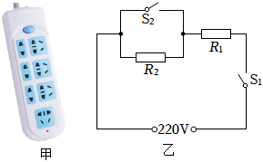
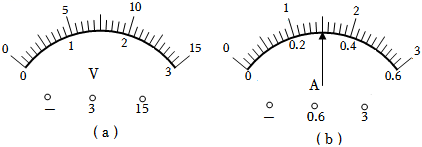
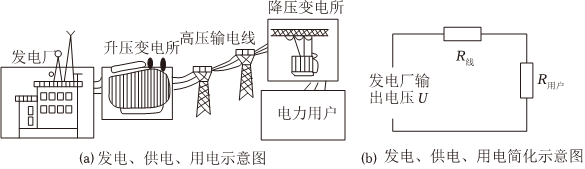

# 物-08 真题精讲 · 电功率综合

> 本讲选 4 题：铭牌计算（插排安全）+ 电能表填空 + 测小灯泡额定功率实验 + 电热与高压输电说理。题 1、题 3、题 4 配图自题源原卷 docx 内嵌图提取入库；题 2 原卷即纯文字题、无配图。

**1.**（原卷计算第 22 题）插排与电热水壶（铭牌计算）

如图甲所示，小明爸爸办公桌上的插排标有"$220\ \text{V}\ 10\ \text{A}$"字样，上面插有办公电脑（约 $300\ \text{W}$）、打印机（约 $500\ \text{W}$）和一台多功能电热水壶。电热水壶额定电压 $220\ \text{V}$，快烧挡功率 $2000\ \text{W}$、慢烧挡功率 $500\ \text{W}$，等效电路如图乙所示：$R_1$、$R_2$ 为发热电阻且阻值不变，通过控制开关 $S_1$、$S_2$ 的断开或闭合，热水壶可在快烧、慢烧两个不同挡位工作。

（1）闭合 $S_1$、断开 $S_2$ 时，热水壶处于快烧挡还是慢烧挡？
（2）求 $R_1$ 与 $R_2$ 的比值；
（3）若热水壶快烧、电脑和打印机同时工作，该插排是否存在安全隐患？请计算说明。

> [!tip]- 💡 思路导航
> 铭牌题三板斧：$R=U^2/P$ 求电阻、"电阻大者功率小"判挡位、"总功率 vs $UI_{额}$"判安全；由图乙认结构——$S_2$ 闭合把 $R_2$ 短路、只有 $R_1$ 工作。

> [!success]- ✅ 详解 · 评分点 · 易错 · 关联
> **详解**：（1）$S_1$ 闭合、$S_2$ 断开时 $R_1$ 与 $R_2$ 串联，总电阻最大；电压一定时由 $P=U^2/R$ 知电功率最小，故为**慢烧挡**。
> （2）快烧挡只有 $R_1$：$R_1=\dfrac{U^{2}}{P_{快}}=\dfrac{(220\ \text{V})^{2}}{2000\ \text{W}}=24.2\ \Omega$。慢烧挡串联总电阻：$R_{串}=\dfrac{U^{2}}{P_{慢}}=\dfrac{(220\ \text{V})^{2}}{500\ \text{W}}=96.8\ \Omega$，则 $R_2=96.8-24.2=72.6\ \Omega$。$R_1:R_2=24.2:72.6=$ **$1:3$**。**验**：$24.2\times3=72.6$ ✓。
> （3）**列** 插排允许的最大功率 $P_{排}=UI_{额}$；**算** $P_{排}=220\ \text{V}\times10\ \text{A}=2200\ \text{W}$；同时工作总功率 $P_{总}=2000+300+500=2800\ \text{W}$。**验** $P_{总}=2800\ \text{W}>P_{排}=2200\ \text{W}$，超载 $600\ \text{W}$。**答**：存在安全隐患——总电流超过插排额定电流，插排过热易引发火灾。
>
> **评分点**：**挡位判断的固定句式**——"电压一定时，由 $P=U^{2}/R$，电阻越大功率越小"，不写公式依据只答"慢烧"要扣分；$R=U^{2}/P$ 是原始公式的变形，第一次出现建议写成"由 $P=U^{2}/R$ 得 $R=U^{2}/P$"，步骤分更稳。
>
> **易错**：**安全比较对象**——插排上限是 $P=UI_{额}=2200\ \text{W}$（或比电流 $I_{总}=2800/220\approx12.7\ \text{A}>10\ \text{A}$），两条路任选其一，别拿 $2800$ 与 $220$ 比。
>
> **关联**：[[04-物理/知识点/07-电功率与家庭电路]]（电功率、挡位电路、安全用电）。

**2.**（原卷填空第 6 题）电能表与电能计算

测量家庭消耗电能的仪表是 ＿＿＿＿＿＿＿＿ 表。标有"$220\ \text{V}\ 1600\ \text{W}$"的电吹风正常工作 $0.1\ \text{h}$ 耗电 ＿＿＿＿＿＿＿＿ 千瓦时。为减小电能损耗，远距离输电时必须用 ＿＿＿＿＿＿＿＿（选填"高压"或"低压"）。

> [!tip]- 💡 思路导航
> "正常工作"即按额定功率算；$W=Pt$ 中功率用千瓦、时间用小时，直接得千瓦时数；高压输电的说理走"判断 → 依据 → 结论"三段式。

> [!success]- ✅ 详解 · 评分点 · 易错 · 关联
> **详解**：测量消耗电能的仪表是**电能**表；$W=Pt=1.6\ \text{kW}\times0.1\ \text{h}=0.16\ \text{kW}\cdot\text{h}$，即 **0.16** 千瓦时；**高压**。说理：输送功率一定时，由 $P=UI$，电压越高，输电电流越小；由 $P_{损}=I_线^{2}R_线$，$R_线$ 一定时电流越小，输电线上损耗的功率越小，故用高压输电。
>
> **关联**：[[04-物理/知识点/07-电功率与家庭电路]]（电能表、电能计算、高压输电）。

**3.**（原卷实验第 23 题）测定小灯泡的额定功率

小华测小灯泡（标有"$3.8\ \text{V}$"字样）的电功率：电源电压 $6\ \text{V}$，将小灯泡、滑动变阻器、电流表串联，电压表并联在电路中。闭合开关后无法使小灯正常发光，他记录的三组数据如下表，并打算用"电阻平均值 $10.0\ \Omega$"由 $P=U^2/R$ 求额定功率。

| 序号 | 电压表示数/V | 电流表示数/A | 小灯泡电阻/Ω |
| ---- | ---- | ---- | ---- |
| 1 | 2.0 | 0.22 | 9.1 |
| 2 | 2.4 | 0.24 | 10.0 |
| 3 | 2.8 | 0.26 | 10.8 |

小明观察电表表盘并经过思考，对小华连接的电路进行调整（电压表改并在滑动变阻器两端）后按正确步骤重新实验，可选变阻器有 A"$10\ \Omega\ 2\ \text{A}$"、B"$20\ \Omega\ 2\ \text{A}$"两个。当小灯正常发光时，观察到电流表示数如图所示（电流表量程 $0\sim0.6\ \text{A}$）。

（1）说明不能用电阻平均值替代正常发光时电阻的原因；
（2）通过计算说明应选哪个变阻器；
（3）写出调整电路后判定小灯正常发光的依据；
（4）求小灯泡的额定功率。

> [!tip]- 💡 思路导航
> 表中电阻随电压增大而增大，是"不能取平均"的根源；选变阻器用最接近正常发光的那组数据倒推所需 $R_{滑}$；改测变阻器电压后，"正常发光"的判据由"灯两端 $3.8\ \text{V}$"转化为"变阻器分得其余电压"。

> [!success]- ✅ 详解 · 评分点 · 易错 · 关联
> **详解**：（1）由表可知，灯两端电压增大时，灯的实际功率增大、灯丝温度升高，电阻从 $9.1\ \Omega$ 增大到 $10.8\ \Omega$——**灯丝电阻随温度升高而增大，不是定值**，三组数据的平均值没有物理意义，不能代表 $3.8\ \text{V}$ 正常发光时的电阻。（测**定值电阻**才多次测量取平均。）
> （2）与正常发光最接近的是第 1 组数据（$U_L=2.0\ \text{V}$，$I=0.22\ \text{A}$），此时变阻器两端电压 $U_{滑}=6-2.0=4\ \text{V}$，需接入 $R_{滑}=\dfrac{4\ \text{V}}{0.22\ \text{A}}\approx18.2\ \Omega>10\ \Omega$，A 变阻器不够用，故选 **B（"$20\ \Omega\ 2\ \text{A}$"）**。
> （3）规范表述："当电压表（测变阻器两端电压）示数为 $6\ \text{V}-3.8\ \text{V}=2.2\ \text{V}$ 时，小灯两端电压恰为额定电压 $3.8\ \text{V}$，小灯正常发光。"
> （4）**列** $P_{额}=U_{额}I_{额}$；**算** $P_{额}=3.8\ \text{V}\times0.3\ \text{A}=1.14\ \text{W}$。**验**：$0.3\ \text{A}<0.6\ \text{A}$，未超电流表量程 ✓。**答**：小灯泡额定功率为 $1.14\ \text{W}$。
>
> **评分点**：**改测变阻器后的判据转换**——正常发光从"灯两端 $3.8\ \text{V}$"变为"变阻器两端 $2.2\ \text{V}$"，转换依据是串联电路电压之和等于电源电压；判定依据要落到具体示数上。
>
> **易错**：**额定 ≠ 实际**——用电器的电阻由额定值算出后不变（题 1），但灯丝电阻随温度变（本题），两种"电阻观"分别用在不同题型里，不能混；**测灯泡功率不取平均**（高频考点）——平均值 $10.0\ \Omega$ 对应的是"三个电压下电阻的平均"，物理上不存在这个状态。
>
> **关联**：[[04-物理/知识点/07-电功率与家庭电路]]（额定功率、伏安法测功率）、[[04-物理/专题/电学四大题型]]（题型四实验策略）、[[04-物理/专题/大题规范书写-设列算验答]]（计算规范）。

**4.**（原卷填空第 12 题）高压输电说理

为了解发电厂发出的电能为什么需要用高压输电线送往各地：由于电流的热效应，远距离输电的导线很长，导线电阻不能忽略不计，线上有电流就会发热损耗电能。已知发电站的输出功率 $P=IU$ 一定，输电线电阻 $R_线$ 一定，输电线发热功率 $P_{损}=I_线^2R_线$。发电、供电、用电示意如图所示。请分析说明为什么远距离输电必须采用高压输电。

> [!tip]- 💡 思路导航
> 说理题按"判断 → 依据 → 结论"三段式书写；钥匙是"输出功率一定"——电压升高时电流怎么变，损耗又随电流怎么变。

> [!success]- ✅ 详解 · 评分点 · 易错 · 关联
> **详解**：**判断**——远距离输电必须采用高压输电，以减小输电线上的电能损耗。**依据**——输送功率 $P=IU$ 一定，输出电压 $U$ 越高，输电电流 $I_线$ 越小；输电线的发热损耗 $P_{损}=I_线^{2}R_线$，$R_线$ 一定，$P_{损}$ 随 $I_线$ 的减小而成平方倍地减小。**结论**——所以远距离输电采用高压，能显著减小导线发热损耗，提高输电效率。
>
> **评分点**：说理三段式缺一不可；依据中必须同时写出"功率一定 → 电压高电流小"与"$P_{损}=I_线^{2}R_线$ → 电流小损耗小"两步因果。
>
> **关联**：[[04-物理/知识点/07-电功率与家庭电路]]（电能输送）、[[04-物理/专题/大题规范书写-设列算验答]]（说理书写规范）。

## 🔗 关联

- [[04-物理/知识点/07-电功率与家庭电路]]（电功率、电能表、安全用电）
- [[04-物理/专题/电学四大题型]]（题型三电学计算规范、题型四实验策略）
- [[04-物理/专题/大题规范书写-设列算验答]]（计算与说理书写规范）
