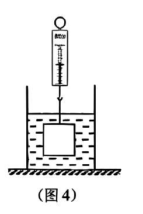
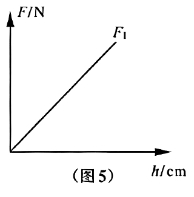
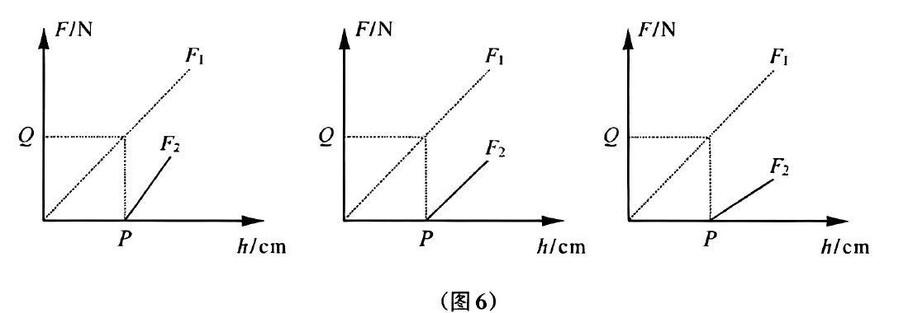

# 物-15 2026真题精讲 · 研究浮力

> 2026 上海中考综合测试物理部分压轴题块"研究浮力"（9 分，第 11 题）：从测力计示数表→浮力数据→下/上表面压力的 $F\text{-}h$ 图象，最后由图象反推圆柱高度 $P$ 与压力 $Q$。（2）（3）是"图象选择+说理+计算"三连，为本卷物理压轴，难度 ★★★★。
>
> ✅ 核对说明：撰写时官方答案页暂缺，本讲为自主推演；**后已与官方答案（第 5 页）逐项核对一致**——（1）F拉先变小后不变；（2）选 B（上下表面压力差，浸没时浮力不变故 F₁ 与 F₂ 差值不变）；（3）P=6.5 cm、Q=1.3 N。

**11.**（9分）小明为研究浮力，……，在测力计下方挂圆柱体，浸在某液体中，……，记录测力计示数 $F_{拉}$ 和圆柱体下方浸入液体深度 $h$ 如表 2 所示。

（卷面题干两处印作省略号"……"——按参考答案页补全，实验目的为"研究浮力大小与什么因素有关"。）

**表 2**

| 表号 | 1 | 2 | 3 | 4 | 5 | 6 |
| ---- | ---- | ---- | ---- | ---- | ---- | ---- |
| $h$/cm | 0.0 | 2.0 | 4.0 | 6.0 | 8.0 | 10.0 |
| $F_{拉}$/N | 7.0 | 6.6 | 6.2 | 5.8 | 5.7 | 5.7 |
| $V_{排}$/cm³ | （灰块，待填） | （灰块） | （灰块） | （灰块） | （灰块） | （灰块） |
| $F_{浮}$/N | （灰块，待填） | （灰块） | （灰块） | （灰块） | （灰块） | （灰块） |

（1）根据表中数据可知：$h$ 越大，$F_{拉}$＿＿＿＿＿＿＿＿；

小明分析数据后，结合实验现象，得出：物体所受的浮力 $F_{浮}$ 与排开液体的体积 $V_{排}$ 成正比。

（2）小华绘制得出物体下表面所受液体的压力 $F_1$ 与物体浸入液体深度 $h$ 的关系图如图 5 所示。……物体上表面所受液体的压力 $F_2$ 应是图 6 中的＿＿＿＿＿＿＿＿。请选择并说明理由。

（3）根据（2）中的图像：$P=$＿＿＿＿＿＿＿＿cm；$Q=$＿＿＿＿＿＿＿＿N。

> [!tip]- 💡 思路导航
> 先由 $F_{浮}=G-F_{示}$ 补全数据行再读趋势（注意"浸没"分界）；选图题的钥匙是写出 $F_1$、$F_2$ 各自随 $h$ 的函数形式——比斜率、比起点；$P$、$Q$ 要从表 2 的数据链里"算"出来，浸没前后浮力增量的突变是内插的钥匙。

> [!success]- ✅ 详解 · 评分点 · 易错 · 关联
> **详解**：（1）$h=0$ 时测力计示数即物重：$G=7.0\ \text{N}$。逐列算 $F_{浮}=G-F_{拉}$：0、0.4、0.8、1.2、1.3、1.3 N（待填行）。若题干省略号处给出的液体密度为 $1.0\times10^{3}\ \text{kg/m}^{3}$（水），由 $V_{排}=F_{浮}/(\rho_{水}g)$ 补 $V_{排}$ 行：0、40、80、120、130、130 cm³——$F_{浮}/V_{排}=0.01\ \text{N/cm}^{3}$ 恒定，支撑"成正比"结论。趋势表述（规范句式）："根据表中数据可知：$h$ 越大，$F_{拉}$ **先变小后不变**（浸没前随 $h$ 均匀减小，完全浸没后保持不变）。"（2）**选择：图 6 中间一幅。** **判断**：$F_2$ 的图线应从横轴上的 $P$ 点出发，且与 $F_1$ **平行（斜率相同）**。**依据**：圆柱体横截面积为 $S$，液体密度 $\rho$。下表面深度即 $h$，由液体压强 $p=\rho gh$ 得 $F_1=pS=\rho ghS$——过原点的直线（图 5）✓。上表面深度为 $h-H$（$H$ 为圆柱高度）：当 $h<H$ 时上表面在液面之上，不受液体压力，$F_2=0$；当 $h\ge H$ 时 $F_2=\rho g(h-H)S=\rho gS\cdot h-\rho gS\cdot H$——是随 $h$ 增大的直线，斜率 $\rho gS$ 与 $F_1$ 相同，只是整条线向右平移了 $H$，故从 $(P,0)$ 出发且与 $F_1$ 平行。**排除**：图 6 左图 $F_2$ 比 $F_1$ 陡、右图比 $F_1$ 缓——上、下表面处于**同种液体、面积相同**，深度每增加 1 cm，两个表面压力的增量都应是 $\rho gS$，斜率不同违背 $p=\rho gh$，均排除。（3）**设**：圆柱高度 $H$，浸没前每浸入 1 cm 浮力增加 $k$。**列与算**：浸没前（$h\le6.0$ cm）$F_{浮}$ 随 $h$ 线性增大：每 2.0 cm 增 0.4 N，即 $k=0.2\ \text{N/cm}$。$h$ 从 6.0→8.0 cm 示数只减 0.1 N、8.0→10.0 cm 不再变，说明圆柱在 6.0～8.0 cm 之间恰好浸没：浸没前还差 $0.1\ \text{N}$ 浮力，对应深度 $0.1/0.2=0.5\ \text{cm}$，故 $H=6.0+0.5=6.5\ \text{cm}$。**图象对应**：$F_2$ 开始出现的时刻是"上表面刚到达液面"=圆柱刚好浸没，即 $P=H=6.5\ \text{cm}$。$Q$ 是 $F_1$ 在 $h=P$ 处的值：此刻上表面刚达液面、$F_2=0$，由 $F_{浮}=F_1-F_2$ 得 $F_1=F_{浮max}=7.0-5.7=1.3\ \text{N}$，故 $Q=1.3\ \text{N}$。**验**：另一条路——$F_1=\rho gS\cdot h$，而 $\rho gS=k=0.2\ \text{N/cm}$，$Q=0.2\ \text{N/cm}\times6.5\ \text{cm}=1.3\ \text{N}$，两法一致 ✓；$F_{浮max}=1.3$ N 后不再变化，与表 2 第 5、6 列自洽 ✓。**答**：$P=6.5\ \text{cm}$，$Q=1.3\ \text{N}$。
>
> **评分点**：（1）2 分；（2）结论 1 分+理由 2 分，共 3 分；（3）P 2 分+Q 2 分，共 4 分（官方答案页）。理由的给分表述："浮力等于上下表面压力差，浸没时浮力不变，所以 $F_2$ 与 $F_1$ 的差值不变，故选 B。"
>
> **易错**：① **（1）趋势要答全**——"先变小后不变"；只答"变小"会漏掉浸没段。结论句按规范表述："液体密度一定时，物体所受浮力与排开液体的体积成正比"——"液体密度一定"这一前提不能丢。② **（2）说理三要素**——写出 $F_2=\rho gS(h-H)$ 的来源（$p=\rho gh$）、$h<H$ 时 $F_2=0$、斜率与 $F_1$ 相同；缺"平行（同斜率）"这一条，选图理由不完整。③ **（3）数据不完美是命题设计**——表 2 在 6.0→8.0 cm 处浮力增量突降（0.4→0.1 N），提示浸没发生在**两格之间**，需用比例内插 $0.1/0.2=0.5$ cm；直接把 $P$ 读成 8.0 cm（最后一格）是最大陷阱。④ **$Q$ 的物理意义**——$h=P$ 时上表面压力恰为零，$F_1$ 全额承担浮力，$Q=F_{浮max}$；能说出这层关系，说理题就通了一大半。⑤ **$V_{排}$ 行的前提**——补 $V_{排}$ 需要液体密度；卷面省略号处（扫描缺损）应给出该条件，本讲按 $1.0\times10^{3}\ \text{kg/m}^{3}$ 推算。$F_{浮}$ 行则只需 $G-F_{拉}$，与密度无关，考试时先填它。
>
> **关联**：[[04-物理/知识点/05-密度压强与浮力]]（阿基米德原理、$p=\rho gh$、称重法测浮力）、[[04-物理/专题/真题精讲/物-14-2026真题-测量电阻]]（同为"由现象反推"型实验压轴）。

## 🔗 关联

- [[04-物理/知识点/05-密度压强与浮力]]（阿基米德原理、$p=\rho gh$、称重法测浮力）
- [[04-物理/专题/压强浮力-上海特色题型]]（浮力图象与压力分析）
- [[04-物理/专题/实验操作考点-物理]]（测力计使用规范）
- 同类题：[[04-物理/专题/真题精讲/物-05-密度压强浮力综合]]（浮力综合计算）、[[04-物理/专题/真题精讲/物-14-2026真题-测量电阻]]（同为"由现象反推"型实验压轴）
