# 物模26 嘉定一模精讲（上）· 学科基础

> 2026 届嘉定区初三一模（2025 学年第一学期九年级质量调研综合测试样卷，物理部分 70 分）第一题块"学科基础"（39 分，第 1～12 题）。原卷为扫描件、无文字层，题目全部由逐页读图转录，看不清处以"[卷面模糊，按××重构]"标注；**原卷无答案文本，本讲答案全部为自主推演**（推演后与扫描件所附评分标准图逐项核对一致；题15评分图有一处面积数字笔误，已勘正，见 [[04-物理/专题/真题精讲/物模26-嘉定-下]]）。下册题块（第 13～17 题）见 [[04-物理/专题/真题精讲/物模26-嘉定-下]]。

**1.**（2分）智能监控摄像头
（1）通话时调节设备使音量放大，这是改变了声音的（　）
- （A）响度
- （B）音调
- （C）音色
- （D）频率

（2）摄像头镜头相当于一个凸透镜，远处物体通过它成倒立、＿＿＿＿＿＿＿＿的实像。

> [!tip]- 💡 思路导航
> 抓住两条即可破题："音量放大"改变的是振幅——振幅对应声音三特性中的哪一个？凸透镜成实像时"物远像近像变小"，摄像头物距远大于二倍焦距。

> [!success]- ✅ 详解 · 评分点 · 易错 · 关联
> **详解**：（1）音量放大改变振幅→**A 响度**。（2）摄像头物距远大于2f，成倒立、**缩小**的实像。

**2.**（3分）神舟二十一号出舱
2025年12月9日，神舟二十一号乘组执行出舱任务，如图1所示。
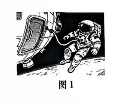

（1）航天员从地面运送到空间站，其质量（　）
- （A）变大
- （B）不变
- （C）变小

（2）出舱过程中以飞船为参照物，航天员是＿＿＿＿＿＿＿＿的（"A. 运动"或"B. 静止"）；
（3）航天员拉动安全系绳时，系绳也对航天员产生拉力，这说明＿＿＿＿＿＿＿＿。

> [!tip]- 💡 思路导航
> 质量是物体的属性，不随位置、形状、状态改变；判断运动还是静止，看相对参照物的位置是否变化；"A 施力给 B、B 同时也给 A"的现象背后是哪条规律？

> [!success]- ✅ 详解 · 评分点 · 易错 · 关联
> **详解**：（1）质量不随位置改变，**B 不变**。（2）出舱中航天员相对飞船位置变化，**A 运动**。（3）**力的作用是相互的**（航天员拉系绳，系绳同时拉航天员）。
>
> **关联**：[[04-物理/知识点/02-运动与力]]（质量属性、参照物、力的相互性）。

**3.**（4分）塔式起重机的滑轮组
如图2所示是塔式起重机中用到的滑轮组。
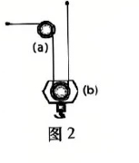

（1）图中(a)是＿＿＿＿＿＿＿＿滑轮（"A. 定"或"B. 动"），使用它的优点是＿＿＿＿＿＿＿＿；
（2）若将重力大小为 $5×10^6$ N 的物体匀速提升 30m，则起重机对物体做的功是＿＿＿＿＿＿＿＿J；该过程中保持不变的是物体的（　）
- （A）机械能
- （B）重力势能
- （C）动能

> [!tip]- 💡 思路导航
> 定滑轮"不省力但能改变用力方向"；$W=Fs$ 中的 s 是物体沿力方向移动的距离；匀速提升时速度不变——逐一判"动能、重力势能、机械能"谁变谁不变。

> [!success]- ✅ 详解 · 评分点 · 易错 · 关联
> **详解**：（1）(a)轴固定不动，是**A 定**滑轮，优点：**可以改变用力的方向**（不省力也不费距离）。（2）**列** $W=Fs=Gh$。**算** $W=5×10^6×30=$ **$1.5×10^8$ J**。匀速→速度不变→**C 动能**不变（势能增大、机械能增大）。
>
> **易错**：**匀速≠机械能不变**——动能不变但势能增大、机械能增大；"匀速"只锁"动能"这一个量。
>
> **关联**：[[04-物理/知识点/03-机械与功]]（定滑轮、功的计算）。

**4.**（5分）厨房里的物理
如图3所示，生活中用燃气灶烧煮食物时，通常用脱排油烟机将油烟和水汽排至室外。
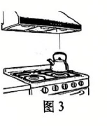

（1）脱排油烟机是利用＿＿＿＿＿＿＿＿原理工作的；
（2）烧水过程是通过＿＿＿＿＿＿＿＿的方式增加水的内能；水沸腾时壶口附近产生"白雾"，这是水蒸气发生＿＿＿＿＿＿＿＿形成的；继续加热，水的温度（　）
- （A）变大
- （B）不变
- （C）变小

（3）水壶壶嘴的高度不低于壶身高度，其设计遵循了＿＿＿＿＿＿＿＿原理。

> [!tip]- 💡 思路导航
> 油烟机"抽气造低压"——油烟靠哪个看不见的"推手"压向室外？"白雾"辨物态变化；沸腾继续吸热但温度怎么走？壶嘴与壶身"上端开口、底部连通"的结构有专门名称。

> [!success]- ✅ 详解 · 评分点 · 易错 · 关联
> **详解**：（1）油烟机把机内空气抽出、灶前气压降低，油烟在大气压作用下被压向室外——利用**大气压强**。（2）**热传递**；**液化**现象；水沸腾后温度**B 不变**。（3）壶嘴与壶身构成上端开口、底部连通的容器，遵循**连通器**原理。
>
> **关联**：[[04-物理/知识点/04-热学]]（内能、液化、沸腾）。

**5.**（4分）固体空气清新剂
固体空气清新剂是家庭常用的芳香用品，如图4置于置物架A上。
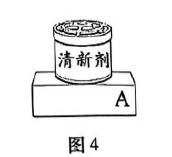

（1）在图4中用力的示意图画出固体清新剂对置物架A上表面的压力F；
（2）打开盖子室内各处都能闻到香味，这一现象表明分子在＿＿＿＿＿＿＿＿；
（3）常温下放置一段时间后固体清新剂逐渐变小，其剩余部分的密度（　）
- （A）变大
- （B）不变
- （C）变小

> [!tip]- 💡 思路导航
> 压力示意图抓三要素：作用点（受压面A上）、方向（垂直表面向下）、字母F；闻到香味即扩散现象；剩余部分物质种类、状态不变，密度随之确定。

> [!success]- ✅ 详解 · 评分点 · 易错 · 关联
> **详解**：（1）作用点画在置物架A上表面与罐底接触处，方向**垂直于A表面竖直向下**，标字母F。（2）香味扩散表明分子在**不停地做无规则运动**。（3）剩余部分物质种类、状态不变，密度**B 不变**。
>
> **易错**：**压力≠重力**——压力画在**受压面A上**、方向垂直表面向下；作用点画在罐上、方向沿重力方向都是常见错。
>
> **关联**：[[04-物理/知识点/02-运动与力]]（力的示意图）、[[04-物理/知识点/04-热学]]（分子动理论）。

**6.**（2分）城市热岛效应
图5是城市不同区域对应的温度示意图，中心城区的温度显著高于郊区，形成了典型的城市"热岛效应"。
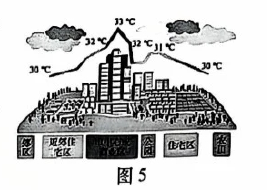

（1）中心城区的众多建筑物和道路在日照下升温较＿＿＿＿＿＿＿＿（"A. 快"或"B. 慢"）；
（2）下列做法中无法缓解热岛效应的是（　）
- （A）扩大绿地覆盖面积
- （B）多鼓励汽车出行
- （C）增加人工湿地与水体面积

> [!tip]- 💡 思路导航
> 建筑、道路的比热容比水小，日照下升温快；绿地、水体比热容大可缓温——逐项看哪种做法反而向城区排热。

> [!success]- ✅ 详解 · 评分点 · 易错 · 关联
> **详解**：（1）建筑物、道路的比热容比水小，日照下升温较**A 快**。（2）绿地、水体比热容大可缓温，**B 多鼓励汽车出行**排放废热反而加剧热岛。
>
> **关联**：[[04-物理/知识点/04-热学]]（比热容与热岛效应）。

**7.**（3分）汽车与汽油机
汽车在日常生活中被广泛使用。
（1）一辆汽车在平直的公路上匀速行驶，4s内通过的路程是80m，则汽车行驶的速度是＿＿＿＿＿＿＿＿m/s；
（2）图6是单缸四冲程汽油机的＿＿＿＿＿＿＿＿冲程；
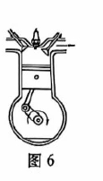

（3）若消耗2kg汽油，完全燃烧释放的热量是＿＿＿＿＿＿＿＿J。[$q_{汽油}=4.6×10^7$ J/kg]

> [!tip]- 💡 思路导航
> $v=s/t$ 直接代入；辨冲程抓"气门开闭＋活塞方向"两要素；放热用 $Q=mq$。

> [!success]- ✅ 详解 · 评分点 · 易错 · 关联
> **详解**：（1）**列** $v=s/t$。**算** $v=80/4=$ **20 m/s**。（2）排气门开启、活塞上行，是**排气**冲程。（3）**列** $Q=mq$。**算** $Q=2×4.6×10^7=$ **$9.2×10^7$ J**。
>
> **关联**：[[04-物理/知识点/02-运动与力]]（速度）、[[04-物理/知识点/04-热学]]（热值、热机四冲程）。

**8.**（3分）飞机机翼与放电
飞机机翼采用上凸下平的流线型设计，飞行时机翼上方空气流速大、压强＿＿＿＿＿＿＿＿，产生向上的升力；高空飞行时机身与空气由于＿＿＿＿＿＿＿＿起电，使飞机带上电荷，机身安装金属材质放电刷缓慢释放电荷，这是利用了金属材料的＿＿＿＿＿＿＿＿性（"A. 导热"或"B. 导电"）。

> [!tip]- 💡 思路导航
> 机翼"上凸下平"→上方流速大→流速大处压强小；机身与空气起电属于"摩擦起电"；"缓慢释放电荷"考金属的导电性。

> [!success]- ✅ 详解 · 评分点 · 易错 · 关联
> **详解**：机翼上方流速大、压强**小**（下表面流速小压强大，形成向上压强差）；机身与空气**摩擦**起电；放电刷利用金属的**B 导电**性。
>
> **关联**：[[04-物理/知识点/02-运动与力]]（流体压强与升力）、[[04-物理/知识点/06-电学基础]]（摩擦起电、导体）。

**9.**（4分）家庭简单电路
图7为某家庭简单电路的示意图。
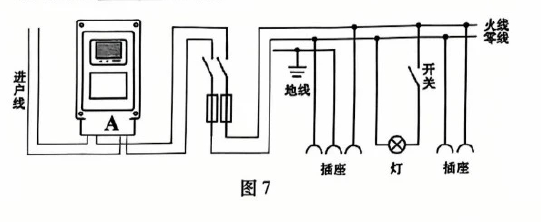

其中A是＿＿＿＿＿＿＿＿表，火线和零线之间的电压为＿＿＿＿＿＿＿＿V；若在插座上接一台额定功率300W的电视机正常工作2h，消耗的电能为＿＿＿＿＿＿＿＿kW·h；它与灯是＿＿＿＿＿＿＿＿连接的。

> [!tip]- 💡 思路导航
> 电能表接在进户线后、干路最前端；我国家庭电路电压 220V；电能计算先换算单位（300W=0.3kW）；插座与灯工作时互不影响。

> [!success]- ✅ 详解 · 评分点 · 易错 · 关联
> **详解**：**电能**表；**220** V；**列** $W=Pt=0.3$ kW×2 h。**算** $W=$ **0.6** kW·h；插座与灯工作时互不影响，是**并联**的。
>
> **易错**：**别漏单位换算**——300W=0.3kW，直接写 300×2=600 就错；kW·h 计算必须用 kW。
>
> **关联**：[[04-物理/知识点/07-电功率与家庭电路]]（家庭电路组成、电能计算）。

**10.**（2分）车库横杆式闸机
如图8所示是某小区车库入口的横杆式闸机，其工作电路中，电子门禁对应开关 $S_1$，门卫按钮对应开关 $S_2$，横杆起落由电动机M控制。
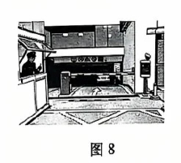

（1）当"登记"车辆靠近时，电子门禁自动感应抬杆放行；"非登记"车辆由门卫手动控制横杆起落。下列电路图能实现上述目标的是（　）
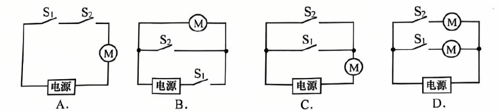

（2）当车辆缓慢驶过感应区、横杆始终抬起时，控制横杆的电路处于的状态是（　）
- （A）通路
- （B）开路
- （C）短路

> [!tip]- 💡 思路导航
> "自动、手动两条路径都要能**独立**开电机"——判断这需要把两开关串联还是并联；"始终抬起"=电动机持续工作，对应电路三态中的哪一态。

> [!success]- ✅ 详解 · 评分点 · 易错 · 关联
> **详解**：（1）目标：$S_1$、$S_2$ 任一闭合电机都转。逐项：A两开关串联，须同时闭合，排除；B $S_1$ 在干路，登记车自动抬杆也要经 $S_1$，排除；C $S_1∥S_2$ 再与M串联，任一闭合即抬杆，正确；D出现两个电动机且结构错误，排除。选 **C**。（2）横杆始终抬起=电动机持续工作，电路处于**A 通路**。
>
> **易错**：**逐项说"缺什么"**——A缺"独立控制"、B缺"自动路径"、D多一个电机，只写答案C不排他会扣推理分。
>
> **关联**：[[04-物理/知识点/06-电学基础]]（串并联电路设计）。

**11.**（3分）隔板容器探究液体压强
小丁使用如图9甲所示的装置进行"探究液体压强与哪些因素有关"的实验：容器正中间用隔板分成左右两部分，隔板中有一圆孔用薄橡皮膜封闭。
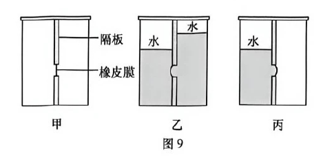

（1）如图乙，橡皮膜向左凸出，说明同种液体内部，＿＿＿＿＿＿＿＿越大，压强越大；
（2）如图丙，左侧倒入水后，若水面到橡皮膜中心的距离为0.2m，橡皮膜受到水的压强大小是＿＿＿＿＿＿＿＿Pa；
（3）在丙图中，若往右侧倒入一定量的酒精，使橡皮膜恢复平整，则此时左右容器底部受到液体压强的大小关系 $p_水'$＿＿＿＿＿＿＿＿ $p_酒精'$（　）。[已知 $\rho_酒精<\rho_水$]
- （A）大于
- （B）等于
- （C）小于

> [!tip]- 💡 思路导航
> 隔板容器把"膜两侧压强相等"当桥梁：膜凸向哪侧，哪侧压强小；$p=\rho gh$ 中的 h 是到膜中心的竖直深度；比较底部压强要在"膜处相等"的基础上再叠加膜以下的液柱压强。

> [!success]- ✅ 详解 · 评分点 · 易错 · 关联
> **详解**：（1）乙中右侧水深、橡皮膜向左（浅侧）凸出：同种液体内部**深度**越大，压强越大。（2）**列** $p=\rho_水 gh$。**算** $p=1.0×10^3×9.8×0.2=$ **$1.96×10^3$ Pa**。（3）膜平整⇒膜两侧 $p_水=p_酒精$；底部压强=膜处压强+膜下方液柱压强：$p'=p_膜+\rho g h_{膜底}$，膜到底距离相同且 $\rho_水>\rho_酒精$，故 $p_水'$ **A 大于** $p_酒精'$。
>
> **易错**：**分两段比压强**——先"膜平⇒膜处相等"，再"膜以下加 $\rho gh$"；直接答"等于"（混淆膜处与底部）是最高频错误。
>
> **关联**：[[04-物理/知识点/05-密度压强与浮力]]（液体压强）。

**12.**（4分）电路故障的两步检测
小嘉按图10连接实物后闭合S，发现灯L不发光，于是她利用一只完好的电压表进行检测。若电源电压为 $U_0$，电路中仅有一处故障，且只发生在灯L或电阻R。
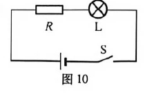

（1）他将电压表并联在电阻R两端，闭合S观察到示数为 $U_0$，则故障可能是＿＿＿＿＿＿＿＿；
（2）为进一步确定故障，应进行的操作是（　）
- （A）将电压表并联在小灯两端
- （B）将电压表串联在电路中

（3）请根据上述选择，写出闭合开关S后电压表的示数情况及对应的故障。

> [!tip]- 💡 思路导航
> 电压表并在R两端读 $U_0$：R 开路（V 经 L 接电源）或 L 短路（R 独占电源电压）两种可能；（2）要挑一种能区分这两种故障的电压表接法，（3）再按所选接法分情况给"示数—故障"对应。

> [!success]- ✅ 详解 · 评分点 · 易错 · 关联
> **详解**：（1）V并在R两端读 $U_0$，两种可能：**电阻R开路**（V经L接电源，示数≈$U_0$）或**灯L短路**（R独占电源电压）。（2）**B 将电压表串联在电路中**（便于区分两种故障）。（3）**析**：若灯L短路→电路经V与R导通，V内阻远大于R，示数≈**$U_0$**；若电阻R开路→回路被切断、电压表无电流通过，示数为**0**。**答**：示数为 $U_0$，则灯L短路；示数为0，则电阻R开路。
>
> **易错**：**三问连贯**——（1）答"R开路或L短路"两种都要写；（3）的结论必须与（2）的操作（串联电压表）对应，写成"并在L两端测"会答非所问。
>
> **关联**：[[04-物理/知识点/06-电学基础]]（电路故障分析）、同类题 [[04-物理/专题/真题精讲/物模26-杨浦-上]]（电路故障同款两步法）。

## 🔗 关联

- [[04-物理/知识点/01-声与光]]（响度、凸透镜成像）
- [[04-物理/知识点/02-运动与力]]（质量属性、参照物、力的相互性）
- [[04-物理/知识点/04-热学]]（内能、液化、沸腾、热值、比热容与热岛）
- [[04-物理/知识点/06-电学基础]]（家庭电路、电路设计、故障分析）
- 同类题：[[04-物理/专题/真题精讲/物模26-嘉定-下]]（同卷计算题块）、[[04-物理/专题/真题精讲/物模26-宝山-上]]（烟雾报警器动态电路）、[[04-物理/专题/真题精讲/物模26-杨浦-上]]（电路故障同款两步法）
