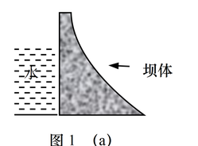
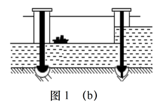
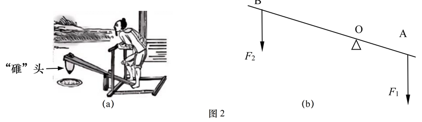
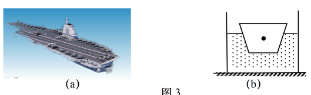
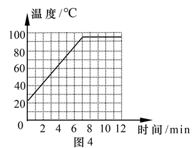
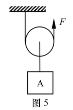
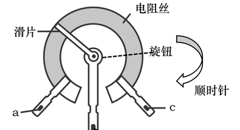
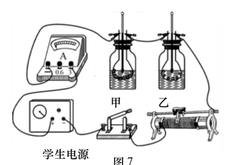
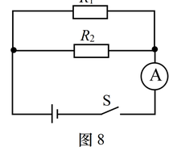

# 物模26 奉贤一模精讲（上）· 学科基础

> 2026 届奉贤区初三一模（2025 学年第一学期九年级综合练习 2026.01，物理部分 70 分：学科基础 38 分＋学科综合 32 分）第一题块（第 1～12 题）。原卷为扫描件，题目逐页读图转录；**扫描件末尾附参考答案与评分要求（第 7～8 张图），本讲全部结论已逐项与其核对一致**；题 7 沸点读图约 98℃（平台段略低于 100℃ 刻度线）为读图重构，不影响选 C 的判断。学科综合（第 13～17 题）见 [[04-物理/专题/真题精讲/物模26-奉贤-下]]。

**1.** 电器
（1）上海地区家用照明电路的电压为＿＿＿＿＿＿＿＿V；
（2）电视机和冰箱之间的连接方式是＿＿＿＿＿＿＿＿。
- （A）串联
- （B）并联

（3）大功率用电器一般不同时使用，同时使用的电器增多时，电路中的总电流将＿＿＿＿＿＿＿＿。
- （A）变大
- （B）变小
- （C）不变

> [!tip]- 💡 思路导航
> 家庭电路电压 220V 是常识锚点；各用电器并联互不影响；并联支路越多→总电阻越小——总电流走向用欧姆定律收尾。

> [!success]- ✅ 详解 · 评分点 · 易错 · 关联
> **详解**：（1）**220**。（2）**B 并联**：电视机、冰箱工作互不影响。（3）并联支路增多→总电阻变小，U 不变，**A 变大**。
>
> **关联**：[[04-物理/知识点/07-电功率与家庭电路]]（家庭电路电压、连接方式）。

**2.** 三峡大坝
（1）坝体建成上窄下宽的形状如图1(a)所示，主要是因为水的压强随深度的增加而＿＿＿＿＿＿＿＿。
- （A）增大
- （B）减小
- （C）不变

此时坝体＿＿＿＿＿＿＿＿受到浮力作用。
- （A）会
- （B）不会

（2）如图1(b)，轮船经过多级船闸通过大坝，船闸的工作是利用了＿＿＿＿＿＿＿＿原理。

> [!tip]- 💡 思路导航
> 液体压强随深度增大，所以坝体"上窄下宽"；浮力产生的原因是上下表面的压力差——想想坝底与基岩之间有没有水；船闸是连通器的典型应用。

> [!success]- ✅ 详解 · 评分点 · 易错 · 关联
> **详解**：（1）p=ρgh，深度越大压强越大，**A**；坝底与坝体基岩密合，水不能进入坝体底部，无上下表面压力差，**B 不会**受到浮力。（2）船闸的闸室与上游（或下游）上端开口、底部连通，构成**连通器**。
>
> **易错**：坝体"不会"受浮力是上海卷高频结论——浮力产生原因是上下表面压力差，坝底与基岩密合无水；凭直觉选"会"直接丢分。
>
> **关联**：[[04-物理/知识点/05-密度压强与浮力]]（液体压强、浮力产生原因、连通器）。

**3.** 二十四节气
（1）大寒时节采石：在岩石上凿孔、注水并封口，利用夜晚低温使水结冰（ρ冰=0.9×10³kg/m³）后，体积＿＿＿＿＿＿＿＿，从而将石头胀裂。
- （A）增大
- （B）减小
- （C）不变

（2）"白露"时节，露水的形成，经历的物态变化是＿＿＿＿＿＿＿＿。
- （A）汽化
- （B）液化
- （C）升华
- （D）凝华

> [!tip]- 💡 思路导航
> 水结冰质量不变、密度变小，由 $V=m/\rho$ 判体积；露是液态小水珠——水蒸气遇冷液化。

> [!success]- ✅ 详解 · 评分点 · 易错 · 关联
> **详解**：（1）ρ冰＜ρ水，结冰质量不变，V=m/ρ 变**大（A）**。（2）露是水蒸气遇冷**液化（B）**形成的小水珠。
>
> **关联**：[[04-物理/知识点/04-热学]]（物态变化）。

**4.** 汽油机
（1）在加油站附近能闻到汽油的气味，这是由于分子在不停地做＿＿＿＿＿＿＿＿运动；
（2）四冲程汽油机在工作过程中，内能转化为机械能的冲程是＿＿＿＿＿＿＿＿。
- （A）压缩冲程
- （B）做功冲程
- （C）吸气冲程
- （D）排气冲程
（3）汽油热值 q 为 4.6×10⁷J/kg。某汽车行驶一段路程，消耗了 2kg 汽油，若汽油完全燃烧，则放出的热量为＿＿＿＿＿＿＿＿J。

> [!tip]- 💡 思路导航
> 闻到气味=扩散现象；四冲程中只有做功冲程是"内能→机械能"；放热用 $Q=qm$。

> [!success]- ✅ 详解 · 评分点 · 易错 · 关联
> **详解**：（1）**无规则**（扩散现象）。（2）**B 做功冲程**（内能→机械能）。（3）**设** m=2kg、q=4.6×10⁷J/kg。**列** Q=qm。**算** Q=4.6×10⁷×2=**9.2×10⁷J**。**验** 数量级与 1kg 汽油放热 4.6×10⁷J 相符 ✓。
>
> **关联**：[[04-物理/知识点/04-热学]]（分子动理论、热机、热值）。

**5.** 脚踏碓（作图+计算）
《天工开物》记载脚踏碓舂米：用脚连续踏木杠一端，另一端的碓头连续起落将稻米去壳。

（1）如图2(b)，"踏碓"相当于杠杆，画出阻力 F₂ 的阻力臂 l₂。（作图）
（2）若杠杆平衡时动力臂 l₁ 为 0.4m，阻力 F₂ 为 100N，阻力臂 l₂ 为 0.8m，则动力 F₁ 的大小为＿＿＿＿＿＿＿＿N。
（3）"碓"头的头部很尖，主要是为了＿＿＿＿＿＿＿＿。
- （A）增大压强
- （B）减小压强

> [!tip]- 💡 思路导航
> 力臂是"支点到力的作用线的垂直距离"——从支点 O 向 F₂ 的竖直作用线作垂线段；碓头尖=受力面积小——压力一定时压强怎么变？

> [!success]- ✅ 详解 · 评分点 · 易错 · 关联
> **详解**：（1）从支点 O 向 F₂ 的作用线（竖直虚线）作垂线段，标注 l₂。（2）**设** l₁=0.4m、F₂=100N、l₂=0.8m。**列** F₁l₁=F₂l₂。**算** F₁=F₂l₂/l₁=100×0.8/0.4=**200N**。**验** 动力臂小于阻力臂，F₁＞F₂，是费力杠杆，数值合理 ✓。（3）尖头减小受力面积，**A 增大压强**。
>
> **易错**：杠杆平衡代入时单位统一为 m、N，F₁=200N；把 0.8m 与 0.4m 位置代反得 50N。
>
> **关联**：[[04-物理/知识点/03-机械与功]]（杠杆平衡、力臂作图）、[[04-物理/知识点/05-密度压强与浮力]]（增大压强）。

**6.** 福建舰（作图+选择）
福建舰是中国第一艘采用电磁弹射系统的航母，如图3(a)所示。

（1）一只重为 8 牛的模型船漂浮在水面上（图3b），请用力的示意图画出模型船受到的浮力 F浮。（作图）
（2）采用电磁弹射系统，这是为了增大起飞时飞机的＿＿＿＿＿＿＿＿。
- （A）动能
- （B）弹性势能
- （C）重力势能

（3）飞机起飞时，机翼下表面的空气流速比上表面小，下表面受到的压强要＿＿＿＿＿＿＿＿一些，机翼上下表面形成压力差，飞机获得上升的动力。
- （A）大
- （B）小

> [!tip]- 💡 思路导航
> 漂浮条件 $F_浮=G$——从重心画竖直向上、等长带箭头的线段；弹射增大起飞速度→动能增大；流速小处压强大。

> [!success]- ✅ 详解 · 评分点 · 易错 · 关联
> **详解**：（1）漂浮 F浮=G=8N，从船的重心画竖直向上的带箭头线段，标 F浮=8N。（2）弹射增大起飞速度→质量不变时动能增大，**A**。（3）下表面流速小→压强**大（A）**，上表面流速大压强小，形成向上的压力差。
>
> **关联**：[[04-物理/知识点/05-密度压强与浮力]]（浮力作图）、[[04-物理/知识点/02-运动与力]]（流体压强与升力）。

**7.** 沸腾实验
小红做"探究水在沸腾前后温度变化的特点"实验。

（1）图4 是根据实验数据绘制的水温-时间图像，得出水沸腾时的特点是：继续吸热，温度＿＿＿＿＿＿＿＿。
- （A）升高
- （B）降低
- （C）不变

（2）根据图4 可知当地当时的大气压强＿＿＿＿＿＿＿＿1 个标准大气压。
- （A）大于
- （B）等于
- （C）小于

> [!tip]- 💡 思路导航
> 图像平台段=沸腾：吸热但温度不变；先读出平台温度（略低于 100℃），再由"气压越低沸点越低"判断气压。

> [!success]- ✅ 详解 · 评分点 · 易错 · 关联
> **详解**：（1）沸腾时继续吸热、温度**不变（C）**。（2）读图平台约 98℃（略低于 100℃ 刻度线，读图重构），气压越低沸点越低，**C 小于**。
>
> **易错**：先读出平台温度不足 100℃，再由"气压低→沸点低"得出小于 1 标准大气压；跳过读图直接写"等于"是通病。
>
> **关联**：[[04-物理/知识点/04-热学]]（沸腾图像、沸点与气压）。

**8.** 动滑轮
如图5所示，工人用动滑轮匀速提升重为 400N 的重物 A，不计绳重和摩擦，所用竖直拉力为 250N，重物 A 上升的高度为 10m，用时 50s。

（1）该动滑轮可看作＿＿＿＿＿＿＿＿杠杆。
- （A）省力
- （B）费力
- （C）等臂
（2）工人所做的有用功 W有 为＿＿＿＿＿＿＿＿J，拉力 F 的功率 P 为＿＿＿＿＿＿＿＿W。

> [!tip]- 💡 思路导航
> 动滑轮实质是动力臂为阻力臂 2 倍的省力杠杆；$s=2h$；功率要用**总功**除以时间（$W_总=Fs$），别用有用功。

> [!success]- ✅ 详解 · 评分点 · 易错 · 关联
> **详解**：（1）动滑轮实质是动力臂为阻力臂 2 倍的**A 省力**杠杆。（2）**设** G=400N、h=10m、F=250N、t=50s。**列** W有=Gh；W总=Fs，s=2h；P=W总/t。**算** W有=400×10=**4000J**；W总=250×2×10=5000J，P=5000/50=**100W**。**验** η=W有/W总=80%＜100%，不计绳重摩擦合理 ✓。
>
> **易错**：P=W总/t，总功必须用 F×s 且 s=2h=20m；错用 W有/t 得 80W 是典型失分。
>
> **关联**：[[04-物理/知识点/03-机械与功]]（动滑轮、功率、机械效率）。

**9.** 电位器
调光台灯用到的电位器结构图如图6所示。

（1）电位器是通过改变接入电路中电阻丝的＿＿＿＿＿＿＿＿来改变接入电路中的电阻，从而改变灯泡亮度；
（2）若只将 b、c 接线柱接入电路，顺时针转动旋钮时，调光台灯的灯泡会＿＿＿＿＿＿＿＿。
- （A）变亮
- （B）变暗

> [!tip]- 💡 思路导航
> 电位器本质是滑动变阻器：靠改变接入电路的电阻丝**长度**改变电阻；b、c 接入时判断"顺时针转动→接入段变长还是变短"是关键。

> [!success]- ✅ 详解 · 评分点 · 易错 · 关联
> **详解**：（1）通过改变接入电路中电阻丝的**长度**来改变电阻。（2）b、c 接入即滑片到 c 段电阻丝：顺时针转动滑片向 c 靠拢→接入段变短→R 变小→I 变大→**A 变亮**。
>
> **关联**：[[04-物理/知识点/06-电学基础]]（滑动变阻器）。

**10.** 电流产生热量
研究"电流产生的热量与电阻的关系"：将甲、乙两根电热丝分别浸入装有煤油的瓶中，瓶内各插一支温度计（图7）。

（1）电流通过电热丝时将电能转化为电热丝的＿＿＿＿＿＿＿＿能；
（2）实验中通过观察＿＿＿＿＿＿＿＿来比较电流产生热量的多少。
- （A）温度计示数的变化量
- （B）加热时间

（3）煤油的温度升高是通过＿＿＿＿＿＿＿＿的方式增加了煤油的内能。
- （A）做功
- （B）热传递

> [!tip]- 💡 思路导航
> 电流热效应：电能→内能；"转换法"——热量多少看不见，借温度计示数变化量来比较；电热丝温度高，热量传给煤油属热传递。

> [!success]- ✅ 详解 · 评分点 · 易错 · 关联
> **详解**：（1）**内**能。（2）转换法：热量越多煤油温度升得越多，**A**。（3）电热丝温度高于煤油，热量从电热丝传给煤油，**B 热传递**。
>
> **关联**：[[04-物理/知识点/04-热学]]（电流热效应、内能）、[[04-物理/专题/实验操作考点-物理]]（转换法）。

**11.** 电路故障（多选）
如图8，电源电压为 U₀ 且保持不变，电阻 R₁、R₂ 的阻值均为 R₀（并联），闭合开关 S 后，电流表的示数不为零。

（1）电路可能存在的情况有（多选）（　）
- （A）电阻 R₁ 开路
- （B）电阻 R₂ 开路
- （C）电阻 R₁、R₂ 均开路
- （D）电路正常，各元件均完好

（2）若电路中仅有一处故障，且只发生在 R₁ 或 R₂ 上。现用另一完好的阻值为 R₀ 的电阻 R₃ 去替换 R₁，请写出闭合开关 S 后电流表的示数及相应的故障。

> [!tip]- 💡 思路导航
> "电流表示数不为零"只排除"两条支路全断"；故障判断抓住"电流表有无示数"；换 R₃ 后按"两条支路都通/仅一条通"两种示数反推原故障。

> [!success]- ✅ 详解 · 评分点 · 易错 · 关联
> **详解**：（1）电流表示数不为零→至少一条支路导通：R₁ 断（R₂ 通）✓、R₂ 断（R₁ 通）✓、均完好 ✓；两支路全断则示数为零，C 错。选 **A、B、D**。（2）**设** 换 R₃ 后两支路电阻均为 R₀。**列** 并联 I=U₀/R₁′+U₀/R₂′。**算·判** 若示数为 2U₀/R₀（两支路都通）→原 **R₁ 开路**；若示数为 U₀/R₀（仅 R₃ 通）→原 **R₂ 开路**。
>
> **易错**：这是多选题，"示数不为零"只排除"两支路全断"，A、B、D 都要保留；漏选不得分。
>
> **关联**：[[04-物理/知识点/06-电学基础]]（并联电路故障分析）。

**12.** 洒水降温
（1）水蒸发过程中需要＿＿＿＿＿＿＿＿热量。
- （A）吸收
- （B）放出
（2）质量为 2 千克的水温度升高 5℃，求水吸收的热量 Q吸。[c水=4.2×10³J/(kg·℃)]

> [!tip]- 💡 思路导航
> 蒸发是汽化的一种，吸热有致冷作用；$Q_吸=cm\Delta t$ 直接代入。

> [!success]- ✅ 详解 · 评分点 · 易错 · 关联
> **详解**：（1）蒸发是汽化，**A 吸收**热，有致冷作用。（2）**设** m=2kg、Δt=5℃。**列** Q吸=c水mΔt。**算** Q吸=4.2×10³×2×5=**4.2×10⁴J**。**验** 2kg 水升 5℃ 约需 10kcal，量级合理 ✓。
>
> **关联**：[[04-物理/知识点/04-热学]]（汽化吸热、比热容计算）。

## 🔗 关联

- [[04-物理/知识点/04-热学]]（物态变化、沸腾图像、热值、比热容、电流热效应）
- [[04-物理/知识点/05-密度压强与浮力]]（液体压强、浮力产生原因、连通器、浮力作图）
- [[04-物理/知识点/06-电学基础]]（家庭电路、滑动变阻器、电路故障）
- [[04-物理/专题/实验操作考点-物理]]（沸腾、焦耳实验的转换法）
- 同类题：[[04-物理/专题/真题精讲/物模26-奉贤-下]]（同卷综合题块）、[[04-物理/专题/真题精讲/物模26-松江-上]]（学科基础同构）、[[04-物理/专题/真题精讲/物模26-宝山-上]]
