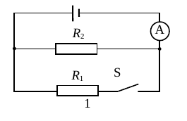
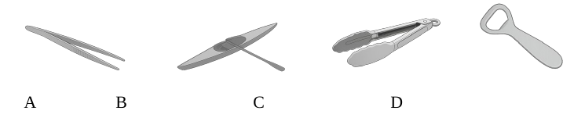
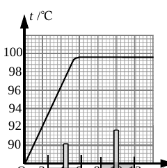
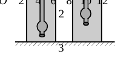
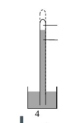
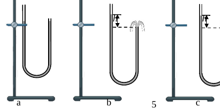
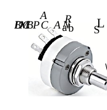
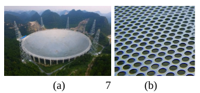
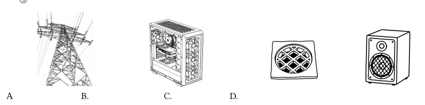

# 物模26 徐汇一模精讲（上）· 情境题块（第一部分）

> 2026 届徐汇区初三一模（2025 学年第一学期学习能力诊断卷，2026.1，物理独立卷 100 分/90 分钟）第一部分（60 分，第 1～6 题）：每题一个生活/科技情境，概念辨析中嵌小计算与说理，题 5 电路故障分析、题 6 数据归纳是本卷思维高点。卷面插图已自原卷页图裁切补齐（`figs/物模26-徐汇/`）；唯图 6(b) 电位器电路图在原卷 docx→PDF 转制中图形丢失（仅存散落文字标签），题 5 电路结构以题干文字描述为准。计算实验题块见 [[04-物理/专题/真题精讲/物模26-徐汇-下]]。

## 📝 题目与解析

**1.**（摩擦起电与热机）
（1）用丝绸摩擦过的玻璃棒和用毛皮摩擦过的橡胶棒相互靠近时相互吸引，是因为玻璃棒带正电，橡胶棒带＿＿＿＿＿＿＿＿电，（A．同种　B．异种）电荷相互吸引。若玻璃棒与橡胶棒接触，瞬间电流的方向是＿＿＿＿＿＿＿＿（A．从橡胶棒流向玻璃棒　B．从玻璃棒流向橡胶棒）。
（2）钻木取火时木头相互摩擦，干草温度升高达到燃点燃烧，这是通过＿＿＿＿＿＿＿＿（A．做功　B．热传递）方式将机械能转化为木头的＿＿＿＿＿＿＿＿能。这个过程中能量转化情况与汽油机＿＿＿＿＿＿＿＿冲程相同。
- （A）吸气
- （B）压缩
- （C）做功
- （D）排气

> [!tip]- 💡 思路导航
> 异种电荷相吸；金属中电流方向与自由电子定向移动方向**相反**。钻木取火是做功改变内能（机械能→内能），到汽油机四冲程里找同款能量转化。

> [!success]- ✅ 详解 · 评分点 · 易错 · 关联
> **详解**：（1）橡胶棒带**负**电；正负电荷相互吸引，选 **B 异种**；接触时电子从橡胶棒流向玻璃棒（负→正），电流方向与电子移动相反，选 **B 从玻璃棒流向橡胶棒**。（2）摩擦生热是**做功**（A）把机械能转化为木头的**内**能；汽油机压缩冲程也是机械能→内能，选 **B 压缩**冲程（做功冲程是内能→机械能，排除 C）。
>
> **易错**：电流方向规定——金属中自由电子（负电荷）定向移动方向与电流方向相反，"从玻璃棒流向橡胶棒"是最常见错选；（2）第二空填"内"不填"热"。
>
> **关联**：[[04-物理/知识点/06-电学基础]]（摩擦起电、电流方向）、[[04-物理/知识点/04-热学]]（内能改变与热机冲程）

**2.**（家用电器）
（1）洗澡时浴室镜面出现"白雾"：温度较高的水蒸气遇较冷镜面后＿＿＿＿＿＿＿＿（A．汽化　B．液化）成小水珠；镜背装电热膜，通电后镜面温度升高，小水珠＿＿＿＿＿＿＿＿（A．吸收　B．放出）热量，发生＿＿＿＿＿＿＿＿（A．汽化　B．升华）现象，镜子又清晰。
（2）电热膜铭牌"220V 22W"：正常工作电压为＿＿＿＿＿＿＿＿V，正常工作 1 小时耗电＿＿＿＿＿＿＿＿度。生活中用＿＿＿＿＿＿＿＿表计量家庭电路消耗的用电量。
（3）电冰箱与吸顶灯之间是＿＿＿＿＿＿＿＿（A．串联　B．并联）连接。电冰箱支撑脚底面积较大，在重力不变时可减小冰箱对地面的＿＿＿＿＿＿＿＿。电冰箱用三脚插头，插入三孔插座时将金属外壳与＿＿＿＿＿＿＿＿相连，防止触电。
（4）在图 1 所示的电路中，开关 S 从闭合到断开，电流表两次示数之比为 5︰2，则 R₁、R₂ 阻值之比为＿＿＿＿＿＿＿＿；闭合时两电阻消耗的电功率 P₁、P₂ 之比为＿＿＿＿＿＿＿＿。

> [!tip]- 💡 思路导航
> 物态变化对号入座；铭牌 $W=Pt$ 直接算度数；家庭电路用电器互不影响。第（4）问抓"闭合时电流表测干路、断开后只剩 $R_2$ 支路"两次示数的物理含义列比例。

> [!success]- ✅ 详解 · 评分点 · 易错 · 关联
> **详解**：（1）水蒸气遇冷**液化**（B）成小水珠；受热后小水珠**吸收**（A）热量**汽化**（A）成水蒸气。（2）正常工作电压 **220V**；$W=Pt=0.022\,\text{kW}×1\,\text{h}=$ **0.022** 度；用**电能**表计量。（3）冰箱与灯互不影响，**B 并联**；增大受力面积减小对地面的**压强**；三脚插头把金属外壳与**大地（地线）**相连。（4）闭合时 A 测干路 $I_1+I_2$，断开 S 后只剩 $R_2$，A 测 $I_2$：$(I_1+I_2):I_2=5:2$，得 $I_1:I_2=3:2$；并联电压相等，$R_1:R_2=I_2:I_1=$ **2:3**；闭合时 $P=I^2R$，$P_1:P_2=I_1^2R_1:I_2^2R_2=3^2×2:2^2×3=$ **3:2**。
>
> **评分点**：第（4）问先画等效电路再列比例才给全过程分；功率比必须用同一时刻（闭合时）的支路电流。
>
> **易错**：把两次示数比写反会得 3:2；断开后电流表只测 $R_2$ 支路这一点易漏。
>
> **关联**：[[04-物理/知识点/06-电学基础]]（家庭电路、串并联）、[[04-物理/知识点/07-电功率与家庭电路]]（电功计算）

**3.**（工具与实验）
（1）下列工具中，属于省力杠杆的是＿＿＿＿＿＿＿＿。
- （A）镊子
- （B）赛艇的船桨
- （C）食品钳
- （D）起瓶器

（2）在"探究水沸腾前后温度变化特点"实验中，根据实验数据绘制温度随时间变化的图像（图 2）：水在沸腾前温度＿＿＿＿＿＿＿＿，沸腾过程中温度＿＿＿＿＿＿＿＿，水的沸点为＿＿＿＿＿＿＿＿℃。

（3）同一支密度计分别放在甲、乙液体中（同样容器），静止后如图 3 所示：$F_{浮甲}$＿＿＿＿＿＿＿＿ $F_{浮乙}$，$\rho_甲$＿＿＿＿＿＿＿＿ $\rho_乙$，液体对容器底部的压力 $F_甲$＿＿＿＿＿＿＿＿ $F_乙$。（均选 A．大于　B．等于　C．小于）

> [!tip]- 💡 思路导航
> 省力/费力看动力臂与阻力臂的长短；沸腾前升温、沸腾时恒温，沸点从图上读；密度计始终漂浮 $F_浮=G$，再用 $F_浮=ρ_液 gV_排$ 把浸入深度与液体密度挂钩。

> [!success]- ✅ 详解 · 评分点 · 易错 · 关联
> **详解**：（1）逐项：镊子、船桨、食品钳使用时动力臂都小于阻力臂（费力杠杆）；起瓶器支点在瓶盖前沿、动力臂大于阻力臂，选 **D**。（2）沸腾前吸热温度**持续上升**；沸腾时**保持不变**；由图读得沸点 **99.6**℃。（3）密度计在两液体中都漂浮：$F_浮=G$，故 $F_{浮甲}$ **等于（B）** $F_{浮乙}$；由 $F_浮=ρ_液 gV_排$，甲浸入深（$V_排$ 大）则 $\rho_甲$ **小于（C）** $\rho_乙$；柱形容器中液体对底部压力 $F=ρg h S$，密度小者压力小，$F_甲$ **小于（C）** $F_乙$（亦可由"柱形容器底压力=液重+密度计重"判断）。
>
> **易错**：第（3）问压力第三空易空着——柱形容器"底部压力=液重+漂浮物重"是上海卷常用判断链，勿只比密度忘了几何。
>
> **关联**：[[04-物理/知识点/03-机械与功]]（杠杆分类）、[[04-物理/知识点/04-热学]]（沸腾实验）、[[04-物理/知识点/05-密度压强与浮力]]（密度计）

**4.**（流体压强）
（1）大风天只开一扇窗，窗帘被"吸"向窗外，原因是＿＿＿＿＿＿＿＿。
- （A）窗外空气密度比室内小，气流带动窗帘向密度小的一侧运动
- （B）窗外空气密度比室内大，气流带动窗帘向密度小的一侧运动
- （C）窗外空气流速大、压强大，窗内流速小、压强小，气压差把窗帘吸向窗外
- （D）窗外空气流速大、压强小，窗内流速小、压强大，气压差把窗帘压向窗外

（2）标准大气压约 $1.0×10^5$ Pa，表示 1 平方米面积受到＿＿＿＿＿＿＿＿；该值由意大利科学家＿＿＿＿＿＿＿＿用图 4 所示装置首先测得；若仅将玻璃管提升至虚线位置，管内水银柱长度将＿＿＿＿＿＿＿＿（A．变大　B．不变　C．变小）。

（3）如图 5，一段两端敞口的空心软管内装一定量的水。

① 如图 5(a)，当装置内所装的水不流动时，根据＿＿＿＿＿＿＿＿的原理，左、右管水面的高度差为＿＿＿＿＿＿＿＿。
② 现降低右管，水会从右侧管口喷出，如图 5(b)；若将一个尖嘴小管套接在软管的右端，其他条件相同的情况下，水从尖嘴小管管口喷出情况如图 5(c)。
（a）分析比较图 5(b) 和 (c) 中水喷出的高度，可得初步结论：同一 U 形管中，当两管水面的＿＿＿＿＿＿＿＿相同时，尖嘴小管使出口的＿＿＿＿＿＿＿＿减小，从而使水流的＿＿＿＿＿＿＿＿增大。
（b）已知两管液面高度差越大，喷出的水流速度越大。在忽略摩擦的情况下，从能量角度说明：图 5(c) 中随着水的喷出，喷出的高度逐渐减小的原因是＿＿＿＿＿＿＿＿。

> [!tip]- 💡 思路导航
> 流速大处压强小；托里拆利实验中水银柱的竖直高度只由大气压决定；不流动的软管是连通器；能量链"高度差→流速→动能→重力势能"。

> [!success]- ✅ 详解 · 评分点 · 易错 · 关联
> **详解**：（1）窗外流速大压强小、窗内流速小压强大，压强差把窗帘压向窗外，选 **D**（A、B 用"密度"解释错，C 把内外压强大小说反）。（2）1 平方米面积上受到的**压力为 $1.0×10^5$ N**；**托里拆利**；提升玻璃管（管口未离开液面）时大气压不变，支持的水银柱竖直高度不变，**B 不变**。（3）① 水不流动时左右管构成**连通器**，同种液体静止时液面相平，高度差为 **0**。②（a）**高度差**；（出口截）**面积**；**流速（速度）**。（b）随着水不断喷出，管内水量减少，两管液面高度差逐渐减小→出口处水流速度减小→水的动能减小；水喷出后动能转化为重力势能，动能变小则能达到的高度随之减小。
>
> **易错**："提升玻璃管"是经典陷阱——水银柱竖直高度只由大气压决定，与管提升、倾斜（长度变）要区分，本题问"长度"，竖直管提升时长度不变。
>
> **关联**：[[04-物理/知识点/05-密度压强与浮力]]（流体压强、连通器、大气压）、[[04-物理/专题/压强浮力-上海特色题型]]

**5.**（电位器调光灯）
调光灯常用图 6(a) 所示的电位器来改变小灯亮度，其电路如图 6(b) 所示：电源电压为 $U_0$ 且保持不变，电位器 R 与小灯 L 串联；A、B、C 是电位器 R 上的三个接线柱（A、C 为弧形电阻片两端，B 为滑片引出柱），现将 B、C 分别与电路中的接线头 M、N 相连。闭合开关，逆时针旋转电位器的轴，滑片 P 从弧形电阻片上的 D 点滑动至 A 点。【注：图 6(b) 电路图在原卷 docx→PDF 转制中图形丢失，电路结构以本段文字为准】

（1）电位器接入电路的电阻将＿＿＿＿＿＿＿＿（A．变大　B．不变　C．变小），小灯亮度将＿＿＿＿＿＿＿＿（A．增大　B．不变　C．减小）。
（2）若观察到小灯始终不亮，已知电路中出现一处故障，且只发生在小灯 L 或电位器 R 上（各接线柱连接完好），则电路的故障可能是＿＿＿＿＿＿＿＿。
① 为确定故障，顺时针转动电位器的轴，滑片 P 从弧形电阻片上的 A 点滑动至 B 点，观察到小灯仍然始终不亮，则可以排除的电路故障是＿＿＿＿＿＿＿＿；
② 为进一步确定故障，滑片 P 滑回至弧形电阻片上的 D 点，再在电路中接入电压表，写出电压表接入的位置及方式，以及闭合开关后电压表的示数与对应的故障：＿＿＿＿＿＿＿＿。

> [!tip]- 💡 思路导航
> 接入段是 P 至 C 之间的电阻片，P 远离 C 则接入变大。"始终不亮"+只坏一处：先枚举故障候选，再用"滑动中电路会不会被接通"逐个排除，最后用电压表区分剩余两种。

> [!success]- ✅ 详解 · 评分点 · 易错 · 关联
> **详解**：（1）接入段为 P–C 间电阻片，逆时针 P 从 D 滑向 A 端，接入段变长→电阻**变大（A）**；电路电流变小，小灯亮度**减小（C）**。（2）可能故障：**电位器 R 断路、小灯 L 断路、小灯 L 短路**（若 R 短路，电路只剩灯，灯应亮，先排除）。① 顺时针使接入电阻减小到接近零：若故障是 R 断路，滑动过程中电路会在某位置被接通（此时灯完好），灯应发光；现灯始终不亮，**可排除"电位器 R 断路"**（L 短路、L 断路仍无法排除）。② 方法一：电压表并联在电位器 R 两端，闭合开关——示数为 $U_0$，则小灯 L 短路（R 上分得全部电压）；示数为 0，则小灯 L 断路（电路不通）。（方法二：电压表并联在小灯两端，$U_0$→L 断路、0→L 短路；方法三：电压表串联接入电路，$U_0$→L 短路、0→L 断路。写出一种且合理即可。）
>
> **评分点**：排除法要闭环——先说清"R 短路为什么不在候选"（灯应亮），再在 ① 中用"滑动中会接通"排除 R 断路；② 须写全"位置＋方式＋两种示数对应的结论"。
>
> **关联**：[[04-物理/知识点/06-电学基础]]（电路故障分析）

**6.**（中国天眼 FAST）
如图 7(a)，中国天眼（FAST）是世界最大的单口径射电望远镜，其反射面由众多三角形金属反射面板拼接而成，反射面板进行了镂空设计，每块面板上有几十万个直径为 8mm 左右的小孔，如图 7(b) 所示。

（1）为了减轻反射面的自重，选用金属铝制成面板，是因为金属铝＿＿＿＿＿＿＿＿。
- （A）导电性好
- （B）密度小
- （C）导热性好

（2）为探究反射面板开孔的原因，小明查阅资料后得知：(a) 过强的风力会导致面板形变，降低其观测精度；(b) 风压是指风对物体表面产生的、垂直于物体表面的单位面积上的压力；(c) 当空气密度一定时，风压的大小与风速有关，风压和风速的关系见表 1。

| 风速 v/(m/s) | 5 | 10 | 15 | 20 | 25 |
|----|----|----|----|----|----|
| 风压 p/Pa | 15 | 60 | 135 | 240 | 375 |

① 分析比较表中风压 p、风速 v 的变化情况，可得出初步结论：当空气密度一定时，＿＿＿＿＿＿＿＿。
② 综合上述信息和所学知识，解释"反射面板开孔"的原因：＿＿＿＿＿＿＿＿。
③ 下列实例中，镂空设计的主要作用与射电望远镜面板相同的是＿＿＿＿＿＿＿＿。

- （A）电力铁塔的格架结构
- （B）电脑机箱后的散热格栅
- （C）下水口的格栅
- （D）扬声器前面的网孔

> [!tip]- 💡 思路导航
> 密度的应用＋表格归纳＋用公式解释工程设计。先看 p 随 v 的增减性，再看相邻组的比值是否为定值；解释时抓「开孔改变的是哪个量」，回到 $F=pS$。

> [!success]- ✅ 详解 · 评分点 · 易错 · 关联
> **详解**：（1）铝**密度小**，同体积下质量小，选 **B**。（2）① 空气密度一定时，**风速越大风压越大**（进一步：$p$ 与 $v^2$ 成正比，$p=0.6v^2$——各组 $p/v^2$ 均为 0.6）。② 反射面板开孔后，风可以从孔中穿过，减小了面板的受力面积；由 $F=pS$，风速一定（风压一定）时受力面积减小，面板受到的总压力不会过大，面板不易形变，保证观测精度。③ **A** 电力铁塔格架：镂空减小受风面积、减小风压总压力；B 散热、C 拦截杂物、D 防尘保护，主要作用不同。
>
> **评分点**：① 结论分两档给分——只答"v 越大 p 越大"得基本分，能写出 $p∝v^2$（或 $p=0.6v^2$）更完整。
>
> **易错**：③ 中排除"散热、拦截、防尘"等其它功能，只认"减小风的受力面积"。
>
> **关联**：[[04-物理/知识点/05-密度压强与浮力]]（密度应用、压强）、[[04-物理/知识点/03-机械与功]]（结构受力）

## 🔗 关联

- [[04-物理/专题/真题精讲/物模26-徐汇-下]]（同卷计算实验题块）
- 同类题：[[04-物理/专题/真题精讲/物-10-2026真题-生活与自然]]
