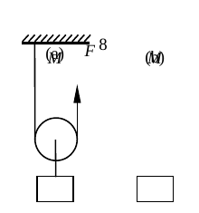
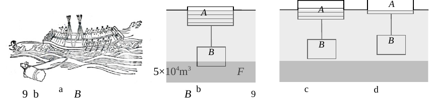
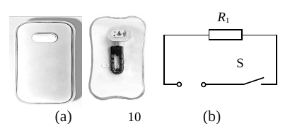
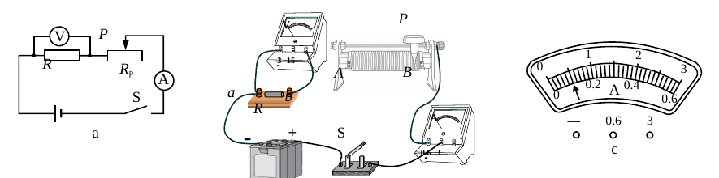
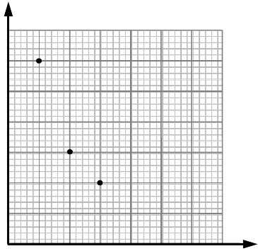

# 物模26 徐汇一模精讲（下）· 计算与实验题块（第二部分）

> 2026 届徐汇区初三一模第二部分（40 分，第 7～10 题）：动滑轮作图与机械效率、"舟载土石卸载上浮"拔铁牛（浮力本质＋排开体积变化量）、电热水袋热敏控温电路、"探究电流与电阻"实验（含滑动变阻器可控电压范围计算）。卷面插图已自原卷页图裁切补齐（`figs/物模26-徐汇/`）。计算题按 [[04-物理/专题/大题规范书写-设列算验答]] 五步书写。情境题块见 [[04-物理/专题/真题精讲/物模26-徐汇-上]]。

## 📝 题目与解析

**7.**（滑轮提物）
如图 8(a)，用竖直向上的拉力 F，通过滑轮匀速提起重为 20N 的物体 M。

（1）（作图）在图 8(b) 中画出物体 M 受到的拉力 $F_拉$ 的示意图。
（2）图 8(a) 中的滑轮可看作＿＿＿＿＿＿＿＿杠杆；若不计摩擦和滑轮重力，力 F 的大小为＿＿＿＿＿＿＿＿N；物体 M 所受合力的大小为＿＿＿＿＿＿＿＿N。
（3）若不计摩擦，物体 M 被竖直提升 1m 过程中，拉力 F 做的总功为 25J，求该过程中滑轮提升物体 M 所做的有用功 $W_有$ 和滑轮的机械效率。

> [!tip]- 💡 思路导航
> 匀速提升→平衡状态；动滑轮实质是动力臂为阻力臂 2 倍的杠杆。作图把拉力画在 M 上、竖直向上。第（3）问 $W_有=Gh$、$\eta=W_有/W_总$。

> [!success]- ✅ 详解 · 评分点 · 易错 · 关联
> **详解**：（1）【作图】$F_拉$ 的作用点画在物体 M 上（重心或系绳处），方向竖直向上，标 $F_拉=20N$（与重力等大反向）。（2）动滑轮实质是动力臂为阻力臂 2 倍的**省力**杠杆；不计摩擦和滑轮重，$F=G/2=20/2=$ **10N**；匀速直线运动，合力为 **0N**。（3）**设**有用功 $W_有$、机械效率 $\eta$。**列** $W_有=Gh$；$\eta=\dfrac{W_有}{W_总}×100\%$。**算** $W_有=20N×1m=20J$；$\eta=20J/25J×100\%=80\%$。**验**：额外功 $25-20=5J$，不计摩擦时额外功来自动滑轮，$G_动=5J/1m=5N$，则 $F=(20+5)/2=12.5N$、$s=2m$，$W_总=12.5×2=25J$ 自洽 ✓。**答**：$W_有$ 为 20J，机械效率为 80%。
>
> **易错**：误用 $F=G=20N$ 算总功——题给总功 25J 是"拉力做的功"，含提升动滑轮的额外功，80% 来自两个功之比。
>
> **关联**：[[04-物理/知识点/03-机械与功]]（动滑轮、机械效率）、[[04-物理/专题/大题规范书写-设列算验答]]

**8.**（古法拔铁牛）
如图 9(a)，重达数万斤的铁牛大部分身体在淤泥中，古人以"舟载土石、卸载上浮"的方法拔出铁牛：先在船舱装满泥沙，将铁牛和船用绳索系牢，后减少船中泥沙，铁牛缓慢从淤泥中拔出。忽略船和铁牛的形状，将其简化为物体 A（船）和物体 B（铁牛）。

（1）若河水密度为 $1×10^3kg/m^3$，船排开水的体积为 $5×10^4m^3$（原卷数值如此，量级疑点见下方易错），求船受到的浮力 $F_浮$。
（2）如图 9(b)，物体 B 部分露出淤泥，请从浮力的本质分析物体 B 是否受到液体的浮力。
（3）如图 9(c)(d)，铁牛拔出后继续减少船中泥沙，船带着铁牛一起缓慢上浮，最终停在图 9(d) 位置。此过程中船舱里泥沙减少的质量为 $\Delta m$，水的密度为 $\rho_水$，求船排开液体的体积变化量 $\Delta V_A$。

> [!tip]- 💡 思路导航
> 第一问套阿基米德原理；第二问考浮力产生的原因（上下表面压力差）；第三问抓"整体始终漂浮"，卸载前后各列一次漂浮方程再作差。

> [!success]- ✅ 详解 · 评分点 · 易错 · 关联
> **详解**：（1）**列**阿基米德原理 $F_浮=\rho_液 gV_排$。**算** $F_浮=1×10^3×9.8×5×10^4=4.9×10^8N$（按原卷数据）。**答**：$F_浮$ 为 $4.9×10^8N$。（2）浮力来源于液体对物体**上下表面的压力差**。物体 B 下表面不与液体接触、不受液体向上的压力，液体仅对其上表面施加向下的压力，上下压力差不存在，故液体对 B **不产生浮力**（B 只受重力、淤泥支持力与绳的拉力等）。（3）**设**排开液体体积变化量为 $\Delta V_A$。**列**船和铁牛整体始终处于漂浮状态：卸载前 $\rho_水 gV_{A1}=G_A+G_B+m_沙 g$；卸载后 $\rho_水 gV_{A2}=G_A+G_B+(m_沙-\Delta m)g$。**算** 两式相减：$\rho_水 g\Delta V_A=\Delta m\, g$，故 $\Delta V_A=\dfrac{\Delta m}{\rho_水}$。**验**：卸去泥沙越多上浮越多（排开体积减小越多），方向合理 ✓。**答**：$\Delta V_A=\Delta m/\rho_水$。
>
> **易错**：（1）数据量级疑点——按原卷"$5×10^4m^3$"代入得 $4.9×10^8N$，但"数万斤"铁牛对应排水体积应为个位数量级（如 $5m^3$→$4.9×10^4N$），原卷/解析疑丢失指数；考试按卷面数据代入、公式与单位规范书写即可。（2）紧扣"压力差"——只答"不受浮力"不说"下表面无液体向上的压力"不得全分；勿用"漂浮条件"分析（B 未漂浮）。
>
> **关联**：[[04-物理/知识点/05-密度压强与浮力]]（阿基米德原理、浮力本质、漂浮条件）、[[04-物理/专题/真题精讲/物-15-2026真题-研究浮力]]

**9.**（电热水袋）
图 10(a) 是某电热水袋及其内部结构，其工作电路可简化如图 10(b)：袋内充水 1kg，接入家庭电路，电压 U=220V，加热电阻 $R_1=110Ω$。

（1）求通过加热电阻的电流 $I_1$ 以及工作 10s 产生的热量 $Q_1$。
（2）袋内水温升高 50℃，求水吸收的热量 $Q_吸$。[$c_水=4.2×10^3$ J/(kg·℃)]
（3）将一个热敏电阻 $R_2$ 接入工作电路实现控温，其阻值随温度变化见表 2。

| 温度/℃ | 25 | 50 | 60 | 65 | 70 | 80 |
|----|----|----|----|----|----|----|
| 电阻 $R_2$/Ω | 20 | 40 | 80 | 400 | 5000 | 10kΩ 以上 |

① 写出 $R_2$ 与加热电阻 $R_1$ 之间的电路连接方式及理由；
② 若设定 $R_1$ 的最小工作电流值为 0.40A，通过计算说明该热水袋的控温范围。

> [!tip]- 💡 思路导航
> 纯电阻电路 $I=U/R$、$Q=I^2Rt$。控温的本质是"温度→$R_2$→电流→发热功率"的自动链条——先想"若并联行不行"，再令 $I=0.40A$ 反算 $R_2$ 对照表 2 定温度区间。

> [!success]- ✅ 详解 · 评分点 · 易错 · 关联
> **详解**：（1）**列**欧姆定律与焦耳定律。**算** $I_1=U/R_1=220/110=2A$；$Q_1=I_1^2R_1t=2^2×110×10=4400J$。**验**：$P=U^2/R_1=440W$，10s 耗电 4400J ✓。**答**：$I_1$ 为 2A，$Q_1$ 为 4400J。（2）**列** $Q_吸=c_水m\Delta t$。**算** $Q_吸=4.2×10^3×1×50=2.1×10^5J$。**答**：$Q_吸$ 为 $2.1×10^5$ J。（3）① **串联**。理由：若 $R_2$ 与 $R_1$ 并联，由并联各支路互不影响，温度升高使 $R_2$ 变大也不会改变通过 $R_1$ 的电流，$Q_1=I_1^2R_1t$ 不变，无法控温；串联时温度升高→$R_2$ 变大→总电阻变大→电流变小→$R_1$ 发热功率变小，实现自动控温。② **设**电流恰为 0.40A 时 $R_2$ 的阻值为 $R_2'$。**列**串联电路 $U_1=IR_1$、$R_2'=(U-U_1)/I$。**算** $U_1=0.40×110=44V$，$R_2'=(220-44)/0.40=440Ω$。对照表 2：65℃ 时 400Ω、70℃ 时 5000Ω，440Ω 介于两者之间。水温低于此区间时 $R_2＜440Ω$、电流大于 0.40A，继续加热；高于此区间时 $R_2＞440Ω$、电流小于 0.40A，基本停止加热。**答**：控温范围约为 **65℃～70℃**。
>
> **评分点**：① 说理题要求"判断→依据→回扣情境"，只写"串联"不写理由得一半分；② 结论要落成温度区间，只报 440Ω 不给满分。
>
> **关联**：[[04-物理/知识点/07-电功率与家庭电路]]（焦耳定律、纯电阻电路）、[[04-物理/专题/真题精讲/物-13-2026真题-电熨斗]]（电热控温）

**10.**（探究电流与电阻）
某小组做"探究电流与电阻的关系"实验。器材：电源（电压 6V 且保持不变）、电流表、电压表、开关、定值电阻 R（5Ω、10Ω、15Ω、30Ω）、两种规格的滑动变阻器（分别标有"10Ω 2A""50Ω 1A"字样）以及导线若干。电路如图 11(a) 所示。

（1）在图 11(b) 中有一根导线尚未连接，用笔画线代替导线，将实物图连接完整，使滑动变阻器接入电路的阻值最大。
（2）选用"50Ω 1A"的变阻器进行实验，先后在 a、b 间接入定值电阻 5Ω、10Ω、15Ω。闭合开关后，移动变阻器的滑片，保持电阻 R 两端电压不变，实验数据见表 3。当他将 15Ω 的电阻替换为 30Ω 的电阻后，变阻器接入电路的电阻相应需要＿＿＿＿＿＿＿＿（A．变大　B．变小），使得电阻 R 两端电压不变，此时电流表的示数如图 11(c) 所示，电流表的示数为＿＿＿＿＿＿＿＿A。

| 表3 | 电阻/Ω | 电流表示数/A |
|----|----|----|
| 序号1 | 5 | 0.60 |
| 序号2 | 10 | 0.30 |
| 序号3 | 15 | 0.20 |
| 序号4 | 30 | |

① 请在坐标纸中把未标出的点用"×"描出来，并画出 I-R 图像；

② 计算表 3 中电流与电阻的乘积，可以发现：当导体两端的电压一定时，通过导体的电流与导体的电阻成＿＿＿＿＿＿＿＿比（A．正　B．反）。
（3）实验中，小明改用"10Ω 2A"的变阻器进行实验，先后在 a、b 间接入定值电阻 5Ω、10Ω、15Ω、30Ω。在移动变阻器滑片的过程中，发现无法保持电阻 R 两端电压为 4V，请通过计算说明他应保持电阻 R 两端的电压 U 的取值范围。

> [!tip]- 💡 思路导航
> 先算表 3 每行 $IR$ 的乘积——是个定值，据此锁定控制电压。换大电阻后电流变小、变阻器必须分掉更多电压。变阻器的两个极限决定 $U_R$ 范围：全连入与滑到零各对应一端，再逐一校四组电阻取最不利者。

> [!success]- ✅ 详解 · 评分点 · 易错 · 关联
> **详解**：（1）【作图】电压表（0～3V）并联在 R 两端，电流表（0～0.6A）串联；补连的导线把开关与滑动变阻器下方**远离滑片初始位置**的接线柱相连（"一上一下"），使闭合开关前变阻器接入阻值最大。（2）表 3 中 $IR=5×0.60=10×0.30=15×0.20=3V$，即控制 $U_R=3V$。换成 30Ω 后 $I=3/30=0.1A$，总电阻需 $6/0.1=60Ω$，变阻器接入 $60-30=30Ω$，比原来 15Ω 大，选 **A 变大**；图 11(c) 0～0.6A 量程读数为 **0.10A**。① 描出点 $(30Ω,0.10A)$，用平滑曲线连接各点（双曲线一支，见图）。② 乘积 $IR=3V$ 恒定，电流与电阻成**反**比，选 **B**。（3）**设**能保持的电压为 U、变阻器最大阻值 $R_{p,max}=10Ω$。**列**串联分压 $U_R=\dfrac{R}{R+R_p}×6V$。**算** $U_R$ 的下限出现在 R 最大且 $R_p$ 最大时：R=30Ω 时 $U_{R,min}=6×30/(30+10)=4.5V$（R=5、10、15Ω 时下限分别为 2V、3V、3.6V，均低于 4.5V）；上限出现在 $R_p=0$ 时：$U_{R,max}=6.0V$，此时若 R=5Ω，$I=6/5=1.2A＜2A$，未超变阻器允许电流 ✓。故四组电阻都能取到的电压范围为 $4.5V≤U≤6.0V$，4V 不在其中，所以"无法保持 4V"。**验**：U=4.5V 时 R=30Ω 恰需 $R_p=10Ω$ 全连入，可行 ✓。**答**：应保持 R 两端电压 $4.5V≤U≤6.0V$。
>
> **评分点**：（3）下限的来源要写清——必须指明"R 最大、变阻器全连入时 $U_R$ 最小"，并用四组电阻逐一（或取最不利者）比较；漏掉 R=5Ω 时的电流校验（1.2A＜2A）会被扣过程分。
>
> **关联**：[[04-物理/知识点/06-电学基础]]（欧姆定律、滑动变阻器）、[[04-物理/专题/实验操作考点-物理]]（探究电流与电阻）、[[04-物理/专题/真题精讲/物-14-2026真题-测量电阻]]

## 🔗 关联

- [[04-物理/专题/真题精讲/物模26-徐汇-上]]（同卷情境题块）
- [[04-物理/专题/大题规范书写-设列算验答]]（计算题五步书写）
