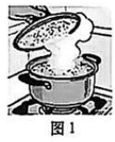
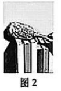
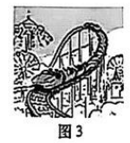
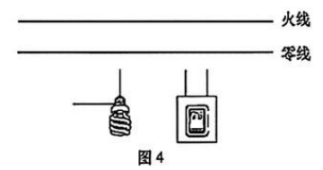
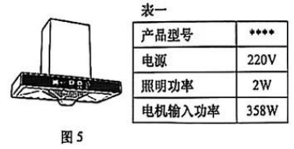
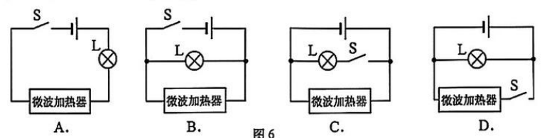
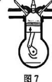
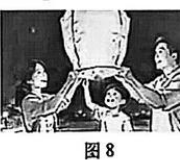
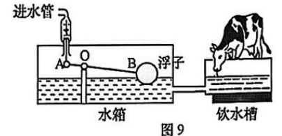
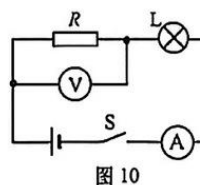

# 物模26 普陀一模精讲（上）· 学科基础

> 2026 届普陀区初三一模（2025 学年度第一学期期末九年级自适应练习 2026.1·综合试卷，物理部分：学科基础 39 分＋学科综合 30 分）第一题块（第 1～11 题）。**本讲已与官方参考答案（PDF 第 6～7 页）逐项核对**：题 1～10 全部一致；题 11 官方文字层印制混乱且其电压表对应关系与卷面图不符，以物理原理为准并已在详解中标注。卷面插图已自原卷页图裁切补齐（`figs/物模26-普陀/`）。学科综合（第 12～15 题）见 [[04-物理/专题/真题精讲/物模26-普陀-下]]。

## 📝 题目与解析

**1.**（烧水锅）
如图 1，在炉火上加热食物，开盖的一瞬间，可以观察到锅盖内部出现大量的水珠，这是由于锅内水蒸气＿＿＿＿＿＿＿＿形成的；食物的香气四溢，表明分子做＿＿＿＿＿＿＿＿运动。锅身和锅柄分别用金属和塑胶制成，这主要是利用了金属和塑胶不同的＿＿＿＿＿＿＿＿性。

> [!tip]- 💡 思路导航
> 锅盖水珠是水蒸气遇冷**液化**（放热）；香气四溢是扩散现象；锅身锅柄的选材看导热性差异。

> [!success]- ✅ 详解 · 评分点 · 易错 · 关联
> **详解**：水蒸气遇冷锅盖**液化**成小水珠（放热）；香气四溢是扩散现象，表明分子做**无规则**运动；金属导热快做锅身、塑胶隔热的锅柄防烫，利用二者**导热**性不同。
>
> **关联**：[[04-物理/知识点/04-热学]]（液化放热、分子热运动）

**2.**（静电除尘掸）
如图 2，用"静电除尘掸"扫除书本上的灰尘。（1）使除尘掸带电的方式是＿＿＿＿＿＿＿＿（A．接触起电　B．摩擦起电　C．感应起电）；（2）带电的除尘掸能吸附灰尘，是利用了带电体＿＿＿＿＿＿＿＿的性质。

> [!tip]- 💡 思路导航
> 掸子蹭书带电＝摩擦起电；带电体的基本性质是吸引轻小物体。

> [!success]- ✅ 详解 · 评分点 · 易错 · 关联
> **详解**：（1）掸子与书尘摩擦带电，选 **B 摩擦起电**。（2）带电体**吸引轻小物体**。
>
> **关联**：[[04-物理/知识点/06-电学基础]]（摩擦起电）

**3.**（过山车）
如图 3，游乐园里"过山车"沿轨道运行。（1）下行过程，车轮温度升高，这是通过＿＿＿＿＿＿＿＿方式使其内能增加的（原卷印"内热"，按物理术语取"内能"）；（2）当"过山车"从轨道顶端向下运行时，动能＿＿＿＿＿＿＿＿，重力势能＿＿＿＿＿＿＿＿，机械能＿＿＿＿＿＿＿＿（均选择"A．增大""B．不变"或"C．减小"）。

> [!tip]- 💡 思路导航
> 摩擦生热＝做功改变内能；动能看速度、势能看高度；"车轮温度升高"提示存在摩擦，机械能不守恒。

> [!success]- ✅ 详解 · 评分点 · 易错 · 关联
> **详解**：（1）车轮与轨道摩擦生热，通过**做功**方式增大内能（机械能转化为内能）。（2）下行时速度增大、动能**增大（A）**；高度减小、重力势能**减小（C）**；车轮发热说明克服摩擦做功，机械能**减小（C）**。
>
> **易错**：机械能要结合"车轮温度升高"判**减小**——无视摩擦条件按"守恒"填"不变"即错；（1）已为（2）埋了存在摩擦的伏笔。
>
> **关联**：[[04-物理/知识点/03-机械与功]]（动能势能转化）、[[04-物理/知识点/04-热学]]（做功改变内能）

**4.**（节能灯接入家庭电路）
某节能灯标有"220V 11W"字样。（1）其中"11W"表示＿＿＿＿＿＿＿＿，当它正常工作时，通过的电流为＿＿＿＿＿＿＿＿A；（2）在图 4 中，请用笔画线代替导线，将该节能灯与开关连接后接入家庭电路中。（用 2B 铅笔在答题纸的相应位置连线）

> [!tip]- 💡 思路导航
> "11W"是额定功率，$I=P/U$ 直接算；安全红线——开关必须**串在火线上**再接灯。

> [!success]- ✅ 详解 · 评分点 · 易错 · 关联
> **详解**：（1）"11W"表示**该节能灯的额定功率为 11W**。**设** U=220V、P=11W。**列** I=P/U。**算** I=11/220=**0.05A**。**验** 0.05×220=11W ✓。（2）开关**串联在火线与节能灯之间**、节能灯另一端接零线【官方答案图同此】——断开开关后灯不再带电，检修安全。
>
> **易错**：开关接在零线上时断开后灯具仍带电，不符合安全用电规范。
>
> **关联**：[[04-物理/知识点/06-电学基础]]（家庭电路）、[[04-物理/知识点/07-电功率与家庭电路]]（额定功率）

**5.**（脱排油烟机）
如图 5，是某型号脱排油烟机，其部分工作参数见表一。（1）脱排油烟机是利用大气压强工作的，最早测出大气压值的科学家是＿＿＿＿＿＿＿＿；（2）使用时，它与其它家用电器之间是＿＿＿＿＿＿＿＿连接（选择"A．串联"或"B．并联"）；（3）若脱排油烟机上的照明灯和电机同时工作 0.5h，消耗电能＿＿＿＿＿＿＿＿kW·h；家庭中可以用＿＿＿＿＿＿＿＿表来计量用电量。

| 表一 | |
|----|----|
| 产品型号 | **** |
| 电源 | 220V |
| 照明功率 | 2W |
| 电机输入功率 | 358W |

> [!tip]- 💡 思路导航
> 首先测出大气压值的是托里拆利；家庭电路用电器全是并联；两功率相加再乘时间即耗电。

> [!success]- ✅ 详解 · 评分点 · 易错 · 关联
> **详解**：（1）**托里拆利**。（2）**B 并联**（各用电器互不影响）。（3）**设** P总=2W+358W=360W=0.36kW、t=0.5h。**列** W=P总t。**算** W=0.36×0.5=**0.18kW·h**。计量用电量用**电能**表。**验** 与官方 0.18 一致，且表一数据自洽 ✓。
>
> **关联**：[[04-物理/知识点/05-密度压强与浮力]]（大气压）、[[04-物理/知识点/07-电功率与家庭电路]]（电功、电能表）

**6.**（并联电路电阻特点）
（1）"总电阻"概念的建立，采用的是＿＿＿＿＿＿＿＿的研究方法（A．控制变量　B．转换　C．类比　D．等效替代）；（2）若将电阻值分别为 1000Ω 和 10Ω 的电阻并联，其总电阻的值＿＿＿＿＿＿＿＿（A．可能等于 10Ω　B．可能在 10~1000Ω 之间　C．一定小于 10Ω　D．一定大于 1000Ω）。

> [!tip]- 💡 思路导航
> "一个电阻替代两个的效果相同"＝等效替代；并联相当于增大横截面积，总电阻比任何一条支路都小。

> [!success]- ✅ 详解 · 评分点 · 易错 · 关联
> **详解**：（1）同一电路效果相当、用总电阻替代→**D 等效替代**。（2）并联总电阻小于任一支路电阻，必小于较小的 10Ω，选 **C**。
>
> **关联**：[[04-物理/知识点/06-电学基础]]（等效电阻）

**7.**（微波炉电路）
某微波炉如工作正常，闭合开关 S，指示灯 L 发光，微波加热器工作；断开开关 S，指示灯 L 熄灭，微波加热器停止工作。小明用该微波炉加热食物时，发现指示灯 L 发光，但微波加热器未工作。图 6 中的四个选项是小明等四位同学画的该微波炉的简化电路图，其中可能正确的选项是＿＿＿＿＿＿＿＿。

> [!tip]- 💡 思路导航
> "断开 S 两者都停"→S 必在**干路**；故障现象"灯亮而加热器不工作"→加热器支路断路、两用电器并联。

> [!success]- ✅ 详解 · 评分点 · 易错 · 关联
> **详解**："断开 S 两者都停"→S 必在**干路**：C（S 在灯支路，断开后加热器仍工作）、D（S 在加热器支路，断开后灯仍亮）排除。A 中 L 与加热器**串联**：正常工作时两者分压、均达不到 220V 不能正常工作，且串联一处断路全停，不可能"灯亮而加热器不工作"，排除。**B**：L 与微波加热器**并联**、S 在干路——正常时 S 同时控制两者；故障时加热器支路断路，灯仍亮、加热器不工作 ✓。选 **B**。
>
> **易错**：判断顺序是"先用开关位置锁干路，再用故障现象辨串并联"；A 的串联在正常态就分压不达标，不必等到故障才发现。
>
> **关联**：[[04-物理/知识点/06-电学基础]]（串并联辨识）

**8.**（汽车与汽油机）
汽车在日常生活中已被广泛使用。（1）图 7 是四冲程汽油机工作时的一个冲程，下列说法中正确的是＿＿＿＿＿＿＿＿。
- （A）这是做功冲程，此过程中机械能转化成内能
- （B）这是压缩冲程，此过程中机械能转化成内能
- （C）这是做功冲程，此过程中内能转化成机械能
- （D）这是压缩冲程，此过程中内能转化成机械能

（2）一种汽油密度是 0.74×10³kg/m³，它表示的物理意义是＿＿＿＿＿＿＿＿。一辆汽车装有的体积为 6×10⁻³m³ 的这种汽油，汽油的质量是＿＿＿＿＿＿＿＿kg。行驶途中用去总油量的 1/2，则剩余汽油的密度是原来的＿＿＿＿＿＿＿＿倍。

> [!tip]- 💡 思路导航
> 两气门全关＋活塞上行＝压缩冲程（机械能→内能）；密度的定义句式"1m³ 某物质的质量是…"；密度是物质的**属性**，与质量体积无关。

> [!success]- ✅ 详解 · 评分点 · 易错 · 关联
> **详解**：（1）图 7 进、排气门均关闭、活塞上行→**压缩冲程**，机械能转化为内能，选 **B**。（2）物理意义：**1m³ 该汽油的质量为 0.74×10³kg**。**设** ρ=0.74×10³kg/m³、V=6×10⁻³m³。**列** m=ρV。**算** m=0.74×10³×6×10⁻³=**4.44kg**。密度是物质的属性，与质量、体积无关→剩余密度是原来的 **1** 倍。**验** 约 4.4kg 合 6L 油量，合理 ✓。
>
> **易错**：物理意义标准句式"1m³ 某物质的质量是…"，漏单位限定词不得分；"剩余密度是原来的几倍"考属性不变，答 0.5 即掉坑。
>
> **关联**：[[04-物理/知识点/04-热学]]（热机四冲程）、[[04-物理/知识点/05-密度压强与浮力]]（密度属性）

**9.**（孔明灯）
如图 8，小明和家人放飞一盏孔明灯。已知外界空气密度为 1.3kg/m³。（1）若点燃后灯的体积为 0.5m³，则灯受到的浮力大小是＿＿＿＿＿＿＿＿N；（2）放手后灯加速上升，此时灯受到的浮力大小＿＿＿＿＿＿＿＿其受到的重力大小；灯内气体密度＿＿＿＿＿＿＿＿1.3kg/m³。（均选择"A．大于""B．等于"或"C．小于"）

> [!tip]- 💡 思路导航
> $F_浮=ρ_空气 gV_排$ 直接算；加速上升→合力向上→浮力＞重力；灯内空气受热膨胀逸出、密度变小。

> [!success]- ✅ 详解 · 评分点 · 易错 · 关联
> **详解**：（1）**设** ρ空气=1.3kg/m³、V排=0.5m³。**列** F浮=ρ空气gV排。**算** F浮=1.3×9.8×0.5=**6.37N**。（2）加速上升→合力向上→浮力**大于（A）**重力；灯内空气受热膨胀逸出，密度**小于（C）**外界空气密度。
>
> **关联**：[[04-物理/知识点/05-密度压强与浮力]]（阿基米德原理、浮沉条件）

**10.**（乳牛自动喂水器）
如图 9，是乳牛自动喂水器的装置原理图。水箱中，带浮子的硬杆 AB 相当于一根杠杆，可以绕 O 点转动，用于控制进水管的"开"和"关"。（1）牛喝水后，若饮水槽中水位下降 1cm，则饮水槽底受到水的压强减小＿＿＿＿＿＿＿＿Pa；自动喂水装置的设计主要利用了杠杆原理和＿＿＿＿＿＿＿＿原理，实现水的自动补给；（2）当停止进水时，浮子所受的浮力大小为 3 牛，若不计浮子所受重力，$l_{OB}=4l_{OA}$，则进水管中水对 A 点的压力是＿＿＿＿＿＿＿＿N；（3）在图中画出浮子所受的浮力 $F_浮$。

> [!tip]- 💡 思路导航
> 水位变化用 $\Delta p=ρg\Delta h$；水箱与饮水槽上端开口、底部连通＝连通器；杠杆平衡 $F_A·l_{OA}=F_浮·l_{OB}$；作图抓浮力的方向与作用点两要素。

> [!success]- ✅ 详解 · 评分点 · 易错 · 关联
> **详解**：（1）**设** Δh=1cm=0.01m。**列** Δp=ρ水gΔh。**算** Δp=1.0×10³×9.8×0.01=**98Pa**。水箱与饮水槽上端开口、底部连通→**连通器**原理，静止时液面相平，配合杠杆自动补水。（2）停止进水时杠杆平衡：**列** $F_A·l_{OA}=F_浮·l_{OB}$。**算** $F_A=3×4=$**12N**。**验** $l_{OB}=4l_{OA}$，B 端 3N 恰平衡 A 端 12N ✓。（3）浮力**竖直向上**、作用点画在**浮子球心**，标 $F_浮$【官方答案图：竖直向上、作用点在浮子中心】。
>
> **评分点**：杠杆平衡的力与力臂必须一一对应——浮力配 $l_{OB}$、水压力配 $l_{OA}$。
>
> **易错**：两力臂写反得 0.75N。
>
> **关联**：[[04-物理/知识点/03-机械与功]]（杠杆平衡条件）、[[04-物理/知识点/05-密度压强与浮力]]（液体压强、连通器、浮力）、[[04-物理/专题/压强浮力-上海特色题型]]

**11.**（电路故障）
小明按照图 10 所示的电路连接实物后，闭合开关 S，发现灯 L 不发光。若电源电压为 $U_0$，电路中仅有一处故障，且只发生在灯 L、电阻 R 上。（1）根据上述条件，可以直接排除的故障是＿＿＿＿＿＿＿＿；（2）可否根据电压表、电流表的示数情况确定具体故障情况，请写出理由＿＿＿＿＿＿＿＿。

> [!tip]- 💡 思路导航
> 故障四情形（L 短/断、R 短/断）逐一对照"灯 L 不发光"，先排除 R 短路；再算三种剩余故障下电压表（并在 R 两端）与电流表的示数组合。

> [!success]- ✅ 详解 · 评分点 · 易错 · 关联
> **详解**：逐一检验（仅一处故障，在 L 或 R 上）：R 短路→电路只剩 L，灯应发光，与"灯 L 不发光"矛盾→（1）可直接排除**电阻 R 短路**【官方答案文字层此处印制混乱（"灯L短路且电阻R短路…"），按卷面条件与图 10 推得上述结论】。剩余三种的两表示数：**L 短路**→只余 R，A 有示数（$I=U_0/R$）、V 读 R 两端电压 $U_0$，两表**均有**示数；**R 断路**→I=0，A 无示数，V 经 L 跨接断口近似测电源电压，**有**示数（≈$U_0$）；**L 断路**→I=0，A 无示数，V 无电流通过、无示数。（2）**可以**：三种故障的"（V，A）"组合分别为（有，有）（有，无）（无，无），互不相同，故由两表示数即可唯一确定具体故障【官方答案所写对应关系基于电压表并在 L 两端的情形，与图 10"V 并在 R 两端"不符，以图与物理原理为准】。
>
> **评分点**：（2）理由必须落到"三种故障对应的两表示数组合互不相同"，只答"可以"不列组合不给满分。
>
> **关联**：[[04-物理/知识点/06-电学基础]]（电路故障分析）

## 🔗 关联

- [[04-物理/专题/真题精讲/物模26-普陀-下]]（同卷学科综合）
- 同类题：[[04-物理/专题/真题精讲/物模26-松江-上]]（学科基础同构）、[[04-物理/专题/真题精讲/物模26-杨浦-上]]
