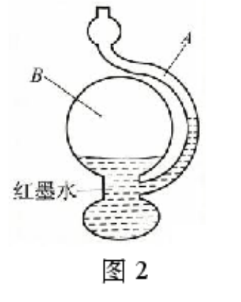
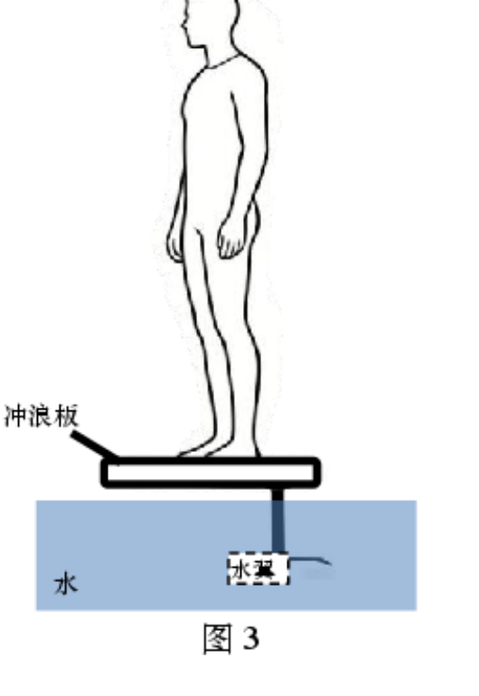
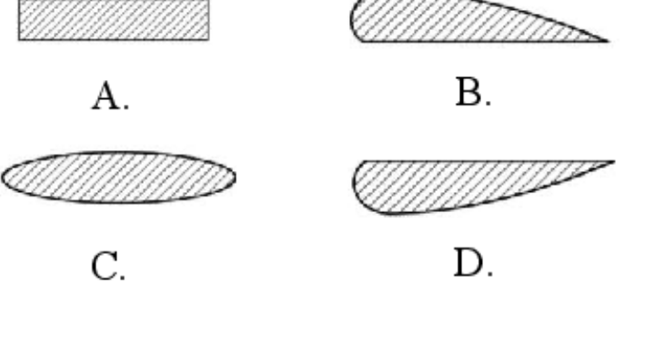
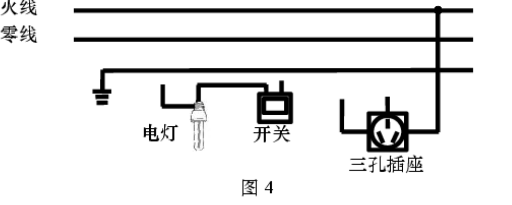
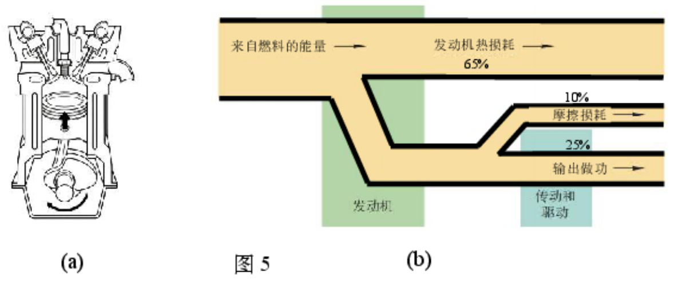
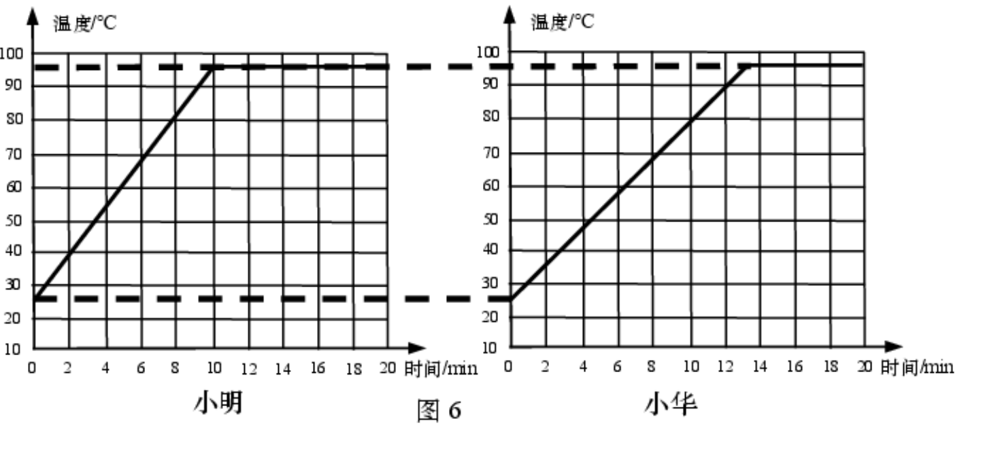
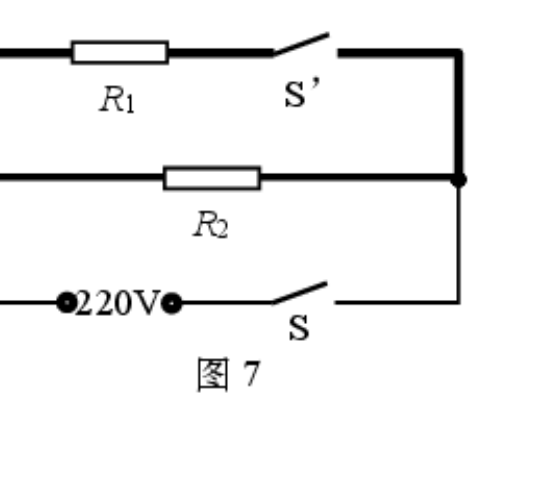
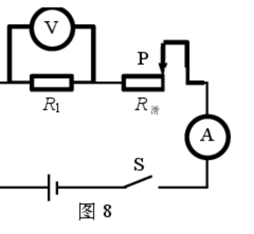
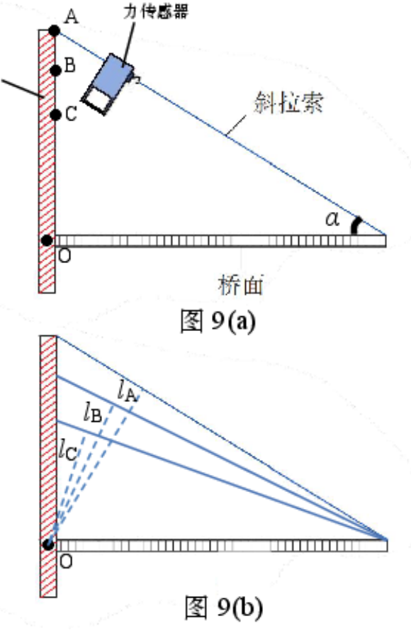
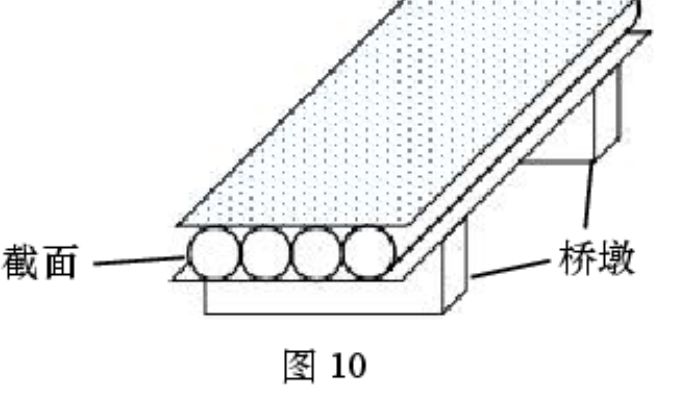

# 物模26 杨浦一模精讲（上）· 学科基础

> 2026 届杨浦区初三一模（2025 学年度第一学期初三期末质量调研综合测试卷，2026.1，物理部分 70 分）第一题块"学科基础"（39 分，第 1～12 题）。**原卷无答案文本，本讲答案全部为自主推演**（推演后与扫描件所附评分答案图逐项核对一致）。卷面插图已自原卷页图裁切补齐（`figs/物模26-杨浦/`）。下册题块（第 13～17 题）见 [[04-物理/专题/真题精讲/物模26-杨浦-下]]。

## 📝 题目与解析

**1.**（神舟紧急救援）
神舟二十号返回舱遭太空碎片撞击、舷窗出现裂纹，神舟二十二号携带处置装置紧急升空。（1）太空碎片因速度很大，具有很大的＿＿＿＿＿＿＿＿能；（2）为处理裂纹，携带处置装置的神舟二十二号发射升空，在升空的过程中：
a. 该装置的惯性（　）
- （A）增大
- （B）减小
- （C）不变

b. 该装置的重力势能（　）
- （A）增大
- （B）减小
- （C）不变

> [!tip]- 💡 思路导航
> 动能看速度、惯性只看质量、重力势能看高度，三个概念各管各。

> [!success]- ✅ 详解 · 评分点 · 易错 · 关联
> **详解**：（1）速度大→**动**能大。（2）a 惯性只与质量有关，**C 不变**；b 高度增大，重力势能 **A 增大**。
>
> **易错**：惯性是属性，与速度、高度无关，勿选"增大"。
>
> **关联**：[[04-物理/知识点/02-运动与力]]（惯性、机械能）

**2.**（滑梯上的静电与内能）
如图 1，小朋友从滑梯上滑下，头发一根根竖了起来。

（1）竖起的头发丝所带的电荷一定是（　）
- （A）正电荷
- （B）负电荷
- （C）同种电荷
- （D）异种电荷

（2）小朋友滑下后，臀部有灼热感，这是通过＿＿＿＿＿＿＿＿的方式增加了臀部的内能（A．热传递　B．做功）。

> [!tip]- 💡 思路导航
> 头发"炸开"＝同种电荷相互排斥；滑动摩擦生热属做功改变内能。

> [!success]- ✅ 详解 · 评分点 · 易错 · 关联
> **详解**：（1）头发丝彼此排斥→带**C 同种电荷**（电性无法确定正负，A、B 错）。（2）滑动摩擦生热属**B 做功**改变内能。
>
> **易错**：只知"排斥→同种"，推不出正负，错选 A 或 B。
>
> **关联**：[[04-物理/知识点/06-电学基础]]（电荷间作用）、[[04-物理/知识点/04-热学]]（做功改变内能）

**3.**（天气预报瓶）
如图 2 所示的容器是"天气预报瓶"。A 为玻璃管，与大气连通，B 为密闭的玻璃球，A 与 B 底部相通，内装红墨水。

（1）该容器＿＿＿＿＿＿＿＿连通器（A．属于　B．不属于）；（2）由两边液面位置可知，此时 B 球内气压＿＿＿＿＿＿＿＿外界大气压（A．大于　B．小于　C．等于）；（3）相同气温下晴天气压比阴雨天高，则晴天时 A 管液面高度＿＿＿＿＿＿＿＿阴雨天时 A 管液面高度（A．高于　B．低于　C．等于）。

> [!tip]- 💡 思路导航
> 连通器必须"上端开口、底部相通"，逐条对照 B 球的情形；液面高低用 $p_B=p_大气+ρg\Delta h$ 判；外界气压升高把液面往 B 侧压。

> [!success]- ✅ 详解 · 评分点 · 易错 · 关联
> **详解**：（1）B 球密闭、不满足"上端开口"，**B 不属于**连通器。（2）A 管液面高于 B 侧液面，由 $p_B=p_大气+ρg\Delta h$，**A 大于**。（3）晴天气压更高，外界大气把液体压向 B 侧，A 管液面下降，**B 低于**。
>
> **易错**：（2）别凭"感觉"答，必须抓住"A 管液面高于 B 侧"这一图像信息列式；（3）是定性推演"外界气压升→A 液面降"。
>
> **关联**：[[04-物理/知识点/05-密度压强与浮力]]（连通器、大气压）

**4.**（青铜器）
（1）我国秦汉时期制作的青铜器，是将熔化的合金液体浇注入模具里＿＿＿＿＿＿＿＿成器的（填物态变化名称）；汉代博山炉点上香后芳香四溢，表明分子在不停地做＿＿＿＿＿＿＿＿运动；（2）青铜合金的密度比纯铜小，用两者制成形状大小完全相同的器具，质量较大的是（　）
- （A）青铜器具
- （B）纯铜器具

> [!tip]- 💡 思路导航
> 液态合金冷却成型是凝固；香味扩散是无规则运动；形状大小相同→体积相同，密度大者质量大。

> [!success]- ✅ 详解 · 评分点 · 易错 · 关联
> **详解**：（1）液态合金冷却成型是**凝固**；香味扩散表明分子**无规则**运动。（2）形状大小相同→体积相同，$\rho_铜>\rho_青铜$，由 $m=\rho V$，**B 纯铜器具**质量大。
>
> **关联**：[[04-物理/知识点/04-热学]]（物态变化、分子热运动）、[[04-物理/知识点/05-密度压强与浮力]]（密度比较）

**5.**（无动力水翼板）
无动力水翼板是一种水上运动器材，由一块冲浪板和水翼（未画出）组成，如图 3 所示，一位重为 750N 的运动员站在水平的冲浪板上向前匀速滑行。

（1）在图中画出冲浪板对运动员的支持力 F 的示意图；
（2）为了在滑行的过程中使水对水翼产生一个较大的向上的力，图中虚框内水翼形状应设计成（　）

> [!tip]- 💡 思路导航
> 匀速→二力平衡，支持力与重力等大反向；水翼要"机翼朝上"——上方流速大、压强小，获得向上压强差。

> [!success]- ✅ 详解 · 评分点 · 易错 · 关联
> **详解**：（1）【作图】匀速滑行→支持力与重力平衡：F=G=**750N**，方向**竖直向上**，作用点画在人板接触处，标字母 F。（2）水翼需像机翼：上方流速大、压强小，获得向上压强差，**B**（上凸下平）。逐项：A 平板无压差；C 上下对称、合力为零；D 方向相反（向下压），排除。
>
> **评分点**：作图须"作用点＋方向＋字母 F"三要素齐全。
>
> **易错**：（2）分清"凸"的方向——要向上的力选"上凸下平"（B）；选 D 会把翼压向水下，是最典型错项。
>
> **关联**：[[04-物理/知识点/02-运动与力]]（二力平衡）、[[04-物理/知识点/05-密度压强与浮力]]（流体压强与流速）

**6.**（安全用电与节约用电）
（1）人体安全电压不高于（　）
- （A）1.5V
- （B）2V
- （C）36V
- （D）220V

（2）11W 的节能灯与 60W 的白炽灯发光效果相当，若两灯均工作 200s，节能灯比白炽灯消耗的电能要少＿＿＿＿＿＿＿＿J；
（3）根据安全用电规范，试着用笔画线代替导线，将图 4 中的电灯、开关和三孔插座正确接入电路中。

> [!tip]- 💡 思路导航
> 安全电压 36V；少消耗的电能 $\Delta W=\Delta P·t$；动笔前先回忆：开关接在哪条线上才安全？三孔插座三个孔各接什么？

> [!success]- ✅ 详解 · 评分点 · 易错 · 关联
> **详解**：（1）**C 36V**。（2）**列** $\Delta W=\Delta Pt$。**算** $\Delta W=(60-11)×200=$ **9800 J**。（3）【作图】火线→开关→接灯顶端金属点，灯螺旋套接零线；三孔插座"左零、右火、上接地"。
>
> **易错**：（3）开关必须接在火线上；三孔插座上孔接地线，防外壳带电触电。
>
> **关联**：[[04-物理/知识点/06-电学基础]]（安全用电）、[[04-物理/知识点/07-电功率与家庭电路]]（电功计算、插座接法）

**7.**（"雪龙2号"破冰船）
（1）"雪龙 2 号"在极地附近航行时，船只的螺旋桨旋转将水向后推出，同时船只向前航行，这说明了力的作用是＿＿＿＿＿＿＿＿；若其排开水的质量为 $1.2×10^4$ t，则此时受到的浮力为＿＿＿＿＿＿＿＿N。
（2）船头下方有一个特殊的凸起，在破冰时能（　）
- （A）增大对冰面的压力
- （B）减小对冰面的压力
- （C）增大对冰面的压强
- （D）减小对冰面的压强

> [!tip]- 💡 思路导航
> 桨推水、水推船＝力的作用相互；$F_浮=G_排=m_排g$；凸起改变了接触面积还是压力？回到 $p=F/S$。

> [!success]- ✅ 详解 · 评分点 · 易错 · 关联
> **详解**：（1）物体间力的作用是**相互的**；$F_浮=G_排=m_排g=1.2×10^4×10^3×9.8=$ **$1.176×10^8$ N**。**验**：$1.176×10^8/9.8÷10^3=1.2×10^4$ t ✓。（2）凸起减小与冰面的接触面积，压力近似不变，**C 增大压强**。
>
> **关联**：[[04-物理/知识点/02-运动与力]]（力的相互性、压强）、[[04-物理/知识点/05-密度压强与浮力]]（阿基米德原理）

**8.**（汽油机与能流图）
（1）汽油机中常用汽油作为燃料，汽油的热值约 $4.6×10^7$ J/kg，表示完全燃烧 1kg 汽油释放热量约为＿＿＿＿＿＿＿＿J；
（2）图 5(a) 是四冲程汽油机工作过程中的＿＿＿＿＿＿＿＿冲程；
（3）图 5(b) 是某燃油轿车发动机的能量分配图，若某段时间里发动机输出做功为 $8×10^7$ J，则在这段时间里来自燃料的能量为＿＿＿＿＿＿＿＿J。

> [!tip]- 💡 思路导航
> 热值是"1kg 完全燃烧"放出的热量；两气门关闭＋活塞上行＝压缩冲程；能流图里"各损耗之外剩余的份额才是输出"。

> [!success]- ✅ 详解 · 评分点 · 易错 · 关联
> **详解**：（1）热值定义：**$4.6×10^7$ J**。（2）两气门关闭、活塞上行→**压缩**冲程。（3）输出做功占 $1-63\%-10\%-2\%=25\%$，$W_燃料=8×10^7/0.25=$ **$3.2×10^8$ J**。**验**：$3.2×10^8×25\%=8×10^7$ J ✓。
>
> **易错**：先补输出份额再除——能流图只给了损耗，漏掉 2% 传动损耗就得不到 $3.2×10^8$。
>
> **关联**：[[04-物理/知识点/04-热学]]（热值、热机、能量守恒）

**9.**（水沸腾实验）
小明和小华做"探究水在沸腾前后温度变化的特点"实验，他们所用器材完全相同，水的质量分别为 $m_1$、$m_2$（$m_1≠m_2$），测得水的温度随时间的变化图像如图 6 所示。

（1）该实验所处环境的大气压强＿＿＿＿＿＿＿＿标准大气压强（A．大于　B．小于　C．等于）；
（2）两位同学实验用水的质量 $m_1$ 与 $m_2$ 的大小关系是（　）
- （A）$m_1>m_2$
- （B）$m_1<m_2$

> [!tip]- 💡 思路导航
> 先由图像读出沸点，与 100℃ 比较定气压高低；再用"同器材→供热快慢相同"把加热时间与水的质量挂钩。

> [!success]- ✅ 详解 · 评分点 · 易错 · 关联
> **详解**：（1）沸点约 98℃＜100℃→**B 小于**。（2）器材相同→供热快慢相同，升温到沸腾用时短者吸热少、质量小：小明 10min＜小华 14min，$m_1<m_2$，选 **B**。
>
> **关联**：[[04-物理/知识点/04-热学]]（沸腾实验、沸点与气压）

**10.**（智能电饭煲）
如图 7 是某款智能电饭煲的简化电路图。电源两端电压稳定不变，$R_1$ 和 $R_2$ 为材料、长度相同且粗细不同的电热丝，S 是手动开关，S′ 是自动控制开关。该电饭煲的加热功率有两档，且较大功率是较小功率的 8 倍。

（1）电热丝加热食物，主要利用了电流的＿＿＿＿＿＿＿＿效应；$R_1$ 和 $R_2$ 电阻之比为＿＿＿＿＿＿＿＿；
（2）$R_1$ 的横截面积＿＿＿＿＿＿＿＿ $R_2$ 的横截面积（A．大于　B．小于　C．等于）。

> [!tip]- 💡 思路导航
> 电热＝电流热效应；两档功率对应"并联双丝"与"只接 $R_2$"，由 $P_大=8P_小$ 解电阻比；材料长度相同，电阻小者粗。

> [!success]- ✅ 详解 · 评分点 · 易错 · 关联
> **详解**：（1）电流的**热**效应。**设**两档功率 $P_大$（S、S′闭合，$R_1∥R_2$）、$P_小$（只闭合 S，仅 $R_2$）。**列** $P_大/P_小=8$。**算** $\dfrac{U^2/R_1+U^2/R_2}{U^2/R_2}=8⇒\dfrac{1}{R_1}=\dfrac{7}{R_2}⇒R_1:R_2=$ **1:7**。（2）材料、长度相同，电阻小者粗：$R_1<R_2$，横截面积 **A 大于**。
>
> **关联**：[[04-物理/知识点/07-电功率与家庭电路]]（多档功率）、[[04-物理/知识点/06-电学基础]]（电阻定律定性）

**11.**（探究电流与电阻·电路故障）
小红用如图 8 所示的电路进行"探究电流与电阻关系"的实验，电路中，电源两端电压为 $U_0$ 不变，$R_1$ 的阻值为 $2R_0$，电压表并联在 $R_1$ 两端，与滑动变阻器 $R_滑$、电流表串联。

（1）小红规范操作，闭合开关 S，观察到电压表示数为 $\frac{1}{2}U_0$，并记录了此时电流表的示数。一段时间后，两电表中只有一个电表的示数为零。经分析，小红发现电路某一处存在故障，且故障发生在电阻 $R_1$ 或滑动变阻器 $R_滑$ 上，请写出电压表示数及对应的故障：＿＿＿＿＿＿＿＿。
（2）小红排除故障后，将阻值为 $R_0$ 的定值电阻替换 $R_1$，规范操作，重新闭合开关 S：
a. 此时电压表示数为＿＿＿＿＿＿＿＿；
b. 接下来小红移动滑片 P，直至电压表示数为＿＿＿＿＿＿＿＿时，再次记录电流表的示数。

> [!tip]- 💡 思路导航
> 串联"一处断处处断"，但电压表内阻极大可当"通路"看——示数是否为零要结合断点位置分析；四种故障要排查穷尽；换 $R_0$ 后滑片仍在最大端，按分压算示数；探究 I 与 R 必须控电压不变。

> [!success]- ✅ 详解 · 评分点 · 易错 · 关联
> **详解**：（1）逐项排查：$R_1$ 开路→电流表 0、电压表经 $R_滑$ 接电源，示数≈**$U_0$**；$R_1$ 短路→电压表**0**、电流表有示数；$R_滑$ 开路→两表均为 0（不符"仅一个"）；$R_滑$ 短路→两表均不为 0（不符）。**答**：示数为 $U_0$→$R_1$ 开路；示数为 0→$R_1$ 短路。（2）原状态 $U_{R_1}=\frac{1}{2}U_0$、$R_1=2R_0$ ⇒ 滑片在最大端且 $R_{滑max}=2R_0$。a. 换 $R_0$ 后仍在最大端：**列** $U_{R_0}=U_0\frac{R_0}{R_0+R_{滑max}}$，**算** $=U_0/3$，即 **$\frac{1}{3}U_0$**。b. 探究 $I$ 与 $R$ 须**控制电阻两端电压不变**，调回原控制值 **$\frac{1}{2}U_0$** 再读电流。
>
> **评分点**：（1）四种故障要排查穷尽，结论必须"示数＋故障"成对写；$R_滑$ 开路/短路两种情形因"两表同时为零/均不为零"被排除，这个排除过程就是得分点。
>
> **易错**：（2）b 控制变量意识——换电阻后必须调回原控电压 $\frac{1}{2}U_0$，错填 $\frac{1}{3}U_0$（沿用 a 问示数）是高频错误。
>
> **关联**：[[04-物理/知识点/06-电学基础]]（电路故障、动态电路）、[[04-物理/专题/实验操作考点-物理]]（探究电流与电阻）

**12.**（斜拉桥的原理与模型）
某兴趣小组在"斜拉桥的原理与模型制作"跨学科实践中。
（1）在研究斜拉索对桥面拉力 F 的大小与斜拉索和桥面夹角 α 的关系时，该小组同学利用硬卡纸和细线制作出如图 9(a) 所示桥面的模型，桥面与桥柱间的连接点为 O，用力传感器测出斜拉索顶端悬点在不同位置 A、B、C 时拉力 F 的大小，整个过程中桥面始终水平，相关数据见表 1。

| 表1 斜拉索顶端悬点位置 | A | B | C |
|----|----|----|----|
| 拉力 F/N | 1.55 | 1.73 | 2.12 |

a. 分析表 1 数据，可得拉力 F 的大小与夹角 α 的关系是：同一桥面水平静止时，＿＿＿＿＿＿＿＿；
b. 该小组同学分别画出了三个位置时 O 点到斜拉索的距离 $l_A$、$l_B$、$l_C$，如图 9(b) 所示。请根据简单机械的相关知识，分析并解释拉力 F 变大的原因＿＿＿＿＿＿＿＿。
（2）为进一步研究桥面稳固性与桥面截面形状和桥墩间距的关系，该小组同学用相同纸张制作了不同截面形状的桥面，如图 10 所示，将桥面放在两桥墩之间，在纸桥中央放上硬币，直到纸桥塌陷，记录下此时的硬币个数，相关数据见表 2。（卷面序号 3、4 桥面均标"c"但截面图标一为△形、一为□形，评分答案将 3、4 按"同一桥面 c、同形状、不同间距"推理，本讲从答案意图）

| 表2 序号 | 桥面 | 截面形状 | 桥墩间距(cm) | 硬币个数(个) |
|----|----|----|----|----|
| 1 | a | 平板（无褶） | 15 | 36 |
| 2 | b | 圆弧○○○○ | 15 | 16 |
| 3 | c | △△△△ | 18 | 19 |
| 4 | c | □□□□ | 12 | 28 |

根据表 2 数据，能否选出稳固性最强的截面形状，请简要说明理由：＿＿＿＿＿＿＿＿。

> [!tip]- 💡 思路导航
> 表 1 归纳"α 越小 F 越大"；解释时把桥面当杠杆：$F=Gl_2/l$，α 小→动力臂 l 小→F 大；表 2 用"同形状比间距、同间距比形状"两条链推理。

> [!success]- ✅ 详解 · 评分点 · 易错 · 关联
> **详解**：（1）a. 悬点 A→B→C 夹角 α 依次减小、拉力依次增大：**同一桥面水平静止时，斜拉索与桥面的夹角 α 越小，拉力 F 越大**。（1）b. **桥面近似杠杆**：O 为支点，重力 G 为阻力、阻力臂 $l_2$ 不变；拉力 F 为动力、动力臂为 O 到拉索作用线的垂线段 $l$。**列** $Fl=Gl_2$，$F=Gl_2/l$。**析** α 越小，$l$ 越小（$l_A>l_B>l_C$），G、$l_2$ 不变，故 F 越大——与表 1 数据一致。（2）**能**。由序号 3、4（同一桥面 c）：同形状、间距 12cm 比 18cm 承载多（28＞19），推得间距 15cm 时 c 的承载介于 19～28 个之间；再由序号 1、2（同间距 15cm）：桥面 a 承载 36 个＞b 的 16 个＞c 的上限 28 个，故**平板桥面 a 的截面形状稳固性最强**。（答"不能"，若依据充分如"3、4 形状图标不同无法控制变量"，也可按合理给分。）
>
> **评分点**：（2）作答写清"同形状比间距、同间距比形状"两条推理链。
>
> **易错**：表 2 的 3、4 行卷面图标（△/□）与答案推理逻辑存在出入，已按评分答案意图重构；勿把 3、4 当两种形状比较。
>
> **关联**：[[04-物理/知识点/03-机械与功]]（杠杆平衡条件）、[[04-物理/知识点/02-运动与力]]（受力分析）、[[04-物理/专题/压强浮力-上海特色题型]]

## 🔗 关联

- [[04-物理/专题/真题精讲/物模26-杨浦-下]]（同卷计算题块）
- 同类题：[[04-物理/专题/真题精讲/物模26-宝山-上]]（同款动态电路与沸腾图像）
