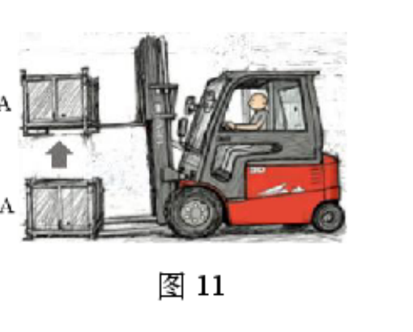
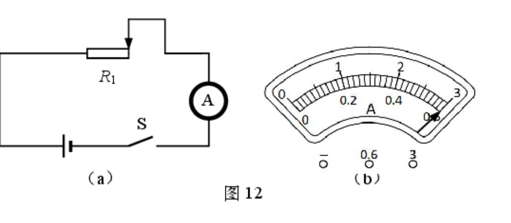
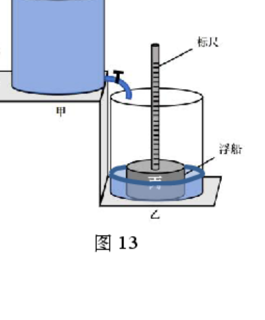
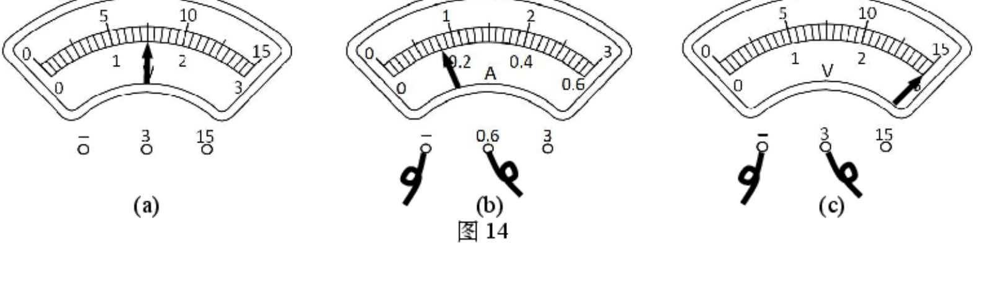
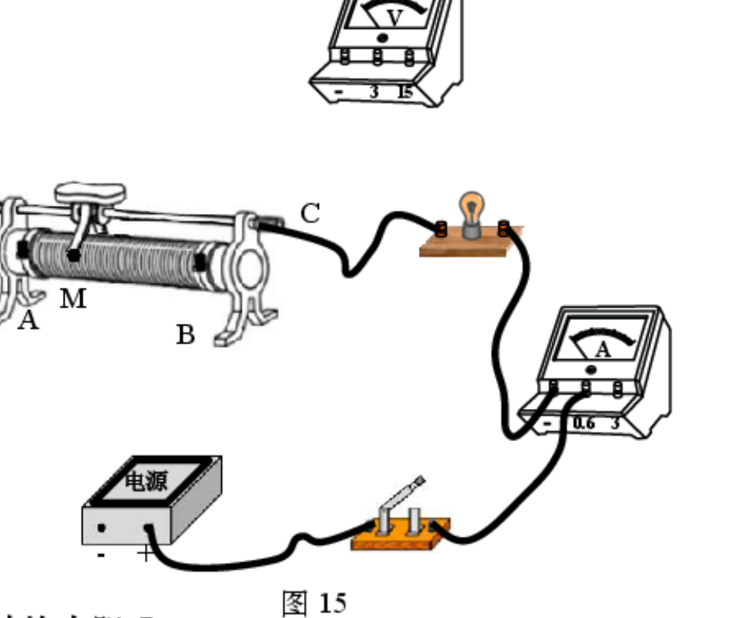

# 物模26 杨浦一模精讲（下）· 学科综合

> 杨浦卷第二题块"学科综合"（31 分，第 13～17 题）：热量计算、叉车功率与机械效率、滑动变阻器电路的等效电阻与变化量、"漏刻"计时模型的浮力压强综合、小灯泡电阻测量（电表读数推理＋灯带设计）。**原卷无答案文本，本讲答案全部为自主推演**（推演后与扫描件所附评分答案图逐项核对一致）。卷面插图已自原卷页图裁切补齐（`figs/物模26-杨浦/`）。上册题块见 [[04-物理/专题/真题精讲/物模26-杨浦-上]]。

## 📝 题目与解析

**13.**（水吸收的热量）
加热质量为 5kg 的水，水的温度升高了 20℃。求水吸收的热量 $Q_水$。[$c_水=4.2×10^3$ J/(kg·℃)]

> [!tip]- 💡 思路导航
> 一眼题：注意"升高了 20℃"即 $\Delta t=20℃$，直接 $Q=cm\Delta t$。

> [!success]- ✅ 详解 · 评分点 · 易错 · 关联
> **详解**：**列** $Q_水=c_水 m_水\Delta t$。**算** $Q_水=4.2×10^3×5×20=$ **$4.2×10^5$ J**。**答**：$4.2×10^5$ J。
>
> **易错**："升高了 20℃"是 $\Delta t$，不是末温。
>
> **关联**：[[04-物理/知识点/04-热学]]（热量计算）

**14.**（叉车提货）
工人驾驶叉车，将货物 A 在 2s 内匀速提升了 2m，如图 11 所示。已知提升过程中，叉车工作时的功率为 5kW，机械效率为 60%。

（1）求提升货物过程中叉车对货物 A 做的功 W；
（2）求货物 A 所受重力 G。

> [!tip]- 💡 思路导航
> 先 $W_总=Pt$，再 $W_有=\eta W_总$；两个效率对象别混——60% 乘在总功上；匀速提升 $W_有=Gh$。

> [!success]- ✅ 详解 · 评分点 · 易错 · 关联
> **详解**：（1）**设**总功 $W_总$。**列** $W_总=Pt$，$W_有=\eta W_总$。**算** $W_总=5000×2=10^4$ J，$W=0.6×10^4=$ **6000 J**。（2）**列**匀速提升 $W=Gh$。**算** $G=6000/2=$ **3000 N**。**验**：货物质量约 306kg，配叉车作业合理 ✓。**答**：W 为 6000J；G 为 3000N。
>
> **易错**：把 60% 乘到 G 上（$G=W_总/h$）是高频错误——机械效率定义在"对货物做的有用功"上。
>
> **关联**：[[04-物理/知识点/03-机械与功]]（功率、机械效率）、[[04-物理/专题/大题规范书写-设列算验答]]

**15.**（滑动变阻器电路）
在图 12(a) 所示的电路中，电源两端电压为 12 伏不变，电流表仅 0～0.6A 量程完好，滑动变阻器 $R_1$ 的滑片置于最大阻值处，闭合开关 S，电流表示数如图 12(b) 所示。

（1）求滑动变阻器的最大阻值 $R_{1max}$；
（2）在电路中接入电阻 $R_2$：
a. 将滑片移至某一位置时，电流表指针又回到了如图 12(b) 所示位置，则此时电路的等效电阻为＿＿＿＿＿＿＿＿Ω。请画出该情况对应的电路图；
b. 在确保电路中各元件正常工作的情况下，将滑片移向另一位置时，电流表示数变化了 0.1A，求滑动变阻器 $R_1$ 的阻值改变量 $\Delta R_1$。

> [!tip]- 💡 思路导航
> 满偏 0.6A 对应最大阻值；"指针又回到 0.6A"＝电流不变→等效电阻不变；电流表只有 0～0.6A 量程完好，"变化 0.1A"只能往小变（0.5A）。

> [!success]- ✅ 详解 · 评分点 · 易错 · 关联
> **详解**：（1）**列** $R_{1max}=U/I$。**算** $R_{1max}=12/0.6=$ **20Ω**。（2）a. 电流仍为 0.6A，等效电阻与原电路相同：$R_等=U/I=$ **20Ω**；【电路图文字重构：$R_1$（滑片不在最大端）与 $R_2$、电流表、开关串联接电源】b. **设**变化后电流 $I'$。**析** 电流表仅 0～0.6A 完好，0.6+0.1=0.7A 超量程且危及元件，故 $I'=0.6-0.1=0.5$ A。**列** $R'=U/I'$，$\Delta R_1=|R'-R|$（$R_2$ 不变，总电阻变化全部来自 $R_1$）。**算** $R'=12/0.5=24$ Ω，$\Delta R_1=24-20=$ **4Ω**。**验**：若 $R_2$ 较小，$R_1$ 可在 0～20Ω 内增减 4Ω，滑片行程足够 ✓。**答**：$\Delta R_1=4Ω$。
>
> **评分点**：（2）b 必须写明"0.7A 超过量程、不满足各元件正常工作"才取 0.5A；只答 4Ω 不给推理过程会丢分。
>
> **易错**：先判方向再计算——"变大 0.1A"不可行是被量程与元件安全排除的。
>
> **关联**：[[04-物理/知识点/06-电学基础]]（欧姆定律、滑动变阻器）

**16.**（简易"漏刻"模型）
某兴趣小组为制作可计时的简易"漏刻"模型，分别将两个完全相同的圆柱形薄壁容器甲、乙放置在高低不同的水平台阶上，如图 13 所示。盛满水的容器甲底部有一个出水管（此时出水管上的阀门关闭），盛有水的容器乙中有一个由标尺和圆柱形浮船组成的物体丙，其下表面刚好与容器乙底部接触且无压力。已知容器甲的底面积为 $5×10^{-2}$ m²、内装水的质量为 10kg；浮船的底面积为 $5×10^{-3}$ m²，浮船排开水的体积为 $4×10^{-4}$ m³。

（1）求物体丙受到的浮力 $F_浮$；
（2）求容器乙底部受到水的压强 $p_乙$；
（3）打开出水管的阀门，容器甲中的水缓慢注入容器乙，每分钟注入质量为 150g 的水，求从刚开始注水到容器甲、乙对台阶的压强相等时所用的间 $t_0$。

> [!tip]- 💡 思路导航
> 丙"下表面刚好贴底、无压力"＝漂浮临界；乙底压强取决于水深，水深＝浮船吃水深度；注水时浮船始终漂浮、$V_排$ 不变；压强相等且底面积相同⇒两侧"总质量"相等。

> [!success]- ✅ 详解 · 评分点 · 易错 · 关联
> **详解**：（1）**列** $F_浮=\rho_水 gV_排$。**算** $F_浮=10^3×9.8×4×10^{-4}=$ **3.92 N**。（2）**析** 丙下表面刚好贴底、无压力，乙中水深即浮船吃水深度。**列** $h_乙=V_排/S_船$，$p_乙=\rho_水 gh_乙$。**算** $h_乙=4×10^{-4}/5×10^{-3}=0.08$ m；$p_乙=10^3×9.8×0.08=$ **784 Pa**。（3）**设**注入时间 $t_0$ 分钟、注入水的质量 $\Delta m$。**析** 浮船始终漂浮，$V_排$、吃水深度不变；丙漂浮 $m_丙=F_浮/g=3.92/9.8=0.4$ kg；原乙中水 $m_乙水=\rho_水(h_乙S_乙-V_排)=10^3×(0.08×5×10^{-2}-4×10^{-4})=3.6$ kg。**列** 容器相同、底面积相同，压强相等⇒总质量相等：$m_甲水-\Delta m=m_乙水+\Delta m+m_丙$。**算** $10-\Delta m=3.6+\Delta m+0.4⇒\Delta m=3$ kg；$t_0=3/0.15=$ **20 min**。**验**：20min 后甲剩 7kg、乙侧 $3.6+3+0.4=7$ kg，两侧总质量相等 ✓（乙水深 $(3.6+3)×10^{-3}/5×10^{-2}+0.08=0.14$ m＜容器高，未溢出 ✓）。**答**：$t_0=20$ min。
>
> **评分点**：抓"压强相等⇒总质量相等"——两容器相同、底面积相同，无需算容器重。
>
> **易错**：漏加 $m_丙=0.4$ kg 或漏算乙中原有 3.6 kg 水都得不到 20min。
>
> **关联**：[[04-物理/知识点/05-密度压强与浮力]]（漂浮条件、液体压强）、[[04-物理/专题/压强浮力-上海特色题型]]（浮船吃水、双容器压强相等类）

**17.**（灯带小灯泡参数测量）
小华和小明利用 10 个相同规格的小灯泡（标有"2.5V"字样）来制作一串灯带，他们需要知道小灯泡正常工作时的电阻。小华将电源、小灯泡、电流表、开关正确串联，再将电压表并联在小灯泡两端；闭合开关后，小灯发出较暗的光，电压表和电流表的示数如图 14(a)(b) 所示。经两位同学讨论后，小明在小华原有实验器材基础上更换了电源，并挑选了一个滑动变阻器重新连接电路。他将变阻器的滑片移到图 15 所示的 M 点，闭合开关，电流表的示数与图 14(b) 所示一致，电压表的示数如图 14(c) 所示；继续将滑片移向 B 端的过程中，两电表指针均发生偏转，当观察到小灯泡正常发光时，两个电表中的一个电表的指针偏转了两小格。

（1）小华实验时电源两端电压为＿＿＿＿＿＿＿＿V；
（2）根据上述信息，在图 15 中，用笔画线代替导线，将小明的实验电路连接完整。

（3）求小灯泡正常发光时的电阻 $R_L$；
（4）小华将上述 10 个小灯泡与一个阻值为 50Ω 的定值电阻串联，接在电压为 30V 的电源两端，试分析这 10 个小灯泡能否正常发光。

> [!tip]- 💡 思路导航
> 小华电路无变阻器→灯电压即电源电压，"较暗"提示电压低于额定值、据此选量程；M 点电流与小华相同→灯的工作状态相同→(c) 读的是变阻器电压，两段电压相加得新电源电压；"偏转两小格"是甄别器——先算 0.6A 量程的格值，再看哪个电表的变化恰好符合。

> [!success]- ✅ 详解 · 评分点 · 易错 · 关联
> **详解**：（1）小华电路中无变阻器，灯两端电压即电源电压；灯"较暗"说明电压低于 2.5V，图 14(a) 用 0～3V 量程、指针半偏，读数 1.5V。**答**：**1.5 V**。（2）【作图】电源、开关、电流表、小灯、滑动变阻器串联成回路；电压表接"−"与"3"两接线柱，**并联在滑动变阻器两端**（M 点靠 A 端、接入电阻大）。（3）**设**正常发光电流 $I_额$。**析** M 点电流与小华相同（0.16A）→灯状态相同→灯电压仍 1.5V；图 14(c) 读得变阻器电压 3.0V，新电源 $U=1.5+3.0=4.5$ V。正常发光时 $U_灯=2.5$ V，$U_滑=4.5-2.5=2.0$ V。**判**：0.6A 量程每小格 0.02A，电流由 0.16A 增至 0.20A 恰偏转**两小格**✓（电压表从 3.0V→2.0V 变化 10 小格，不符"两小格"），故 $I_额=0.2$ A。**列** $R_L=U_额/I_额$。**算** $R_L=2.5/0.2=$ **12.5Ω**。**答**：12.5Ω。（4）**假设** 10 灯均正常发光。**列** 串联电流 $I=I_额=0.2$ A，$U_需=10U_额+IR$。**算** $U_R=0.2×50=10$ V，$U_需=10×2.5+10=35$ V。**判**：35V＞30V，电源电压不足。**答**：**不能正常发光**（实际每灯分压低于 2.5V，发光偏暗）。
>
> **评分点**：（1）量程选择要给依据——"较暗→$U_灯$＜2.5V→只能 0～3V 量程→半偏读 1.5V"，直接写 1.5V 不给满；（3）"两小格"是甄别器，用它排除电压表、锁定电流表。
>
> **易错**：不看格值硬算 $R_L=2.5/0.16$ 是常见错；（4）结论句规范——"假设正常发光→需 35V＞30V→不能"，只答"不能"不说依据只得一半分。
>
> **关联**：[[04-物理/知识点/07-电功率与家庭电路]]（串联分压、电表读数）、[[04-物理/专题/真题精讲/物模26-宝山-下]]（测小灯电阻同款）

## 🔗 关联

- [[04-物理/专题/大题规范书写-设列算验答]]（计算题书写范式）
- 同类题：[[04-物理/专题/真题精讲/物模26-嘉定-下]]（坐位体前屈电路设计）、[[04-物理/专题/真题精讲/物-15-2026真题-研究浮力]]
