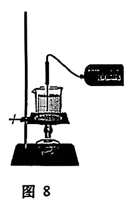
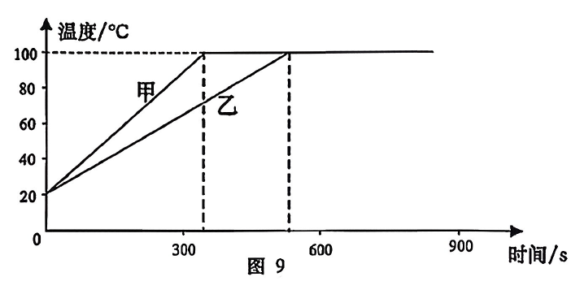
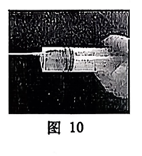
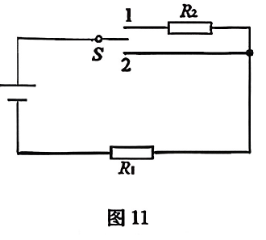
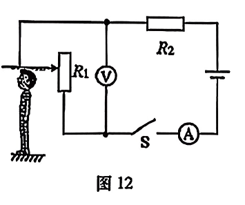
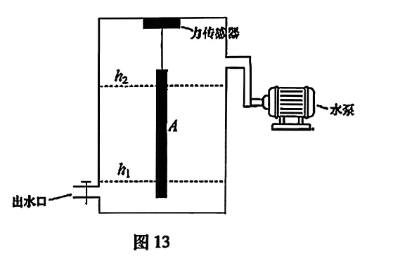
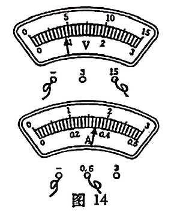

# 物模26 松江一模精讲（下）· 学科综合

> 2026 届松江区初三一模第二题块"学科综合"（第 13～17 题，34 分）：沸腾实验说理、多挡位加热器计算、身高测量仪动态电路与故障、浮体力传感器综合计算、伏安测小灯泡电阻，层层递进。原卷为扫描件、逐页读图转录；**扫描件末尾附参考答案页，本讲全部数值已重算并逐项与其核对一致**；题干配图均已自扫描页裁切嵌入（题 13～17）。仅题 13(3) 答案页缺印（自主推演选 B）、题 13(2) 答案页印作"m甲≤m乙"（按其理由句取 m甲＜m乙），均已注明。学科基础见 [[04-物理/专题/真题精讲/物模26-松江-上]]。

**13.** 水沸腾实验
甲、乙两同学用完全相同的装置探究"水在沸腾前后温度变化的特点"（图8），由温度传感器测得数据绘成图9。

（1）由图像可知，水的沸点是＿＿＿＿＿＿＿＿℃，水沸腾时会产生大量气泡，这些气泡实际上是＿＿＿＿＿＿＿＿；
（2）丙同学发现甲、乙所用水质量不同导致图像存在差异，请判断甲、乙所用水质量的大小关系，并说明理由；
（3）丙做"针管烧水"实验（图10）：用注射器吸入适量约 80℃ 的水，用牙签堵住注射口，用力向外拉活塞，观察到针筒里的水冒泡沸腾。下列生活现象与其原理一致的是（　）

- （A）打开密封的碳酸饮料瓶时，瓶内迅速冒出大量气泡
- （B）高海拔地区食物难以煮熟
- （C）密封包装的薯片带到青藏高原包装袋膨胀

> [!tip]- 💡 思路导航
> 沸点读水平段、气泡是水蒸气不是空气；初温末温相同→Δt 相同，同装置下加热时间正比于吸热多少，用 $Q=cm\Delta t$ 判质量；针管实验的内核是"气压减小→沸点降低"。

> [!success]- ✅ 详解 · 评分点 · 易错 · 关联
> **详解**：（1）沸点 **100℃**；气泡实际是**水蒸气**。（2）甲、乙水的初温、末温相同→Δt 相同；装置相同，甲加热时间短→$Q_甲＜Q_乙$；由 $Q=cm\Delta t$，c、Δt 相同时 Q 与 m 成正比→**m甲＜m乙**【答案页印"m甲≤m乙"，其理由句为"甲同学所用水质量更少"，取严格小于】。（3）向外拉活塞→筒内气压减小→水的沸点降低→80℃ 的水沸腾。**B 高海拔气压低、沸点低**，同一原理；A 是气压减小使 CO₂ 溶解度变小而冒泡、C 是袋内气压大于袋外而膨胀，均非"沸点降低"。选 **B**【答案页题 13(3) 缺印，本项为自主推演，与其余各项互证无冲突】。
>
> **评分点**：（2）说理两段式——先给大小关系、再引 $Q=cm\Delta t$ 论证；只写"时间短质量就小"不引公式要扣分。
>
> **易错**：（3）与"气体溶解度（A）""袋内外压强差（C）"划清界限——共同点是"气压变化"，但只有 B 落在"气压影响沸点"上。
>
> **关联**：[[04-物理/知识点/04-热学]]（沸腾实验、气压与沸点）、[[04-物理/专题/实验操作考点-物理]]。

**14.** 高低温两挡加热器
小明制作了具有高温和低温两个挡位的加热器（图11）：电源电压为 20V 且保持不变，定值电阻 R₁ 的阻值为 10Ω。

（1）当开关 S 转到位置＿＿＿＿＿＿＿＿（选涂 "A. 1" 或 "B. 2"）时为高温挡；
（2）加热器处于低温挡时的功率为 8W，求定值电阻 R₂ 的阻值；
（3）用该加热器在高温挡持续加热 5min，求产生的热量 Q；
（4）该加热器在高温挡和低温挡的功率之比为＿＿＿＿＿＿＿＿。

> [!tip]- 💡 思路导航
> 高温挡=功率大=总电阻小，先判 S 两个位置各接入谁；低温挡已知 $P=8W$，用 $I=P/U$ 与 $R_总=U/I$ 反推 R₂；功率比直接用 $U^2/R$ 比。

> [!success]- ✅ 详解 · 评分点 · 易错 · 关联
> **详解**：（1）掷 2 时仅 R₁ 接入、总电阻最小、功率最大→高温挡，选 **B**。（2）**设**低温挡 R₁、R₂ 串联。**列** $I_低=P_低/U$，$R_总=U/I_低$，$R_2=R_总-R_1$。**算** $I_低=8/20=0.4A$；$R_总=20/0.4=50Ω$；$R_2=50-10=$ **40Ω**。**验** $P=U^2/R_总=400/50=8W$ ✓。**答** $\boxed{R_2=40\Omega}$。（3）**设**高温挡仅 R₁ 接入。**列** $I_高=U/R_1$，$Q=I_高^2R_1t$。**算** $I_高=20/10=2A$；$Q=2^2×10×300=$ **12000J**（t=5min=300s）。**验** $P_高=U^2/R_1=40W$，$Q=P_高t=40×300=12000J$ ✓。**答** $\boxed{Q=1.2\times10^4J}$。（4）$P_高:P_低=40:8=$ **5:1**。
>
> **易错**：（3）**t=5min 必须换算成 300s**；$Q=P_高t$ 与 $I^2Rt$ 两条路互为验算。
>
> **关联**：[[04-物理/知识点/07-电功率与家庭电路]]（多挡位电热、功率比）、[[04-物理/专题/大题规范书写-设列算验答]]。

**15.** 身高测量仪
如图12，小明设计了一个身高测量仪：电源电压为 U₀ 且保持不变，R₂ 的阻值为 R₀。

（1）当被测者的身高越高时，电压表的示数将＿＿＿＿＿＿＿＿（选涂 "A. 变大" "B. 不变" 或 "C. 变小"）；
（2）为了增大身高测量仪的测量范围，下列方案可行的是（　）
- （A）电压表的量程改为 0～3V
- （B）把 R₂ 换成阻值更小的定值电阻
- （C）适当减小电源电压
（3）移动滑片，若观察到两电表示数均不变，且至少有一个不为 0。已知电路中出现一处故障，且只发生在滑动变阻器 R₁ 或电阻 R₂ 上，请写出两电表的示数及对应的故障。

> [!tip]- 💡 思路导航
> 身高越高→滑片越上移→接入电阻越大→串联分压越大；测量上限卡在电压表量程——想让"更高身高"不超量程，就要让同样的接入电阻分得更小的电压；故障题按"两表示数均不变＋至少一个不为 0"逐一检验四种故障。

> [!success]- ✅ 详解 · 评分点 · 易错 · 关联
> **详解**：（1）身高越高→滑片上移→R₁ 接入段越长→总电阻越大→电流越小→R₂ 分压越小→$U_1=U_0-IR_0$ 变**大**，选 **A**。（2）测量上限卡在电压表量程：A 量程改小→更早满偏，范围变小，错；B R₂ 变小→同样接入下 $U_1$ 更大→更早满偏，错；C 电源电压减小→$U_1$ 变小→可容纳更大的接入电阻（更高身高），**对**。选 **C**。（3）逐一检验：**R₁ 短路**→接入恒为 0，$I=U_0/R_0$ 不变、$U_1=0$，两表均不变且 I 不为 0 ✓；**R₁ 开路**→I=0，电压表经 R₂ 跨接断口，$U_1=U_0$，两表均不变且 V 不为 0 ✓；R₂ 短路→$I=U_0/R_{1接入}$ 随滑片变化，不符；R₂ 开路→两表示数均为 0，不满足"至少一个不为 0"，排除。**答**：电流表示数 $U_0/R_0$、电压表示数 0→R₁ 短路；电流表示数 0、电压表示数 $U_0$→R₁ 开路（与官方答案一致）。
>
> **评分点**：（3）故障题要写全"示数＋对应故障"，并显式排除 R₂ 短路（示数会变）与 R₂ 开路（两表均 0）——漏排除会多写答案。
>
> **关联**：[[04-物理/知识点/06-电学基础]]（动态电路、电路故障）、[[04-物理/专题/电学四大题型]]。

**16.** 自动储水水箱
物理兴趣小组为学校"生物角"设计了自动储水水箱模型（图13）：浮体 A（不吸水）的底面积为 0.01m²、高为 1m，通过一轻质硬细杆与力传感器相连；浮体 A 底面与水箱底的距离为 0.1m；柱形薄壁水箱的底面积为 1.2m²。当水箱内水位低于最低水位线 h₁ 时，水泵开始注水；当水位到达 0.5m 时，力传感器示数恰为 0；继续注水到最高水位线 h₂ 时，水泵停止注水，此时力传感器示数为 49N（即浮体 A 所受浮力较水位线在 0.5m 时增加了 49N）。

（1）若水面位于最低水位线 h₁（h₁=0.2m）处【卷面作"水面位于最低水位线h₁为0.2m处"，按官方解答水深取 0.2m 转录】，求此时水对水箱底部的压强 P₁；
（2）求浮体 A 的密度 ρA；
（3）求最高水位线 h₂。

> [!tip]- 💡 思路导航
> "传感器示数 0"=轻杆无力=浮力恰与重力平衡，这是全题枢纽；浸深=水位−A 底高度（0.1m），ρA 用 $G=F_浮$ 反推；示数 49N 是浮力的**增加量**，$\Delta F_浮=ρ_水gS·\Delta h$。

> [!success]- ✅ 详解 · 评分点 · 易错 · 关联
> **详解**：（1）**设**水深 h=0.2m。**列** $p=ρ_水gh$。**算** $p=1.0×10^3×9.8×0.2=$ **1960Pa**。**答** $\boxed{P_1=1960Pa}$。（2）水位 0.5m 时传感器示数为 0→轻杆无力→$F_浮=G_A$；此时浸深 $h_浸=0.5-0.1=0.4m$。**列** $F_浮=ρ_水gS_A·h_浸=ρ_A(S_A·h_A)g$。**算** $F_浮=1.0×10^3×9.8×0.01×0.4=39.2N$；$ρ_A=39.2/(9.8×0.01×1)=$ **400kg/m³**。**验** $ρ_A＜ρ_水$，A 能随水位浮动 ✓。**答** $\boxed{\rho_A=0.4\times10^3kg/m^3}$。（3）**列** $\Delta F_浮=ρ_水gS_A(h_2-0.5m)$。**算** $49=1.0×10^3×9.8×0.01×(h_2-0.5)$→$h_2-0.5=0.5$→**$h_2=1m$**。**验** $h_2=1m$ 时浸深 0.9m，$F_浮=1.0×10^3×9.8×0.01×0.9=88.2N=G_A+49N=39.2+49$ ✓，且 h₂ 低于 A 顶（1.1m），A 未全浸、自洽 ✓。**答** $\boxed{h_2=1m}$。（水箱底面积 1.2m² 三问均未用到，是干扰条件。）
>
> **易错**：**"示数 0"=杆无力=浮力等于重力**，是第（2）（3）问的共同起点；49N 是浮力**增加量**而非浮力，误当浮力用会算出荒唐结果。
>
> **关联**：[[04-物理/知识点/05-密度压强与浮力]] 与 [[04-物理/专题/压强浮力-上海特色题型]]（浮体、液面传感器类压轴）。

**17.** 测小灯泡的电阻
小华用电流表、电压表、滑动变阻器等，测量小灯泡（标有"3.8V"字样）正常发光时的电阻。他正确连接电路，实验步骤正确。闭合开关，观察到电压表、电流表示数如图14 所示，发现无法使小灯泡正常发光。经过思考，他改变了电源电压，重新连接了电路，测得四组实验数据如表1。

| 实验序号 | 电压表示数/V | 电流表示数/A |
|---|---|---|
| 1 | 3.0 | 0.26 |
| 2 | 2.6 | 0.28 |
| 3 | 2.2 | 0.30 |
| 4 | 1.5 | 0.34 |

（1）①本实验的原理是＿＿＿＿＿＿＿＿；②请分析调整前小灯泡无法正常发光的原因；③通过计算说明调整后的电源电压 U；④小灯泡正常发光时的电阻 R小灯=＿＿＿＿＿＿＿＿Ω（精确到 0.1Ω）。
（2）利用现有器材，能否"探究通过导体的电流与电压的关系"？并说出理由。

> [!tip]- 💡 思路导航
> 表中电流增大、电压表示数减小→新电路中电压表并在**变阻器**两端；同一电流下小灯电压相同——初态图14 的（4.5V，0.34A）是求新电源电压的桥梁；$U=U_灯+U_滑$，U灯=3.8V 对应哪一组数据，哪一组就是"正常发光"。

> [!success]- ✅ 详解 · 评分点 · 易错 · 关联
> **详解**：（1）① **R=U/I**。② 刚闭合开关时变阻器全接入、小灯两端电压最小，但图14 示数 $U_灯=4.5V$（0～15V 量程）**已大于额定电压 3.8V**——原电源电压过高，连最小状态都超额定，故无法正常发光。③ 由表：电流增大时电压表示数减小→电压表并在**变阻器**两端；同一电流 0.34A 下小灯电压相同（图14 的 4.5V），查表第 4 组变阻器电压 1.5V。**列** $U=U_灯+U_滑$。**算** $U=4.5+1.5=$ **6V**。**验** $U_灯=6-V_表=3.0、3.4、3.8、4.5V$，随电流增大而增大，单调合理 ✓。**答** $\boxed{U=6V}$。④ $U_灯=3.8V$ 对应第 3 组（6−2.2=3.8V），I=0.30A：$R=3.8/0.30≈$ **12.7Ω**（与答案 12.7 一致）。（2）**不能**：该实验需控制导体电阻不变，而由表算得小灯电阻约 11.5→12.1→12.7→13.2Ω，随电压（温度）变化，无法控制变量（与官方答案一致）。
>
> **易错**：**③ 新旧两次实验靠"同一电流下小灯电压相同"拼接**，这是唯一入口；得 6V 后必须回代四组数据验 $U_灯$ 单调性。
>
> **关联**：[[04-物理/专题/实验操作考点-物理]] 与 [[04-物理/专题/电学四大题型]]（伏安法、动态电路与故障）、同类题 [[04-物理/专题/真题精讲/物模26-黄浦-下]]（伏安测电阻＋故障）。

## 🔗 关联

- [[04-物理/专题/大题规范书写-设列算验答]]（计算题五步规范）
- [[04-物理/知识点/04-热学]]（沸腾、气压与沸点）
- [[04-物理/知识点/05-密度压强与浮力]] 与 [[04-物理/专题/压强浮力-上海特色题型]]（浮体、液面传感器类压轴）
- [[04-物理/知识点/07-电功率与家庭电路]]（多挡位电热、功率比）
- [[04-物理/专题/实验操作考点-物理]] 与 [[04-物理/专题/电学四大题型]]（伏安法、动态电路与故障）
- 同类题：[[04-物理/专题/真题精讲/物模26-松江-上]]、[[04-物理/专题/真题精讲/物模26-黄浦-下]]（伏安测电阻＋故障）、[[04-物理/专题/真题精讲/物模26-杨浦-下]]
