# 物模26 浦东一模精讲 · 全卷

> 2026 届浦东新区初三一模（2025 学年度第一学期初三年级期末练习，物理部分 70 分：学科基础 35 分＋学科综合 35 分；基础第 7、10 题 4 分、其余每题 3 分，综合第 12 题 3 分、第 13 题 5 分、第 14、15 题 4 分、第 16 题 12 分、第 17 题 7 分）。原卷为 docx 转制 PDF 扫描件，题目逐页读图转录；**卷面配图（图1～图13）已按 150dpi 页图裁切嵌入对应题目**。扫描件末尾附参考答案与评分标准（第 6～7 张页图），本讲全部结论已逐项与其核对一致；题 15(2) 答案页"转移到水渠和地板"按卷面情境录作"水泥和地板"；题 13 卷面重力与额外功为 3×10⁵N、1×10⁷J（与答案 1.5×10⁷J、60% 互证，早期转录的 3×10⁴N、1×10⁶J 系笔误，已修正）。

**1.**（3分）家庭电路
上海家用照明电路的电压为＿＿＿＿＿＿＿＿V，用来计量家庭用电量的仪表是＿＿＿＿＿＿＿＿表；洗衣机、冰箱等电器一般采用＿＿＿＿＿＿＿＿（选填：A. 两脚　B. 三脚）插头。

> [!tip]- 💡 思路导航
> 220V 是必背常数；计量"用电量"（电能）的表是哪块？大功率、金属外壳的电器为了安全该用哪种插头？

> [!success]- ✅ 详解 · 评分点 · 易错 · 关联
> **详解**：**220**V；**电能**表；**B 三脚**（第三脚接地线，金属外壳接地防触电）。
>
> **关联**：[[04-物理/知识点/07-电功率与家庭电路]]（家庭电路电压、电能表、安全用电）。

**2.**（3分）家庭中的物理现象及应用
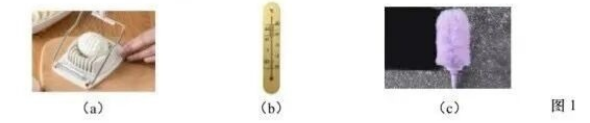

如图1(a)所示，厨房中使用的切蛋器的钢丝线是通过减小受力面积的方法来＿＿＿＿＿＿＿＿压强（选填：A. 增大　B. 减小）；如图1(b)所示，卧室中的寒暑表是根据液体＿＿＿＿＿＿＿＿的性质制成的；如图1(c)所示，客厅中常用的静电除尘刷，在与家具表面摩擦后带上电荷，这是利用带电体能＿＿＿＿＿＿＿＿（选填：A. 吸引　B. 排斥）轻小物体的性质来除尘的。

> [!tip]- 💡 思路导航
> 钢丝线很细→受力面积小→压强效果；常用温度计的原理一句话；"带电体吸引轻小物体"是静电现象的第一判据。

> [!success]- ✅ 详解 · 评分点 · 易错 · 关联
> **详解**：**A 增大**（压力一定时减小受力面积，压强增大）；**热胀冷缩**；**A 吸引**。
>
> **关联**：[[04-物理/知识点/05-密度压强与浮力]]（增大压强的方法）、[[04-物理/知识点/04-热学]]（温度计原理）、[[04-物理/知识点/06-电学基础]]（摩擦起电、带电体吸引轻小物体）。

**3.**（3分）三位物理学家的探索与实践
历史上著名的＿＿＿＿＿＿＿＿实验测定了大气压强的值；在探究电流与电阻的关系时，应控制＿＿＿＿＿＿＿＿不变；阿基米德跨进盛满水的浴缸看到水溢出，想到形状不规则的物体浸没在液体中时，其排开液体的体积＿＿＿＿＿＿＿＿物体的体积（　）
- （A）大于
- （B）小于
- （C）等于

> [!tip]- 💡 思路导航
> 物理史：测定大气压值的经典实验是谁做的？探究 I-R 关系时控制变量法锁住哪一个量？"浸没"两字决定 V排 与 V物 的关系。

> [!success]- ✅ 详解 · 评分点 · 易错 · 关联
> **详解**：**托里拆利**；**电压**（探究电流与电阻关系时控制电压不变）；**C 等于**（浸没时 V排=V物）。
>
> **易错**：托里拆利实验测的是**大气压强**的值；探究 I-R 控制的是**电压**不变，与探究 I-U 控制"电阻"不变交叉出错。
>
> **关联**：[[04-物理/知识点/05-密度压强与浮力]]（大气压、阿基米德原理）、[[04-物理/知识点/06-电学基础]]（控制变量法探究电流规律）。

**4.**（3分）站台安全线
工作人员会提醒乘客站在安全线外候车。如图2所示，列车驶过站台时，乘客和列车之间的气流速度比乘客后方的气流速度＿＿＿＿＿＿＿＿，所以乘客和列车之间的气压比他后方的气压＿＿＿＿＿＿＿＿（前两空均选填：A. 大　B. 小），周围气体使乘客受到方向为＿＿＿＿＿＿＿＿（选填：A. 指向　B. 背向）列车的合力，站在安全线外可防止因为该合力所导致的安全隐患。
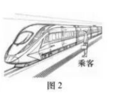

> [!tip]- 💡 思路导航
> 流体流速越大的位置压强越小——先比人与列车之间、人身后两处的流速，再比压强，最后由压强差定合力的方向。

> [!success]- ✅ 详解 · 评分点 · 易错 · 关联
> **详解**：**A 大**→**B 小**（流速大处压强小）→**A 指向**（人与列车之间压强小、身后压强大，合力把人推向列车）。
>
> **关联**：[[04-物理/知识点/02-运动与力]]（流体压强与流速的关系）、同类题 [[04-物理/专题/真题精讲/物模26-宝山-上]] 题10（无叶风扇大风量说理）。

**5.**（3分）四冲程汽油机
部分家用小汽车的主要动力来源是四冲程汽油机。如图3所示的冲程将＿＿＿＿＿＿＿＿（选填：A. 机械能转化为内能　B. 内能转化为机械能）；在小汽车行驶过程中，＿＿＿＿＿＿＿＿冲程使汽车获得动力。汽油的热值在常见的燃料中较大，＿＿＿＿＿＿＿＿（选填：A. 能　B. 不能）说明汽油完全燃烧时放出的热量较多。
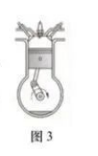

> [!tip]- 💡 思路导航
> 读图3 定冲程：两气门关闭、活塞上行是哪个冲程？能量转化方向随之而定；"获得动力"的是哪一个冲程？热值是"每千克"的放热本领，比总放热还缺什么条件？

> [!success]- ✅ 详解 · 评分点 · 易错 · 关联
> **详解**：图3 两气门关闭、活塞上行=压缩冲程→**A 机械能转化为内能**；**做功**冲程获得动力；热值大只说明**每千克**放热多，不知质量不能比总放热，**B 不能**。
>
> **易错**：压缩冲程是"机械能→内能"，与做功冲程方向记反必错；热值大≠总放热多——缺少质量条件。
>
> **关联**：[[04-物理/知识点/04-热学]]（热机四冲程、热值）。

**6.**（3分）苹果的浮与沉
一只苹果漂浮在容器中的水面上，如图4(a)所示。
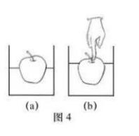

（1）在图4(a)中用力的示意图画出苹果受到的浮力 F浮。（作图）
（2）用手指将苹果向下按压至如图4(b)所示的位置并保持静止，则苹果受到的浮力大小＿＿＿＿＿＿＿＿（选填：A. 变大　B. 变小　C. 不变），若此时水深 0.2m，则水对容器底部的压强为＿＿＿＿＿＿＿＿Pa。

> [!tip]- 💡 思路导航
> 漂浮时 F浮=G，方向竖直向上、作用点画在重心；按压后 V排 增大，浮力怎么变？液体压强只看深度，p=ρgh 与容器形状无关。

> [!success]- ✅ 详解 · 评分点 · 易错 · 关联
> **详解**：（1）从苹果重心画竖直向上的线段，末端标 F浮（示意图）。（2）按压后 V排 增大→**A 变大**；p=ρgh=1.0×10³×9.8×0.2=**1960Pa**。
>
> **易错**：浮力示意图方向竖直向上、作用点在重心，漏标字母或画成斜向不得分。
>
> **关联**：[[04-物理/知识点/05-密度压强与浮力]]（浮力示意图、阿基米德原理、液体压强）。

**7.**（4分）撬棒撬箱
工人想要用撬棒撬箱子，撬棒在如图5所示的位置保持静止。
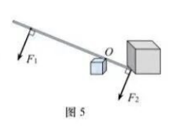

（1）O 为撬棒的支点，工人对撬棒的作用力 F₁ 为动力，箱子对撬棒的作用力 F₂ 为阻力，在图5中画出 F₁ 的力臂 l₁，此时撬棒相当于（　）
- （A）等臂杠杆
- （B）省力杠杆
- （C）费力杠杆

（2）若动力臂 l₁ 为 1.5m，阻力 F₂ 为 300N，阻力臂 l₂ 为 0.5m，则动力 F₁ 的大小为＿＿＿＿＿＿＿＿N。

> [!tip]- 💡 思路导航
> 力臂是"支点到力作用线的垂直距离"，从 O 向 F₁ 的作用线作垂线段；比较 l₁ 与 l₂ 的长短即知杠杆类型；平衡条件 F₁l₁=F₂l₂ 直接代数。

> [!success]- ✅ 详解 · 评分点 · 易错 · 关联
> **详解**：（1）从 O 向 F₁ 作用线作垂线段并标 l₁（作图）；l₁＞l₂，**B 省力**。（2）**列** F₁l₁=F₂l₂。**算** F₁=300×0.5/1.5=**100N**。
>
> **易错**：**动力臂别画成支点到动力作用点的连线**，必须是支点到 F₁ 作用线的垂线段。
>
> **关联**：[[04-物理/知识点/03-机械与功]]（杠杆五要素、力臂作图、杠杆平衡条件）。

**8.**（3分）冰雪路面撒盐
人们有时在有冰雪的路面上撒盐。
（1）冰块上撒有食用盐的位置很快就熔化了，由此可见，其目的是为了＿＿＿＿＿＿＿＿冰雪的熔点（选填：A. 升高　B. 降低），使其快速熔化，方便去除冰雪，提升行路的安全性；
（2）（多选）物体在熔化的过程中需要吸热，下列物态变化同样需要吸热的有（　）
- （A）凝华
- （B）凝固
- （C）汽化
- （D）液化
- （E）升华

> [!tip]- 💡 思路导航
> 杂质使冰的熔点怎样变？六种物态变化按"吸热三兄弟"记：熔化、汽化、升华。

> [!success]- ✅ 详解 · 评分点 · 易错 · 关联
> **详解**：（1）**B 降低**（撒盐后冰的熔点降低，可在 0℃ 以下熔化）。（2）吸热的有汽化、升华，选 **C、E**。
>
> **关联**：[[04-物理/知识点/04-热学]]（熔点与杂质、物态变化吸放热）。

**9.**（3分）电路连接与改错
小明用实验室的器材连接了如图6(a)(b)所示的电路。
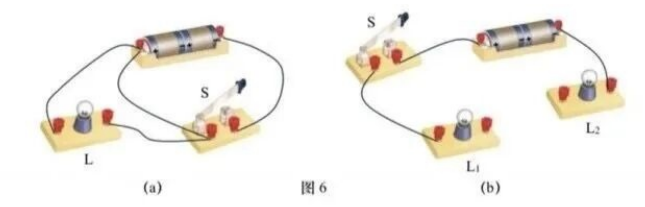

（1）图6(a)中有一根导线接错而会使灯 L 和电源被短路，请把这根导线找出来，在上面画一个"×"；
（2）图6(b)中有两根导线尚未连接，用笔画线代替导线连接电路，使灯 L₁ 和 L₂ 并联，且开关 S 仅控制灯 L₁。

> [!tip]- 💡 思路导航
> 短路=电流不经过用电器直接连通电源两极——顺导线找"绕过灯 L 的那条回路"；并联要求两灯各自有独立支路，开关只串在 L₁ 的支路里。

> [!success]- ✅ 详解 · 评分点 · 易错 · 关联
> **详解**：（1）"×"画在使 L 两端被直接连通到电源两极的那根导线上（L 被短路）。（2）L₁ 与 L₂ 并联，S 串接在 L₁ 支路（画线连接，图略）。
>
> **关联**：[[04-物理/知识点/06-电学基础]]（短路识别、并联电路连接）、[[04-物理/专题/电学四大题型]]（电路故障）。

**10.**（4分）透明软管找水平
小东和小方尝试利用一根透明软管和适量的水，在墙上找到相同高度的点，如图7所示。
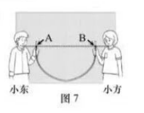

（1）他们将透明软管弯成"U"形状后，透明软管可以看成一个简单的＿＿＿＿＿＿＿＿装置；
（2）他们在软管内注入水，当水＿＿＿＿＿＿＿＿时，沿两侧管内水面对应的位置在墙上进行标记，找到了相同高度的点 A、B；
（3）若小东手持软管不动，小方将软管的右端缓慢向上提一些（水未溢出），则通过（2）中的方法重新获得的相同高度的两个点的位置（　）

- （A）高于点 A、B
- （B）低于点 A、B
- （C）与点 A、B 等高

> [!tip]- 💡 思路导航
> 上端开口、底部连通——这是什么装置？静止时各液面总有什么关系？右端上提后想一想：管内水柱的"最低点"和"水柱总长"变没变？

> [!success]- ✅ 详解 · 评分点 · 易错 · 关联
> **详解**：（1）**连通器**。（2）**静止**时两液面相平。（3）右端上提，管最低点上移、水柱长度不变，重新静止时两液面仍等高且高于原标记点，**A**。
>
> **易错**：第(3)问"一端上提后液面升高"的因果链（管最低点上移、水柱长不变）要写全，只写"连通器液面相平"不完整。
>
> **关联**：[[04-物理/知识点/05-密度压强与浮力]]（连通器原理及应用）。

**11.**（3分）冰的熔化与比热容
小明和小珠在实验室利用加热器加热冰块。他们将 −20℃ 的冰加热至 20℃ 的水（过程中被加热物质每分钟吸收的热量相等且质量保持不变），其温度随加热时间变化的关系图像如图8所示。根据图像，他们都发现了冰的比热容＿＿＿＿＿＿＿＿水的比热容（选填：A. 大于　B. 小于　C. 等于），小明得出该结论的依据是：质量相同的冰和水，升高相同温度，水吸收的热量比冰多。小珠认为还能从图像中获得另一种支持该结论的依据，她的依据可以是：＿＿＿＿＿＿＿＿。
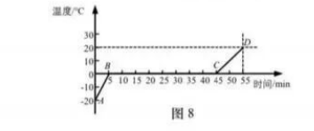

> [!tip]- 💡 思路导航
> 每分钟吸热相同→"加热时间"就是吸热多少的尺子；比一比相同时间内冰、水各升温多少，或比一比升高相同温度各需多长时间——两条路都能到达结论。

> [!success]- ✅ 详解 · 评分点 · 易错 · 关联
> **详解**：**B 小于**。图8 中冰每分钟升温 2℃、水每分钟升温 1℃（吸热相同）。依据：**质量相同的冰和水，吸收相同的热量（加热相同时间），冰升高的温度大于水**。
>
> **易错**：写依据时必须扣住"质量相同、吸热相同"这两个前提，只写"冰升温快"不给满分。
>
> **关联**：[[04-物理/知识点/04-热学]]（比热容、熔化图像、控制变量比较比热容）。

**12.**（3分）冷却液吸热计算
汽车发动机工作时会释放热量，可以用水作为冷却液来降温。质量为 6kg 的冷却液（水），温度升高 50℃，求冷却液（水）吸收的热量 Q吸。【c水=4.2×10³J/(kg·℃)】

> [!tip]- 💡 思路导航
> 单一公式题：Q吸=cmΔt，按"设—列—算—验"规范书写，别漏单位。

> [!success]- ✅ 详解 · 评分点 · 易错 · 关联
> **详解**：**设** m=6kg、Δt=50℃。**列** Q吸=cmΔt。**算** Q吸=4.2×10³×6×50=**1.26×10⁶J**。**验** 6kg 水升 50℃ 约 30 万卡量级，合理 ✓。
>
> **关联**：[[04-物理/知识点/04-热学]]（热量的计算）、[[04-物理/专题/大题规范书写-设列算验答]]。

**13.**（5分）重力储能
重力储能是一种新型的储能方式。
（1）在用电低谷时储存能量，利用起重机将重物提升到一定的高度，如图9所示。某一重为 3×10⁵N 的砖块被匀速竖直提升 50m，所用时间为 100s，在此过程中起重机对砖块做的功为＿＿＿＿＿＿＿＿J，功率为＿＿＿＿＿＿＿＿W，若额外功是 1×10⁷J，通过计算求出该起重机的机械效率 η。
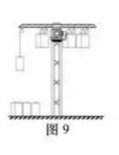

（2）在用电高峰时释放能量，让重物稳定下落带动发电机发电，使＿＿＿＿＿＿＿＿能转化为电能。

> [!tip]- 💡 思路导航
> 匀速提升：W=Fs（s 即提升高度）、P=W/t；机械效率把"额外功"算进总功里再作比；发电环节想想重物的机械能去了哪里。

> [!success]- ✅ 详解 · 评分点 · 易错 · 关联
> **详解**：（1）W=Fs=3×10⁵×50=**1.5×10⁷J**；P=W/t=1.5×10⁷/100=**1.5×10⁵W**。W总=W有+W额=1.5×10⁷+1×10⁷=2.5×10⁷J，η=W有/W总=1.5×10⁷/2.5×10⁷=**60%**。（2）**机械**能→电能。
>
> **易错**：额外功别漏加——效率=有用/总功，总功=有用+额外；把"3×10⁵N"看成"3×10⁴N"则数值全错。
>
> **关联**：[[04-物理/知识点/03-机械与功]]（功、功率、机械效率）。

**14.**（4分）压缩饼干
一块未压缩的饼干，长、宽、高如图10(a)所示，其质量为 200g。经过高压压缩后，长、宽不变，高变为原来的 1/4。在包装前，工人还需要对压缩好的饼干进行耐压测试，以保证出厂压缩饼干的品质。
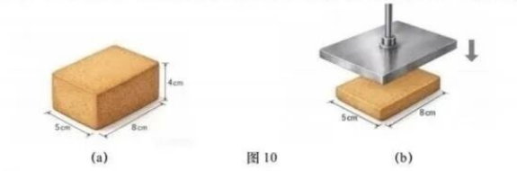

（1）求饼干被压缩后的密度 ρ；
（2）在耐压测试中，工人用一块面积为 100cm² 的金属板正对饼干施加 80N 的压力，如图10(b)所示，求金属板对饼干表面的压强 p。

> [!tip]- 💡 思路导航
> 压缩后高变为 1cm，体积按长×宽×新高压；压强的分母要用**实际接触面积**——金属板面积和饼干面面积，谁小用谁？

> [!success]- ✅ 详解 · 评分点 · 易错 · 关联
> **详解**：（1）**设** 压缩后高=4×1/4=1cm，V=8×5×1=40cm³=4×10⁻⁵m³。**算** ρ=m/V=0.2/(4×10⁻⁵)=**5×10³kg/m³（5g/cm³）**。
> （2）接触面积为饼干面 S=0.08×0.05=0.004m²＜金属板面积 100cm²。**算** p=F/S=80/0.004=**2×10⁴Pa**。**验** 约 0.2 个大气压，合理 ✓。
>
> **易错**：第(2)问受力面积取**饼干面**（0.08m×0.05m），不是金属板的 100cm²；单位换算 cm³→m³ 别出错。
>
> **关联**：[[04-物理/知识点/05-密度压强与浮力]]（密度公式、固体压强、受力面积的判断）。

**15.**（4分）水地暖说理
如图11所示，水地暖的工作原理是用锅炉持续加热水，水可在地板下被水泥包裹住的软管内循环流动，通过热传递的方式，使地板温度升高、房间内空气变暖。小明打开家里的水地暖一段时间后，发现房间内的温度并未明显升高，他将管道内的水放出，观察到流出的水中存在大量大小不一的气泡。他查阅资料后得知：(a) 当气泡的直径略小于管道内径时，气泡很难随水流动，水只能从气泡周围绕行，且阻力很大；(b) 气体在管道内的狭窄空间内，对流较差；(c) 气体传导热的能力较差。
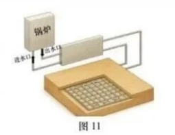

（1）冬天地暖正常工作时，锅炉出水口流出的水经地板下的管道循环后流入进水口，在此过程中水的内能＿＿＿＿＿＿＿＿（选填：A. 增加　B. 减少　C. 不变）；
（2）结合上述信息和所学知识，分析说明小明家里的水地暖制热效果不理想的原因。

> [!tip]- 💡 思路导航
> 说理题按"现象→物理依据→回扣情境"三段式：气泡卡在管道里，水还流得动吗？热量想穿过"气段"传出去，难在哪两处？

> [!success]- ✅ 详解 · 评分点 · 易错 · 关联
> **详解**：（1）热水在地板下放热降温，**B 减少**。
> （2）说理（判断→依据→回扣）：管道内水中有大量直径略小于管道内径的气泡→水只能从气泡周围绕行、阻力很大，很难流回锅炉被加热后再次循环；且气体对流差、导热能力差→锅炉内热水的内能很难穿过气泡传给管道内的水，更难传给水泥和地板→热量利用率低，制热效果不理想。
>
> **易错**：说理必须同时用到资料(a)"水流受阻"和(b)(c)"气体不导热"两条，漏一条即扣分；结论句"制热效果不理想的原因是……"要回扣题问。
>
> **关联**：[[04-物理/知识点/04-热学]]（热传递、内能）、同类题 [[04-物理/专题/真题精讲/物模26-宝山-上]] 题10（说理题三要素）。

**16.**（12分）电热暖手宝
某电热暖手宝的发热原理图如图12所示，电源电压为 12V 且保持不变，R₁、R₂ 为电热丝，R₁ 阻值为 30Ω，R₂ 阻值为 20Ω。在使用时，可通过断开、闭合开关 S₁、S₂、S₃ 来改变接入电路的电热丝个数或连接方式，从而调节暖手宝的发热功率，满足用户对暖手宝的不同需求。
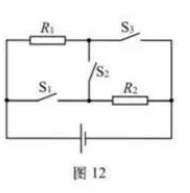

（1）若仅闭合开关 S₁，求通过 R₂ 的电流 I；
（2）若仅闭合开关 S₃，求暖手宝通电 10s 产生的热量 Q；
（3）求暖手宝在使用时，电路总功率的最大值 P最大 和最小值 P最小，并写出其对应的各个开关的断开、闭合情况；
（4）（不定项）某一个开关由于故障，无法闭合，导致该暖手宝只能实现 2 个不同发热功率的调节，发生故障的开关可能是（　）
- （A）S₁
- （B）S₂
- （C）S₃

> [!tip]- 💡 思路导航
> 先读图12 定结构：R₁ 上、R₂ 下，S₃ 与 R₁ 同在一条支路、S₁ 串在 R₂ 支路，S₂ 是两支路内侧节点之间的"桥"。四种开关组合对应四种状态：仅 S₁→仅 R₂；仅 S₃→仅 R₁；仅 S₂→串联；S₁、S₃ 闭合且 S₂ 断开→并联。功率大小看总电阻；第(4)问逐一模拟"某个开关永远断开"后还剩几个功率挡。

> [!success]- ✅ 详解 · 评分点 · 易错 · 关联
> **详解**：（1）仅 S₁：R₂ 单独接入。**列·算** I=I₂=U/R₂=12/20=**0.6A**。
> （2）仅 S₃：R₁ 单独接入。I₁=U/R₁=12/30=0.4A；**列·算** Q=I²R₁t=(0.4)²×30×10=**48J**。
> （3）**最大**：S₁、S₃ 闭合、S₂ 断开→R₁ 并 R₂，I最大=I₁+I₂=0.4+0.6=1A，P最大=UI最大=12×1=**12W**；**最小**：仅 S₂ 闭合→R₁ 串 R₂，R=30+20=50Ω，I最小=12/50=0.24A，P最小=12×0.24=**2.88W**。**验** 12W=144/12Ω（并），2.88W=144/50Ω（串），自洽 ✓。
> （4）坏 S₁：剩 4.8W（仅 R₁，S₃）、2.88W（串，S₂）、4.8W（S₂、S₃）→2 档 ✓；坏 S₃：剩 7.2W（仅 R₂，S₁）、2.88W（串）、7.2W（S₁、S₂）→2 档 ✓；坏 S₂：7.2W、4.8W、12W→3 档 ✗。选 **A、C**。
>
> **易错**：两种状态的开关条件必须与功率对应写清；并联是 S₁、S₃ 闭合且 **S₂ 必须断开**，否则电源短路；第(4)问要逐一枚举三个开关的故障情形，漏枚举易漏选。
>
> **关联**：[[04-物理/知识点/07-电功率与家庭电路]]（挡位功率、P=UI 与 I=U/R 联用）、同类题 [[04-物理/专题/真题精讲/物模26-静金闵青-下]] 题12（同款三开关电路）、[[04-物理/专题/电学四大题型]]（挡位切换专项）。

**17.**（7分）测小灯泡正常发光电阻
小珠做"用电流表和电压表测量小灯泡正常发光时的电阻"实验：她将电源（电压保持不变）、待测小灯泡、滑动变阻器、电流表和开关串联，并将电压表并联在小灯泡两端。小珠依次记录滑片位于不同位置时的电流表和电压表示数（下表为记录的部分数据），并根据其中一组数据计算出了小灯泡正常发光时的电阻。小灯泡正常发光时，电流表、电压表（表盘如图13(a)所示）中恰有一个电表的指针位于刻度盘的中央。小珠根据记录的数据，绘制了小灯泡的电流随其两端电压变化的 I-U 图像，如图13(b)所示。（实验过程中，电表均选择了合适的量程）

| 实验序号 | 电压（V） | 电流（A） |
| ---- | ---- | ---- |
| 1 | 0.8 | 0.14 |
| 2 | 1.0 | 0.16 |
| 3 | — | 0.24 |
| 4 | 2.5 | — |
| 5 | 2.9 | 0.32 |

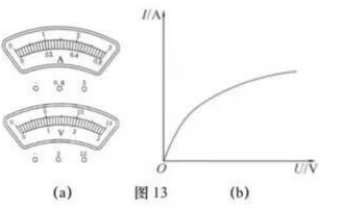

（1）"用电流表和电压表测量小灯泡正常发光时的电阻"实验原理是＿＿＿＿＿＿＿＿；
（2）请画出小珠的实验电路图；
（3）求小灯泡正常发光时的电阻 R_L。（需写出解答过程，计算结果精确到 0.1Ω）

> [!tip]- 💡 思路导航
> 伏安法原理一句话；电路图按"电源—开关—变阻器—电流表—灯"串联、电压表并灯两端画。第(3)问的关键是"恰有一个表指针居中"：居中=量程一半，先由数据上限定两表量程，再用"灯丝电阻随电压增大而增大"排除矛盾组，锁定哪一组是正常发光态。

> [!success]- ✅ 详解 · 评分点 · 易错 · 关联
> **详解**：（1）**R=U/I**。
> （2）图略：电源、开关、滑动变阻器、电流表、小灯泡串联，电压表并联在小灯泡两端。
> （3）**推理**：U最大=2.9V＜3V、I最大=0.32A＜0.6A→电压表选 0～3V、电流表选 0～0.6A，居中读数 1.5V、0.3A。序号 2：R₂=1.0/0.16=6.25Ω；若序号 3 电压表居中→U₃=1.5V→R₃=1.5/0.24=6.25Ω=R₂，但由 I-U 图像灯丝电阻 R 随 U 增大而增大，U₃＞U₂→R₃＞R₂→矛盾，序号 3 电压表不居中；序号 1、2、5 两表均不居中→正常发光组为序号 4：电流表居中 I₄=0.30A，U₄=2.5V。**算** R_L=U₄/I₄=2.5/0.30≈**8.3Ω**。
>
> **易错**：必须先用量程判定+矛盾排除说明"为什么是序号 4"，直接取 2.5V/0.30A 而不写推理过程要扣过程分。
>
> **关联**：[[04-物理/知识点/06-电学基础]]（伏安法测电阻）、[[04-物理/专题/实验操作考点-物理]]、同类题 [[04-物理/专题/真题精讲/物模26-静金闵青-下]] 题11（同款测电阻推理）。

## 🔗 关联

- [[04-物理/知识点/06-电学基础]]（短路识别、电路连接、伏安法、控制变量法）
- [[04-物理/知识点/07-电功率与家庭电路]]（家庭电路、挡位功率、P=UI 与 I=U/R 联用）
- [[04-物理/知识点/05-密度压强与浮力]]（流体压强、固体压强、密度、连通器）
- [[04-物理/知识点/04-热学]]（比热容图像、热值、物态变化吸放热、热机冲程）
- [[04-物理/知识点/03-机械与功]]（杠杆、功与功率、机械效率）
- [[04-物理/知识点/02-运动与力]]（流体压强与流速）
- [[04-物理/专题/大题规范书写-设列算验答]]（第12～17题计算规范）
- 同类题：[[04-物理/专题/真题精讲/物模26-静金闵青-下]]（同款测电阻推理与三开关电路）、[[04-物理/专题/真题精讲/物模26-宝山-上]]（说理与流体压强）、[[04-物理/专题/真题精讲/物-08-电功率综合]]
