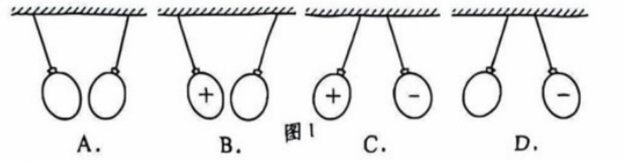
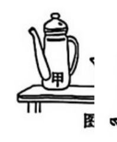
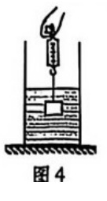
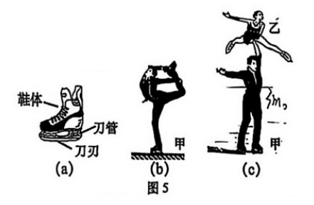
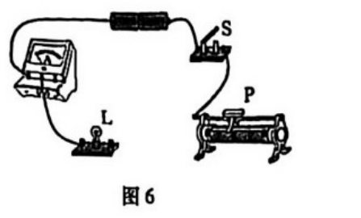

# 物模26 虹口一模精讲（上）· 学科基础

> 2026 届虹口区初三一模（2025 学年度第一次学习能力诊断练习，2026.1，综合卷满分 135 分，物理部分 70 分）第一题块"学科基础"（40 分，第 1～12 题），概念填空与小计算为主。**卷面配图已自页图裁切嵌入（题 2、3、5、6、7、9；源文件为 docx 转制 PDF，中文正文字体未渲染、图形保留）；原以为缺失的"参考答案与评分标准"已在扫描件末两页找到，本讲全部结论已逐项与其核对一致**，其中题 3(2)、题 5(2) 系据官方答案订正（见各题详解）。综合题块见 [[04-物理/专题/真题精讲/物模26-虹口-下]]。

**1.** 城市热岛效应
（1）城市道路在日照下升温，这是通过＿＿＿＿＿＿＿＿的方式改变道路的内能；
（2）汽油机工作时，＿＿＿＿＿＿＿＿冲程将内能转化为机械能；排气冲程排放的废热是造成"热岛效应"的原因之一；
（3）市内人工湖能有效调节周围环境温度，主要是因为水的＿＿＿＿＿＿＿＿较大。

> [!tip]- 💡 思路导航
> 日照升温是"晒热"不是做功；内能→机械能对应做功冲程；人工湖调温靠水的比热容大。

> [!success]- ✅ 详解 · 评分点 · 易错 · 关联
> **详解**：（1）道路吸收太阳辐射的热量升温，通过**热传递**改变内能。（2）**做功**冲程：燃气推动活塞，内能→机械能。（3）水的**比热容**大，吸收大量热量而温度升高不多，能调节气温。
>
> **关联**：[[04-物理/知识点/04-热学]]（内能、热机、比热容）。

**2.** 摩擦起电
用一块干燥的毛皮分别摩擦两个相同的橡胶气球，使气球均带电。
（1）橡胶气球是＿＿＿＿＿＿＿＿。
- （A）导体
- （B）绝缘体
（2）如图1所示，将这两个气球悬挂后，关于它们所带电荷的种类及相互作用情况正确的是＿＿＿＿＿＿＿＿。

> [!tip]- 💡 思路导航
> 橡胶是典型绝缘体；毛皮摩擦过的橡胶制品带负电——两个都带负电，同种电荷相互排斥。

> [!success]- ✅ 详解 · 评分点 · 易错 · 关联
> **详解**：（1）橡胶不容易导电，**B 绝缘体**（正因绝缘，电荷停留在摩擦处使气球带电）。（2）毛皮摩擦过的橡胶制品带**负电**，两气球带同种电荷、相互排斥而彼此分开悬挂，选 **D**（与官方答案一致）。
>
> **易错**：**先定电荷种类再判相互作用**——若误记"橡胶棒带正电"，就会错选 C（一正一负相吸）。
>
> **关联**：[[04-物理/知识点/06-电学基础]]（摩擦起电、电荷间相互作用）。

**3.** 安全锤
图2为公交车配备的安全锤。

（1）安全锤一端做得很尖锐是为了＿＿＿＿＿＿＿＿。
- （A）增大压力
- （B）减小压力
- （C）增大压强
- （D）减小压强
（2）若安全锤尖端面积为 $5×10^{-7}m^2$（卷面印制值；源文本误提取作"5×10⁻¹"，按官方答案 1×10⁸ Pa 回推订正），破窗时对玻璃窗的压力为 50N，则它对玻璃窗的压强为＿＿＿＿＿＿＿＿Pa。

> [!tip]- 💡 思路导航
> 尖端是减小受力面积→增大压强；代入 $p=F/S$ 时先核指数运算。

> [!success]- ✅ 详解 · 评分点 · 易错 · 关联
> **详解**：（1）尖端受力面积小，压力一定时由 $p=F/S$ 压强大，选 **C 增大压强**（压力不变，排除 A、B）。（2）**设**压强为 p。**列** $p=F/S$。**算** $p=50/(5×10^{-7})=1×10^8Pa$。**验**：钉尖类压强可达 $10^6～10^8$ Pa，量级合理 ✓（与官方答案一致）。
>
> **易错**：**负指数幂运算**——$50/(5×10^{-7})=10×10^7=10^8$，把 $10^{-7}$ 当 $10^{-6}$ 会算成 $10^7$；源文本曾把面积误印为"5×10⁻¹"，考场上以原卷印制数值代入即可。
>
> **关联**：[[04-物理/知识点/05-密度压强与浮力]]（压强公式与增大压强的方法）。

**4.** 冰的密度
常温常压下，冰的密度为 $0.9×10^3kg/m^3$。
（1）它表示 $1m^3$ 冰的＿＿＿＿＿＿＿＿为 $0.9×10^3kg$；
（2）冰熔化成水后，＿＿＿＿＿＿＿＿。
- （A）质量变大，体积变小
- （B）质量变小，体积变大
- （C）质量不变，体积变小
- （D）质量不变，体积变大

> [!tip]- 💡 思路导航
> 密度的物理意义按"单位体积的质量"表述；质量不随物态变化，再用 $V=m/ρ$ 判体积。

> [!success]- ✅ 详解 · 评分点 · 易错 · 关联
> **详解**：（1）密度表示单位体积的质量：$1m^3$ 冰的**质量**为 $0.9×10^3kg$。（2）熔化时物质多少不变，**质量不变**；$ρ_水＞ρ_冰$，由 $V=m/ρ$ 体积变小，选 **C**。
>
> **关联**：[[04-物理/知识点/05-密度压强与浮力]]（密度的物理意义、密度与物态）。

**5.** 两只水壶
图3：壶身高度、壶底面积均不同的甲、乙两个水壶放在水平桌面上。

（1）水壶的壶嘴和壶身相连通，这是＿＿＿＿＿＿＿＿应用的实例；
（2）当壶内均装满水时，水对甲底部的压强＿＿＿＿＿＿＿＿水对乙底部的压强。
- （A）大于
- （B）等于
- （C）小于
（3）壶盖上有一小孔，其作用是使壶内水面上方的压强＿＿＿＿＿＿＿＿外界大气压，使水得以持续被倒出。
- （A）大于
- （B）等于
- （C）小于

> [!tip]- 💡 思路导航
> 壶嘴壶身=连通器；装满水时 $p=ρgh$ 只看壶身高度——先从图上认准谁高（本卷甲壶更高），再看小孔通大气的作用。

> [!success]- ✅ 详解 · 评分点 · 易错 · 关联
> **详解**：（1）壶嘴与壶身上端开口、底部连通，是**连通器**的应用。（2）装满水时水深等于液面到底部的高度，由 $p=ρgh$ 只比深度、与底面积无关；本卷甲壶壶身更高、水深更大，水对甲底压强**较大，选 A（大于）**（与官方答案一致）。（3）小孔使壶内水面上方与大气相通，压强**等于（B）**外界大气压，倒水时空气可进入壶内，水才能持续流出。
>
> **易错**：**液体压强与底面积无关**——被"壶底面积不同"带偏是比较 $p=ρgh$ 的最大陷阱；"谁高谁底压强大"要先看图再落笔。
>
> **关联**：[[04-物理/知识点/05-密度压强与浮力]]（连通器、液体压强）、[[04-物理/专题/压强浮力-上海特色题型]]。

**6.** 弹簧测力计与浮力
图4：重为 4N 的物块，用细线挂在弹簧测力计下浸没在水中，静止时测力计示数为 3N。

（1）物块受到浮力的大小为＿＿＿＿＿＿＿＿N，方向＿＿＿＿＿＿＿＿；
（2）若剪断细线，物块将（　）
- （A）上浮
- （B）悬浮
- （C）下沉

> [!tip]- 💡 思路导航
> 称重法 $F_浮=G-F_示$；沉浮看"浸没时"浮力与重力谁大。

> [!success]- ✅ 详解 · 评分点 · 易错 · 关联
> **详解**：（1）**设**浮力为 $F_浮$。**列**称重法 $F_浮=G-F_示$。**算** $F_浮=4-3=$ **1N**；方向**竖直向上**。（2）浸没时浮力 1N＜重力 4N，剪断细线后合力向下，**C 下沉**。
>
> **易错**：**沉浮看"浸没时"的浮力**——剪断后瞬间仍浸没，$F_浮=1N＜G=4N$ 判下沉；切勿用"排开体积变化"先入为主。
>
> **关联**：[[04-物理/知识点/05-密度压强与浮力]]（称重法测浮力、物体的沉浮条件）。

**7.** 冰刀鞋
图5(a)：花样滑冰运动员的冰刀鞋，刀刃用坚硬耐磨的高碳不锈钢，刀管用密度较小的铝合金。

（1）刀管用铝合金的主要目的是＿＿＿＿＿＿＿＿冰刀鞋的质量。
- （A）增大
- （B）减小
（2）运动员甲单脚站立时对地面的压力为 650N，请在图5(b) 中画出压力 F 的示意图；
（3）甲的质量为 $3m_0$，单脚站立时对地面的压强为 $p_0$；乙的质量为 $2m_0$。甲托举乙双脚站立时，甲对地面的压强为＿＿＿＿＿＿＿＿（用 $p_0$ 表示）。

> [!tip]- 💡 思路导航
> 密度小→同体积质量小；压力示意图抓"作用点、方向、大小"三要素；比值法处理"托举＋双脚"：压力相加、面积翻倍。

> [!success]- ✅ 详解 · 评分点 · 易错 · 关联
> **详解**：（1）铝合金密度小，同体积下质量小，**B 减小**。（2）【作图】压力 F 的作用点画在地面（脚与地面接触处），方向**垂直地面向下**（水平地面上即竖直向下），标注 $F=650N$【官方评分：压力的大小、方向、作用点均正确】。（3）**设**单脚与地面接触面积为 S。**列** $p_0=F/S=3m_0g/S$；托举乙双脚站立时 $p'=F'/S'=(3m_0+2m_0)g/(2S)$。**算** $p'=\dfrac{5m_0g}{2S}=\dfrac{5}{6}×\dfrac{3m_0g}{S}=\dfrac{5}{6}p_0$。**验**：压力增为 5/3 倍、面积增为 2 倍，压强为原来的 5/6，合理 ✓（与官方答案 5/6p₀ 一致）。**答**：$p'=\dfrac{5}{6}p_0$。
>
> **易错**：**用比值法最后必须回代成 $p_0$ 的形式**（题干要求用 $p_0$ 表示），保留 S、$m_0$ 会被扣分。
>
> **关联**：[[04-物理/知识点/05-密度压强与浮力]]（密度、固体压强）、[[04-物理/知识点/02-运动与力]]（力的示意图）。

**8.** 安全用电
（1）上海地区家用照明电路的电压为＿＿＿＿＿＿＿＿V；
（2）家用冰箱和空调是＿＿＿＿＿＿＿＿连接的。
- （A）串联
- （B）并联
（3）关于安全用电，下列做法中正确的是＿＿＿＿＿＿＿＿（多选）。
- （A）断开开关后更换灯泡
- （B）将多个大功率用电器接在同一个拖线板上
- （C）用湿手触摸家庭电路中的开关
- （D）发生触电事故时，不能直接触碰触电人员

> [!tip]- 💡 思路导航
> 家庭电路三常识（电压、并联、多选安全原则）；多选题逐项找"错在哪儿"再排除。

> [!success]- ✅ 详解 · 评分点 · 易错 · 关联
> **详解**：（1）**220V**。（2）各用电器互不影响，**B 并联**。（3）逐项：A 断开开关后操作、不带电作业 ✓；B 同一拖线板接多个大功率电器→总电流过大易引发事故 ✗；C 水是导体，湿手操作易触电 ✗；D 直接拉拽触电者会使施救者间接触电，应先断开电源 ✓。选 **AD**（与官方答案一致）。
>
> **关联**：[[04-物理/知识点/07-电功率与家庭电路]]（家庭电路、安全用电）。

**9.** 滑动变阻器
（1）滑动变阻器是利用电阻大小与＿＿＿＿＿＿＿＿的关系制成的。
- （A）材料
- （B）长度
- （C）横截面积
（2）图6电路中有两根导线尚未连接，请用笔画线代替导线补上。要求：闭合开关 S，小灯泡 L 发光；向右移动滑动变阻器滑片 P 的过程中，小灯泡 L 的亮度不变，电流表的示数变大。

> [!tip]- 💡 思路导航
> 变阻器原理看"改变什么"；"亮度不变"→灯的电流不变→并联；"电流表示数变大"→电流表在变阻器支路、且滑片右移时接入变短。

> [!success]- ✅ 详解 · 评分点 · 易错 · 关联
> **详解**：（1）移动滑片改变接入电路的电阻丝**长度**，选 **B**。（2）【作图】"亮度不变"→灯的电流不变→灯 L 与滑动变阻器**并联**；"电流表示数变大"→电流表（0～0.6A）串联在滑动变阻器支路，且变阻器下方接**右侧**接线柱（右移滑片接入变短、该支路电流变大）；开关接干路，电流"正进负出"【官方评分：电路连接正确】。（电流表接干路、变阻器下接右柱同样满足题意。）
>
> **易错**：**两个要求逐一落实**——"亮度不变"定并联、"示数变大"定变阻器下接线柱方向与电流表位置，作图后逐条自查。
>
> **关联**：[[04-物理/知识点/06-电学基础]]（滑动变阻器、串并联电路）。

**10.** 取暖与燃料
（1）一台取暖器正常工作时的电阻为 22Ω，通过的电流为 10A，则工作 60s 产生的热量为＿＿＿＿＿＿＿＿J；
（2）下列用电器中利用电流热效应工作的是＿＿＿＿＿＿＿＿。
- （A）电热毯
- （B）吸尘器
- （C）液晶电视机
（3）质量相同的干木柴和木炭完全燃烧，＿＿＿＿＿＿＿＿放出的热量多（$q_{干木柴}=1.2×10^7J/kg$、$q_{木炭}=3.4×10^7J/kg$）。
- （A）干木柴
- （B）木炭

> [!tip]- 💡 思路导航
> 焦耳定律 $Q=I^2Rt$；热效应辨别看"电→内"还是"电→机械/光"；同质量比放热看热值。

> [!success]- ✅ 详解 · 评分点 · 易错 · 关联
> **详解**：（1）**列** $Q=I^2Rt$。**算** $Q=10^2×22×60=1.32×10^5J$。**答**：$1.32×10^5$ J（与官方答案一致）。（2）电热毯把电能转化为内能，选 **A**（吸尘器用电动机、液晶电视机主要不是利用热效应）。（3）由 $Q_放=mq$，质量相同时热值大的放热多，$3.4×10^7＞1.2×10^7$，选 **B 木炭**。
>
> **关联**：[[04-物理/知识点/04-热学]]（焦耳定律、热值）。

**11.** 救生圈的浮力
一个救生圈浸在水中时，排开水的体积为 $2×10^{-3}m^3$，计算救生圈受到浮力 $F_浮$ 的大小。

> [!tip]- 💡 思路导航
> 阿基米德原理一步代入：$F_浮=ρ_水gV_排$。

> [!success]- ✅ 详解 · 评分点 · 易错 · 关联
> **详解**：**设**浮力为 $F_浮$。**列**阿基米德原理 $F_浮=ρ_水 gV_排$。**算** $F_浮=1.0×10^3×9.8×2×10^{-3}=19.6N$。**验**：排开 2L 水约重 19.6N ✓（与官方答案一致）。**答**：$F_浮$ 为 19.6N。
>
> **关联**：[[04-物理/知识点/05-密度压强与浮力]]（阿基米德原理）、[[04-物理/专题/大题规范书写-设列算验答]]。

**12.** 烧开水
在 1 个标准大气压下，将质量为 1kg、温度为 20℃ 的水加热至沸腾。计算：
（1）水升高的温度 $\Delta t$；
（2）水吸收的热量 $Q_吸$。[$c_水=4.2×10^3J/(kg·℃)$]

> [!tip]- 💡 思路导航
> 标准大气压下沸水 100℃；$\Delta t=t-t_0$，再代 $Q_吸=cm\Delta t$。

> [!success]- ✅ 详解 · 评分点 · 易错 · 关联
> **详解**：（1）标准大气压下沸水温度 100℃，$\Delta t=100-20=$ **80℃**。（2）**列** $Q_吸=c_水m\Delta t$。**算** $Q_吸=4.2×10^3×1×80=3.36×10^5J$。**验**：1kg 水升温 80℃ 约 $3.4×10^5$ J，量级合理 ✓（与官方答案一致）。**答**：$Q_吸$ 为 $3.36×10^5$ J。
>
> **易错**：**"加热至沸腾"隐含末温 100℃**——不写"标准大气压下沸水 100℃"直接冒出 80℃ 会扣过程分。
>
> **关联**：[[04-物理/知识点/04-热学]]（比热容、沸点与气压）、[[04-物理/专题/大题规范书写-设列算验答]]。

## 🔗 关联

- [[04-物理/知识点/04-热学]]（内能、热机、比热容、热值）
- [[04-物理/知识点/06-电学基础]]（摩擦起电、导体绝缘体、家庭电路、滑动变阻器）
- [[04-物理/知识点/05-密度压强与浮力]]（密度、压强、连通器、浮力）
- [[04-物理/专题/压强浮力-上海特色题型]]（$p=ρgh$ 与连通器）
- 同类题：[[04-物理/专题/真题精讲/物-10-2026真题-生活与自然]]、[[04-物理/专题/真题精讲/物模26-虹口-下]]（同卷综合题块）
