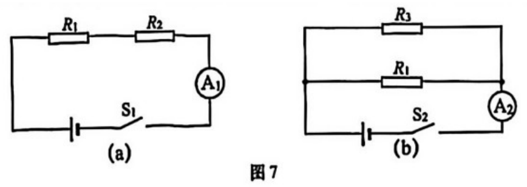
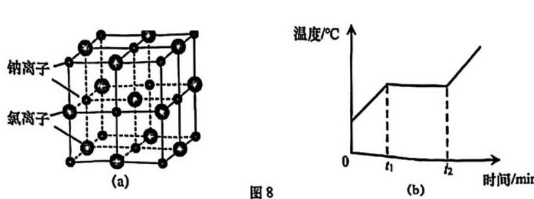
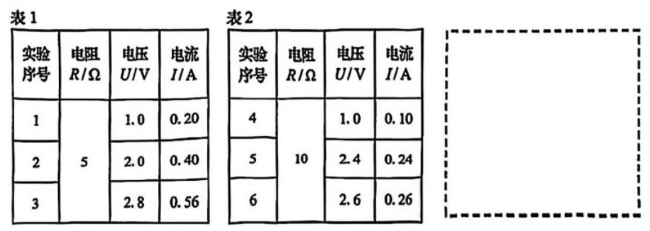
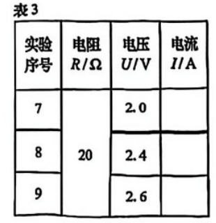
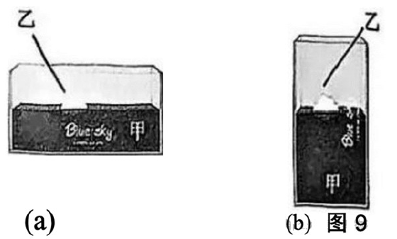
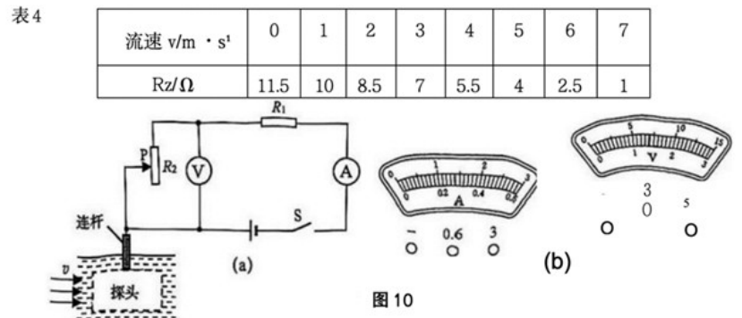
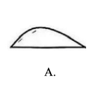

# 物模26 虹口一模精讲（下）· 学科综合

> 2026 届虹口区初三一模物理部分第二题块"学科综合"（30 分，第 13～17 题）：三电阻两种连接的故障定位方案选择、氯化钠晶体熔化的微粒说理、"探究电流与电压、电阻"数据分析、密闭摆件正放竖放的压强计算、水流速度自动报警器电路设计。**本讲初版曾因源文本缺图缺答案而整卷推演；现已自页图恢复全部图表（图 7～10、表 1～4 均已裁切嵌入），并找到扫描件末两页的官方参考答案，逐项核对后订正了题 13、15 的原推演**（详见各题详解与 ⚠️ 注）。基础题块见 [[04-物理/专题/真题精讲/物模26-虹口-上]]。

**13.** 三电阻电路故障
电阻 $R_1$、$R_2$、$R_3$ 以不同的方式先后组成图7(a)(b) 所示电路：图7(a) 中 $R_1$ 与 $R_2$ 串联、电流表 $A_1$ 测电路电流；图7(b) 中 $R_3$ 与 $R_1$ 并联、电流表 $A_2$ 测干路电流。电源电压相同且保持不变。三个电阻中仅有一个存在故障。闭合开关 $S_1$、$S_2$，电流表 $A_1$、$A_2$ 的示数均不为 0。

（1）电路中的故障可能是＿＿＿＿＿＿＿＿（写出所有可能）；
（2）为进一步确定故障，现有方案：
- 方案①：在图7(a)中，将电阻 $R_2$ 替换为 $R_3$；
- 方案②：在图7(b)中，将电阻 $R_3$ 替换为 $R_2$。

你将采用哪一方案，请说明理由，并解释不能采用另一方案的原因。

> [!tip]- 💡 思路导航
> 先用"两表示数均不为 0"排除断路与"并联即电源短路"两类故障，再看两种方案各能提供什么信息——串联电路换电阻，示数"变 0 / 不变 0"恰好区分两类故障；并联电路里换入可能短路的电阻等于制造电源短路。

> [!success]- ✅ 详解 · 评分点 · 易错 · 关联
> **详解**：（1）逐一检验：若 $R_1$ 或 $R_2$ **开路**，图7(a) 串联电路无电流、$A_1$ 示数为 0，不合题意；若 $R_1$ 或 $R_3$ **短路**，图7(b) 并联电路中电源被短路、电流表会损坏且示数异常，不符合"正常示数不为 0"的情境。剩下的可能是：**$R_2$ 短路**（(a) 中 $R_1$ 与短路的 $R_2$ 串联、$A_1≠0$；(b) 不含 $R_2$、$R_3∥R_1$ 正常、$A_2≠0$）或 **$R_3$ 开路**（(a) 不含 $R_3$、$A_1≠0$；(b) 中 $R_3$ 支路断而 $R_1$ 支路仍通、$A_2≠0$）。**答**：$R_2$ 短路或 $R_3$ 开路（与官方答案一致）。
> （2）**采用方案①**。图7(a) 为串联电路、电流有确定的"正常值" $U/(R_1+R_3)$。把 $R_2$ 换成 $R_3$ 后：若原故障是 $R_2$ 短路，新电路三个电阻均完好，电流表示数不为 0（恢复为 $U/(R_1+R_3)$）；若原故障是 $R_3$ 开路，新电路因 $R_3$ 开路而断路，电流表示数为 0——由替换后示数是否为 0 即可确定故障（与官方答案一致）。
> **不能采用方案②**：图7(b) 为并联电路，$R_3$ 与 $R_1$ 均直接接在电源两端；由（1）知故障可能是 $R_2$ 短路，把 $R_2$ 换入 (b) 会将它并联在电源两端、造成电源短路（电流极大，烧坏电流表和电源），因此不能采用（与官方答案一致）。
>
> **易错**：**"示数均不为 0"排除的是两类**——串联断路（$A_1=0$）与并联短路（电源短路、示数异常），漏掉后者会把 $R_1$、$R_3$ 短路也写成可能故障；方案②的理由要写"短路无法通过并联替换恢复＋损坏电路"两层。
>
> **关联**：[[04-物理/知识点/06-电学基础]]（串联并联电路、故障分析）、[[04-物理/专题/电学四大题型]]（电路故障）、同类题 [[04-物理/专题/真题精讲/物-07-探究电路与故障]]（故障分析通法）。

**14.** 氯化钠晶体熔化
资料：①氯化钠晶体中微粒排列规则，在各自固定的平衡位置附近不停地做微小振动；②温度达到熔点时，微粒的剧烈振动会破坏原有规则排列，晶体结构被破坏，变成液体；③结构完全被破坏后，继续吸热温度持续升高。图8(b)为氯化钠晶体熔化时的温度变化曲线。

（1）从 0 至 t₁，组成氯化钠晶体的微粒振动剧烈程度＿＿＿＿＿＿＿＿。
- （A）增大
- （B）不变
- （C）减小
（2）小红提出"从 t₁ 至 t₂，氯化钠晶体结构被破坏需要消耗能量"的猜想。请判断该猜想是否合理，并写出依据。

> [!tip]- 💡 思路导航
> 温度是分子热运动剧烈程度的标志；熔化过程"吸热但温度不变"是解题钥匙——吸收的热量去哪了？

> [!success]- ✅ 详解 · 评分点 · 易错 · 关联
> **详解**：（1）0～t₁ 温度升高，微粒热运动加剧，振动剧烈程度**增大**，选 **A**（与官方答案一致）。（2）**合理**。依据（判断→依据→回扣）：t₁ 至 t₂ 是氯化钠的熔化过程，晶体持续从外界吸收热量但**温度保持不变**——吸收的热量没有用于增大微粒运动的剧烈程度，而是用于破坏微粒的规则排列，即消耗在晶体结构的破坏上（转化为微粒势能）；题给资料②也指出"微粒的剧烈振动会破坏其原有的规则排列"，故该猜想合理（与官方答案一致）。
>
> **评分点**：**结论先行、依据跟上**——只写"合理"不写"吸热但温度不变→热量用于破坏结构"只能得一半分；能引用题给资料②更稳。
>
> **关联**：[[04-物理/知识点/04-热学]]（晶体熔化、温度与分子热运动）。

**15.** 探究电流与电压、电阻
器材：电源（3V 保持不变）、电流表、电压表、开关、导体（5Ω、10Ω、20Ω 各一个）、滑动变阻器（"20Ω 2A"）、导线。探究电流与电压关系时，用变阻器多次改变导体两端电压，数据记在表1、表2 中（卷面原表见下图）。

（1）在虚线框中画出实验电路图；
（2）分析比较实验序号 1、2 与 3（或 4、5 与 6）的数据可得：＿＿＿＿＿＿＿＿；
（3）分析比较实验序号＿＿＿＿＿＿＿＿的数据，可得"电压相同时，电阻较大的导体通过的电流较小"。为探究电压一定时电流与电阻的定量关系，将 20Ω 电阻接入电路，预设电阻两端电压如表3。判断他的方案是否合理，并说明理由。

> [!tip]- 💡 思路导航
> 控制变量法找数据组：同导体比电压→正比结论；"电压相同时比电流"要找**电压数值相同**的两组数据——先在表1、表2 里找同电压的配对；20Ω 方案的判断落点在"同电压的数据够不够归纳出定量关系"。

> [!success]- ✅ 详解 · 评分点 · 易错 · 关联
> **详解**：（1）【电路图】电源、开关、滑动变阻器与导体串联；电流表（0～0.6A）串联在电路中；电压表（0～3V）并联在导体两端【官方评分：电路图正确】。（2）序号 1、2 与 3 是**同一导体**（5Ω）的三组数据：电压 1.0→2.0→2.8V，电流 0.20→0.40→0.56A，$I/U$ 恒为 0.2A/V。结论句：**同一导体（电阻一定），通过导体的电流与导体两端的电压成正比**（与官方答案一致）。（3）第一空：表1、表2 中电压数值相同的数据只有**序号 1 与 4**（均为 1.0V：5Ω 通过 0.20A、10Ω 通过 0.10A），故填 **1 与 4**（与官方答案一致）。方案判断：**不合理**——探究"电压一定时电流与电阻"需要多个导体在**同一电压**下的数据；表3 预设的 2.0V、2.4V、2.6V 中，2.0V 只与表1 序号 2（5Ω）同压、2.4V 与 2.6V 只与表2 序号 5、6（10Ω）同压，找不到能同时容纳 5Ω、10Ω、20Ω 的同电压数据组，**导体两端电压相同的实验数据太少，无法归纳得出电流与电阻的定量关系**（与官方答案一致）。
>
> **易错**：**"不合理"的原因不在"做不到"而在"比不成"**——顺带可算：3V 电源、20Ω 变阻器控制 20Ω 导体时两端电压最低可到 1.5V，表3 预设值本身都能实现；落点必须是"同压数据太少、无法归纳定量关系"。第一空误填"2 与 5、3 与 6"是没核对电压数值（2.0V≠2.4V、2.8V≠2.6V）。
>
> **关联**：[[04-物理/专题/实验操作考点-物理]]（探究电流与电压、电阻的关系）、[[04-物理/知识点/06-电学基础]]（欧姆定律、控制变量法）。

**16.** 密闭摆件的压强
图9(a)：薄壁密闭长方体摆件甲置于水平桌面上，甲内装有一定量的水，水中漂浮着物体乙，此时水的深度 h=0.02m，甲对桌面的压强 $p_甲=3×10^2Pa$。

（1）计算水对甲底部的压强 $p_水$；
（2）若甲的底面积为 $3×10^{-3}m^2$，计算甲对桌面的压力 $F_甲$；
（3）将甲竖放在水平桌面上（图9b），此时甲对桌面的压强 $p_甲'=6×10^2Pa$，计算水对甲底部的压强 $p_水'$。

> [!tip]- 💡 思路导航
> 液体压强 $p=ρgh$ 只看水深；桌面压力 $F=pS$；密闭容器正放竖放总重不变→对桌面压力不变，由压强比反求底面积比，再由"内容物体积不变"求新水深。

> [!success]- ✅ 详解 · 评分点 · 易错 · 关联
> **详解**：（1）**列** $p_水=ρ_水 gh$。**算** $p_水=1.0×10^3×9.8×0.02=196Pa$。**答**：$p_水$ 为 196Pa（与官方答案一致）。（2）**列** $F_甲=p_甲 S$。**算** $F_甲=3×10^2×3×10^{-3}=0.9N$。**验**：甲对桌面压力等于容器、水与乙的总重，薄壁轻摆件量级合理 ✓（与官方答案一致）。**答**：$F_甲$ 为 0.9N。（3）**设**竖放时底面积为 $S'$。**列**密闭摆件总重不变，对桌面压力不变：$p_甲'S'=F_甲$；内容物（水与乙浸入部分）体积不变：$S'h'=Sh$。**算** $S'=0.9/600=1.5×10^{-3}m^2$；$h'=\dfrac{3×10^{-3}×0.02}{1.5×10^{-3}}=0.04m$；$p_水'=1.0×10^3×9.8×0.04=392Pa$。**验**（官方另解）：$p_甲:p_甲'=3×10^2:6×10^2=1:2$→$S:S'=2:1$；同一物体乙漂浮、$V_排$ 不变，$V_总=V_水+V_排$ 不变→$h'=2h$→$p_水'=2p_水=392Pa$ ✓。**答**：$p_水'$ 为 392Pa（与官方答案一致）。
>
> **评分点**：**（3）三个方程环环相扣**——压力不变定 $S'$、内容物体积不变定 $h'$、再算压强；跳步直接写 392Pa 过程分尽失。"密闭、乙仍漂浮"两个隐含条件要会说。
>
> **关联**：[[04-物理/知识点/05-密度压强与浮力]]（液体压强、压力与受力面积）、[[04-物理/专题/压强浮力-上海特色题型]]。

**17.** 水流速度自动报警器
图10(a)：电源电压保持不变，虚线框中探头始终浸没在水中，流速 v 变化时探头通过连杆带动滑动变阻器 $R_2$ 的滑片 P 上下移动，$R_2$ 与 v 的对应关系见表4。允许通过 $R_2$ 的最大电流为 1A。流速过快或过慢时，电流表或电压表的示数会分别达到某一量程的最大值而触发报警。电表表盘如图10(b)。

（1）根据 $R_2$ 与流速 v 的变化情况，虚线框中的探头形状可能是＿＿＿＿＿＿＿＿（选项 A 图形如下；B、C、D 选项图形在源文件转换中缺失）。

（2）若电压表示数为 2V、电流表示数为 0.5A，计算此时电阻 $R_2$ 的电功率 $P_2$；
（3）若流速 v 达到 1m/s 和 6m/s 时均会触发警报，计算电源电压 U 和定值电阻 $R_1$ 的阻值。

> [!tip]- 💡 思路导航
> 由表4 定"$v↑→R_2↓$"，再由连杆—滑片的动作定探头形状应提供"流速越大、滑片移动越多"的力；报警对应两个量程满偏——流速**过慢**时 $R_2$ 大、电压表（测 $R_2$）先满偏，流速**过快**时 $R_2$ 小、电流表先满偏；$R_2$ 允许 1A 会筛掉大量程（3A、15V 组合）。

> [!success]- ✅ 详解 · 评分点 · 易错 · 关联
> **详解**：（1）由表4：$v$ 增大（0→7m/s）时 $R_2$ 减小（11.5→1Ω）。图10(a) 中探头经连杆带动滑片 P：流速越大、滑片上移越多、$R_2$ 接入段越短。上凸伞形探头（选项 **A**）在水流中因曲面上方流速大、压强小而受到向上的升力，$v$ 越大升力越大，与"$v↑→$滑片上移→$R_2↓$"匹配，故选 **A**（与官方答案一致；B、C、D 选项图形在源文件转换中缺失）。（2）【电压表并联在 $R_2$ 两端、电流表测电路电流】**列** $P_2=U_2I$。**算** $P_2=2×0.5=1W$（此时 $R_2=U_2/I=4Ω$，与表4 中 v≈5m/s 一致 ✓）。**答**：$P_2$ 为 1W（与官方答案一致）。（3）报警对应两个量程满偏。$R_2$ 允许电流 1A：若电压表取 0～15V 量程，$U_2=15V$ 时 $I=U_2/R_2=15/10=1.5A＞1A$（v=1m/s、$R_2=10Ω$），不合题意；故电压表量程取 **0～3V**、电流表量程取 **0～0.6A**（3A 超过 $R_2$ 允许的 1A）。**列** 流速过快 v=6m/s（$R_2=2.5Ω$）时电流表满偏：$U=I(R_1+R_2)=0.6R_1+0.6×2.5=0.6R_1+1.5$；流速过慢 v=1m/s（$R_2=10Ω$）时电压表满偏：$I=U_2/R_2=3/10=0.3A$，$U=0.3R_1+3$。**算** 联立 $0.6R_1+1.5=0.3R_1+3$，得 $R_1=$ **5Ω**，$U=0.6×5+1.5=$ **4.5V**。**验**：v=1m/s 时 $I=4.5/15=0.3A$、$U_2=3V$ 满偏 ✓；v=6m/s 时 $I=4.5/7.5=0.6A$ 满偏、$U_2=1.5V$ ✓；电路最大电流 0.6A＜1A ✓（与官方答案 U=4.5V、R₁=5Ω 一致）。
>
> **评分点**：**量程选择是（3）的隐藏采分点**——必须先用"$R_2$ 允许 1A"筛掉 15V/3A 量程组合，再列两个满偏方程；直接默认量程会错。
>
> **关联**：[[04-物理/知识点/06-电学基础]]（欧姆定律、串联分压）、[[04-物理/知识点/05-密度压强与浮力]]（流体压强与流速）、[[04-物理/专题/电学四大题型]]（报警器类动态电路）、同类题 [[04-物理/专题/真题精讲/物-08-电功率综合]]。

## ⚠️ 与初版推演的差异（据官方答案订正）

- **题13**：初版将图7 重构为"(a) 三电阻串联、(b) 三电阻并联"，故障推为"只能是短路"。实际卷面图7 为 (a) $R_1$、$R_2$ 串联（$A_1$）、(b) $R_3$、$R_1$ 并联（$A_2$ 测干路），官方答案：故障为 **$R_2$ 短路或 $R_3$ 开路**；采用方案①（示数为 0 判 $R_3$ 开路、不为 0 判 $R_2$ 短路）、不能采用方案②（$R_2$ 短路换入并联会造成电源短路）。
- **题15(3)**：初版因表1/表2/表3 数据缺失按"临界电压 1.5V"笼统推演。实际卷面数据：表1（5Ω）1.0V/0.20A、2.0V/0.40A、2.8V/0.56A；表2（10Ω）1.0V/0.10A、2.4V/0.24A、2.6V/0.26A；表3（20Ω）预设 2.0/2.4/2.6V。官方答案：第一空 **1 与 4**；方案**不合理**，理由是"导体两端电压相同的实验数据太少，无法归纳得出电流与电阻的定量关系"。
- **其余各题数值与结论经官方答案核对一致**（题14(1) A、题14(2) 合理、题16 196Pa/0.9N/392Pa、题17(1) A、题17(2) 1W、题17(3) U=4.5V、R₁=5Ω）。
- 题17(1) 选项 B、C、D 的图形在源文件（docx 转制 PDF）中丢失，仅选项 A 图形留存并嵌入；判断链不受影响。

## 🔗 关联

- [[04-物理/知识点/06-电学基础]]（串联并联电路、欧姆定律、故障分析）
- [[04-物理/知识点/04-热学]]（晶体熔化、温度与分子热运动）
- [[04-物理/知识点/05-密度压强与浮力]]（液体压强、压力与受力面积、流体压强）
- [[04-物理/专题/电学四大题型]]（电路故障、动态电路）
- [[04-物理/专题/实验操作考点-物理]]（探究电流与电压、电阻的关系）
- 同类题：[[04-物理/专题/真题精讲/物-07-探究电路与故障]]（故障分析通法）、[[04-物理/专题/真题精讲/物-08-电功率综合]]（报警器类动态电路）、[[04-物理/专题/真题精讲/物-05-密度压强浮力综合]]（压强综合计算）
