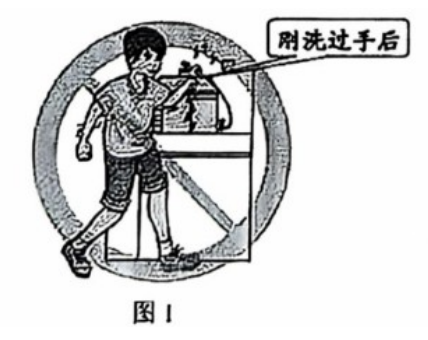
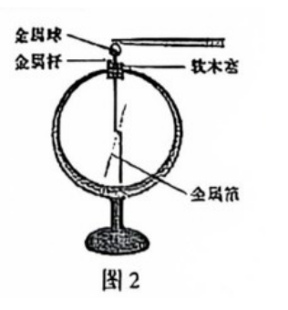
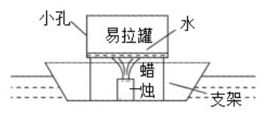
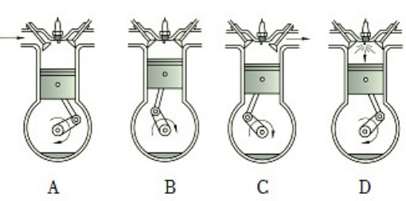
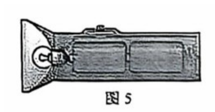
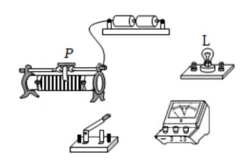
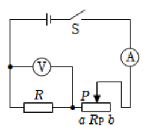

# 物模26 长宁一模精讲（上）· 学科基础

> 2026 届长宁区初三一模（2025 学年第一学期初三综合教学质量调研，2026.1，物理部分 70 分）第一题块"学科基础"（37 分，第 1～10 题）：家庭电路、用电安全、验电器、动力小船、电阻与串联、手电筒与调光灯、水的比热容、热机效率、探究电流与电压电阻实验（题 7、10 含作图与多选）。**原卷图 1～7 已全部自页图裁切嵌入**（源文件为 docx 原卷版转制 PDF，中文正文字体未渲染、图形保留；题干文字已与解析版逐字核对）。题 9(1) 第一空系按解析版官方答案订正。下册题块见 [[04-物理/专题/真题精讲/物模26-长宁-下]]。

**1.** 家庭电路
（1）电灯、空调等家用电器的正常工作电压为＿＿＿＿＿＿＿＿V，测量家庭电路消耗电能的装置是＿＿＿＿＿＿＿＿表；
（2）各用电器之间的基本连接方式是＿＿＿＿＿＿＿＿。
- （A）串联
- （B）并联
（3）下列家用电器正常工作时，电功率最大的是＿＿＿＿＿＿＿＿。
- （A）节能灯
- （B）电冰箱
- （C）电视机
- （D）空调

> [!tip]- 💡 思路导航
> 家庭电路三常识（220V、电能表、并联）；功率大小用 $I=P/U$ 反着想——电压相同比功率就是比电流。

> [!success]- ✅ 详解 · 评分点 · 易错 · 关联
> **详解**：（1）家庭电路电压 **220V**；测消耗电能用**电能表**。（2）各用电器需互不影响、独立工作，**B 并联**；串联则一断全停。（3）估测功率量级：节能灯 10～100W、冰箱约 100～200W、电视机约 100～200W、空调 1000～3000W，**D 空调**。
>
> **关联**：[[04-物理/知识点/07-电功率与家庭电路]]（家庭电路、电功率估算）。

**2.** 用电安全
（1）在家庭电路中，电功率越大的用电器，正常工作时通过它的电流越＿＿＿＿＿＿＿＿；同时使用的用电器越多，电路中的总电流越＿＿＿＿＿＿＿＿；
（2）如图1所示的操作过程，存在的安全问题是＿＿＿＿＿＿＿＿。

> [!tip]- 💡 思路导航
> 电压 220V 不变，用 $I=P/U$ 比电流；并联干路电流等于各支路之和；看图抓"湿手"这一动作，从"水是导体"切入。

> [!success]- ✅ 详解 · 评分点 · 易错 · 关联
> **详解**：（1）电压 220V 不变，由 $I=P/U$：$P$ 越大 $I$ 越**大**；并联总电流等于各支路电流之和，用电器越多总电流越**大**。（2）**用湿手触摸（插拔）插座/开关**：水是导体，湿手操作人体易触电，还可能造成短路，过大电流产生大量热量引发事故。
>
> **易错**：**表述要具体**——只写"不安全"不得分，须点出"湿手操作"这一动作及"水是导体、易触电/短路"的因果。
>
> **关联**：[[04-物理/知识点/07-电功率与家庭电路]]（安全用电）。

**3.** 验电器
将用毛皮摩擦过的橡胶棒与验电器的金属球接触（如图2）。

（1）验电器的金属箔带＿＿＿＿＿＿＿＿电荷。
- （A）正
- （B）负
（2）金属箔张开是因为＿＿＿＿＿＿＿＿，金属箔张开的角度越大，说明带电体带的电荷越＿＿＿＿＿＿＿＿；
（3）移去橡胶棒，用手触摸验电器金属球，金属箔的张角变为零，说明人体是＿＿＿＿＿＿＿＿。
- （A）导体
- （B）绝缘体

> [!tip]- 💡 思路导航
> 毛皮摩擦过的橡胶棒带负电；验电器原理"同种电荷相互排斥"；张角大=电荷多；人体能否导电看电荷能否经它导走。

> [!success]- ✅ 详解 · 评分点 · 易错 · 关联
> **详解**：（1）毛皮摩擦过的橡胶棒带负电，接触金属球时电子转移到金属箔上，箔带**负**电，选 **B**。（2）两片金属箔带**同种电荷，同种电荷相互排斥**，故张开；张角越大说明电荷越**多**。（3）手触摸后电荷经人体导走（导入大地），说明人体容易导电，**A 导体**。
>
> **关联**：[[04-物理/知识点/06-电学基础]]（摩擦起电、验电器原理、导体与绝缘体）。

**4.** 动力小船
小华在学校科技节活动中展示的动力小船如图3所示：易拉罐中的水吸热汽化产生大量水蒸气，从小孔冲出时小船向前运动。

（1）易拉罐用铝制成，是因为铝＿＿＿＿＿＿＿＿导热。
- （A）容易
- （B）不容易
（2）加热后，罐中水温度升高，改变水内能的方式是＿＿＿＿＿＿＿＿。
- （A）做功
- （B）热传递
（3）图4为内燃机各冲程，与"动力小船"能量转化情况相同的是＿＿＿＿＿＿＿＿冲程。

> [!tip]- 💡 思路导航
> 铝是热的良导体；火焰传热属热传递；小船是"内能→机械能"——看气门开闭＋活塞方向＋火花塞是否点火来辨冲程。

> [!success]- ✅ 详解 · 评分点 · 易错 · 关联
> **详解**：（1）铝导热性好，能快速把热量传给水，**A 容易**。（2）火焰的热量经罐壁传给水，属能量的转移，**B 热传递**。（3）小船：水蒸气冲出，**内能→机械能**。逐项（图4）：A 吸气、C 排气无能量转化；B 压缩冲程机械能→内能；D 做功冲程（两气门关闭、活塞下行、火花塞点火）内能→机械能。选 **D 做功**冲程。
>
> **易错**：**先辨冲程再对能量**——看气门开闭+活塞方向定冲程，再看火花塞点火——有电火花才是做功冲程；小船是"内能→机械能"，别错配成压缩冲程。
>
> **关联**：[[04-物理/知识点/04-热学]]（热传递、热机四冲程）。

**5.** 两根合金丝
两根长度相同的镍铬合金丝 A、B，横截面积 $S_A＞S_B$，串联接入同一电路。
（1）$R_A$、$R_B$：＿＿＿＿＿＿＿＿
- （A）$R_A＞R_B$
- （B）$R_A＜R_B$
- （C）$R_A=R_B$
（2）$I_A$、$I_B$：＿＿＿＿＿＿＿＿
- （A）$I_A＞I_B$
- （B）$I_A＜I_B$
- （C）$I_A=I_B$
（3）$U_A$、$U_B$：＿＿＿＿＿＿＿＿
- （A）$U_A＞U_B$
- （B）$U_A＜U_B$
- （C）$U_A=U_B$

> [!tip]- 💡 思路导航
> 电阻决定式：材料长度同，越粗电阻越小；串联电流处处相等；最后由 $U=IR$ 比电压——三问环环相扣。

> [!success]- ✅ 详解 · 评分点 · 易错 · 关联
> **详解**：（1）材料、长度相同，横截面积越大电阻越小，$S_A＞S_B$ 则 $R_A＜R_B$，选 **B**。（2）串联电路各处电流相等，$I_A=I_B$，选 **C**。（3）由 $U=IR$，$I$ 相同而 $R_A＜R_B$，故 $U_A＜U_B$，选 **B**。
>
> **关联**：[[04-物理/知识点/06-电学基础]]（电阻定律、串联电路特点）。

**6.** 手电筒
如图5所示，手电筒使用两节干电池作电源。

（1）电源电压为＿＿＿＿＿＿＿＿V；
（2）只有额定电压 2.5V、额定电流 0.2A 的小灯泡可用，为使其正常发光，需串联一个＿＿＿＿＿＿＿＿Ω的定值电阻；小灯正常发光时的电阻为＿＿＿＿＿＿＿＿Ω。

> [!tip]- 💡 思路导航
> 两节干电池串联 3V；串联分压 $U_阻=U-U_灯$、串联电流 $I=I_额$——两个电阻分别用"自己的电压"算，别混。

> [!success]- ✅ 详解 · 评分点 · 易错 · 关联
> **详解**：（1）一节干电池 1.5V，两节串联 $U=1.5+1.5=$ **3V**。（2）**设**串联电阻两端电压 $U_阻$。**列**串联分压 $U_阻=U-U_灯$，串联电流 $I=I_额=0.2A$。**算** $U_阻=3-2.5=0.5V$，$R_阻=0.5/0.2=$ **2.5Ω**；灯电阻 $R_灯=2.5/0.2=$ **12.5Ω**。**验**：$2.5+12.5=15Ω$，$I=3/15=0.2A$ ✓。**答**：2.5Ω；12.5Ω。
>
> **易错**：**两问对象不同**——串联电阻用"分到的 0.5V"算，灯电阻用"灯的 2.5V"算，混用电压是最高频错误。
>
> **关联**：[[04-物理/知识点/06-电学基础]]（串联电路、欧姆定律）。

**7.** 简易调光灯
小华设计的简易调光灯电路如图所示。

（1）用笔线代替导线完成电路连接。要求：①闭合开关，滑片 P 向左移动时灯变暗；②电压表正确并联在某个用电器两端；
（2）电源电压 3V，滑片在某处时电压表示数 1.0V，此时小灯电阻 10Ω，通过小灯的电流为＿＿＿＿＿＿＿＿A，通电 10s 电流做功为＿＿＿＿＿＿＿＿J。

> [!tip]- 💡 思路导航
> 作图两要求逐一落实："P 左移灯变暗"→左移电阻变大→变阻器下端接**右**柱；3V 电源→电压表选 0～3V 量程；计算认准电压表测的是谁。

> [!success]- ✅ 详解 · 评分点 · 易错 · 关联
> **详解**：（1）【作图】变阻器与灯串联，下方接**右**下接线柱（P 左移→接入变长→电阻变大→灯变暗）；电压表选 0～3V 量程并联在**小灯**两端，电流"正进负出"。（2）**设**通过小灯电流 $I$。**列**欧姆定律 $I=U_灯/R_灯$；电功 $W=U_灯It$。**算** $I=1.0/10=$ **0.1A**；$W=1.0×0.1×10=$ **1J**。**验**：电压表测灯两端电压，用灯的电压、电阻自洽 ✓。**答**：0.1A；1J。
>
> **易错**：**认准电压表测谁**——解析版设定电压表并联在小灯两端，故用 $U_灯=1.0V$ 而不是电源 3V 算电流；作图题还要检查电压表量程（3V 电源选 0～3V）与正负接线柱。
>
> **关联**：[[04-物理/知识点/06-电学基础]]（滑动变阻器、电功计算）、[[04-物理/专题/实验操作考点-物理]]（作图规范）。

**8.** 水的比热容
（1）沿海地区昼夜温差较内陆小，因为相同质量的水和砂石吸收或放出相同热量，水升高或降低的温度较＿＿＿＿＿＿＿＿；
（2）汽车发动机或发电机线圈的冷却剂常用水或水溶液（原卷"汽车发动机成发电机"系脱字），因为升高相同的温度，水吸收的热量较＿＿＿＿＿＿＿＿；
（3）质量和初温相同的水和石头，放出相同热量后，将石头放入水中，则＿＿＿＿＿＿＿＿（原卷"热传通"为排印之误）。
- （A）石头传热给水
- （B）水传热给石头
- （C）不发生热传递

> [!tip]- 💡 思路导航
> 比热容大→吸放热相同时温度变化小、升温相同时吸热多；热传递方向：高温→低温，先比末温。

> [!success]- ✅ 详解 · 评分点 · 易错 · 关联
> **详解**：（1）水的比热容大，相同质量吸放热相同时温度变化**小**，故沿海昼夜温差小。（2）由 $Q=cm\Delta t$，$c$ 大则升温相同时吸热**多**，适作冷却剂。（3）质量初温相同、放热相同→水降温少、末温高，石头温度低；热由高温向低温传递，**B 水传递热量给石头**。
>
> **关联**：[[04-物理/知识点/04-热学]]（比热容、热传递方向）。

**9.** 热机效率
表1 中仅序号②的数据正确：①外燃机·蒸汽机 30%～45%；②内燃机·汽油机 20%～30%；③内燃机·柴油机 45%～150%。
（1）仔细查阅课本后，小明知道了表1中数据记录的错误：序号①外燃机的"热机效率"比内燃机＿＿＿＿＿＿＿＿了；序号③热机的"热机效率"＿＿＿＿＿＿＿＿；
（2）燃烧同一型号汽油的汽油机，用来做功的能量相同时，热机效率越高，消耗汽油的质量越＿＿＿＿＿＿＿＿；
（3）一般情况下，汽车尾气温度越高，说明该内燃机的效率越＿＿＿＿＿＿＿＿。

> [!tip]- 💡 思路导航
> 热机效率总小于 1；外燃机（蒸汽机）损失更大、效率更低——所以表中①的数据是"记高了"；尾气越热=废气带走能量越多。

> [!success]- ✅ 详解 · 评分点 · 易错 · 关联
> **详解**：（1）第一空问的是"数据记录错在哪里"：外燃机（蒸汽机）损失更大，效率实际比内燃机**低**，表中却记到 30%～45%，即"比内燃机**高**了（记高了）"【与解析版官方答案一致】；第二空：热机总有能量损失，效率总小于 1，"45%～150%"中**大于 1** 不可能。（2）效率越高，做同样有用功所需燃料完全燃烧放出的总能量越少，由 $Q_放=mq$ 需汽油质量越**少**。（3）尾气温度越高→废气带走能量越多→损失越大→效率越**低**。
>
> **易错**：**第一空填"高"不是"低"**——问的是"表中数据错在哪儿"（记得比内燃机高），不是问真实效率谁低；答"效率不可能超过 1/总小于 1"才算完整。
>
> **关联**：[[04-物理/知识点/04-热学]]（热机效率、能量损失）。

**10.** 探究电流与电压、电阻
小华按照图7所示的电路图做"探究电流与电压、电阻的关系"实验。所用电源电压 6V 不变，滑动变阻器标有"20Ω 1A"。

（1）探究电流与电压的关系：①闭合开关前，滑片应置于＿＿＿＿＿＿＿＿端（选涂 "A. a" 或 "B. b"）；②滑片向左移动过程中，电流表 A 示数将＿＿＿＿＿＿＿＿（选涂 "A. 变小" "B. 变大" 或 "C. 不变"）；
（2）探究电流与电阻的关系：先接入 10Ω 定值电阻，调节滑片使电压表示数 2.0V、电流表 0.20A。还应进行的操作是＿＿＿＿＿＿＿＿（多选）。
- （A）断开开关，改变电源电压
- （B）断开开关，用不同阻值的导体替换原来 10Ω 的定值电阻
- （C）每次闭合开关后，移动滑片 P 使电压表示数为 2.0V，再读取电流表示数
- （D）每次闭合开关后，移动滑片 P 使电流表示数为 0.20A，再读取电压表示数

> [!tip]- 💡 思路导航
> 分两问对应"控制变量"的两个方向：控电阻研究 $I$-$U$，控电压研究 $I$-$R$；闭合前变阻器取最大值保护电路；研究 $I$ 与 $R$ 必须"换电阻、控电压"。

> [!success]- ✅ 详解 · 评分点 · 易错 · 关联
> **详解**：（1）① 保护电路，闭合前滑片置于阻值最大端，即 **B（b 端）**；② 左移时变阻器接入电阻变小→总电阻变小→由欧姆定律电流变大，**B 变大**。（2）研究 $I$ 与 $R$ 要**换电阻、控电压**：**B** 换不同阻值电阻 + **C** 每次调节滑片使电压表示数保持 2.0V 再读电流。逐项：A 改变电源电压会使控制变量失去基准，排除；D 控制电流不变恰好颠倒了"控电压"的要求，排除。选 **BC**。
>
> **易错**：**多选漏选不得分**，D 是典型陷阱（控电流≠控电压）；换电阻后先要把滑片退回最大阻值再闭合开关（本题选项未考，操作规范要会）。
>
> **关联**：[[04-物理/专题/实验操作考点-物理]]（探究电流与电压、电阻的关系）、[[04-物理/知识点/06-电学基础]]（控制变量法、欧姆定律）。

## 🔗 关联

- [[04-物理/知识点/04-热学]]（内能、热传递、比热容、热机效率）
- [[04-物理/知识点/06-电学基础]]（摩擦起电、验电器、导体绝缘体、家庭电路）
- [[04-物理/专题/实验操作考点-物理]]（探究电流与电压、电阻的关系）
- 同类题：[[04-物理/专题/真题精讲/物模26-徐汇-上]]（摩擦起电与电流方向）、[[04-物理/专题/真题精讲/物模26-长宁-下]]（同卷综合题块）
