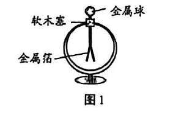
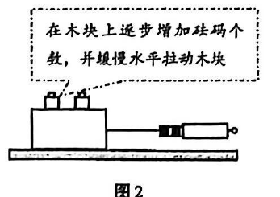
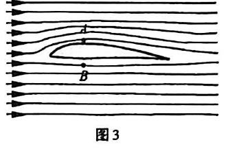

# 物模26 静金闵青联考一模精讲（上）· 第1～8题

> 2026 届静安、金山、闵行、青浦四区联考初三一模（2025 学年第一学期初三年级学业质量调研·物理试卷 2026.01，时间 60 分钟、满分 70 分）第一部分（第 1～8 题，共 36 分：第 1、2、5 题每题 3 分，第 3、4、7 题每题 4 分，第 6 题 6 分，第 8 题 9 分）。原卷为扫描件、无文字层，题目逐页读图转录；**卷面配图（图1～图3）已按 150dpi 页图裁切嵌入对应题目**。扫描件末尾附参考答案与详解（第 6～8 张页图），本讲全部结论已逐项与其核对一致；题 6(3) 受力示意图按答案页图 2 红线（f=0.6N、F=0.6N）核对。第 9～12 题（共 34 分）见 [[04-物理/专题/真题精讲/物模26-静金闵青-下]]。

**1.**（3分）西塞山诗
"西塞山前白鹭飞，桃花流水鳜鱼肥"。
（1）以山为参照物，白鹭是＿＿＿＿＿＿＿＿的（选涂"A 静止"或"B 运动"）；
（2）白鹭在水中的倒影，是由光的＿＿＿＿＿＿＿＿（A. 反射　B. 折射）形成的；
（3）看到水中的"鳜鱼"，是鳜鱼的＿＿＿＿＿＿＿＿（A. 实　B. 虚）像。

> [!tip]- 💡 思路导航
> 判断运动只看"相对参照物的位置是否变化"；倒影是水面这面"平面镜"成的像；水中的鱼则是光从水里折射出来进入眼睛——一反射一折射，两个光现象正好成对辨析。

> [!success]- ✅ 详解 · 评分点 · 易错 · 关联
> **详解**：（1）白鹭相对山的**位置在变化**，选涂 **B 运动**。（2）倒影是水面这个"平面镜"成像，由光的**A 反射**形成。（3）光从水斜射入空气发生折射，看到的是变浅的虚像，选 **B 虚**。
>
> **易错**：看到水中的鱼是**折射**成的虚像，与"倒影=反射"成对记忆，两者互错是最经典失分。
>
> **关联**：[[04-物理/知识点/01-声与光]]（光的反射与折射）。

**2.**（3分）验电器
验电器带电后，两片金属箔张开，如图1所示。

（1）验电器上的部件属于绝缘体的是（　）
- （A）金属球
- （B）软木塞
- （C）金属箔

（2）再用带正电荷的玻璃棒接触该验电器金属球时，金属箔张开的角度变大，接触前金属箔带＿＿＿＿＿＿＿＿电荷。

> [!tip]- 💡 思路导航
> 验电器的"金属球—金属杆—金属箔"是一条导电通路，隔断电荷的部件才绝缘；"张角变大"说明箔上电荷变多——与正电棒接触后电荷变多，反推接触前箔上电荷的性质。

> [!success]- ✅ 详解 · 评分点 · 易错 · 关联
> **详解**：（1）金属球、金属杆、金属箔都是导体，**B 软木塞**隔绝电荷传走。（2）接触正电玻璃棒后张角**变大**→箔上电荷增多→接触前已带**正**电荷（若原带负电，会先中和使张角变小）。
>
> **易错**：判据是"张角**变大**"——若原来带负电，接触正电棒会先中和使张角变小，不可能立刻变大。
>
> **关联**：[[04-物理/知识点/06-电学基础]]（验电器原理、电荷间相互作用）。

**3.**（4分）抹香鲸
抹香鲸在海面下游动（ρ海水 约为 1.0×10³ kg/m³）。
（1）海水在 1000m 深处产生的压强约为＿＿＿＿＿＿＿＿Pa；
（2）抹香鲸排开海水的体积为 20m³，其所受浮力的大小约为＿＿＿＿＿＿＿＿N。

> [!tip]- 💡 思路导航
> 液体压强直接代 $p=\rho gh$，注意深度与密度都要用题给值；浮力走阿基米德原理 $F_浮=\rho_液 gV_排$，g 取 9.8N/kg。

> [!success]- ✅ 详解 · 评分点 · 易错 · 关联
> **详解**：（1）**设** ρ海水=1.0×10³kg/m³、h=1000m。**列** p=ρgh。**算** p=1.0×10³×9.8×1000=**9.8×10⁶Pa**。（2）**列** F浮=ρ液gV排。**算** F浮=1.0×10³×9.8×20=**1.96×10⁵N**。**验** 约 20 吨物体的重量级，与抹香鲸体型相符 ✓。
>
> **易错**：题给"约为 1.0×10³kg/m³"、g 取 9.8N/kg；把 1000m 代成 100m 或漏写单位均丢分。
>
> **关联**：[[04-物理/知识点/05-密度压强与浮力]]（液体压强、阿基米德原理）。

**4.**（4分）冬天窗玻璃起雾
冬天，家中窗玻璃上有时会出现"起雾"现象。
（1）"起雾"是＿＿＿＿＿＿＿＿（A. 液化　B. 汽化　C. 熔化）现象；
（2）使用空调制热时，家中窗玻璃上的"雾"出现在＿＿＿＿＿＿＿＿（　）
- （A）室内外两侧
- （B）室内侧
- （C）室外侧

> [!tip]- 💡 思路导航
> "雾"是小水珠不是水蒸气——水蒸气遇冷变液态；制热时想想哪一侧的空气又热又湿、玻璃面又被降温。

> [!success]- ✅ 详解 · 评分点 · 易错 · 关联
> **详解**：（1）"雾"是水蒸气遇冷变成的小水珠，**A 液化**（放热）。（2）空调制热时**室内**空气温度高、水蒸气多，遇到被室外冷空气降温的玻璃内表面液化，选 **B 室内侧**。
>
> **易错**：夏季（制冷）时"雾"在室外侧，与冬季制热情形相反，别背成固定答案。
>
> **关联**：[[04-物理/知识点/04-热学]]（液化及其条件）。

**5.**（3分）音乐厅
在音乐厅听音乐时，要求"手机调静音"，减少噪声。
（1）"手机调静音"是控制噪声的＿＿＿＿＿＿＿＿（选涂"A 声源"或"B 传播途径"）；
（2）听众能够分辨出交响乐演奏中的钢琴声和小提琴声，主要是根据声音的＿＿＿＿＿＿＿＿（　）
- （A）频率
- （B）响度
- （C）音调
- （D）音色

> [!tip]- 💡 思路导航
> 减弱噪声三途径：声源处、传播途中、人耳处——"调静音"是不让手机发声；分辨不同乐器靠的是发声体本身的"声音指纹"。

> [!success]- ✅ 详解 · 评分点 · 易错 · 关联
> **详解**：（1）调静音是让手机不发声，在**A 声源**处减弱。（2）音色由发声体的材料结构决定，**D 音色**。
>
> **关联**：[[04-物理/知识点/01-声与光]]（噪声控制、音色）。

**6.**（6分）滑动摩擦力实验
小华做"探究滑动摩擦力大小与哪些因素有关"实验，如图2所示。

（1）该实验研究滑动摩擦力大小与＿＿＿＿＿＿＿＿的关系（选涂"A 压力大小""B 接触面情况"或"C 速度大小"）；
（2）"缓慢水平拉动"是为了使木块处于＿＿＿＿＿＿＿＿状态；
（3）若弹簧测力计示数为 0.6N，请画出木块在水平方向上的受力示意图。（作图）

> [!tip]- 💡 思路导航
> 图2 的操作是"在木块上逐步增加砝码"——改变的量就是研究方向；只有木块做匀速直线运动时，拉力与摩擦力才是一对平衡力；画受力示意图先定方向、再定作用点、最后标等长。

> [!success]- ✅ 详解 · 评分点 · 易错 · 关联
> **详解**：（1）木块上逐步**增加砝码**→改变的是压力，选涂 **A 压力大小**。（2）只有**匀速直线**运动时木块处于平衡状态，拉力与摩擦力才是一对平衡力。（3）水平方向画两个等长反向箭头：拉力 F=0.6N 水平向右（沿测力计方向）、滑动摩擦力 f=0.6N 水平向左，作用点画在木块重心/受力面上【答案页图2：f=0.6N 向左、F=0.6N 向右】。
>
> **易错**：摩擦力方向与相对运动方向相反，画在**水平方向**且与拉力**等长反向**；漏画或画成竖直方向不得分。
>
> **关联**：[[04-物理/知识点/02-运动与力]]（二力平衡、滑动摩擦力）、[[04-物理/专题/实验操作考点-物理]]（摩擦力实验的平衡条件）。

**7.**（4分）国产大飞机 C919
（1）如图3，A、B 为 C919 飞机机翼上方、下方的两点，飞行过程中 A、B 处的空气流速大小和压强大小分别为 v_A、v_B 和 p_A、p_B，已知 v_A＞v_B，则（　）

- （A）p_A＞p_B
- （B）p_A=p_B
- （C）p_A＜p_B

（2）C919 采用了钛合金等先进航空材料，已知钛合金的密度为 4.5×10³ kg/m³，钢的密度为 7.9×10³ kg/m³，1m³ 的钛合金与等体积的钢相比，质量相差＿＿＿＿＿＿＿＿kg。

> [!tip]- 💡 思路导航
> 机翼上方流线密→流速大，流体压强随流速增大而减小；第(2)问抓"等体积"三个字，质量差=密度差×体积。

> [!success]- ✅ 详解 · 评分点 · 易错 · 关联
> **详解**：（1）流速大处压强小：v_A＞v_B→p_A＜p_B，选 **C**。（2）**设** V=1m³。**列** Δm=(ρ钢−ρ钛)V。**算** Δm=(7.9×10³−4.5×10³)×1=**3.4×10³kg**。**验** 每立方米省 3.4 吨，正是航空材料减重的意义 ✓。
>
> **关联**：[[04-物理/知识点/02-运动与力]]（流体压强与流速）、[[04-物理/知识点/05-密度压强与浮力]]（密度公式的应用）。

**8.**（9分）厨房物理
小华和妈妈在厨房一起做饭。
（1）汤里撒入盐，即使不搅动整锅汤也会变咸，是因为分子在不停地做＿＿＿＿＿＿＿＿运动；
（2）为防止烫手，铁锅的手柄外层使用塑料包裹，是因为塑料的导热性比铁＿＿＿＿＿＿＿＿；
（3）用固体酒精做燃料加热汤锅，完全燃烧 0.05kg 酒精放出的热量为＿＿＿＿＿＿＿＿J（q酒精=3.0×10⁷J/kg）；
（4）高压锅煲汤是利用增大锅内的气体压强，使水的沸点＿＿＿＿＿＿＿＿（　）
- （A）升高
- （B）不变
- （C）降低

（5）高压锅内的水蒸气在出气口顶起阀门，排出"白气"。小华想到：锅炉产生的高温高压水蒸气喷射到汽轮机的叶片上时，推动叶片转动。此过程中水蒸气的内能转化为汽轮机叶片的＿＿＿＿＿＿＿＿能；
（6）小华想知道"1 个标准大气压下，将温度为 20℃、质量为 1kg 的水，全部加热为 100℃ 的水蒸气所吸收的热量"。他查到 c水=4.2×10³J/(kg·℃)，解答如下：Q吸=c水mΔt=4.2×10³J/(kg·℃)×1kg×(100℃−20℃)=3.36×10⁵J。请判断小华的解答是否正确，并写出理由。

> [!tip]- 💡 思路导航
> 前(5)小题逐个对号：扩散、导热性、热值公式 q=Q/m、气压与沸点、蒸汽做功的能量去向；第(6)问盯住"水变成水蒸气"的中间过程——温度不变时吸不吸热？

> [!success]- ✅ 详解 · 评分点 · 易错 · 关联
> **详解**：（1）**无规则**（热）运动，盐分子扩散到整锅汤。（2）**差**（弱），塑料是热的不良导体。（3）**列·算** Q=qm=3.0×10⁷×0.05=**1.5×10⁶J**。（4）气压增大沸点**A 升高**，汤可在高于 100℃ 下炖煮。（5）内能→**机械**能（蒸汽推叶片转动）。（6）**不正确**。理由：水变成水蒸气的**汽化过程中需要持续吸收热量**（温度保持 100℃ 不变但一直吸热），小华仅计算了水从 20℃ 升温到 100℃ 所吸收的热量，**没有计算水在汽化时所需要的热量**，所以总吸热远大于 3.36×10⁵J。
>
> **易错**：第(6)问判断题必须先给"不正确"的结论再写理由，理由落在"汽化仍需吸热"这一关键点上，只写"算错了"不给分。
>
> **关联**：[[04-物理/知识点/04-热学]]（分子热运动、热值、沸点与气压、汽化吸热）。

## 🔗 关联

- [[04-物理/知识点/01-声与光]]（光的反射与折射、噪声控制、音色）
- [[04-物理/知识点/02-运动与力]]（参照物、二力平衡、滑动摩擦力、流体压强）
- [[04-物理/知识点/05-密度压强与浮力]]（液体压强、阿基米德原理、密度差计算）
- [[04-物理/知识点/04-热学]]（液化、沸点与气压、热值、分子热运动、汽化吸热）
- [[04-物理/知识点/06-电学基础]]（验电器、静电）
- 同类题：[[04-物理/专题/真题精讲/物模26-静金闵青-下]]（同卷第9～12题）、[[04-物理/专题/真题精讲/物模26-奉贤-上]]（学科基础同构）
