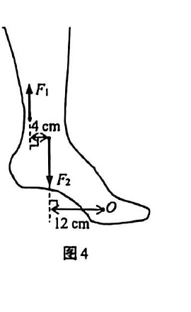
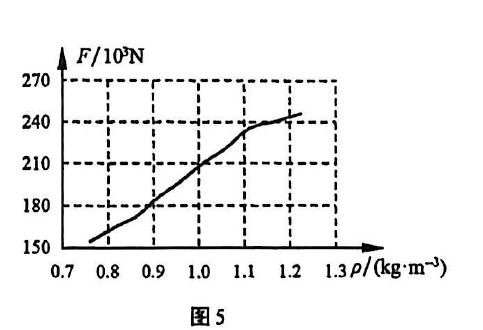
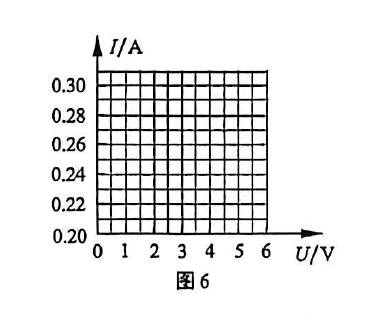
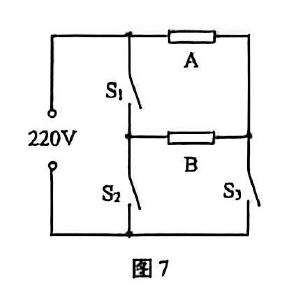

# 物模26 静金闵青联考一模精讲（下）· 第9～12题

> 2026 届静安、金山、闵行、青浦四区联考初三一模（2025 学年第一学期初三年级学业质量调研·物理试卷 2026.01）第二部分（第 9～12 题，共 34 分：第 9 题 10 分，第 10、11 题每题 7 分，第 12 题 10 分；除选择、填空和作图外均需写出解答过程）。原卷为扫描件、无文字层，题目逐页读图转录；**卷面配图（图4～图7）已按 150dpi 页图裁切嵌入对应题目**。扫描件末尾附参考答案与详解（第 6～8 张页图），本讲全部结论已逐项与其核对一致；题 9 图 4 中"4 cm"为 F₁ 与 F₂ 作用点间的水平距离（据此 F₁ 力臂 16cm，与答案 F₁=180N 互证吻合）。第 1～8 题见 [[04-物理/专题/真题精讲/物模26-静金闵青-上]]。

**9.**（10分）踮脚训练
小华采用踮脚的方式进行关节柔韧性训练，小华所受的重力 G 为 480N。
（1）如图4，小华脚踮起站稳时，相关肌肉骨骼可以看作以 O 为支点的杠杆，每条腿中肌肉向上的拉力为 F₁，所克服的阻力为 F₂。阻力臂 l₂ 为＿＿＿＿＿＿＿＿cm；若 F₂=240N，则 F₁ 的大小为＿＿＿＿＿＿＿＿N。

（2）小华双脚站立时，两鞋底与地面接触的总面积为 3×10⁻²m²；脚踮起站稳时，两鞋底与地面接触的总面积为 6×10⁻³m²。求双脚站立与脚踮起站稳两种情况下，小华对地面压强的变化量 Δp。
（3）若小华 20s 内连续踮脚 10 次，每次踮脚他的重心均升高 0.05m，求小华在 20s 内克服重力所做的功 W，及其克服重力做功的功率 P。

> [!tip]- 💡 思路导航
> 踮脚杠杆支点在脚尖，F₁、F₂ 都沿竖直方向，力臂一律取**水平距离**；F₁ 的力臂要从图上的两段水平距离相加得到。压强变化量=大压强−小压强，先分别求 p₁、p₂；踮 10 次重心升 10 次，W=nGh。

> [!success]- ✅ 详解 · 评分点 · 易错 · 关联
> **详解**：（1）支点 O 在脚尖，F₂ 到 O 的水平距离即阻力臂，l₂=**12cm**；F₁ 的力臂 l₁=4+12=16cm。**列** F₁l₁=F₂l₂。**算** F₁=F₂l₂/l₁=240×12/16=**180N**。**验** F₁＜F₂，省力杠杆，与"踮脚省力"的生理常识相符 ✓。
> （2）**设** 双脚站立 S₁=3×10⁻²m²、踮脚 S₂=6×10⁻³m²，水平地面 F=G=480N。**列** p=F/S；Δp=p₂−p₁。**算** p₁=480/(3×10⁻²)=1.6×10⁴Pa；p₂=480/(6×10⁻³)=8×10⁴Pa；Δp=8×10⁴−1.6×10⁴=**6.4×10⁴Pa**。
> （3）**列** W=nGh（每踮一次重心升 0.05m）。**算** W=480×10×0.05=**240J**；P=W/t=240/20=**12W**。**验** 12W 与人做轻缓运动的功率量级相符 ✓。
>
> **易错**：①力臂取**水平距离**，F₁ 力臂是 4cm+12cm=16cm（不是 4cm），代错力臂得 720N，方向性检验（省力）可自查；②(2)问的是"变化量"Δp=p₂−p₁，只写两个压强不比较要扣分，踮脚面积是 6×10⁻³m²，别代入单脚面积；③(3)问 W=nGh 用**总重力**（重心整体升高），不能乘"双腿 2 倍"得 480J。
>
> **关联**：[[04-物理/知识点/03-机械与功]]（杠杆平衡条件、功与功率）、[[04-物理/知识点/05-密度压强与浮力]]（压强变化量）。

**10.**（7分）飞机往返
小华旅游时，乘坐同型号飞机往返于甲、乙两市。
（1）飞机在某一巡航高度匀速飞行 1600km，所用时间为 2h，此过程中飞机飞行速度大小为＿＿＿＿＿＿＿＿km/h。
（2）小华发现所乘飞机在两市机场起飞所需的跑道长度不同。为探究其原因，他查阅资料得知：(a) 飞机发动机推力越大，其达到起飞速度所需距离越短；(b) 该型号飞机发动机最大推力 F 和空气密度 ρ 的关系如图5；(c) 不同海拔高度 H 对应的大气压强 p 和空气密度 ρ 的值见表1；(d) 甲市、乙市的海拔高度分别约为 500m、4000m。

表1

| H/10³m | 0 | 1 | 2 | 3 | 4 | 5 | 6 | 7 |
| ---- | ---- | ---- | ---- | ---- | ---- | ---- | ---- | ---- |
| p/10³Pa | 101.3 | 89.87 | 79.50 | 70.11 | 61.64 | 54.02 | 47.18 | 41.06 |
| ρ/(kg·m⁻³) | 1.225 | 1.112 | 1.014 | 0.892 | 0.802 | 0.719 | 0.644 | 0.543 |

结合上述信息：
① 海拔越高，飞机发动机的最大推力越＿＿＿＿＿＿＿＿，请写出分析过程；
② 该型号的飞机在甲市机场起飞所需的跑道长度＿＿＿＿＿＿＿＿（选涂"A 大于""B 等于"或"C 小于"）其在乙市机场起飞所需的跑道长度。

> [!tip]- 💡 思路导航
> 表格看"H↑→ρ↓"，图像看"ρ↓→F↓"，两段接龙就能回答①；②把甲、乙两市的海拔差翻译成密度差，再顺着"推力→起飞距离"的资料链条走。

> [!success]- ✅ 详解 · 评分点 · 易错 · 关联
> **详解**：（1）**列·算** v=s/t=1600km/2h=**800km/h**。
> （2）① **小**。分析：由表1，海拔 H 越高，空气密度 ρ 越小（1.225→0.543 kg/m³ 单调减小）；由图5，随着空气密度 ρ 减小，发动机最大推力 F 减小。两段接龙：海拔越高→ρ 越小→F 越小。
> ② 甲市海拔低→ρ 大→推力大→达到起飞速度所需距离短→选 **C 小于**。
>
> **易错**：①问必须把"表格规律"与"图像规律"两段都写出来才完整，只写一段扣一半；②问别把"甲市跑道短"说成"乙市跑道短"。
>
> **关联**：[[04-物理/知识点/05-密度压强与浮力]]（大气压与海拔、图像表格推理）、[[04-物理/知识点/02-运动与力]]（匀速直线运动速度）。

**11.**（7分）测量小灯泡电阻
小华测量小灯泡发光时的电阻：他将电源（电压保持不变）、电流表、滑动变阻器、开关、待测小灯泡（标有"3.8V"字样）串联，将电压表并联在某元件两端。闭合开关，移动变阻器滑片，实验数据见表2。一段时间后小灯泡熄灭。为了检查原因，他将电压表并联在不同的位置，当他将电压表并联在小灯泡两端时，移动变阻器滑片，小灯泡始终不发光，电压表示数始终为 6.0V，电流表示数始终为零。

表2

| 实验序号 | 电压表示数/V | 电流表示数/A |
| ---- | ---- | ---- |
| 1 | 3.0 | 0.24 |
| 2 | 2.2 | 0.28 |
| 3 | 1.7 | 0.30 |
| …… | …… | …… |

（1）实验中小灯泡熄灭，是由于小灯泡发生＿＿＿＿＿＿＿＿故障；
（2）将小灯泡正常发光时两端电压和通过电流的值用"×"标记在图6 中，并求出小灯泡正常发光时电阻的阻值（计算结果保留一位小数）。

（3）结合表2 序号 1～3 的数据，滑动变阻器连入电路的阻值变小过程中，小灯泡与滑动变阻器串联的等效电阻的阻值＿＿＿＿＿＿＿＿（选填"变大""不变""变小"或"无法确定"），理由是：＿＿＿＿＿＿＿＿。

> [!tip]- 💡 思路导航
> 电压表并在灯两端示数恒为 6.0V 且电流为零——6.0V 恰是电源电压，说明断点就在被测元件上。第(2)问先想清"电压表到底并在谁两端"：表2 里 U 随 I 增大而减小，被测的其实是变阻器；正常发光时变阻器分得多少电压？第(3)问套 R总=U总/I 看 I 的走向。

> [!success]- ✅ 详解 · 评分点 · 易错 · 关联
> **详解**：（1）V 并灯两端示数恒为 6.0V（等于电源电压）、电流表始终为零→小灯泡发生**开路**（断路）故障。
> （2）表 2 中 I 增大时 U 示数减小→V 并在**滑动变阻器**两端，U滑+U灯=U总=6V。正常发光 U灯=3.8V→U滑=6−3.8=2.2V→对应序号 2：I=0.28A。"×"标记在图6 坐标 **(3.8V, 0.28A)** 处。**算** R灯=U灯/I灯=3.8/0.28≈**13.6Ω**。**验** 表2 序号1~3 灯未达正常电压，电阻应更小且随 U 增大，13.6Ω 合理 ✓。
> （3）**变小**。理由：滑片阻值变小→电路电流 I 逐渐增大；串联等效电阻 R总=U总/I，电源电压不变、I 变大，说明等效电阻在变小。
>
> **易错**：第(2)问必须先说明"电压表并在变阻器两端"（由 U 随 I 增大而减小判断），再用 U滑=6−3.8=2.2V 对准序号 2 取 I=0.28A；直接套 3.8/0.28 不写依据要扣过程分。
>
> **关联**：[[04-物理/知识点/06-电学基础]]（电路故障判断、伏安法、等效电阻）、[[04-物理/专题/实验操作考点-物理]]（伏安法测电阻规范）、[[04-物理/专题/电学四大题型]]（故障排查专项）。

**12.**（10分）电热水壶
小华用标有"220V"字样的电热水壶烧水，所用电取电插座允许通过的最大电流为 5A。电热水壶的简化电路如图7，电路中两电热丝 A、B 的阻值分别为 R_A、R_B，且 R_A≠R_B。通过控制开关 S₁、S₂、S₃ 的断开或闭合，电热水壶可实现不同的加热功率。

（1）通过控制开关 S₁、S₂、S₃，该电热水壶中电热丝连入电路的情况不可能的是（　）
- （A）仅 R_A 连入电路
- （B）仅 R_B 连入电路
- （C）R_A 与 R_B 串联连入电路
- （D）R_A 与 R_B 并联连入电路

（2）若使该电热水壶加热时电功率最小，则开关状态为 S₁＿＿＿＿＿＿＿＿、S₂＿＿＿＿＿＿＿＿、S₃＿＿＿＿＿＿＿＿（选填"断开"或"闭合"）；
（3）当开关 S₂ 断开，S₁、S₃ 闭合时，电路的总电流为 4.1A，通过电热丝 A 的电流为 2A。
① 求电热丝 A 的阻值 R_A；
② 若电流通过电热丝所做的功全部转化为电热水壶产生的热量，求 10s 内电热水壶产生的热量 Q；
③ 现用阻值为 R_C 的电热丝 C 替换电热丝 B，仍保持开关 S₂ 断开，S₁、S₃ 闭合，替换前后电热水壶的电功率变化了 220W，并仍能用原先的取电插座。求电热丝 C 的阻值 R_C。

> [!tip]- 💡 思路导航
> 挡位题先读图定结构：A 上 B 中，S₁ 接通 A、B 上端，S₂ 是两支路内侧节点间的"桥"，S₃ 控制 B 下端到电源的通路。枚举四种状态对应的总电阻，功率最小=总电阻最大；第③问"功率变化了 220W"有增大、减小两种可能，插座 5A 上限是取舍的尺子。

> [!success]- ✅ 详解 · 评分点 · 易错 · 关联
> **详解**：（1）**B**。B 所在支路一端经 S₁ 接电源、另一端需经 S₃（或 S₂）才构成回路，B 上端节点没有直通电源两极的独立通路，任何组合下 B 都无法单独连入；而仅 R_A（S₃ 闭合）、串联（仅 S₂ 或仅 S₁）、并联（S₁、S₃ 闭合）均可实现。
> （2）功率最小=总电阻最大=串联：**S₁ 断开、S₂ 闭合、S₃ 断开**（电流路径：电源→A→S₂→B→回电源）。
> （3）① **设** S₂ 断开、S₁、S₃ 闭合→R_A 与 R_B 并联，U=220V。**列** R_A=U/I_A。**算** R_A=220/2=**110Ω**。
> ② **列·算** Q=W=UIt=220×4.1×10=**9020J**。**验** I_B=4.1−2=2.1A，R_B=220/2.1≈104.8Ω，与 R_A 不等，符合 R_A≠R_B ✓。
> ③ **设** ΔP=220W。**列** ΔP=UΔI→ΔI=ΔP/U。**算** ΔI=220/220=1A。若总功率增大 220W→I′总=4.1+1=5.1A＞5A，超过插座允许的最大电流，舍去；故总功率减小 220W，I′总=4.1−1=3.1A。**列** I_C=I′总−I_A。**算** I_C=3.1−2=1.1A；R_C=U/I_C=220/1.1=**200Ω**。**验** R_C=200Ω＞R_B≈104.8Ω，功率减小方向一致 ✓。
>
> **易错**：第③问双解讨论必须做——"功率变化 220W"有增大、减小两种可能，先按插座 5A 上限舍去"增大"，再算"减小"；漏讨论直接丢一半分。并联挡（S₁、S₃ 闭合）时 S₂ 必须断开，否则电源经 S₁、S₂ 短路。
>
> **关联**：[[04-物理/知识点/07-电功率与家庭电路]]（三开关挡位、插座限流）、[[04-物理/知识点/06-电学基础]]（串并联辨识）、[[04-物理/专题/电学四大题型]]（挡位切换专项）、同类题 [[04-物理/专题/真题精讲/物模26-浦东]] 题16（同款三开关电路）。

## 🔗 关联

- [[04-物理/知识点/03-机械与功]]（杠杆平衡条件、功与功率）
- [[04-物理/知识点/05-密度压强与浮力]]（压强变化量、控制变量图像推理）
- [[04-物理/知识点/06-电学基础]]（电路故障判断、伏安法、等效电阻）
- [[04-物理/知识点/07-电功率与家庭电路]]（三开关挡位、插座限流）
- [[04-物理/专题/大题规范书写-设列算验答]]（第9～12题计算规范）
- [[04-物理/专题/电学四大题型]]（挡位切换与故障排查专项）
- 同类题：[[04-物理/专题/真题精讲/物模26-静金闵青-上]]（同卷第1～8题）、[[04-物理/专题/真题精讲/物模26-浦东]]（同款三开关电路与测电阻推理）、[[04-物理/专题/真题精讲/物模26-松江-下]]
