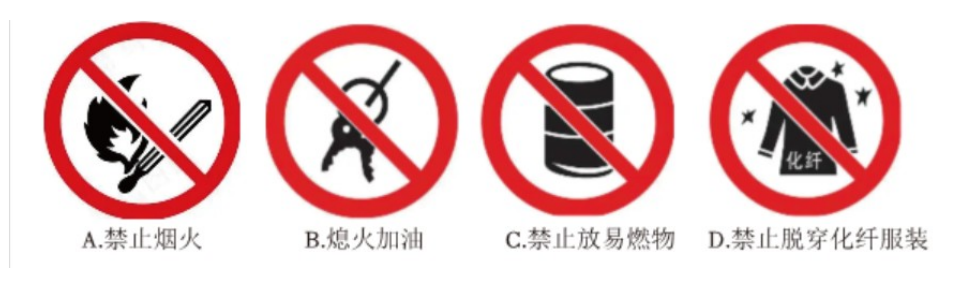
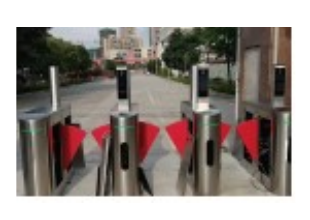
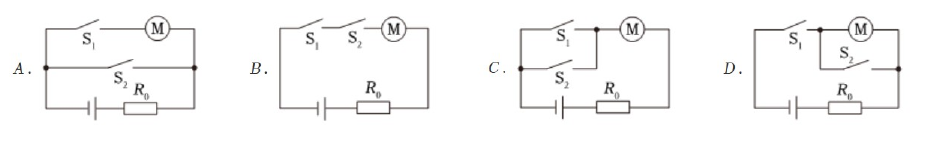
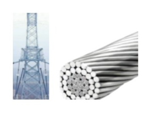
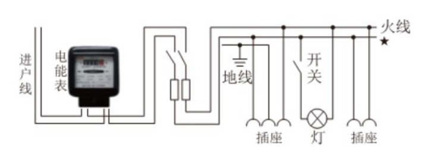
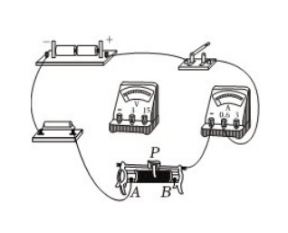
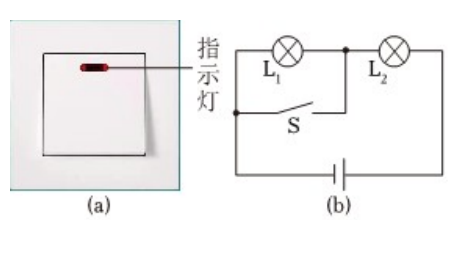
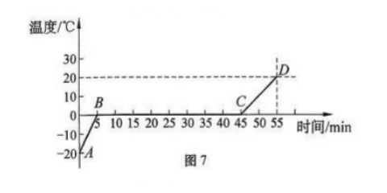
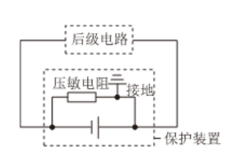

# 物模26 黄浦一模精讲（上）· 学科基础

> 2026 届黄浦区初三一模（2025 学年第一学期期末考试九年级综合测试，物理部分 70 分：学科基础 39 分＋学科综合 31 分）第一题块"学科基础"（第 1～13 题）。原卷为 docx 文字层转制 PDF 页图，转换后中文文字层丢失、位图与电路插图保留，**可辨认的卷面配图均已裁切嵌入**；⚠️ 题4 内燃机剖面图在转换中丢失，该题保留文字重构并标注。卷末附参考答案，本讲已逐题与答案互证一致；答案页数处 OCR 讹误（题 11(2) 指数等）在详解中修正并注明；卷面未标各题分值。学科综合（第 14～17 题）见 [[04-物理/专题/真题精讲/物模26-黄浦-下]]。

**1.**（电视机）
（1）上海地区家庭电路电压为＿＿＿＿＿＿＿＿（　）
- （A）1.5V
- （B）36V
- （C）220V
- （D）380V

（2）电视机与空调之间的连接方式是＿＿＿＿＿＿＿＿（　）
- （A）串联
- （B）并联

（3）标有"100W"字样的电视机正常工作 2h，用电＿＿＿＿＿＿＿＿kW·h。

> [!tip]- 💡 思路导航
> 220V 是必背常数；家庭电路各用电器"互不影响"对应哪种连接？电能 W=Pt，注意 kW·h 与 kW、h 的配套。

> [!success]- ✅ 详解 · 评分点 · 易错 · 关联
> **详解**：（1）**C 220V**。（2）各用电器互不影响，**B 并联**。（3）**设** P=0.1kW、t=2h，**算** W=Pt=**0.2 kW·h**。
>
> **关联**：[[04-物理/知识点/07-电功率与家庭电路]]（家庭电路电压、并联、电功计算）。

**2.**（漫步海滩）
（1）阳光照射下沙子和海水的温度都会升高，它们的内能＿＿＿＿＿＿＿＿（　）
- （A）增大
- （B）不变
- （C）减小

（2）赤足时感到海水比沙子的温度低，是因为海水比沙子的比热容＿＿＿＿＿＿＿＿；穿着橡胶沙滩鞋踩在沙子上感觉不到烫，是因为橡胶的导热性较＿＿＿＿＿＿＿＿。

> [!tip]- 💡 思路导航
> 温度升高，分子热运动加剧，内能必然怎么变？比热容大→同样吸热升温少；导热性弱→热量传到脚上慢。

> [!success]- ✅ 详解 · 评分点 · 易错 · 关联
> **详解**：（1）温度升高，内能**A 增大**。（2）海水比热容**大**，同样吸热升温少；橡胶导热性**弱**，传热慢。
>
> **关联**：[[04-物理/知识点/04-热学]]（内能、比热容、导热性）。

**3.**（静电现象）
（1）"静电复印"是使墨粉和纸张带异种电荷，相互＿＿＿＿＿＿＿＿；
（2）油罐车安装铁链拖在地面，是利用了大地是＿＿＿＿＿＿＿＿（　）
- （A）导体
- （B）绝缘体

（3）下列加油站安全标识中，与摩擦起电有关的是（　）

- （A）禁止烟火
- （B）熄火加油
- （C）禁止放易燃物
- （D）禁止穿脱化纤服装

> [!tip]- 💡 思路导航
> 异种电荷相互吸引；导走静电靠"接地"；四幅标识里只有一幅画的是"衣物与火花"——想想脱化纤衣服时的放电现象。

> [!success]- ✅ 详解 · 评分点 · 易错 · 关联
> **详解**：（1）异种电荷相互**吸引**。（2）大地是**A 导体**，把摩擦静电导入大地。（3）摩擦起电放电火花会点燃汽油，与"脱化纤服装"有关，选 **D**。
>
> **关联**：[[04-物理/知识点/06-电学基础]]（电荷间相互作用、导体与绝缘体、静电防护）。

**4.**（内燃机）
⚠️ 原题配图（单缸内燃机剖面：进气门、排气门关闭、活塞上行）在 docx 转制 PDF 时丢失，此处保留文字描述作后备，作答按官方答案"压缩冲程"情境。
（1）图示为四冲程内燃机工作时的＿＿＿＿＿＿＿＿冲程，该冲程实现了＿＿＿＿＿＿＿＿（　）
- （A）内能转化成机械能
- （B）机械能转化成内能

（2）燃料在燃烧过程中热值＿＿＿＿＿＿＿＿（　）
- （A）变大
- （B）不变
- （C）变小

（3）行驶中轮胎与地面摩擦，这是通过＿＿＿＿＿＿＿＿方式改变轮胎的内能。

> [!tip]- 💡 思路导航
> 先据题面情境定冲程（两气门关闭、活塞上行是哪一冲程），能量转化方向随之而定；热值是燃料的特性只与种类有关；摩擦生热属"做功"改变内能。

> [!success]- ✅ 详解 · 评分点 · 易错 · 关联
> **详解**：（1）两气门关闭、活塞上行=**压缩**冲程，实现 **B 机械能→内能**。（2）热值是燃料的特性，**B 不变**。（3）摩擦生热属**做功**方式。
>
> **易错**：压缩冲程是"机械能→内能"，与做功冲程方向记反必错。
>
> **关联**：[[04-物理/知识点/04-热学]]（热机四冲程、热值、做功与热传递）。

**5.**（地铁闸机）
乘客成功扫码或插入单程票，相当于闭合开关 S₁ 或 S₂，都能让电动机启动进站（闸机如图所示）。符合要求的电路设计是（　）

> [!tip]- 💡 思路导航
> "任一开关闭合电动机都转"是或逻辑——两个开关互不影响地控制同一用电器，它们该串联还是并联？再逐图排除"闭合 S₂ 会把电动机制住/短路"的接法。

> [!success]- ✅ 详解 · 评分点 · 易错 · 关联
> **详解**：S₁、S₂ 任一闭合电动机即转→两开关**并联**后再与电动机串联，选 **C**；A 项 S₂ 与"S₁+电动机"支路并联，闭合 S₂ 会把电动机短接、B 项两开关串联必须同时闭合、D 项 S₂ 与电动机并联，闭合 S₂ 电动机被短接，均不符。
>
> **关联**：[[04-物理/知识点/06-电学基础]]（串并联电路设计、开关的控制作用）。

**6.**（并联用电，不定项）
家庭电路中同时使用的用电器越多，则（　）
- （A）总电阻越大
- （B）总电流越大
- （C）总功率越大
- （D）消耗电能越多

> [!tip]- 💡 思路导航
> 并联相当于增大导体横截面积→总电阻怎么走？总功率是各支路之和；"消耗电能"还与时间有关，扣住"同时使用"这个前提。

> [!success]- ✅ 详解 · 评分点 · 易错 · 关联
> **详解**：并联支路增多→总电阻**减小**（A 错）；总功率为各支路之和、增大（C 对）→由 I=P/U 总电流增大（B 对）→同一时间内消耗电能增多（D 对）。选 **BCD**。
>
> **易错**：A 与其余三项方向相反，"支路越多总电阻越小"是高频反向迷惑；D 必须扣住"同时使用"这一时间前提。
>
> **关联**：[[04-物理/知识点/06-电学基础]]（并联电路性质）、[[04-物理/知识点/07-电功率与家庭电路]]（总功率与总电流）。

**7.**（多股铝绞线）
高压输电线采用"多股铝绞线"（如图所示）。

（1）多股并联相当于增大导体的横截面积，从而＿＿＿＿＿＿＿＿电阻（　）
- （A）增大
- （B）减小

（2）维修断电时，输电线的电阻将＿＿＿＿＿＿＿＿（　）
- （A）变大
- （B）不变
- （C）变小

（3）若发电厂输出电功率不变、输出电压增大，输电线上电能损耗将＿＿＿＿＿＿＿＿（　）
- （A）增大
- （B）不变
- （C）减小

> [!tip]- 💡 思路导航
> 电阻是导体本身的性质，与是否通电无关；输电损耗盯住两步：I=P/U 先看电流，P损=I²R 再看损耗。

> [!success]- ✅ 详解 · 评分点 · 易错 · 关联
> **详解**：（1）并联增大等效横截面积→电阻**B 减小**。（2）电阻是导体本身的性质，与是否通电无关，**B 不变**。（3）P 一定，U 增大→I=P/U 减小→P损=I²R线 减小，选 **C**。
>
> **易错**：第(3)问先 I=P/U 再 P损=I²R 两步走；凭直觉"电压大损耗大"选 A 是典型错误。
>
> **关联**：[[04-物理/知识点/06-电学基础]]（电阻定律、电阻性质）、[[04-物理/知识点/07-电功率与家庭电路]]（输电损耗）。

**8.**（家庭电路）
如图所示为某家庭电路的示意图（进户线、电能表、总开关、保险装置与各支路，★标于其中一根进户线上）。

（1）★处的进户线是＿＿＿＿＿＿＿＿线；
（2）设计中接入位置错误的元件是＿＿＿＿＿＿＿＿（　）
- （A）电能表
- （B）插座
- （C）开关

（3）以下做法中安全的是＿＿＿＿＿＿＿＿（不定项）（　）
- （A）湿手插拔插头
- （B）使用破损老化电线
- （C）定期检查电路电器
- （D）超负荷使用插座
- （E）遇触电事故先断电再施救

> [!tip]- 💡 思路导航
> 火线一侧的"排队顺序"是：进户火线→电能表→总开关→保险装置→各支路——★ 在哪一侧？开关必须串在谁身上才安全？逐项过安全用电常识。

> [!success]- ✅ 详解 · 评分点 · 易错 · 关联
> **详解**：（1）★为**零**线（火线一侧依次接电能表、总开关、保险装置）。（2）图中开关未串接在火线上，**C 开关**错。（3）**CE**。
>
> **易错**：开关接在零线上时，断开后灯具仍带电，是设计错误；湿手插拔、破损电线、超负荷均为危险做法。
>
> **关联**：[[04-物理/知识点/07-电功率与家庭电路]]（家庭电路组成、安全用电）。

**9.**（探究电流与电压的关系）
如图所示为"探究电流与电压的关系"实验装置（两节干电池、开关、滑动变阻器、定值电阻与两电表，电压表待连）。

（1）用笔线代替导线，将电路连接完整；
（2）闭合开关前，滑片 P 应处于＿＿＿＿＿＿＿＿（　）
- （A）A端
- （B）B端

（3）为获取证据，闭合开关后应＿＿＿＿＿＿＿＿，然后换不同定值电阻重复实验。

> [!tip]- 💡 思路导航
> 连图先想"保护电路"——闭合开关前变阻器阻值要调到最大端；"获取证据"意味着要多次测量，滑动变阻器在本实验里就是用来改变什么？

> [!success]- ✅ 详解 · 评分点 · 易错 · 关联
> **详解**：（1）电压表并联在**定值电阻**两端（0～3V 量程），电流表串联入电路。（2）滑片置于阻值最大端，**B**。（3）**多次改变滑动变阻器滑片的位置，并记录相应的电压表、电流表的示数**（答案原文）。
>
> **关联**：[[04-物理/知识点/06-电学基础]]（探究 I-U 关系、滑动变阻器）、[[04-物理/专题/实验操作考点-物理]]（伏安实验规范）。

**10.**（带指示灯的开关）
带指示灯的开关可简化为图(b)：L₁ 与 L₂ 串联接在电源两端，开关 S 与 L₁ 并联。S 闭合时照明灯正常发光、指示灯不发光；S 断开时照明灯不发光、指示灯正常发光。则（　）

- （A）指示灯是 L₁，其额定功率大于照明灯
- （B）指示灯是 L₁，其额定功率小于照明灯
- （C）指示灯是 L₂，其额定功率大于照明灯
- （D）指示灯是 L₂，其额定功率小于照明灯

> [!tip]- 💡 思路导航
> S 闭合时谁被短路、谁独得 220V？S 断开后两灯串联，要"指示灯亮、照明灯不亮"，电压必须几乎全落在谁身上——串联分压看电阻，额定电压同为 220V 时 P=U²/R 定功率大小。

> [!success]- ✅ 详解 · 评分点 · 易错 · 关联
> **详解**：S 闭合时 L₁ 被短接不亮、L₂ 独得 220V 正常发光→照明灯是 L₂、指示灯是 L₁；S 断开时两者串联，指示灯正常发光需 R₁≫R₂，使 U₁≈220V、U₂≈0。额定电压同为 220V 时 P=U²/R，R₁ 大者额定功率小。选 **B**。
>
> **易错**：指示灯"独得"电压靠电阻悬殊，其额定功率反而是**小**的那个；与"指示灯很亮=功率大"的直觉相反。
>
> **关联**：[[04-物理/知识点/06-电学基础]]（串联分压、短路）、[[04-物理/知识点/07-电功率与家庭电路]]（P=U²/R）。

**11.**（冰的熔化实验）
冰的质量 0.5kg，熔化成水后质量不变，水的比热容 4.2×10³ J/(kg·℃)。温度随时间变化的图像如图7所示（A→B 为冰升温段，B→C 为 0℃ 熔化平台，C→D 为水升温段）。

（1）冰的熔化过程所用时间是＿＿＿＿＿＿＿＿min；
（2）水在 CD 段吸收的热量为＿＿＿＿＿＿＿＿J；
（3）酒精热值约 3.0×10⁷ J/kg，若整个实验需释放热量 4.5×10⁵ J，需完全燃烧酒精约＿＿＿＿＿＿＿＿kg。

> [!tip]- 💡 思路导航
> 三空各配一式：图像读平台段的起止时刻；Q=cmΔt 用 CD 段水温变化；Q放=mq 反求质量。

> [!success]- ✅ 详解 · 评分点 · 易错 · 关联
> **详解**：（1）由图7 熔化平台 B→C 自第 5min 至第 45min，读得 **40min**。（2）**设** CD 段水温升高 Δt=20℃、m=0.5kg。**列** Q=cmΔt。**算** Q=4.2×10³×0.5×20=**4.2×10⁴ J**【答案页印"4.2x101"，系 OCR 丢指数，按 Q=cmΔt 反推修正】。（3）**列** m=Q放/q。**算** m=4.5×10⁵/3.0×10⁷=**0.015kg**。
>
> **易错**：读图时平台段起点不是 0min 而是 5min，别把 45min 当熔化时间。
>
> **关联**：[[04-物理/知识点/04-热学]]（熔化图像、热量计算、热值）、同类题 [[04-物理/专题/真题精讲/物模26-浦东]] 题11（冰熔化与比热容图像）。

**12.**（直流电动机）
某直流电动机的参数：线圈电阻 1Ω、额定电压 3V、额定电流 1A。
（1）正常工作 20s，电流通过电动机做功为＿＿＿＿＿＿＿＿J，产生的热量为＿＿＿＿＿＿＿＿J；
（2）分析电流通过电动机做功与产生的热量之间存在差异的原因。

> [!tip]- 💡 思路导航
> 电动机是非纯电阻：W=UIt 与 Q=I²Rt 必须分开算——多出来的电能去哪了？

> [!success]- ✅ 详解 · 评分点 · 易错 · 关联
> **详解**：（1）**算** W=UIt=3×1×20=**60J**；Q=I²Rt=1²×1×20=**20J**。（2）电动机通电后**只将一部分电能转化为内能，其余转化为机械能**，故 W>Q（非纯电阻电路不能套 Q=W）。
>
> **易错**：说理句必须点明"一部分电能转化为机械能"这一非纯电阻特征，只写"W>Q"不给满分。
>
> **关联**：[[04-物理/知识点/07-电功率与家庭电路]]（电功与电热）、[[04-物理/知识点/06-电学基础]]（非纯电阻电路）。

**13.**（压敏电阻保护装置）
家用电器中常将压敏电阻接地后与电源并联组成保护装置（如图所示）。资料：(a) 某压敏电阻两端电压与对应阻值如下表；(b) 电源电压在安全范围内时，压敏电阻可看作断开的开关；电压过高时可看作闭合的开关；(c) 接地可将很大的电流直接导入大地。

| 电压 U/V | 0 | 10 | 20 | 22 | 24 | 26 | 30 |
|---|---|---|---|---|---|---|---|
| 阻值 /×10⁶Ω | 300 | 200 | 30 | 5 | 1 | 0.3 | 0.08 |

（1）分析比较表中数据，可得出的初步结论是＿＿＿＿＿＿＿＿；
（2）结合上述信息和所学知识，解释"将压敏电阻接地后与电源并联组成保护装置"的原因；
（3）为防止压敏电阻失效，可再接入熔断器（常态相当于导线，电流太大时快速熔断），熔断器与后级电路的连接方式应为＿＿＿＿＿＿＿＿（　）
- （A）串联
- （B）并联

> [!tip]- 💡 思路导航
> 先纵向看表：电压一路增大，阻值一路怎么走？再按资料分"电压安全/过高"两种情况说理——旁路+接地，把危险电流引到哪里？熔断器要"电流过大即断"，它该和电路怎么接？

> [!success]- ✅ 详解 · 评分点 · 易错 · 关联
> **详解**：（1）**在 0～30V 范围内，压敏电阻两端电压越大，其阻值越小**。（2）电压在安全范围内→相当于断开的开关→不影响后级电路正常工作；电压过高→相当于闭合的开关→接地后把很大的电流直接导入大地、电流不流经后级电路，从而保护后级。（3）熔断器要"电流过大即切断"，必须与后级电路**A 串联**。
>
> **关联**：[[04-物理/知识点/06-电学基础]]（半导体压敏特性、并联旁路）、[[04-物理/知识点/07-电功率与家庭电路]]（熔断器与安全保护）。

## 🔗 关联

- [[04-物理/知识点/07-电功率与家庭电路]]（家庭电路、安全用电、指示灯电路、非纯电阻）
- [[04-物理/知识点/04-热学]]（内能、比热容、热值、热机冲程）
- [[04-物理/知识点/06-电学基础]]（串联并联、电阻性质、输电损耗、压敏电阻）
- [[04-物理/专题/实验操作考点-物理]]（伏安法实验规范）
- 同类题：[[04-物理/专题/真题精讲/物模26-黄浦-下]]（同卷综合题块）、[[04-物理/专题/真题精讲/物模26-宝山-上]]（学科基础同构）、[[04-物理/专题/真题精讲/物模26-长宁-上]]
