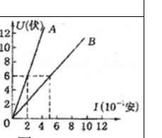
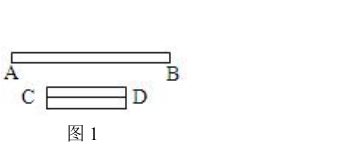
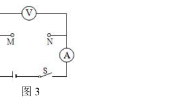
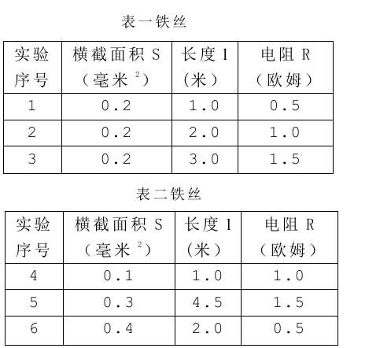
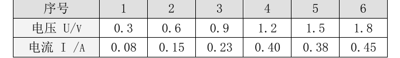
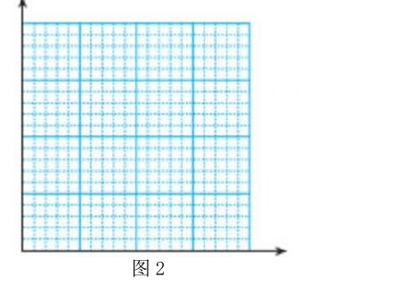

# 物电 02 精讲 · 欧姆定律与电阻

> 沪教版五四制九年级第一学期 7.2《欧姆定律 电阻》课后练习选 3 题：欧姆定律与电阻性质计算（单元作业设计题 0404 + 电阻练习第 2 题）、决定电阻因素表格归纳（电阻练习第 7 题）、I-U 图像数据分析（单元作业设计题 0303）。原卷 6 张插图已于 2026-11-05 裁入（电阻丝对折图、0404 的 U-I 图、实验电路图、表一表二、0303 数据表与坐标网格）。**题源勘误（以图为准）**：题 0404 官方答案给 $U_B=2$V、$R_B=1\Omega$，与其原卷图 2（横轴单位 $10^{-1}$ 安、B 线虚线过 $5\times10^{-1}$ 安、6V）不符，本讲按图取 $R_B=12\Omega$、$U_B=24$V（见题1 易错）。电阻练习第 7 题表一电阻列此前按自洽性修复的 0.5/1.0/1.5 欧，与原卷真表一致，修复注记作废。

## 📝 题目

### 题1 欧姆定律与电阻的性质（计算）（作业设计题 0404 + 电阻练习第 2 题）

**1.** 10 秒内通过某导体 A 横截面的电荷量为 20 库，求通过导体 A 的电流 $I_A$。

**2.** 若将导体 B 接入另一电源，通过 B 的电流 $I_B=I_A$。由图 2 求出导体 B 的电阻，并求此时 B 两端的电压 $U_B$。

**3.** 当导体 B 两端的电压为 0V 时，其电阻为多少？

**4.** 变式（电阻练习第 2 题）：粗细均匀的电阻丝 AB 长为 L，当两端电压为 3V 时，通过的电流为 0.2A。该电阻丝的电阻为＿＿＿＿＿＿＿＿欧；当两端电压为 0V 时，该电阻丝的电阻为＿＿＿＿＿＿＿＿欧；若将该电阻丝折成图 1 中电阻丝 CD 的情形，则电阻丝 CD 的电阻＿＿＿＿＿＿＿＿（选填"大于""等于"或"小于"）电阻丝 AB 的电阻。

### 题2 探究电阻的决定因素（表格归纳）（电阻练习第 7 题）

**7.** 某小组同学通过实验研究导体的电阻与哪些因素有关。如图 3 所示，他们在常温下将横截面积、长度不同的铁丝接入电路的 MN 两点间，利用电流表和电压表测量后计算出阻值，将数据记录在表一、表二中。

（1）分析比较实验序号 1 与 4（或 2 与 6）可得出的初步结论是：常温下，＿＿＿＿＿＿＿＿。

（2）分析比较＿＿＿＿＿＿＿＿（选填"表一"或"表二"）的相关数据可得出的初步结论是：常温下，＿＿＿＿＿＿＿＿。

（3）请进一步综合分析表一、表二的相关数据，并归纳得出结论：①分析比较 1 与 6、2 与 4 或 3 与 5 的数据及相关条件，可得出的初步结论是：常温下，＿＿＿＿＿＿＿＿；②分析比较 1 与 6、2 与 4 和 3 与 5 的数据及相关条件，可得出的初步结论是：常温下，＿＿＿＿＿＿＿＿。

（4）他们继续分析表一和表二的数据及相关条件，发现无法得到导体的电阻与材料的关系。为了进一步探究导体的电阻与材料的关系，需添加的器材为＿＿＿＿＿＿＿＿（选填"甲""乙"或"丙"）。
器材：导体甲——横截面积为 0.2 毫米²、长度为 2.0 米的铁丝；导体乙——横截面积为 0.1 毫米²、长度为 2.0 米的镍铬合金丝；导体丙——横截面积为 0.3 毫米²、长度为 4.5 米的锰铜丝。

### 题3 I-U 图像与欧姆定律（数据分析）（作业设计题 0303）

**3.** 小组"探究导体中电流与电压的关系"实验中，收集了乙金属导体两端电压和通过电流的多次数据，如实记录在下表：

（1）小组尝试用图像法分析这一导体中电流与电压的定量关系，请在图 2 中建立直角坐标系，把表中数据在坐标系中描点。

（2）从图中可以看出，这些数据中有一组是明显错误的，跟其他数据的规律完全不同，可能是读取这组数据时粗心引起的：①在图中圈出这组需剔除的数据；②画出本导体的图像。

（3）乙导体的图像特征是：在交流后发现多个导体的 U-I 图像都具有此类特征。于是，得到初步结论：＿＿＿＿＿＿＿＿，通常称为＿＿＿＿＿＿＿＿定律。

> [!tip]- 💡 思路导航（题1）
> 电流定义式与欧姆定律各用各的对应量，计算按"设列算验答"五步走；图 2 是两条过原点的直线，"谁的图线更陡谁的电阻更大"由同一电压下比电流（或同一电流下比电压）看出；电阻是导体本身的性质，与是否通电无关；对折问题要同时说长度、横截面积两个因素。

> [!success]- ✅ 详解 · 评分点 · 易错 · 关联（题1）
> **详解**：
> 1. **设**通过 A 的电流 $I_A$。**列**电流定义 $I=Q/t$。**算** $I_A=20\text{C}/10\text{s}=$ **2A**。**验**：数量级合理 ✓。**答**：2A。
> 2. 由图 2：同一电压下 B 线的电流大（B 线更平缓），B 线过点 $(5\times10^{-1}\text{安},\ 6\text{V})$，故 $R_B=U/I=6\text{V}/0.5\text{A}=$ **12Ω**。$I_B=I_A=2$A 时，$U_B=I_B R_B=2\times12=$ **24V**。
> 3. 电阻是导体本身的一种性质，由材料、长度、横截面积（和温度）决定，与是否通电、电压大小无关，故仍为 **12Ω**。
> 4. **设**AB 电阻 $R_{AB}$。**列** $R=U/I$。**算** $R_{AB}=3\text{V}/0.2\text{A}=$ **15Ω**；电压为 0 时仍 **15Ω**（同第 3 问）。折成 CD 后：长度变为原来一半（电阻减半），横截面积变为原来 2 倍（电阻再减半），故 CD 的电阻**小于** AB 的电阻（为原来的 1/4，即约 3.75Ω）。
>
> **评分点**：电流定义式与欧姆定律书写各 1 分；从图线取点求 R 要写清"取哪一点、读数是多少"；对折结论必须同时写出"长度减半、横截面积加倍"两个依据。
>
> **易错**：**题源勘误（以图为准）**——官方答案第 2 问给"$U_B=2$V、$R_B=U_B/I_B=1\Omega$"，与原卷图 2 不符：图 2 横轴单位是 $10^{-1}$ 安，B 线的虚线交点在 $(5\times10^{-1}\text{安},\ 6\text{V})$，按图 $R_B=12\Omega$、$U_B=24$V；若按官方答案反推需 B 线过"（6 安，6 伏）"，与图不符。本讲以原卷图为准（2026-11-05 核验）。"电压为 0 电阻也为 0"是典型错答；对折只说"长度变短"不说横截面积，扣一半分。
>
> **关联**：[[04-物理/知识点/06-电学基础]]（欧姆定律、电阻的决定因素） · [[04-物理/专题/大题规范书写-设列算验答]] · [[04-物理/专题/真题精讲/物电-06-测功率与伏安法]]（同一单元作业设计的功率版本）

> [!tip]- 💡 思路导航（题2）
> 上海卷典型的"控制变量三步归纳"：先单一比较（两行比一个量），再同表比较（一表内一个量变、其余不变），最后跨表综合（算比值）；每一步先写"相同的量"，再写"不同的量"与结果；选材题抓"只有材料不同"这一条。

> [!success]- ✅ 详解 · 评分点 · 易错 · 关联（题2）
> **详解**：
> （1）1 与 4：材料（铁）、长度（1.0 米）相同，S 由 0.1→0.2 毫米²，R 由 1.0→0.5 欧。结论：**常温下，导体的材料、长度相同，横截面积越大，电阻越小**。
> （2）选**表一**：材料、横截面积（均 0.2 毫米²）相同，长度 1.0→2.0→3.0 米时电阻 0.5→1.0→1.5 欧成正比增大。结论：**常温下，导体的材料、横截面积相同时，长度越长，电阻越大**。
> （3）①计算比值：1 与 6 的 $l/S$ 均为 5（R 同为 0.5 欧）、2 与 4 均为 10（R 同为 1.0 欧）、3 与 5 均为 15（R 同为 1.5 欧）。结论：**常温下，同种材料的导体，长度与横截面积的比值相同，电阻相同**。
> ②综合：比值 5→10→15 对应电阻 0.5→1.0→1.5 欧。结论：**常温下，同种材料的导体，长度与横截面积的比值越大，电阻越大**。
> （4）探究材料需控制长度、横截面积相同而材料不同：丙（0.3 毫米²、4.5 米锰铜丝）与表二序号 5（0.3 毫米²、4.5 米铁丝）恰好对照。**选丙**。乙的 S、l 与任何一根铁丝都无法同时相同；甲与表一序号 2 同为铁丝，无对照意义。
>
> **评分点**：归纳结论句必须带前提（"常温下""材料相同时"），漏前提即扣分；第(3)②的结论主体是"比值"而非"长度"或"横截面积"单独一个；选材要写明"与哪一序号构成对照"。
>
> **易错**：**题源 OCR 修复确认**——电阻练习第 7 题表一电阻列原文提取残缺（"1.0/1.0/1.5"），此前按 $R\propto l$ 自洽性修复为 0.5/1.0/1.5 欧；原卷真图证实真表即 0.5/1.0/1.5 欧（全表 $R/l=0.5$ 欧/米自洽，且(3)问三组比值严格成立），修复注记作废（2026-11-05）。比较"1 与 4 或 2 与 6"时把相同的量写错（长度不同、材料不同）是最常见失分。
>
> **关联**：[[04-物理/知识点/06-电学基础]]（电阻的决定因素） · [[04-物理/专题/真题精讲/物电-08-电能输送与无线电]]（"增大横截面积减小电阻"回用于四线并联说理） · [[04-物理/专题/真题精讲/物-06-欧姆定律综合]]

> [!tip]- 💡 思路导航（题3）
> 图像法处理数据四步：建系描点→检验剔错→画线→下结论；剔错的依据是各组 $U/I$ 比值的一致性；画线要求过原点的直线且让点均匀分布在两侧；结论句要点名"同一导体""成正比"。

> [!success]- ✅ 详解 · 评分点 · 易错 · 关联（题3）
> **详解**：
> （1）建立坐标系：横轴 U/V、纵轴 I/A，将 6 组数据逐一点描在图 2 网格中。
> （2）检验比值 $U/I$：3.8、4.0、3.9、**3.0**、3.9、4.0——第 4 组（U=1.2V，I=0.40A）明显偏离。按其余数据该导体 $U/I\approx 4\Omega$，1.2V 应对应约 0.30A，故第 4 组为错误数据，**圈出剔除**。用剩余 5 组描点，可画一条**过原点的倾斜直线**，使尽量多的点在线上、其余点均匀分布在直线两侧。
> （3）图像特征：**一条过原点的倾斜直线**。初步结论：**同一导体，通过它的电流与它两端的电压成正比**，通常称为**欧姆**定律（$I=U/R$）。
>
> **评分点**：描点、剔错、画线、结论各 1 分；剔错要有理由（"该组 $U/I$ 比值明显偏离"），只圈不说理扣一半。
>
> **易错**：坐标轴不分度、漏写物理量符号与单位是作图题常见失分；画成折线或"连点描线"而不是平滑直线；结论漏写"同一导体"前提。
>
> **关联**：[[04-物理/专题/实验操作考点-物理]]（探究 I-U 实验的操作与数据处理考点） · [[04-物理/专题/真题精讲/物电-03-串联电路]]（两次测量取平均与找普遍规律的目的辨析） · [[04-物理/专题/真题精讲/物-14-2026真题-测量电阻]]

## 备注

- 单元作业设计 0301（只改接一根导线并标两表正负极的作图题）、0401（甲、乙、丙三导体数据归纳比值定义）、0402（密度/电阻/比热容类比表）未选用：0301 作图要点已并入 [[04-物理/专题/真题精讲/物电-06-测功率与伏安法]] 题 1，0401 思路同本讲题 2，0402 属概念类比基础题。
- 2026-11-05 补：原卷图 6 张裁入（电阻丝对折图、0404 U-I 图、实验电路图、表一表二、0303 数据表与坐标网格）；题 0404 官方答案与图 2 的矛盾按"以图为准"处理（详见题1 易错）；旧版题 1(2)"电流 2A 对应电压 2V"的文字重构注记删除；表一修复注记经原卷真图证实后作废。
