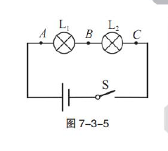
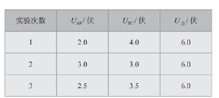
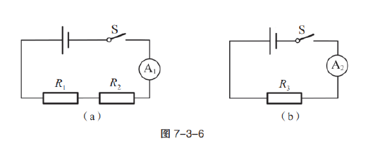
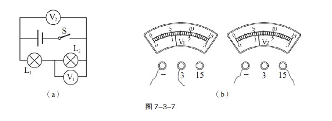
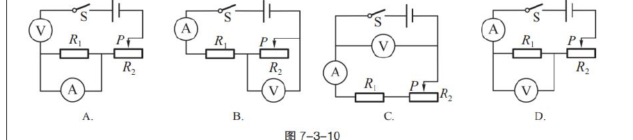
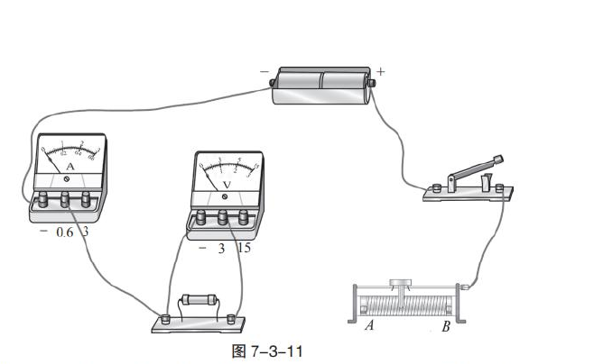
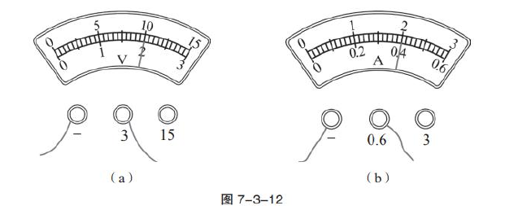
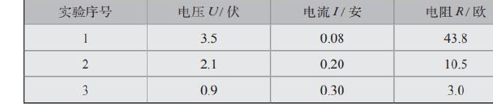
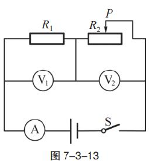
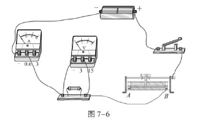

# 物电 03 精讲 · 串联电路

> 沪教版五四制九年级第一学期 7.3《串联电路》①②两课时课后练习，原卷题干完整，8 题全部纳入。**题源勘误（2026-11-05 核验原卷）**：旧版注记"题干均为图片、仅官方答案可读"与原卷不符——两份练习文本俱全；旧版按答案"AC""4.8；1.2"重构的两题实为误读：**"AC"是①第 1 题"电压表再接在＿＿两点间"的填空答案**，**"4.8；1.2"是①第 3 题电压表读数的答案**，并非多选题与串联计算题的答案；旧版虚构的"R₁=16Ω 与 R₂=4Ω 串联"计算题已删除，串联分压由①第 3 题（总电压 6V、L₁ 分得 4.8V）承担。原卷 10 张插图（含官方答案实物连接图）已裁入嵌图。②第 5～9 题原卷带 ★/★★（提高）标记，保留说明。

## 📝 题目

### 题1 探究串联电路的电压规律（①第 1 题）

**1.** 在"探究串联电路中电压的规律"时，小李同学设计的实验如下：他把两个灯泡 L₁、L₂ 串联接入如图 7-3-5 所示电路中，把电压表分别接在 A、B 和 B、C 点间，测量出灯 L₁ 和 L₂ 两端的电压；为了归纳出串联电路中的电压关系，他还应该把电压表再接在＿＿＿＿＿＿＿＿两点间测量出电路两端的总电压。换上不同的小灯泡，再进行两次实验，测量的数据记录在下表中。

分析表中数据可得到的初步结论是：＿＿＿＿＿＿＿＿。

### 题2 等效电阻的比较与电压表读数（①第 2、3 题）

**2.** 在图 7-3-6（a）（b）所示电路中，电源电压相等且不变，若电流表 A₁、A₂ 的示数相等，则电阻 R₁、R₂、R₃ 的大小关系为（　　）
- （A）$R_1+R_2=R_3$
- （B）$R_1=R_3$
- （C）$R_1>R_3$
- （D）$R_2>R_3$

**3.** 小李同学用如图 7-3-7（a）所示的电路测电压，电压表的示数如图 7-3-7（b）所示，则小灯 L₁ 两端的电压为＿＿＿＿＿＿＿＿伏，小灯 L₂ 两端的电压为＿＿＿＿＿＿＿＿伏。

### 题3 伏安法测电阻的电路辨析与实验操作（②第 5、6 题）

**5.** 图 7-3-10 为"用电流表、电压表测电阻"实验的四种电路图，其中正确的是（　　）

**6.** 某小组同学做"用电流表、电压表测电阻"的实验。

（1）所需实验器材是：电源（2 节干电池）、开关、电压表、滑动变阻器、待测电阻、导线若干和＿＿＿＿＿＿＿＿。

（2）实验原理是＿＿＿＿＿＿＿＿。

（3）实验中需要测量的物理量是＿＿＿＿＿＿＿＿和＿＿＿＿＿＿＿＿。

（4）用笔画线代替导线把图 7-3-11 所示实物图连接完整。

（5）在电路中接入滑动变阻器的目的是＿＿＿＿＿＿＿＿。闭合开关前，需将滑动变阻器的滑片 P 移到＿＿＿＿＿＿＿＿端（选填"A"或"B"），这样操作的目的是＿＿＿＿＿＿＿＿。

### 题4 实验故障排查、表盘读数与数据纠错（②第 7、8 题）

**7.** 小李同学在"用电流表、电压表测电阻"的实验中，将最后一根导线连接完毕后，发现电流表和电压表都有较大的示数，其原因可能是：＿＿＿＿＿＿＿＿和＿＿＿＿＿＿＿＿。

发现问题后，他重新进行实验，前两次测得的电阻值分别为 5.2 欧和 5.4 欧。第三次测量时，电压表和电流表的示数如图 7-3-12（a）（b）所示，则第三次测得的电阻值为＿＿＿＿＿＿＿＿欧。该待测电阻的阻值为＿＿＿＿＿＿＿＿欧。

**8.** 小李同学在"用电流表、电压表测电阻"的实验中，所用实验器材有：4.5 伏的电源、电流表、电压表、滑动变阻器、开关及若干导线，实验器材均完好。他把实验数据记录在下表中：

请指出该同学实验中的一个错误：＿＿＿＿＿＿＿＿。请在下表中记录正确的数据，并计算待测电阻的阻值为＿＿＿＿＿＿＿＿欧。

### 题5 动态电路分析（②第 9 题）

**9.** 在图 7-3-13 所示的电路中，电源电压保持不变。闭合开关 S 后，将滑动变阻器的滑片 P 向右移动时，电表示数变小的是＿＿＿＿＿＿＿＿（选填"A""V₁"或"V₂"）。

> [!tip]- 💡 思路导航（题1）
> "总电压"要测在整段电路的两端点上，先在图 7-3-5 中认出 A、B、C 三个点的位置再作答；归纳结论句要写全前提（"串联电路中"）与完整关系（"等于……之和"），并结合三次数据说明"换不同灯泡再测"的目的。

> [!success]- ✅ 详解 · 评分点 · 易错 · 关联（题1）
> **详解**：
> 总电压应测 A 与 C 两点间（官方答案 AC）——A、C 恰是串联电路两端点，A-B、B-C 已分别测了 L₁、L₂ 的电压，补测 A-C 即得总电压，三次测量形成 U_AB、U_BC、U_总 的完整对照。
> 由数据表：三次实验均满足 U_AB＋U_BC＝U_总（2.0＋4.0＝6.0；3.0＋3.0＝6.0；2.5＋3.5＝6.0）✓。**结论**：**串联电路中，电路两端的总电压等于各部分电路两端的电压之和**。
> **多次测量的目的**：换用不同规格的小灯泡再测两次，是为了让结论具有**普遍性**（避免偶然性），与"伏安法测电阻多次测量取平均减小误差"的目的不同。
>
> **评分点**：填空"A、C"1 分；结论句写全"串联电路中……总电压等于各部分电路两端的电压之和"，漏前提或漏"之和"扣分；能说明多次测量目的再得满分。
>
> **易错**：把空填成"B、C"或"A、B"（重复测已有电压）；结论写成"电压相等"（只在两灯规格相同时偶然成立，第 1、3 组数据恰好反证）；旧版按"AC"重构为串联规律多选题，系题源误读，已按原卷更正（2026-11-05）。
>
> **关联**：[[04-物理/知识点/06-电学基础]]（串联电路电压规律） · [[04-物理/专题/真题精讲/物电-02-欧姆定律与电阻]]（多次测量两种目的辨析） · [[04-物理/专题/真题精讲/物电-04-并联电路]]（并联电流规律实验同款结构）

> [!tip]- 💡 思路导航（题2）
> 两图电源电压相等、电流表示数相等，说明 (a) 中 R₁ 与 R₂ 串联的"整体"对电流的阻碍效果与 (b) 中 R₃ 相同——从等效替代的角度列式；读数题先认每只电压表并在谁的两端、再按接线柱定量程，最后用串联电压关系分配。

> [!success]- ✅ 详解 · 评分点 · 易错 · 关联（题2）
> **详解**：
> 2. (a) 图 R₁、R₂ 串联，$I_1=\dfrac{U}{R_1+R_2}$；(b) 图只有 R₃，$I_2=\dfrac{U}{R_3}$。电源电压相等且 $I_1=I_2$，故 $R_1+R_2=R_3$，选 **（A）**。这正是等效替代的思想：R₁ 与 R₂ 串联整体对电流的阻碍作用，与 R₃ 单独接入时相同。
> 3. 由（a）图：V₁ 并联在 L₂ 两端，测 L₂ 的电压；V₂ 并联在电源（L₁ 与 L₂ 串联总）两端，测总电压。由（b）图：V₁ 导线接"－"和"3"，量程 0～3V，指针读 **1.2V**；V₂ 导线接"－"和"15"，量程 0～15V，指针读 **6V**（同一指针位置，大量程读数恰为小量程 5 倍）。故 $U_2=1.2$V，$U_总=6$V，$U_1=U_总-U_2=6-1.2=$ **4.8V**。官方答案"4.8；1.2" ✓。
>
> **评分点**：等效比较写出"电流相等→总电阻相等"的推理链 1 分；读数先认量程再读指针 1 分；用串联电压关系求 L₁ 电压 1 分。
>
> **易错**：V₂ 测的是**总电压**而不是 L₁ 的电压——先分清测量对象再动笔；同一指针位置大量程读数是小量程的 5 倍（1.2↔6.0），反过来先读错量程会差 5 倍；分压计算延伸：已知总电压与两电阻时可用 $U_1:U_2=R_1:R_2$ 快速分配，但上海评分习惯要求写出电流 I 的完整过程。
>
> **关联**：[[04-物理/知识点/06-电学基础]]（串联分压、等效替代） · [[04-物理/专题/真题精讲/物电-04-并联电路]]（题3 等效替代法同源） · [[04-物理/专题/电学四大题型]]（动态与比例分配）

> [!tip]- 💡 思路导航（题3）
> 电路辨析抓两句话：电流表串联在被测支路、电压表并联在**待测电阻**两端——逐图核对两表接法即可；实物连接按"先串后并"顺序，量程按电源（2 节干电池约 3V）与电流估计选取；滑动变阻器记"保护＋变流"双重作用，闭合开关前滑片在阻值最大处。

> [!success]- ✅ 详解 · 评分点 · 易错 · 关联（题3）
> **详解**：
> 5. 逐图核对：A 图——电压表串联在电路中、电流表并在 R₁ 两端，两表位置接反；B 图——电流表串联在干路正确，但电压表并在**滑动变阻器 R₂** 两端，没测待测电阻；C 图——电压表并在**电源**两端，同样没测待测电阻；D 图——电流表串联在干路、电压表并联在待测电阻 R₁ 两端，**正确**。选 **（D）**。
> 6.（1）**电流表**。（2）**R＝U/I**（欧姆定律的变形）。（3）**待测电阻两端的电压**和**通过待测电阻的电流**。
> （4）连接要点：电流表（0～0.6A 量程）串联在待测电阻支路、电流"正进负出"；电压表（0～3V 量程）并联在待测电阻两端；滑动变阻器"一上一下"接入；开关控制干路。官方连接答案见图。
>
> 
>
> （5）接入滑动变阻器的目的：**改变通过待测电阻的电流及其两端的电压**，实现多次测量；闭合开关前滑片 P 移到接入阻值最大处——按官方答案图的接法为 **A** 端（"根据所连接的实物图填写"，以自己连接的图中滑片离下端接线柱最远的位置为准）；这样操作的目的是**防止电路中电流过大，损坏电路元件，起到保护作用**（官方答案原文）。
>
> **评分点**：电路辨析逐图写出错误点（不是只写字母）；原理与两物理量各 1 分；滑动变阻器的"目的"与"这样操作的目的"是两问，答案分别是"变流多次测量"与"保护电路"，写串即失分。
>
> **易错**：B 图最迷惑——电流表位置正确，遮蔽了"电压表测的不是待测电阻"这一错误；变阻器接成"同上同下"（相当于导线或定值电阻）；量程选择的依据要写"被测值不超过量程且尽量用小量程提高精度"。
>
> **关联**：[[04-物理/专题/实验操作考点-物理]] · [[04-物理/专题/真题精讲/物-07-探究电路与故障]]（电路故障判断） · [[04-物理/专题/真题精讲/物电-06-测功率与伏安法]]（测功率实验的同族操作）

> [!tip]- 💡 思路导航（题4）
> "两表都有较大示数"反推连接违规：哪些操作会让电流偏大、电压偏大？读数题按"接线柱定量程→指针读数→R=U/I"三步；数据纠错题先看三次数据的电压之和是否恒等于电源电压——恒等于 4.5V 就是"电压表并在了变阻器两端"的铁证。

> [!success]- ✅ 详解 · 评分点 · 易错 · 关联（题4）
> **详解**：
> 7. 两个原因（官方答案原文）：**连接电路时，开关处于闭合状态**；**滑动变阻器的滑片处于连入电路阻值较小处**——两者都使闭合瞬间电流偏大，电压表示数随之偏大。
> 第三次测量：由图 7-3-12，电压表接"－"和"3"（0～3V 量程）读 **2.0V**，电流表接"－"和"0.6"（0～0.6A 量程）读 **0.40A**，$R_3=U/I=2.0/0.40=$ **5.0Ω**。三次平均：$R=\dfrac{5.2+5.4+5.0}{3}=$ **5.2Ω**（官方答案 5.0；5.2 ✓）。
> 8. 由原表：三次"电压表读数＋待测电阻电压"恒等于 4.5V（3.5＋1.0、2.1＋2.4、0.9＋3.6），且三次算出的"电阻"彼此矛盾——错误是**接线时将电压表连接在滑动变阻器两端**（测的是变阻器电压）。正确数据：U_待＝4.5−U_表，三次分别为 **1.0V、2.4V、3.6V**（电流不变 0.08、0.20、0.30 安），对应电阻 **12.5Ω、12.0Ω、12.0Ω**。待测电阻 $R=\dfrac{12.5+12.0+12.0}{3}\approx$ **12.2Ω**（官方答案 12.2 ✓）。
>
> **评分点**：两空原因各 1 分；表盘读数认量程 1 分；平均值计算与保留位数（12.2）1 分；纠错要写出"电压表并在变阻器两端"这一结构错误而不只是改数。
>
> **易错**：只答"滑片没移到最大"漏"开关闭合"（或相反）；平均值 36.5÷3＝12.166…，保留一位小数写 12.2，写 12.16 或 12 扣分；"数据自洽判据"——三次 U 表 之和规律（每次 U＋U_待＝4.5V）是发现电压表接错位置的关键证据，直接改数不说理由不得满分。
>
> **关联**：[[04-物理/知识点/06-电学基础]]（欧姆定律应用） · [[04-物理/专题/真题精讲/物-07-探究电路与故障]]（由现象反推电路错误） · [[04-物理/专题/真题精讲/物电-06-测功率与伏安法]]（残缺信息推算同类）

> [!tip]- 💡 思路导航（题5）
> 先认电路结构（R₁ 与滑动变阻器串联、V₁ 与 V₂ 分别测谁、A 测什么），再沿"滑片→R_总→I→U₁→U₂"链条逐步判断，每个箭头写出依据；最后核对设问要的是"变小"的表。

> [!success]- ✅ 详解 · 评分点 · 易错 · 关联（题5）
> **详解**：
> 电路结构：R₁ 与滑动变阻器 R₂ 串联，V₁ 测 R₁ 两端电压，V₂ 测 R₂ 两端电压，A 测电路电流。
> P 向右移动 → R₂ 接入阻值增大 → $R_总=R_1+R_2$ 增大（电阻串联规律）→ $I=U/R_总$ 减小，**A 示数变小** → $U_1=IR_1$ 减小，**V₁ 示数变小** → $U_2=U-U_1$ 增大，V₂ 示数变大。
> 示数变小的是 **A、V₁**（官方答案 ✓）。
>
> **评分点**：动态链条"一步一依据"（电阻规律、欧姆定律、串联电压关系），跳步扣分；答案两表齐全才算对。
>
> **易错**：把 V₂ 也答进去（U 不变时 $U_2=U-U_1$ 随 U₁ 减小而增大）；漏答其一（"A、V₁"两个都要写）；滑片移动方向与接入段变化看图出错——先在图 7-3-13 上确认 P 右移时接入电阻变大再动笔。
>
> **关联**：[[04-物理/知识点/06-电学基础]]（动态电路分析） · [[04-物理/专题/电学四大题型]]（动态电路题型） · [[04-物理/专题/真题精讲/物电-04-并联电路]]（并联版动态与支路通断） · [[04-物理/专题/大题规范书写-设列算验答]]

## 备注

- **题源勘误（2026-11-05 核验原卷）**：旧版注记"两份练习的题干均为图片、未随文本导出，仅官方答案可读"不实——①②两份练习题干文本完整。旧版据此重构的题 1（"串联规律多选 AC"）、题 2（"R₁=16Ω、R₂=4Ω 串联分压 4.8/1.2"）均系对官方答案的误读："AC"是①第 1 题填空答案、"4.8；1.2"是①第 3 题读数答案。本讲已按原卷 8 题全部重建，旧版虚构计算题删除；串联分压的数值计算由①第 3 题（6V 总电压、分得 4.8V/1.2V）与题2 易错的分压公式延伸覆盖。
- ②第 5～9 题原卷带 ★/★★（提高题）标记；②第 6(4) 的官方答案实物连接图（图 7-6）已裁入题3 详解供自检。
- 2026-11-05 补：原卷图 10 张裁入（图 7-3-5～7-3-13 及两张官方答案图）；版式统一为 tip + success 双折叠，小题编号全角，填空位 8 全角下划线，选项逐行。
