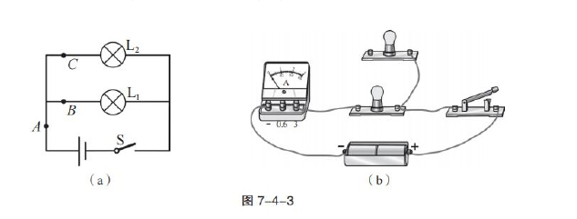
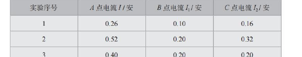
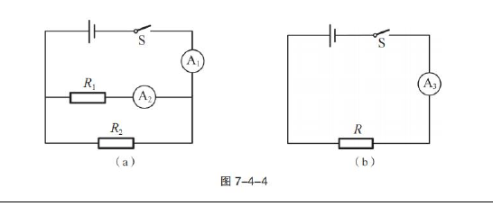
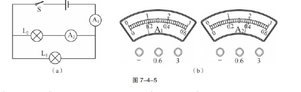
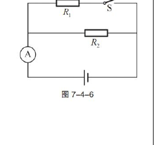
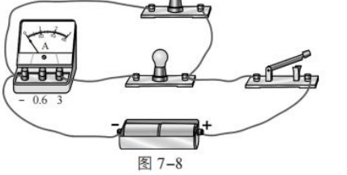

# 物电 04 精讲 · 并联电路

> 沪教版五四制九年级第一学期 7.4《并联电路①》课后练习共 5 题，全部纳入。"并联电路的应用"课时下挂的是第七章单元复习（概念图）与学期复习（压强题）课后练习，电学新题仅本练习一份，概念图题与压强题未选用。原卷 6 张插图已于 2026-11-05 裁入（图 7-4-3～7-4-6、题 2 数据表与官方答案实物连接图）。**题源勘误（2026-11-05 核验原卷）**：旧版"官方答案栏为空"注记不实——本练习官方答案齐全（并联；最小／如图 7-8、干路电流等于各支路电流之和／A₁、等效替代／C／0.4 安、6 伏、15 欧），旧版详解与官方答案一致处照旧，"独立求解"注记作废；题 2 数据表原卷真表（0.26/0.10/0.16 等三组）替换旧版"按结论重构"的 0.5/0.2/0.3 一组；题 4 表盘、题 5 电路以真图嵌入，"表盘按选项自洽重构""按开关位置重构"注记删除（重构值与真卷一致）。

## 📝 题目

### 题1 并联的辨认与总电阻（练习第 1 题）

**1.** 教室里的电灯都是＿＿＿＿＿＿＿＿的（选填"串联"或"并联"）；当教室里的电灯开关都闭合时，电路中的总电阻＿＿＿＿＿＿＿＿（选填"最大"或"最小"）。

### 题2 并联电路电流的特点（练习第 2 题）

**2.** 图 7-4-3（a）是小李同学研究"并联电路电流的特点"的实验电路图，图 7-4-3（b）是他在测量 B 点电流时所连接的实物图，测量数据记录在下表中。

（1）用笔画线代替导线把图 7-4-3（b）所示实物图连接完整；

（2）分析实验数据，可以得出初步结论：并联电路中，＿＿＿＿＿＿＿＿。

### 题3 等效替代法探究并联电阻规律（练习第 3 题）

**3.** 在探究并联电路中电阻的规律时，小李同学分别按图 7-4-4（a）（b）所示电路图连接电路，图（b）中电阻 R 为他选择替代图（a）中并联电阻 R₁ 和 R₂ 的电阻，选择的电阻 R 应满足：电源电压保持不变时，电流表 A₃ 的示数与电流表＿＿＿＿＿＿＿＿的示数相同（选填"A₁"或"A₂"）。此探究过程中运用了一种常用的科学研究方法，请再举一个运用此方法的例子：＿＿＿＿＿＿＿＿。

### 题4 干、支路电流表读数（练习第 4 题）

**4.** 在图 7-4-5（a）所示的电路中，当开关 S 闭合后，电流表 A₁ 和 A₂ 的示数如图 7-4-5（b）所示，则通过灯 L₁ 和 L₂ 的电流分别为（　　）
- （A）0.90 安，0.38 安
- （B）0.18 安，0.38 安
- （C）0.52 安，0.38 安
- （D）0.38 安，0.52 安

### 题5 支路通断的综合计算（练习第 5 题）

**5.** 在图 7-4-6 所示的电路中，电源电压保持不变，电阻 R₂ 的阻值为 10 欧。开关 S 断开时，电流表的示数为 0.6 安；开关 S 闭合后，电流表的示数为 1 安。求：

（1）通过电阻 R₁ 的电流；

（2）电源电压 U；

（3）电阻 R₁ 的阻值。

> [!tip]- 💡 思路导航（题1）
> 从"各盏灯能否独立开关、互不影响"判断连接方式；并联支路越多相当于导体越粗，从横截面积的角度说理；填空后自问一句"依据是什么"，说理题才完整。

> [!success]- ✅ 详解 · 评分点 · 易错 · 关联（题1）
> **详解**：
> 教室电灯需各自开关、互不影响，是**并联**（官方答案 ✓）；开关都闭合时支路最多，并联相当于增大导线的横截面积，总电阻变小，故为**最小**（官方答案 ✓）。
> **教师视角**："最小"是与"只闭合一盏灯"时比较；并联总电阻必定小于任何一个支路的电阻，这一句可作为通用依据句。
>
> **评分点**：两空各 1 分；若作说理，"总电阻最小"要写依据（"并联相当于增大横截面积"或"总电阻小于任一支路电阻"），只填"最小"说理题扣分。
>
> **易错**：把教室电灯答成串联（误以为"一个开关总控"＝串联——串联不能独立通断每一盏灯）；说理时写"用电多所以电阻小"（与用电多少无关，取决于连接方式）。
>
> **关联**：[[04-物理/知识点/06-电学基础]]（并联辨认、总电阻） · [[04-物理/专题/真题精讲/物电-03-串联电路]]（串联总电阻对照）

> [!tip]- 💡 思路导航（题2）
> 实物连接按"先串后并"、电流表串联进被测支路、电流"正进负出"；分析数据时先看 A 点（干路）与 B、C 两点（支路）示数的大小关系，逐行验证再下结论，结论句要点明"干路""各支路""之和"。

> [!success]- ✅ 详解 · 评分点 · 易错 · 关联（题2）
> **详解**：
> （1）电流表串联在 B 点所在支路（测 $I_1$），电流"正进负出"，量程选 0～0.6A（三组数据均不超过 0.6A）；两灯并联后与开关、电池组连成回路。官方连接答案见图。
>
> 
>
> （2）逐行验证：0.26＝0.10＋0.16；0.52＝0.20＋0.32；0.40＝0.20＋0.20 ✓。**结论**：**并联电路中，干路中的电流等于各个支路中的电流之和**（$I_A=I_1+I_2$，即 $I=I_1+I_2$，官方答案 ✓）。
>
> **评分点**：实物图连接规范（电流表串入被测支路、正进负出、量程恰当）2 分；结论句写全"干路……等于各支路……之和"，漏"干路"或"各"扣分。
>
> **易错**：电流表并在灯两端（并联）是致命错误；结论写成"干路电流大于支路电流"（只是推论，不是等量关系本身）；旧版数据表"未随文本导出、按结论重构 0.5/0.2/0.3"——原卷真表为 0.26/0.10/0.16 等三组，已按真图更正（2026-11-05）。
>
> **关联**：[[04-物理/知识点/06-电学基础]]（并联电流规律） · [[04-物理/专题/实验操作考点-物理]] · [[04-物理/专题/真题精讲/物电-03-串联电路]]（串联电压规律实验同款流程）

> [!tip]- 💡 思路导航（题3）
> 等效替代成立的标准是"相同电压下总电流相同"，所以 A₃（测 R 的电流）应对应干路表；说方法名先想"用一个量替代整体效果"这类研究手段；举例题从力学（合力）、经典故事里找同款思想。

> [!success]- ✅ 详解 · 评分点 · 易错 · 关联（题3）
> **详解**：
> R 替代并联的 R₁、R₂ 后，在相同电源电压下若总电流相同，说明 R 对电流的阻碍效果与原并联组合相同。A₃ 测的是通过等效电阻 R 的电流（即总电流），应与 (a) 图**干路**电流表 **A₁** 的示数相同（A₂ 测的是支路电流，不能选）（官方答案 A₁ ✓）。
> 科学方法：**等效替代法**（官方答案示例：两个电阻串联后对电流的阻碍作用可以用一个电阻等效替代）。另例：用一个合力替代两个共点力的作用效果（或"曹冲称象"）。同类迁移：串联电路的"总电阻"也是用等效替代的思想引入的（物电-03 题2 第 2 问）。
>
> **评分点**：选 A₁ 并写明"A₃ 测总电流、A₂ 测支路电流"的理由 1 分；方法名写"等效替代法"（写"等效法"酌情给分）1 分；例子要与"用一个等效替代整体效果"同构。
>
> **易错**：选成 A₂（只看"都测支路/单电阻"的表面相似）；例子举"控制变量法"的实验（如探究电阻因素）——方法类别不符。
>
> **关联**：[[04-物理/知识点/06-电学基础]]（并联总电阻、等效替代） · [[04-物理/专题/真题精讲/物电-03-串联电路]]（串联等效同款思想） · [[04-物理/闪卡/物理公式速记]]（$R_并=\dfrac{R_1R_2}{R_1+R_2}$）

> [!tip]- 💡 思路导航（题4）
> 先认电路：A₁ 在干路、A₂ 在 L₂ 支路，再按指针位置选量程读数——干路电流必大于支路电流，据此判断 A₁ 该用大量程；最后按选项"（L₁，L₂）"的顺序作答，先减出 L₁ 的电流再对号。

> [!success]- ✅ 详解 · 评分点 · 易错 · 关联（题4）
> **详解**：
> **设**通过 L₁、L₂ 的电流为 $I_1$、$I_2$。**列**并联电流规律 $I_总=I_1+I_2$。**读**：图 (b) 表盘未画接线导线，按电路中 A₁ 在干路、A₂ 在 L₂ 支路及指针位置定量程——A₁ 指针在满刻度约 1/3 处，干路电流较大，用 0～3A 量程读 **0.9A**；A₂ 指针在约 2/3 处，支路电流较小，用 0～0.6A 量程读 **0.38A**。
> **算** $I_1=I_总-I_2=0.9-0.38=$ **0.52A**。**选 C（0.52 安，0.38 安）**（官方答案 ✓）。
> 逐项排除：A 把干路电流 0.9A 当作 L₁ 的电流；B 把 0～3A 量程的 0.9A 按 0～0.6A 量程误读成 0.18A；D 把两灯电流顺序颠倒。**验**：$0.52+0.38=0.9$A ✓。
>
> **评分点**：先认量程再认指针各 1 分；用"干路大于支路"说明量程选择依据 1 分。
>
> **易错**：同一指针大量程读数是小量程的 5 倍（0.18↔0.9），B 项即考此陷阱；题干问的是"通过 L₁ 和 L₂ 的电流"，顺序颠倒就选成 D。
>
> **关联**：[[04-物理/知识点/06-电学基础]]（并联电流规律、电表读数） · [[04-物理/专题/真题精讲/物电-06-测功率与伏安法]]（同一指针双量程读数同款题） · [[04-物理/专题/真题精讲/物电-03-串联电路]]（电压表双量程读数）

> [!tip]- 💡 思路导航（题5）
> 开关在 R₁ 支路上，通断只改变这一条支路——"并联各支路互不影响"是全题钥匙：S 断开时干路电流表读的就是 R₂ 的电流；S 闭合后 R₂ 的电流不变，增大的全是 R₁ 的电流；最后用并联总电阻回代验算。

> [!success]- ✅ 详解 · 评分点 · 易错 · 关联（题5）
> **详解**：
> **设**电源电压为 U，通过 R₁、R₂ 的电流为 $I_1$、$I_2$。
> **列**：S 断开时 R₁ 支路断路，只有 R₂ 接入，干路电流表测 $I_2$；并联各支路互不影响，S 闭合后 $I_2$ 不变，干路电流 $I=I_1+I_2$；欧姆定律 $U=I_2R_2$、$R_1=U/I_1$。
> **算**：（1）$I_2=0.6$A，$I_1=1-0.6=$ **0.4A**；（2）$U=I_2R_2=0.6\times10=$ **6V**；（3）$R_1=6/0.4=$ **15Ω**。
> **验**：并联总电阻 $R_并=R_1R_2/(R_1+R_2)=150/25=6\Omega$，$I=U/R_并=6/6=1$A，与题给闭合后示数一致 ✓（与官方答案 0.4 安、6 伏、15 欧一致）。
> **答**：通过 R₁ 的电流 0.4A；电源电压 6V；R₁ 阻值 15Ω。
>
> **评分点**：第(2)问只能用 R₂ 支路的数据（$U=I_2R_2$），误用 1A 是最常见错误，扣分点设在这里；第(3)问写明依据"并联各支路两端的电压相等（且等于电源电压）"再代入；验算步骤加分。
>
> **易错**：**互不影响是并联的灵魂**——S 闭合前后 $I_2$ 不变，第(1)问才能用"1−0.6"求 $I_1$；**用数据反推电路结构**：若 S 在干路，断开时示数应为 0，与题给 0.6A 矛盾——所以 S 必在 R₁ 支路（旧版"按开关在 R₁ 支路重构"的猜测与真图一致，注记删除）；**先认图再动笔**：A₁、A₂ 的编号与位置以卷面图为准，考场拿到图先标出每只表的测量对象再选公式。
>
> **关联**：[[04-物理/知识点/06-电学基础]]（并联电路规律） · [[04-物理/专题/电学四大题型]]（干支路电流组合、动态电路） · [[04-物理/专题/真题精讲/物-07-探究电路与故障]]（并联电路故障判断） · [[04-物理/专题/大题规范书写-设列算验答]]（计算题五步示范） · [[04-物理/专题/真题精讲/物电-05-电功率计算]]（并联电路求功率支路）

## 备注

- "并联电路的应用"课时下挂的第七章单元复习（概念图）与学期复习（压强题）课后练习未选用，见文件首段说明。
- **题源勘误（2026-11-05 核验原卷）**：官方答案栏完整（并联；最小／如图 7-8、干路电流等于各支路电流之和／A₁、等效替代示例／C／0.4 安、6 伏、15 欧），旧版"官方答案栏为空、详解全部独立求解"注记作废；题 2 数据表、题 4 表盘、题 5 电路均以原卷真图嵌入，旧版重构注记（"按结论重构数据""表盘按选项自洽重构""按开关位置重构"）删除——重构值与真卷一致，详解结论不变。
- 2026-11-05 版式改造：每题 tip + success 双折叠 callout，小题编号统一全角（1）（2），填空位 8 全角下划线，选项逐行。
