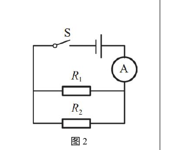
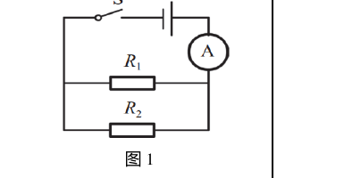
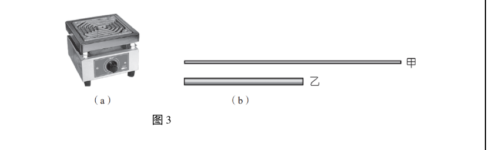
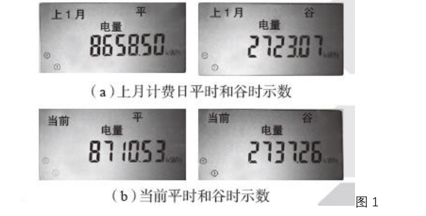
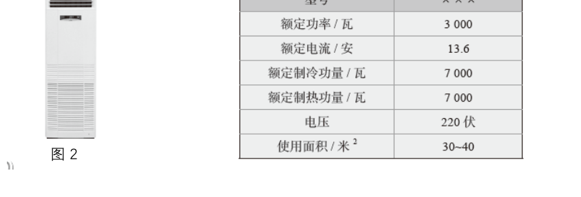
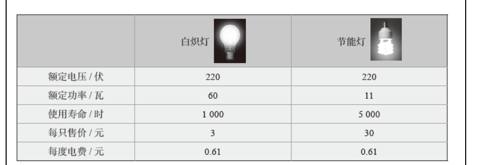
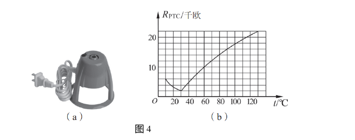

# 物电 05 精讲 · 电功率计算

> 沪教版五四制九年级第二学期 8.1《电功率》①电功、②电功率、④电能表三课时课后练习选 3 题（组合为 6 小问）。②第 3 题（电炉丝比较）作为题 1(4) 并入。配图裁自备课包原卷（2026-11-04 补齐）；电池铭牌、空调铭牌、灯具参数原卷均为图片，已嵌图直读（此前"按官方答案反推重构"的注记随之作废）。

## 📝 题目

### 题1 电功与电功率的基础计算（①第 2 题 + ②第 1、2、3 题）

**(1)** 图 2 电路中电源电压 6V 且保持不变，闭合开关 S 后电流表示数为 1A。求通电 10 秒电流所做的功 W。

**(2)** 图 1 电路中电源电压 6V 且保持不变，$R_1=10\Omega$，闭合 S 后电流表示数为 1A（$R_1$ 与 $R_2$ 并联，电流表在干路）。求电阻 $R_2$ 消耗的电功率 $P_2$。

**(3)** 某手机电池铭牌如图，标称电压 3.8V，容量 3000mAh（即充满时理论电荷量 3000 毫安时）。若待机时间约为 5 天，求待机时间内耗电的平均功率。

**(4)** 电炉是实验室常用的加热设备，甲、乙是两根材料相同的电炉丝（乙短而粗，如图 3）。把它们并联接入 220V 电路工作时，加热更快的是（　）
- （A）甲
- （B）乙
- （C）甲、乙一样快
- （D）无法判断

### 题2 电能表与电费（④第 1～4 题）

**(1)** 智能电能表循环显示如图 1（上月计费日平/谷示数 8658.50、2723.07；当前平/谷示数 8710.53、2737.26），求上月至今平、谷时段的用电量。

**(2)** 电能表标有"5(60)A 220V"，该家庭电路允许同时接入用电器的总功率为（　）
- （A）220 瓦
- （B）3300 瓦
- （C）9900 瓦
- （D）13200 瓦

**(3)** 某型号空调铭牌如图 2（额定功率 3000W），每天按额定功率累计工作 10 小时，一个月（按 30 天计）耗电多少千瓦时？

**(4)** 11W 节能灯与 60W 白炽灯发光效果相当，参数对照如图。照明 5000 小时，通过计算说明使用哪种灯在经济上更具优势。

### 题3 PTC 电灭蚊器：电阻随温度变化（②第 4 题）

电灭蚊器发热部分使用 PTC 发热材料，电阻随温度变化的图线如图 4(b)（30℃ 附近 R 最小约 2 千欧，60℃ 时约 10 千欧，温度继续升高 R 增大），工作电压 220V。

**(1)** 发热体温度为 60℃ 时，电功率为多少瓦？
**(2)** 当发热体温度继续上升时，其电阻会＿＿＿＿＿＿＿＿，消耗的电功率会＿＿＿＿＿＿＿＿（选填"增大""不变"或"减小"）。
**(3)** PTC 元件的最大电功率为多少瓦？

> [!tip]- 💡 思路导航（题1）
> 电功 $W=UIt$；并联电路走"支路电流"线（$I_2=I-I_1$）；mAh 是电荷量单位，先换算 A·h 再除以时间；加热快慢＝比较并联时的电阻大小。

> [!success]- ✅ 详解 · 评分点 · 易错 · 关联（题1）
> **详解**：
> (1) $W=UIt=6\times1\times10=$ **60J**。
> (2) $I_1=U/R_1=6/10=0.6$A；$I_2=1-0.6=0.4$A；$P_2=UI_2=6\times0.4=$ **2.4W**（验：$P_1=3.6$W，$P_1+P_2=6$W=$UI_总$ ✓）。
> (3) $Q=3000\text{mAh}=3\text{A·h}$，$t=5\times24=120$h；$I=3/120=0.025$A；$P=UI=3.8\times0.025=0.095\approx$ **0.1W**。
> (4) 并联电压相同；乙短而粗——长度短、横截面积大，两因素都使 $R_乙<R_甲$；由 $P=U^2/R$，电阻小的功率大，**乙加热快**，选 **（B）**。
>
> **评分点**：公式书写 1 分/处；并联电流分配与功率计算各 1 分；(3) 单位换算是隐形采分点。
>
> **易错**：mAh 不是库仑，直接把"3000"当电荷量代入是最常见错误；题 1(2) 别硬套 $P=U^2/R_2$（$R_2$ 未知），也不能用干路电流 1A 代入——混用干路、支路电流是最高频错误。
>
> **关联**：[[04-物理/知识点/07-电功率与家庭电路]]

> [!tip]- 💡 思路导航（题2）
> 电能表读"示数差"；"5(60)A"括号内是额定最大电流；$W=Pt$ 用"千瓦×小时"直接得千瓦时；比价类问题算"总费用=灯费+电费"。

> [!success]- ✅ 详解 · 评分点 · 易错 · 关联（题2）
> **详解**：
> (1) 平时 $8710.53-8658.50=52.03$ 千瓦时、谷时 $2737.26-2723.07=14.19$ 千瓦时，合计 **66.22 千瓦时**。
> (2) 60A 是额定最大电流，$P=UI=220\times60=$ **13200W**，选 **（D）**（B、C 分别对应 220×15、220×45 的错误取值）。
> (3) $P=3000\text{W}=3\text{kW}$，$W=Pt=3\times10\times30=$ **900 千瓦时**（验：$900/300=3$kW ✓）。
> (4) 白炽灯：$5000/1000=5$ 只，灯费 $15$ 元；电费 $0.06\times5000=300$ 千瓦时 $\times0.61=183$ 元，共 **198 元**。节能灯：1 只 30 元；电费 $0.011\times5000=55$ 千瓦时 $\times0.61=33.55$ 元，共 **63.55 元**。$198>63.55$，**节能灯明显更经济**（约省 134 元）。
>
> **评分点**：(1) 分段读数相减；(2) 概念辨析；(4) 两灯全寿命周期成本比较，漏算"更换只数"即失分。
>
> **易错**："5(60)A"用 5A 计算得 1100W 不在选项中，属概念性陷阱；"千瓦"配"小时"直接得"千瓦时"，别把 3000W 当 3000kW；1 千瓦时 $=3.6\times10^6$ 焦，填空题偶考换算。
>
> **关联**：[[04-物理/知识点/07-电功率与家庭电路]] · [[04-物理/专题/真题精讲/物-08-电功率综合]]

> [!tip]- 💡 思路导航（题3）
> 电阻随温度变化 → 功率随电阻变化；电压恒定用 $P=U^2/R$；"最大功率"对应图线上 R 的最小值。

> [!success]- ✅ 详解 · 评分点 · 易错 · 关联（题3）
> **详解**：
> (1) 60℃ 时 $R=10$ 千欧 $=10000\Omega$：$P=U^2/R=220^2/10000=$ **4.84W**。
> (2) 温度继续上升，由图线 R **增大**；电压不变，$P=U^2/R$ **减小**。
> (3) P 最大对应 R 最小 $\approx2000\Omega$（约 30℃ 处）：$P=48400/2000=$ **24.2W**（验：2000Ω 是 10000Ω 的 1/5，反比得 4.84×5 ✓）。
>
> **评分点**：图线读数（10 千欧、2 千欧）+ $P=U^2/R$ 应用；注意纵轴单位是**千欧**。
>
> **易错**：额定与实际——用电器只有在额定电压下实际功率才等于额定功率；PTC 功率变化的本质是电阻随温度变化，并非电压变化；读图忽略"千欧"会差 1000 倍。
>
> **关联**：[[04-物理/知识点/07-电功率与家庭电路]] · [[04-物理/闪卡/物理公式速记]]（$W=UIt$、$P=UI$、$P=U^2/R$） · [[04-物理/专题/真题精讲/物电-06-测功率与伏安法]]（测小灯泡电功率实验） · [[04-物理/专题/大题规范书写-设列算验答]]

## 备注

- 本文件原版将电池铭牌（3.8V/3000mAh）、空调铭牌（3000W）、灯具参数表按"图片不可读"做了参数重构；2026-11-04 备课包原卷图已裁入，参数与重构值一致（0.61 元/千瓦时、900 千瓦时、183/33.55 元均与官方答案自洽），重构注记作废。原"多挡位"计划槽位无严格原题，以 PTC 变功率（电阻变化等效"换挡"）覆盖。
