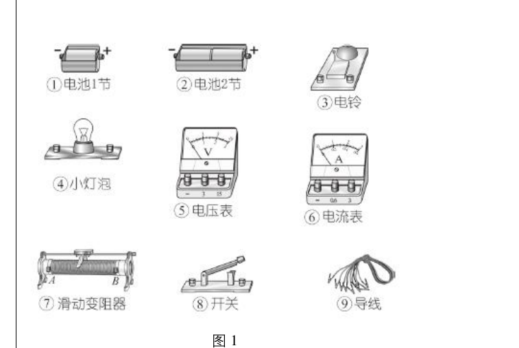
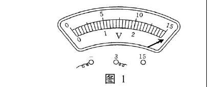
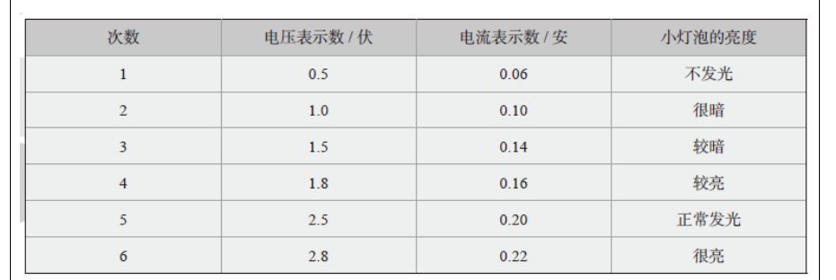
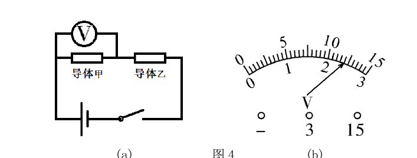
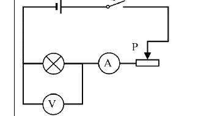

# 物电 06 精讲 · 测功率与伏安法

> 沪教版五四制九年级第二学期 8.1《电功率③》学生实验课后练习 + 7.2 探究 I-U 单元作业设计题 0305 + 第八章单元复习课后练习第 2 题，共 3 题。**题源勘误**：题 0305 官方答案第二问"1.5A"与"同一导体电流与电压成正比"矛盾，本讲以原理为准修正为 0.18A（见题2 易错）。原卷图（器材图、数据表、电压表、电路图）已于 2026-11-04 裁入嵌图，此前"按官方答案重构"注记作废——数据表 6 组读数全部可直读。

## 📝 题目

### 题1 伏安法测小灯泡的电功率（8.1③ 第 1～3 题）

**1.** "测定小灯泡的电功率"实验的原理是＿＿＿＿＿＿＿＿，实验中需要测量的物理量是＿＿＿＿＿＿＿＿、＿＿＿＿＿＿＿＿。

**2.** 为了测定标有"2.5V"字样小灯泡的电功率，画出实验电路图，并从图 1 所示器材中选出需要哪些（官方答案：②④⑤⑥⑦⑧⑨）。

实验电路如图（滑动变阻器与小灯串联、电压表并联在小灯两端、电流表串联）：

**3.** 李同学实验得到如下表所示的电压 U 和电流 I 的数据：

(1) 小灯泡的额定功率为＿＿＿＿＿＿＿＿瓦；(2) 分析表中数据可得出的结论：＿＿＿＿＿＿＿＿；(3) 有同学建议用多次测量的平均值作为小灯泡的额定功率，这种做法是＿＿＿＿＿＿＿＿的（选填"正确"或"错误"）。

### 题2 量程判读与正比关系的应用（探究 I-U 作业设计题 0305）

导体甲两端电压为 4V 时，30 秒内有 9C 电荷量通过该导体。现将甲接入图 4(a) 所示另一电路，电压表指针位置如图 4(b)（0～15V 量程读 12V，0～3V 量程读 2.4V）。

(1) 求此时通过导体甲的电流 $I_甲$；
(2) 分别按电压表两种量程的读数，求通过甲的电流。

### 题3 残缺信息推算额定功率（第八章单元复习第 2 题）

某同学做"测定小灯泡的电功率"实验，现有电源、电压表（0～15V 挡损坏）、待测小灯（标有"X.8V 0.3A"字样）、电流表、滑动变阻器（标有"20Ω 1A"字样）、开关及导线若干。他正确连接电路，实验步骤正确。闭合开关，电流表示数为 0.26A，电压表示数为 2.8V；然后移动滑片至小灯正常发光，此时变阻器大约有三分之二的电阻连入电路。请计算小灯的额定功率。（题源图 1 为电压表情境图，官方解法不依赖该图）

> [!tip]- 💡 思路导航（题1）
> 原理 $P=UI$ 决定"测什么"和"表怎么接"；额定功率只对应额定电压那一组（表中 2.5V/0.20A）；"功率越大灯越亮"要从数据里读出来；平均值对额定功率无意义。

> [!success]- ✅ 详解 · 评分点 · 易错 · 关联（题1）
> **详解**：
> 1. 原理 **$P=UI$**；需测量**小灯泡两端的电压 U** 和**通过它的电流 I**。
> 2. 电路：滑动变阻器与小灯**串联**，电压表**并联在小灯两端**（选 0～3V 量程，电流"正进负出"），电流表串联（选 0～0.6A 量程）。器材：②电池2节、④小灯泡、⑤电压表、⑥电流表、⑦滑动变阻器、⑧开关、⑨导线（电源用干电池组）。滑动变阻器作用：①闭合开关前取最大阻值保护电路；②改变小灯两端电压，测多组数据、观察亮度变化。
> 3. (1) $P_额=U_额I_额=2.5\times0.2=$ **0.5W**。
> (2) 电压升高时电流变大、实际功率变大、灯变亮。结论：**小灯泡的实际功率越大，小灯泡越亮**。规范写法补数据支撑："如 U 由 1.0V 升到 2.5V，I 由 0.10A 增大到 0.20A，P 增大、灯变亮"。
> (3) **错误**。额定功率是额定电压下的功率，不同电压下实际功率本就不同，取平均值无物理意义（这与伏安法测电阻取平均减小误差不同）。
>
> **评分点**：原理与两物理量各 1 分；量程选择要有依据（灯额定 2.5V→电压表 0～3V 挡"大于且接近"；估 $I\approx0.2$A→电流表 0～0.6A 挡）；结论句带数据才是满分句。
>
> **易错**：功率不能取平均——测电阻取平均减小偶然误差，测功率的"额定值"只对应额定电压，取平均是概念错误。
>
> **关联**：[[04-物理/知识点/07-电功率与家庭电路]] · [[04-物理/专题/实验操作考点-物理]]

> [!tip]- 💡 思路导航（题2）
> 电流定义式 $I=Q/t$ 先求 0.3A；两次读数是**同一指针位置**，大量程恰为小量程 5 倍；同一导体 $I_2/I_1=U_2/U_1$。

> [!success]- ✅ 详解 · 评分点 · 易错 · 关联（题2）
> **详解**：
> (1) $I_甲=Q/t=9\text{C}/30\text{s}=$ **0.3A**。
> (2) 同一导体电流与电压成正比：①按 0～15V 量程 $U'=12$V：$I'=(12/4)\times0.3=$ **0.9A**；②按 0～3V 量程 $U''=2.4$V：$I''=(2.4/4)\times0.3=$ **0.18A**。验：12V 与 2.4V 恰为 5 倍（量程关系），0.9A 与 0.18A 也恰为 5 倍，自洽 ✓。
>
> **评分点**：比例式书写与量程换算各 1 分。
>
> **易错**：**题源勘误**——官方答案小量程情形给"1.5A"，与正比结论矛盾（1.5A 无法由任何一致算法得出），正确值为 0.18A，本讲以原理为准。
>
> **关联**：[[04-物理/知识点/07-电功率与家庭电路]] · [[04-物理/专题/真题精讲/物电-02-欧姆定律与电阻]]

> [!tip]- 💡 思路导航（题3）
> 两把钥匙："实验步骤正确"→闭合开关时滑片在最大阻值 20Ω，可先求电源电压；"0～15V 挡损坏"→额定电压读不出，要用正常发光时"约 2/3 接入"倒推，再与"X.8V"对号。

> [!success]- ✅ 详解 · 评分点 · 易错 · 关联（题3）
> **详解**：设电源电压 U。
> 第一步（闭合开关时）：$U=U_灯+IR_{滑}=2.8+0.26\times20=2.8+5.2=$ **8V**。
> 第二步（正常发光时）：$I_额=0.3$A，$R_{滑}'=\frac{2}{3}\times20=\frac{40}{3}\Omega$，$U_{滑}=0.3\times\frac{40}{3}=4$V，$U_灯=8-4=4$V。
> **判读**：灯标"X.8V"。若 4.8V：$R_{滑}=3.2/0.3\approx10.7\Omega$，约为最大阻值一半，与"约三分之二"不符；若 **3.8V**：$R_{滑}=4/0.3\approx13.3\Omega=\frac{2}{3}\times20\Omega$ 吻合 ✓。故额定电压 3.8V。
> $P_额=U_额I_额=3.8\times0.3=$ **1.14W**。
>
> **评分点**：三处证据环环相扣——"步骤正确"定初始滑片、串联电压规律定电源 8V、"2/3 接入 + X.8V"定额定电压；分步列式各 1 分，判读说理 1 分。
>
> **易错**：跳过判读直接把 4V 当额定电压、或写 4.8V，都是常见失分；"约三分之二"是文字化的电阻信息，要翻译成 $R_{滑}=13.3\Omega$ 参与验证。
>
> **关联**：[[04-物理/知识点详解/07-电功率与家庭电路]] · [[04-物理/专题/真题精讲/物-08-电功率综合]] · [[04-物理/专题/真题精讲/物电-05-电功率计算]]（额定/实际功率概念） · [[04-物理/专题/真题精讲/物-14-2026真题-测量电阻]]（同族实验题） · [[04-物理/专题/大题规范书写-设列算验答]]

## 备注

- 0301（改接一根导线作图）、0401（甲乙丙数据归纳比值定义）两题未选用：前者电路设计要点已并入题 1，后者思路同 [[04-物理/专题/真题精讲/物电-02-欧姆定律与电阻]] 题 2。
- 2026-11-04 补：原卷图 5 张裁入（器材图/数据表/电路/电压表×2），数据表 6 组真实读数替换了此前"按官方答案重构"的描述行；题源勘误（0305 答 1.5A→0.18A）保留于题2 易错。
