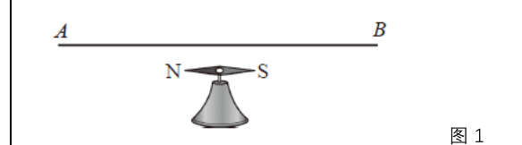
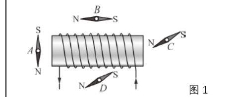
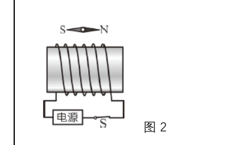
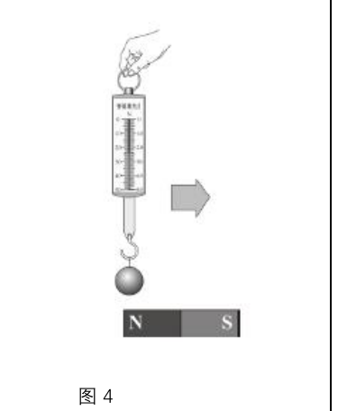
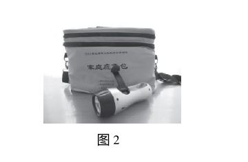
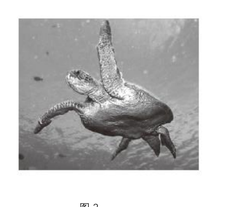

# 物电 07 精讲 · 电流的磁场

> 沪教版五四制九年级第二学期 8.2《电流的磁场》三个课时课后练习选 2 题（磁体基础概念填空组未选用），另从 8.3 课后练习借入第 2 题（手摇应急灯）承担"发电机"辨析槽位。原卷 7 张插图已于 2026-11-04 裁入（含题 1.3 作图题的官方答案图），此前"按官方答案重构磁极方位"的注记作废、以真图为准。

## 📝 题目

### 题1 奥斯特实验与通电螺线管（②第 1 题 + ③第 1、2 题）

**1.** 如图 1，导线 AB 平行置于静止的小磁针上方。导线通电时小磁针发生偏转，这说明＿＿＿＿＿＿＿＿，这就是著名的＿＿＿＿＿＿＿＿实验。若改变导线中的电流方向，可观察到小磁针偏转方向发生变化，由此可得电流的磁场方向与＿＿＿＿＿＿＿＿有关。

**2.** 通电螺线管周围放置 4 个能自由转动的小磁针 A、B、C、D（图 1），闭合开关后静止时指向正确的是＿＿＿＿＿＿＿＿，并写出判断依据。

**3.** 根据小磁针 N 极的指向确定螺线管的磁极，然后标出电源的正、负极（图 2）。

### 题2 磁性强弱判断与"磁生电"辨析（①第 4、5 题 + 8.3 第 2 题）

**1.** 将挂有小铁球的弹簧测力计置于水平放置的条形磁铁上方（图 4），沿水平方向自左向右缓慢移动，测力计示数将（　　）
- （A）不变
- （B）逐渐变小
- （C）先变小后变大
- （D）先变大后变小

**2.** 为了判断一根钢棒是否有磁性，小明进行了如下实验，其中**无法**判断钢棒是否有磁性的是（　　）
- （A）让钢棒靠近铁屑，铁屑被吸引
- （B）用细线吊起钢棒使它能在水平面内自由转动，静止时总是指南北
- （C）让小磁针靠近钢棒，钢棒与小磁针相互排斥
- （D）让小磁针靠近钢棒，钢棒与小磁针相互吸引

**3.** 生活在南美洲的绿海龟（图 3）每到产卵季节，能从巴西沿海准确游到约 2000 多千米外的阿森松岛。这是因为绿海龟和信鸽一样体内有某种磁性物质，它们能借助＿＿＿＿＿＿＿＿辨别方向；利用磁性物质的这一性质，我国古代制成了世界上最早的指南工具——＿＿＿＿＿＿＿＿。

**4.** 家庭应急包中的一种应急灯（图 2），紧急情况下没电时摇动手柄即可应急使用，它的工作原理相当于（　　）
- （A）发电机
- （B）电流的磁效应
- （C）磁极间的相互作用
- （D）通电螺线管

并辨析：发电机与电动机的能量转化和原理分别是什么？

> [!tip]- 💡 思路导航（题1）
> 奥斯特实验抓"因果方向"：电流产生磁场（不是磁场对电流的作用）；小磁针静止时 N 极指向＝该点磁感线方向，外部磁感线从 N 出回到 S；作图题三步：小磁针定磁极 → 安培定则定电流方向 → 电流流入端接电源正极。

> [!success]- ✅ 详解 · 评分点 · 易错 · 关联（题1）
> **详解**：
> 1. 通电导线使小磁针偏转，说明**电流周围存在磁场**（电流的磁效应）；这就是著名的**奥斯特**实验；偏转方向随电流方向改变，说明磁场方向与**电流方向**有关。辨析："磁场对电流的作用"是电动机原理（通电导体在磁场中受力），与奥斯特实验因果方向相反，不能混写。
> 2. 判定依据：磁体外部磁感线从 N 极出来回到 S 极，小磁针静止时 N 极指向与该点磁感线方向一致。先用安培定则（右手握管，四指沿正面电流方向，拇指指 N 极）由绕线与电流方向定出螺线管磁极，再逐个核对 A、B、C、D 的 N 极指向——仅 **C** 与所在点磁感线方向一致（官方答案 C）。
> 3. 判定链条（按原卷图 2）：上方小磁针 N 极指向右 → 该点磁感线方向向右 → 磁感线从螺线管左端出（**左端 N 极**）、回右端（S 极）→ 安培定则：右手四指沿正面电流方向弯曲、拇指指左 → 正面电流方向确定 → 电流从右端流入螺线管 → **电源右端为正极**（官方答案图验证：电源左"−"右"+"✓）。
>
> **评分点**：奥斯特结论句写"通电导线周围存在磁场"或"电流的磁效应"（写成"电流使小磁针带电"即错）；作图题三步各 1 分，顺序颠倒则步步错——先标磁极、再画电流方向、最后标电源正负极。
>
> **易错**：⚠️ 题 1.2 原卷四只小磁针的黑白极性端在扫描件上较难分辨，考试按"安培定则 → 磁感线方向 → 逐个核对"流程作答即可，结论取官方答案 C；延伸——螺线管**内部**磁感线由 S 指向 N，与外部衔接成闭合曲线；放入铁芯即成电磁铁，磁性大大增强。
>
> **关联**：[[04-物理/知识点/08-磁与能源信息]]

> [!tip]- 💡 思路导航（题2）
> 条形磁铁"两端强、中间弱"→ 示数变化对称；磁性判断辨析抓一条：**"吸引"不能证磁性（磁体也能吸无磁性的磁性材料），"排斥"才能**；海龟/信鸽挂地磁场；摇手柄发电＝机械能变电能。

> [!success]- ✅ 详解 · 评分点 · 易错 · 关联（题2）
> **详解**：
> 1. 条形磁铁两端磁性最强、中间最弱：铁球移到两端上方磁力大、示数大，正中上方磁力最小、示数最小。自左向右**先变小后变大**，选 **（C）**（验：磁铁左右对称，两端示数应基本相同 ✓）。
> 2. 逐项：A 吸铁屑——只有磁体才能吸起铁屑，**能**判断；B 静止总指南北——受地磁场作用，**能**判断；C 相互排斥——只有同名磁极间才有排斥力，**能**判断；D 相互吸引——磁体也能吸引**没有磁性**的钢棒，**无法**判断。选 **（D）**。反证：无磁性的钢棒不能吸铁屑、不会规则指南北、只会被吸引不会排斥。
> 3. 绿海龟与信鸽借助**地磁场**辨别方向；最早的指南工具是**司南**。（延伸：地磁两极与地理两极不重合，存在"磁偏角"——教材阅读材料考点。）
> 4. 摇动手柄时线圈在磁场中转动产生电流：**机械能转化为电能**，原理是电磁感应，相当于 **（A）发电机**。辨析：**发电机**——电磁感应，机械能→电能；**电动机**——通电线圈在磁场中受力转动，电能→机械能。
>
> **评分点**：磁性判断四选项要逐项归方法（吸铁性/指向性/磁极相互作用）再判充分性；发电机/电动机辨析抓两点——能量转化方向 + 原理名称，只写"磁生电/电生动"不写原理名扣一半。
>
> **易错**："吸引"不能证磁性——与物电-01"吸引不能证带电"逻辑相同，注意方法迁移；磁化概念：铁钉靠近磁体被磁化——近端异名磁极、远端同名磁极（"大头针针帽互相排斥"类题的依据）；地磁场两条常考——地磁的南极在地理北极附近、磁体静止指南北正是受地磁场作用；磁感线是假想的、实际不存在但分布不能随意画，两条磁感线不相交。
>
> **关联**：[[04-物理/知识点详解/08-磁与能源信息]] · [[04-物理/专题/真题精讲/物-09-能源信息与电磁]] · [[04-物理/专题/真题精讲/物电-08-电能输送与无线电]]（发电机与电能输送衔接） · [[04-物理/专题/真题精讲/物电-01-电流与电压]]（"排斥才能定论"的方法迁移）

## 备注

- 备课包缺口：8.2 课后练习无电动机/发电机原题，辨析槽位由 8.3 第 2 题（手摇应急灯）承担，辨析部分按原理补足；8.2① 的磁体概念填空组（第 1～11 题）为基础重复训练未选用；①第 3 题（绿海龟/司南）并入题 2 第 3 小问。
- 2026-11-04 补：原卷图 7 张裁入。题 1.2 磁极方位此前"右端 N"的重构表述与真图不符，已改为按安培定则流程作答、结论取官方答案 C 并加辨认注记；题 1.3 示例极性原写反，已按官方答案图（电源左−右+）修正。
