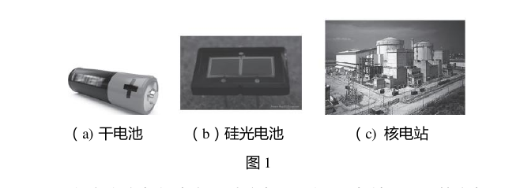
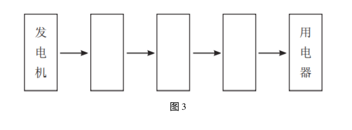
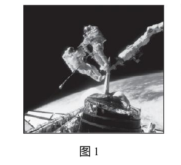
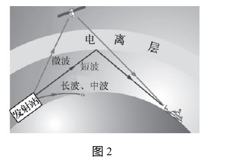
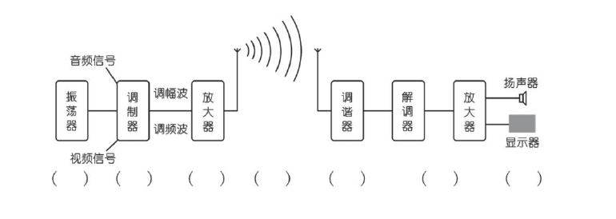

# 物电 08 精讲 · 电能输送与无线电

> 沪教版五四制九年级第二学期 8.3、8.4 课后练习共 6 题，全部纳入两题的框架（8.3 第 2 题手摇应急灯在 [[04-物理/专题/真题精讲/物电-07-电流的磁场]] 承担发电机辨析；第八章单元复习第 2 题测功率推算在 [[04-物理/专题/真题精讲/物电-06-测功率与伏安法]]）。高压输电的说理部分结合 7.2 电阻课后练习第 4 题（四根导线并联，原卷图 2 已裁入）展开。原卷 6 张插图已于 2026-11-05 裁入嵌图，此前"照片/框图/类比图未随文本导出"的重构注记作废——**8.3 第 3 题框图为原卷五框真图（发电机→三只空框→用电器，共三个空），旧版"两空、高压输电线路为已给节点"的重构与真图不符，已按官方答案更正；8.4 第 3 题类比简图为原卷七括号真图，按官方答案七环节作答**。两节内容均为沪教版"了解级"考点，以说理规范与概念辨析为得分关键。

## 📝 题目

### 题1 电能的获得与高压输电（8.3 第 1、3 题 + 7.2 电阻练习第 4 题）

**1.** 如图 1 所示，获取电能的途径有多种。例如：图（a）中干电池可以把＿＿＿＿＿＿＿＿能转化为＿＿＿＿＿＿＿＿能；图（b）中硅光电池可以把＿＿＿＿＿＿＿＿能转化为＿＿＿＿＿＿＿＿能；图（c）中核电站可以把＿＿＿＿＿＿＿＿能转化为＿＿＿＿＿＿＿＿能。

**2.**（7.2 电阻练习第 4 题）如图 2 所示的是四根高压输电线上的一个装置，利用这个装置将四根导线并联起来，相当于增大了导线的＿＿＿＿＿＿＿＿，从而减小了导线的＿＿＿＿＿＿＿＿，以达到减少输电线上电能损失的目的。

**3.** 请在图 3 中方框内补充完整高压输电的主要过程。

**说理延伸**（按"判断→依据→回扣情境"三段作答）：

（1）远距离输电为什么采用高压输电？

（2）结合第 2 题说明：高压输电线上把四根导线并联在一起使用，又有什么好处？

### 题2 电磁波与无线电通信（8.4 第 1～3 题）

**1.** 无线电波的传播速度与光速相同，等于＿＿＿＿＿＿＿＿。如图 1 所示，在太空中，航天员在太空舱外部工作时，相互之间需通过无线电通信设备进行交谈，说明无线电波的传播＿＿＿＿＿＿＿＿介质（选填"需要"或"不需要"）。

**2.** 如图 2 所示，无线电波一般分为四个波段，即＿＿＿＿＿＿＿＿、＿＿＿＿＿＿＿＿、＿＿＿＿＿＿＿＿和微波；其中频率最高的是＿＿＿＿＿＿＿＿，主要用于无线电广播的是＿＿＿＿＿＿＿＿。

**3.** 阅读教科书 P26，用简图将飞机装运货物的过程与无线电波发送和接收的过程类比，在括号中填上相对应的过程。

> [!tip]- 💡 思路导航（题1）
> 能量转化题先问"能量最初从哪来"，再写"→电能"；框图按"升压—输电—降压"的骨架补空；说理抓两条线——输送功率 P=UI 一定时 U 越高 I 越小、导线有电阻电流通过会发热，四线并联改变的是导线自身的电阻。

> [!success]- ✅ 详解 · 评分点 · 易错 · 关联（题1）
> **详解**：
> 1. 干电池：**化学**能→**电**能（放电时发生化学反应释放能量）；硅光电池：**光**能→**电**能（光伏效应）；核电站：**核**能→**电**能（核反应放热，先转化为内能再带动发电机）。三种途径的共同终点都是电能（官方答案：化学；电；光；电；核；电 ✓）。书写格式均为"××能→电能"，两空顺序不可颠倒。
> 2. 四根导线并联在一起，相当于**增大了导线的横截面积**，从而**减小了导线的电阻**（官方答案 ✓），由"损失随 R 减小"可知可减少输电线上的电能损失。
> 3. 框图（官方答案）：发电机 →（**升压变压器**，把电压升高以减小输电电流）→（**输电线**）→（**降压变压器**，把电压降回家庭电路 220V）→ 用电器。
> 说理（判断→依据→回扣）：
> （1）**判断**：远距离输电要采用高压输电。**依据**两条：①输送的电功率 P=UI 一定时，输电电压 U 越高，输电电流 I=P/U 越小；②输电导线有电阻，电流通过时因电流的热效应发热损失电能（Q=I²Rt），电流 I 越小，线路上的电能损失越少。**回扣**：所以发电站先把电压升高再输送，电能到用户附近再降压使用。
> （2）**判断**：四线并联能进一步减少电能损失。**依据**：并联相当于增大横截面积、减小导线电阻（第 2 题结论）。**回扣**：电阻越小，同条件下线路上发热损失越少，所以高压输电线常用分裂导线（多根并联）。
> **验（数量级感受）**：电压升高为原来 10 倍时，电流变为原来的 1/10，线路发热损失变为原来的 1/100——这就是"高压"的威力；若再让导线电阻减为原来的 1/4（四线并联），损失再降为 1/4。
>
> **评分点**：能量转化两空顺序与"源头"归类各 1 分；框图三个空全对（漏"输电线"即失分）；说理两个得分点——①P 一定时 U 高→I 小；②线路损失随 I（或 R）减小，只答"高压安全""高压电量足"不得分；三段说理缺"回扣情境"扣分。
>
> **易错**：**四线并联别答成"增大电压"**——并联改变的是导线自身（横截面积↑→电阻↓），不是输送电压；**变压器不"产生"电能**，只改变电压（升压/降压），不能写"变压器增大电能/电功率"；**框图题源更正**——原卷图 3 共五个框、三个空（升压变压器、输电线、降压变压器），旧版"两空重构（高压输电线路为已给节点）"与真图不符，已按官方答案更正（2026-11-05）。
>
> **关联**：[[04-物理/知识点/08-磁与能源信息]]（电能的获得和输送） · [[04-物理/知识点/06-电学基础]]（电阻决定因素回用于四线并联说理） · [[04-物理/专题/真题精讲/物电-02-欧姆定律与电阻]]（"增大横截面积减小电阻"的出处） · [[04-物理/专题/真题精讲/物电-05-电功率计算]]（P=UI 回用于输电说理）

> [!tip]- 💡 思路导航（题2）
> "传播速度与光速相同"是无线电波属于电磁波家族的标志，真空不能传声而电磁波可以——对照作答；波段按波长从长到短排，波速一定时频率与波长成反比（c=fλ）；类比题先抓"装载信号—发射—传播—接收—还原"骨架，再对号入座。

> [!success]- ✅ 详解 · 评分点 · 易错 · 关联（题2）
> **详解**：
> 1. 无线电波的传播速度 $3\times10^8$ **米/秒**；传播**不需要**介质（官方答案 ✓）。依据：太空舱外是真空，声音不能传播，而无线电波（电磁波）可以在真空中传播，故舱外交谈必须用无线电通信设备。（"与光速相同"正说明无线电波与光同属电磁波家族，这是教材的伏笔。）作答注意：指数是 8 不是 6，"3×10⁸ 米/秒"与"3×10⁸ m/s"写法均可。
> 2. 四个波段：**长波**、**中波**、**短波**和微波（按波长从长到短，官方答案 ✓）；由 $c=f\lambda$，波速一定时波长最短者频率最高，故频率最高的是**微波**；主要用于无线电广播的是**中波和短波**（官方答案 ✓）。（延伸：微波还用于电视广播、雷达与卫星通信；图 2 中微波与短波靠电离层反射或直线传播到达接收端。）记忆口诀："长中短微"由长到短排，"广播用中短波"——两空一起记。
> 3. 类比简图七个括号从左到右依次填（官方答案原文）：**货物装箱；装机；起飞；飞行；降落；卸箱；开箱取物**。对应物理环节：货物**装箱**——音频/视频电信号"装载"（振荡器提供高频载波，信号送入调制器）；**装机**——调制器把信号装到高频电流上（**调制**，得调幅波/调频波）；**起飞**——信号放大后通过天线把载有信号的无线电波**发射**出去；**飞行**——无线电波在空间**传播**；**降落**——接收天线与调谐器**接收选台**；**卸箱**——解调器从高频波中取出音频电信号（**检波**）；**开箱取物**——放大还原，经扬声器发声/显示器成像。一句话骨架：装载信号→发射→传播→接收→取出并还原信号。
>
> **评分点**：速度值与"不需介质"各 1 分；四个波段顺序与两处选填各 1 分；类比七空按顺序全对，"调制"一词写不出时写"把声音信号装载到高频电磁波上"同样给分。
>
> **易错**："不需要介质"要说依据（真空不能传声、电磁波可在真空中传播，对比作答），只填"不需要"说理题不完整；**频率与波长别捆绑错**——微波波长最短、频率最高，勿凭"波长短"误推"频率低"；**类比题先骨架后名词**，五个物理环节顺序不能乱；"与光速相同"是判断依据（无线电波是电磁波的一种），概念判断题爱考。
>
> **关联**：[[04-物理/知识点/08-磁与能源信息]]（无线电波与通信） · [[04-物理/知识点详解/08-磁与能源信息]] · [[04-物理/专题/真题精讲/物-09-能源信息与电磁]] · [[04-物理/专题/真题精讲/物电-07-电流的磁场]]（发电机原理衔接）

## 备注

- 8.3 第 2 题（手摇应急灯，答案 A 发电机）在 [[04-物理/专题/真题精讲/物电-07-电流的磁场]] 承担发电机辨析槽位；第八章单元复习课后练习（概念图 + 测功率推算）分别处理：概念图未选用，测功率题见 [[04-物理/专题/真题精讲/物电-06-测功率与伏安法]]。
- **题源更正（2026-11-05 核验原卷）**：8.3 第 1 题照片、第 3 题框图，8.4 第 1 题航天员图、第 2 题电离层图、第 3 题类比简图均随原卷存在并已裁入；8.3 第 3 题框图实为"发电机→□→□→□→用电器"五框三空（官方答案：升压变压器→输电线→降压变压器），旧版按"两空+高压输电线路"的重构作废；8.4 第 3 题为七括号简图，旧版五环节类比扩充为官方七环节（装箱/装机/起飞/飞行/降落/卸箱/开箱取物）。
- 2026-11-05 版式改造：每题 tip + success 双折叠 callout，小题编号统一全角（1）（2），填空位 8 全角下划线。
