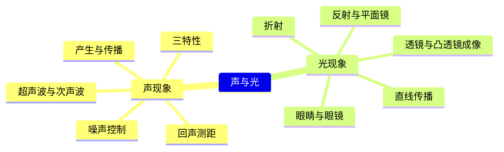
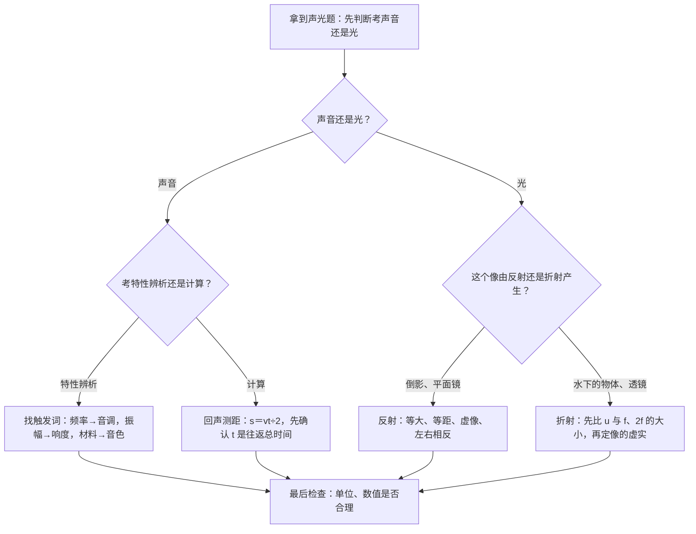

# 声与光（详解版）

> **使用说明**：本文是详解版，从"为什么"讲起供从头自学；考前速查和掌握度跟踪在概要版：[[04-物理/知识点/01-声与光]]。

## 0️⃣ 这章学什么 & 中考怎么考

这一章回答两个问题：**声音是怎么产生、怎么传到你耳朵里的**；**光是怎么传播、怎么成像的**。整章几乎没有复杂计算，拼的是"给你一个生活场景，你能不能又快又准地说出它属于哪种物理现象"。

- 学科总览把本章定级为：权重"中"，概念题为主（见 [[04-物理/学科总览]]）。
- 2026 真题在"生活与自然"题块里考了光的反射/折射成像辨析（概要版已核对）；"调节音量"这类声音三特性辨析也是常客。
- 题型：选择题、填空题中的情境辨析为主。唯一的常考计算是回声测距 $s=\dfrac{vt}{2}$，本质就是速度公式套了个"往返"。
- 凸透镜成像是 5 月实验操作考的重点实验之一（物理实验操作共 10 分，见 [[04-物理/专题/实验操作考点-物理]]：高频扣分点是没找到"最清晰"的像就读数）。

先把本章全景看一眼，学的时候心里有地图：



## 🧭 先修自检（学不下去先回到这里）

> 下面每一项都是本章的地基。做不出就先去补对应知识，硬学只会更挫败。

| # | 你应该会的 | 自查题（先做再看答案） | 答案 | 不会去哪补 |
| - | ---------- | ---------------------- | ---- | ---------- |
| 1 | 速度公式及其变形 | 声音在空气中传 680 m 要多久？（声速 340 m/s） | $t=\dfrac{s}{v}=\dfrac{680}{340}=2\ \text{s}$ | [[04-物理/知识点/02-运动与力]] |
| 2 | 科学记数法的乘法 | $3\times10^8\times2$ 等于多少？ | $6\times10^8$（系数相乘，10 的指数不变） | 数学·科学记数法 |
| 3 | 长度单位换算 | 680 m 是多少 km？ | 0.68 km（小单位换大单位，除以 1000） | [[04-物理/知识点/02-运动与力]] |
| 4 | 会查表、会比大小 | 凸透镜成像表里 u=2f 时成什么像？ | 倒立、等大的实像 | 本文 🌱 第 8 节 |

## 🌱 概念从头讲

> 每个概念按"**为什么需要它 → 它是什么 → 符号与单位 → 容易想错的地方**"四步讲。

### 1. 声音的产生与传播

- **为什么需要**：你每天听到讲课声、铃声、喇叭声，得先弄清"声音从哪来、靠什么传过来"，后面的三特性、回声测距才有的谈。
- **定义**：声音由物体**振动**产生——不振动的物体发不出声。传播需要**介质**：固体、液体、气体都能传声，一般固＞液＞气（越"密实"传得越快）；**真空不能传声**。
- **符号/单位**：声速用 $v$（或 $v_{声}$），单位 m/s。**15℃ 空气中 $v_{声}=340\ \text{m/s}$，这个数必须背下来**，回声测距全靠它。
- **容易想错**：❌"振动停止，声音就立刻消失" → 很多人把"停止发声"当成"声音消失"。振动停止只是**不再产生**新的声音，之前发出去的声音还在介质里继续传播（敲锣后按住锣面，锣声不会瞬间消失，就是这个道理）。→ ✅分清"停止产生"和"传播中断"。
- **容易想错 2**：❌"月球上两名宇航员面对面大喊也能听到" → ✅月球表面没有空气（接近真空），真空不传声，必须靠无线电对话。

### 2. 声音的三特性（音调、响度、音色）

- **为什么需要**：同样一句话，小孩喊出来和大人说出来"不一样"，你需要一套词来描述"哪里不一样"——这套词就是三特性。考试考的就是"给场景，判断改的是哪一特性"。
- **定义**：见下表。

| 特性 | 听感 | 由什么决定 | 题目里的触发词 |
| ---- | ---- | ---------- | -------------- |
| 音调 | 声音的高低（尖细／低沉） | 振动**频率**（振动的快慢） | 弦的松紧、长短、粗细；杯里水量多少；"尖细刺耳" |
| 响度 | 声音的大小（响／轻） | 振动**振幅**（振动的幅度）＋距离远近 | 用力大小、"调节音量"、"震耳欲聋" |
| 音色 | 声音的"质感"（是谁的声音） | 发声体本身的**材料与结构** | "闻其声知其人"、分辨钢琴和小提琴 |

- **符号/单位**：频率的单位是赫兹（Hz），表示每秒振动的次数。
- **容易想错**：❌"用力敲鼓是改变音调" → 用力敲改变的是振幅，所以是**响度**；只有改变振动快慢（弦的松紧、钢尺伸出桌面的长短）才改**音调**。2026 真题里"调节音量"改变的就是响度（概要版已核对）。→ ✅记一句口诀："力大量大（响度），快则高尖（音调）"。

### 3. 噪声控制与超声波、次声波

- **为什么需要**：从物理角度认识噪声，并知道"人耳听不见的声"也有大用处。
- **定义**：从物理角度，无规则振动产生的声音是噪声；从环保角度，妨碍人们正常休息、学习和工作的声音也算。控制噪声有三条路：**在声源处、在传播过程中、在人耳处**减弱。
- **超声波／次声波**：人耳能听到的声音频率有范围，高于听觉上限的叫**超声波**（方向性好 → B超、声呐），低于听觉下限的叫**次声波**（地震、海啸监测）。
- **容易想错**：❌"戴上防噪耳罩是在声源处控制噪声" → ✅耳罩挡在**人耳**这一环；给发动机装消音器才是声源处；道路旁建隔音墙是传播过程中。判断方法就一句：这一招**拦在哪一环**。

### 4. 光的直线传播

- **为什么需要**：影子、日食月食、小孔成像，全是"光走直线"的直接后果；这也是后面一切光路作图的基础。
- **定义**：光在**同种、均匀**介质中沿直线传播。真空中光速 $c=3\times10^8\ \text{m/s}$，是自然界最快的速度，也要背。
- **符号/单位**：光速 $c$；小孔成像成的是**实像**（光屏能接到）。
- **容易想错**：❌"光永远走直线" → ✅前提是"同种、均匀"介质；光从空气斜射进水里会拐弯，那叫折射（见第 6 节），并不违反本条——因为介质变了。

### 5. 光的反射与平面镜成像

- **为什么需要**：照镜子、水面倒影、汽车后视镜，全靠反射；反射定律还是作图题的基本功。
- **定义**：光射到物体表面被弹回来。反射定律：反射光线、入射光线和法线在同一平面内；反射光线和入射光线分居法线两侧；**反射角等于入射角**。镜面反射（光滑面）和漫反射（粗糙面）**都遵循**反射定律。
- **平面镜成像特点**：**等大、等距、虚像、左右相反**——像与物关于镜面对称。
- **符号/单位**：入射角 $i$、反射角 $r$，都是与**法线**（过入射点、垂直于镜面的辅助线）的夹角，**不是**与镜面的夹角。
- **容易想错**：❌"漫反射乱七八糟，没有规律" → ✅每条光线各自满足"反射角＝入射角"，只是表面凹凸不平，各条光线的方向才显得杂乱。

反射光路（示意图，非严格比例）：

```
    \    |    /
     \   |   /
  i   \  |  /   r
       \ | /
        \|/
─────────•─────────  镜面
         O（入射点）

  竖线＝法线：过入射点 O、垂直于镜面（作图时画虚线）
  i＝入射角，r＝反射角（都与法线比），反射定律：r＝i
```

平面镜成像（示意图，非严格比例）：

```
     S（物）               S′（像）
       ●                     ○
       |                     |
       |←— 到镜面距离相等 —→|
       |                     |
  ─────•─────────────────────•───── 平面镜
       └────  连线⊥镜面  ────┘

  特点：像与物等大、到镜面等距、虚像、左右相反
  （○ 是虚像：不是实际光线会聚成的，光屏接不到）
```

### 6. 光的折射

- **为什么需要**：水里的鱼看起来"变浅"、插进水的筷子看起来"弯折"，都是折射干的；这也是"反射还是折射"辨析题的另一半。
- **定义**：光从一种介质**斜射**入另一种介质时，传播方向发生偏折。规律（光从空气斜射入水或玻璃）：**折射角＜入射角**。
- **符号/单位**：折射角也与法线比。
- **容易想错**：❌"垂直射入也会偏折" → ✅垂直入射时方向不变，必须"斜射"才有偏折。❌"水中的鱼是反射成像" → ✅那是折射虚像！区分口诀：**倒影＝反射，水下物＝折射**。2026 真题"鱼在云中游"：云（水中倒影）＝反射，鱼＝折射（概要版已核对）。

折射光路（示意图，非严格比例）：

```
    \       |
      \ i   |
        \   |
         \  |
          \ |
────────────•─────  分界面（上：空气；下：水）
             \ r
              \   折射光线偏向法线：折射角＜入射角

  斜着从空气射入水才偏折；垂直射入不偏折
```

### 7. 透镜：凸透镜与凹透镜

- **为什么需要**：照相机、眼镜、放大镜的核心元件都是透镜，必须先分清"谁会聚、谁发散"。
- **定义**：**凸透镜**中间厚、边缘薄，对光有**会聚**作用，能成实像也能成虚像；**凹透镜**中间薄、边缘厚，对光有**发散**作用，只能成虚像。
- **符号/单位**：焦距 $f$＝焦点到光心的距离；物距 $u$＝物体到透镜的距离；像距 $v$＝像到透镜的距离。这三个符号是下一节的"坐标"。
- **容易想错**：❌"凹透镜也能成实像" → ✅凹透镜只能成缩小的虚像；**实像只有凸透镜能成**。

### 8. 凸透镜成像规律（必背表）

- **为什么需要**：照相机（缩小实像）、投影仪（放大实像）、放大镜（放大虚像）全靠这一张表；考试直接考"给物距判断像"。
- **定义**：像的性质由物距 $u$ 与 $f$、$2f$ 的大小关系决定。必背表：

| 物距 u | 像的性质 | 应用 |
| ---- | ---- | ---- |
| u>2f | 倒立缩小实像，f<v<2f | 照相机、眼睛 |
| u=2f | 等大实像 | 测焦距 |
| f<u<2f | 倒立放大实像，v>2f | 投影仪 |
| u=f | 不成像 | — |
| u<f | 正立放大虚像 | 放大镜 |

- **记忆抓手**："一倍焦距分虚实"（u=f 是实像和虚像的分界）；"二倍焦距分大小"（u=2f 是放大和缩小的分界）。
- **容易想错**：❌"实像虚像随便叫" → ✅实像由实际光线会聚而成，**能成在光屏上**；虚像不能。小孔成像是实像，平面镜成像是虚像。❌"u=f 处还能看到像" → ✅不成像。

学完整章后，用这张表把所有"成像情境"一网打尽：

| 情境 | 原理 | 像的虚实 |
| ---- | ---- | ---- |
| 水中倒影、照镜子 | 反射 | 虚像 |
| 水中的鱼变浅、筷子弯折 | 折射 | 虚像 |
| 小孔成像 | 光的直线传播 | 实像 |
| 照相机、投影仪（凸透镜） | 折射 | 实像 |
| 放大镜（凸透镜，u<f） | 折射 | 虚像 |

### 9. 眼睛与眼镜（近视、远视）

- **为什么需要**：眼睛就是一架"自动调焦的照相机"，眼镜是给它"纠错"的透镜，考试爱考配镜判断。
- **定义**：近视眼：像成在视网膜**前**，配**凹透镜**（先发散一下，让像往后"退"回视网膜上）；远视眼相反：像成在视网膜后，配凸透镜。
- **容易想错**：❌"近视配凸透镜" → ✅记"近视→凹透镜"。判断思路：先答"像成在视网膜前还是后"，再想"需要让像前移还是后移"，最后定透镜。

## 🧮 公式逐个拆解

本章真正的公式只有一个：回声测距。光速、声速是常数。

### 公式 1：回声测距 $$s=\dfrac{vt}{2}$$

| 符号 | 含义 | 单位 |
| ---- | ---- | ---- |
| $s$ | 声源到障碍物的距离 | m |
| $v$ | 声速（15℃ 空气取 340 m/s） | m/s |
| $t$ | 从发声到**听到回声**的总时间 | s |

- 成立条件/适用范围：声音在同种介质（通常是空气）中直线往返；$t$ 是"发出 → 听到"的**往返总时间**，不是单程。
- 为什么除以 2：声音走了一个来回，单程时间只有 $\dfrac{t}{2}$，所以距离 $s=v\times\dfrac{t}{2}=\dfrac{vt}{2}$。
- 常用变形：$t=\dfrac{2s}{v}$（已知距离求往返时间）；声呐测海深时把 $s$ 换成海深，算法一模一样。
- 最小例子：对着山崖喊一声，2 s 后听到回声，山崖离你多远？
  $$s=\dfrac{vt}{2}=\dfrac{340\times2}{2}=\dfrac{680}{2}=340\ \text{m}$$
  算给你看：340×2＝680；680÷2＝340。答：山崖离你 340 m。

### 常数速查（本章两个必背数）

| 常数 | 数值 | 备注 |
| ---- | ---- | ---- |
| 光速 $c$ | $3\times10^8$ m/s | 真空中最快 |
| 声速 $v_{声}$ | 340 m/s | 15℃ 空气中 |

## 🪜 例题阶梯

> 三级台阶，每一级都要动笔跟着算，不许只看。

### 第 1 级 · 入门（照着模仿）

> **题目**：晚自习时，小明（1）把手机音量调小；（2）觉得铃声"太尖细"，换成了低沉的一种。这两次调整分别改变了声音的什么特性？
>
> **每一步为什么这么做**：
> - 第一步：圈关键词。"调小音量"→声音变小→找"大小"这一栏→**响度**。"尖细／低沉"→声音的高低→**音调**。
> - 第二步：对应决定因素核对一遍。响度由振幅决定（音量键控制的就是它）；音调由频率决定（换铃声改变的是振动的快慢）。
> - 第三步：检查音色有没有变。音色由发声体本身的材料结构决定，手机没换，音色没变。
>
> **完整解答**：调音量改变的是**响度**；换低沉铃声改变的是**音调**；两次操作中音色都没有变。

### 第 2 级 · 标准（中考中档）

> **题目**：小明在山谷里对着对面山崖大喊一声，2.5 s 后听到回声。求：山崖离他多远？如果他朝山崖走近一些，听到回声的时间会变长还是变短？（声速取 340 m/s）
>
> **读题→翻译成物理语言**："听到回声"＝声音走了一个来回→回声测距模型；已知 $v=340\ \text{m/s}$、$t=2.5\ \text{s}$，求单程 $s$。
>
> **每一步为什么这么做**：
> - 第一步：识别模型——回声测距，选公式 $s=\dfrac{vt}{2}$。除以 2 是因为声音走了来回。
> - 第二步：先算乘法再算除法，别一步跳到底。
> - 第三步：定性判断用变形公式 $t=\dfrac{2s}{v}$：$v$ 不变时，$s$ 越小 $t$ 越小，所以走近后时间变短。
>
> **完整解答**：
> $$s=\dfrac{vt}{2}=\dfrac{340\times2.5}{2}=\dfrac{850}{2}=425\ \text{m}$$
> 算给你看：340×2＝680，340×0.5＝170，680＋170＝850；850÷2＝425。
> 答：山崖离他 425 m。走近一些后，听到回声的时间变**短**。

### 第 3 级 · 提高（与压轴/综合题接轨）

> **题目**：某凸透镜焦距 $f=10\ \text{cm}$。把点燃的蜡烛先后放在距透镜 30 cm、15 cm、5 cm 处，分别判断像的性质，并说明光屏能否接到像。
>
> **思路从哪来**：这类题第一步永远是"先比 $u$ 与 $f$、$2f$ 的大小"，比完再查成像表，不要凭感觉背结论。卡住时先算出 $f$ 和 $2f$ 各是多少。
>
> **完整解答**：
> - 先定刻度：$f=10\ \text{cm}$，$2f=20\ \text{cm}$。这三个数是全部判断的尺子。
> - $u=30\ \text{cm}$：30＞20，即 u>2f → 倒立、缩小、**实像**，像距在 f<v<2f（10～20 cm 之间）。实像能成在光屏上。
> - $u=15\ \text{cm}$：10＜15＜20，即 f<u<2f → 倒立、放大、**实像**，像距 v>2f。光屏能接到。
> - $u=5\ \text{cm}$：5＜10，即 u<f → 正立、放大、**虚像**。光屏接不到——这正是放大镜的用法。
> - 顺带看出一条规律：蜡烛从 30 cm 移到 15 cm，物距变小，像距变大、像也变大（成实像时"物近像远像变大"）。
>
> **和入门题的差别**：入门题只是给现象"贴标签"；这题要求先把物距和焦距**作大小比较**，再查表下结论——这就是所有凸透镜成像题的通用套路。

## 🗺️ 解题流程图



## 🔥 易错点：为什么会错

| ❌ 常见错误想法 | 为什么会这样想 | ✅ 正确理解 / 自救方法 |
| -------------- | -------------- | ---------------------- |
| 水中倒影和水中的鱼都是"折射" | 都带个"水"字，看起来像一类 | 倒影是水面当**镜子**（反射）；鱼在**水面下**，光从水里折射出来（折射）。2026 真题"鱼在云中游"：云＝反射，鱼＝折射 |
| 实像虚像分不清 | 两个名字长得像 | 实像**能**成在光屏上，虚像**不能**。小孔成像是实像，平面镜成像是虚像 |
| 近视配凸透镜 | "看不清就该聚光"想当然 | 近视像成在视网膜**前**，用凹透镜先发散，像才能"退"回视网膜上 |
| 音调和响度混为一谈 | 中文"高声喊"的"高"有两种意思 | "尖细、刺耳、低沉"＝音调；"响、轻、听不清"＝响度 |
| 漫反射不遵循反射定律 | 觉得"乱反射"就没规律 | 每条光线各自遵循反射定律，只是镜面凹凸导致方向杂乱 |
| 回声测距忘了除以 2 | 只记得 s=vt，忘了"往返" | 一看到"回声"就在公式旁写"÷2"，并确认 t 是总时间 |

## ✅ 自测清单（能独立做到才打勾）

- [ ] 1. 能不看书说出声音产生和传播的条件，并解释为什么真空不能传声
- [ ] 2. 能用"触发词"秒判音调／响度／音色（不看表做出第 1 级例题）
- [ ] 3. 能默写回声测距公式、说清"为什么除以 2"，并独立算出第 2 级例题
- [ ] 4. 能照着本文示意图画出反射光路，标出入射角、反射角和法线
- [ ] 5. 能背出凸透镜成像表，并用"u 与 f、2f 比大小"的套路独立做出第 3 级例题
- [ ] 6. 能一眼分辨"倒影＝反射，水下物＝折射"
- [ ] 7. 能说出近视／远视分别配什么透镜、为什么
- [ ] 8. 能说出本章至少 3 个易错点及正确的自救方法

## 🔗 关联

- 概要版：[[04-物理/知识点/01-声与光]]（掌握度在这边更新）
- 前置知识：[[04-物理/知识点/02-运动与力]]（回声测距要用速度公式）
- 后续/综合应用：[[04-物理/知识点/05-密度压强与浮力]]（光学＋浮力的综合情境）
- 相关专题：[[04-物理/专题/实验操作考点-物理]]（凸透镜成像实验是操作考重点） · [[04-物理/专题/真题精讲/物-01-声现象基础]] · [[04-物理/专题/真题精讲/物-02-光现象与透镜]]
- 公式速记：[[04-物理/闪卡/物理公式速记]]（光速、声速在"关键常数"一栏）
