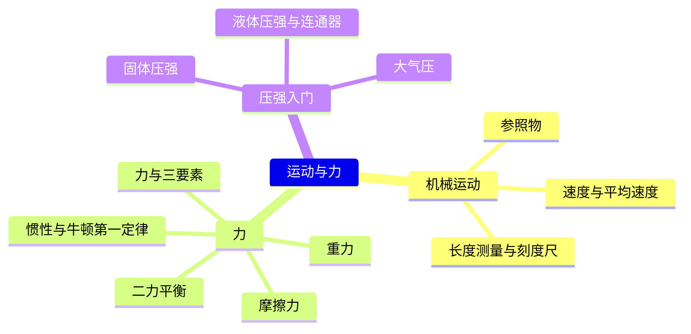
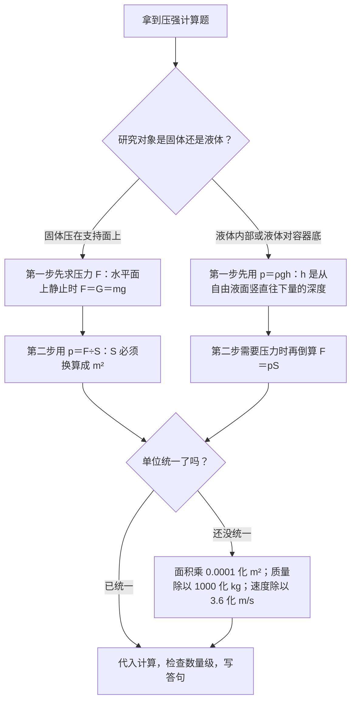

# 运动与力（详解版）

> **使用说明**：本文是详解版，从"为什么"讲起供从头自学；考前速查和掌握度跟踪在概要版：[[04-物理/知识点/02-运动与力]]。

## 0️⃣ 这章学什么 & 中考怎么考

这一章回答三个问题：**物体怎么动**（速度、参照物）、**为什么动起来或停下来**（力、平衡、惯性）、**力压在面上效果有多大**（压强入门）。它是整个力学的地基——压强在本章只学基础，深化在 [[04-物理/知识点/05-密度压强与浮力]]；后面的功、功率也都建立在"力"和"二力平衡"上。

- 学科总览定级：权重"中"。
- 2026 真题"机器人马拉松"情境（"机器人"题块，共 12 分）考了参照物、惯性、二力平衡（概要版已核对）。
- 固体压强和液体压强的"公式顺序"是上海卷经典陷阱（概要版原话："顺序别反"），本文用一整道提高例题带你走一遍。
- 大题步骤分很严格，按"设→列→算→验→答"写，见 [[04-物理/专题/大题规范书写-设列算验答]]。

本章全景：



## 🧭 先修自检（学不下去先回到这里）

> 下面每一项都是本章的地基。做不出就先去补对应知识，硬学只会更挫败。

| # | 你应该会的 | 自查题（先做再看答案） | 答案 | 不会去哪补 |
| - | ---------- | ---------------------- | ---- | ---------- |
| 1 | 速度单位换算 | 72 km/h 等于多少 m/s？ | 20 m/s（72÷3.6） | 本文 🧮 公式 1 |
| 2 | 质量单位换算 | 500 g 等于多少 kg？ | 0.5 kg（除以 1000） | 本文 🧮 公式 2 |
| 3 | 公式变形 | 已知 v=5 m/s、t=20 s，求 s | $s=vt=5\times20=100\ \text{m}$ | 数学·分式变形 |
| 4 | 小数除法 | 490÷0.035 等于多少？ | 14000 | 数学·小数运算 |

## 🌱 概念从头讲

> 每个概念按"**为什么需要它 → 它是什么 → 符号与单位 → 容易想错的地方**"四步讲。

### 1. 长度测量与刻度尺

- **为什么需要**：物理是从"量出来"开始的学科，长度测量是最基本的测量，实验操作考也考它。
- **定义**：用刻度尺测长度：零刻度线（或某整刻度）对齐物体一端，视线正对刻度线，**估读到分度值的下一位**。
- **符号/单位**：长度单位 m；常用换算 1 m＝100 cm＝1000 mm。
- **容易想错**：❌"读到分度值那一格就停" → ✅必须再多估一位（比如毫米刻度尺读到 0.1 mm 位）。这是实验操作考的高频扣分点（见 [[04-物理/专题/实验操作考点-物理]]："忘估读"）。

### 2. 机械运动与参照物

- **为什么需要**："这辆车动没动"其实要看跟谁比——不先选定"跟谁比"，运动就说不清楚。
- **定义**：被选作标准的物体叫**参照物**；研究对象相对参照物的**位置改变**了，它就是运动的；位置不变就是静止。
- **符号/单位**：无公式，纯判断。
- **容易想错**：❌"物体是不是运动的，跟参照物没关系" → ✅同一物体选不同参照物，结论可能不同（2026 真题"以云为参照物，鱼是运动的"就是考这个）。❌"参照物必须选静止的" → ✅参照物可以任选（通常默认地面），关键是要先说清"以谁为参照物"。

### 3. 速度、匀速直线运动与平均速度

- **为什么需要**：要比"谁快"，光比路程或光比时间都不公平，必须"路程和时间一起看"——这就是速度。
- **定义**：速度＝路程÷时间，$v=\dfrac{s}{t}$。**匀速直线运动**：快慢不变、沿直线。**平均速度**＝**总路程÷总时间**，描述一段变速运动的整体快慢。
- **符号/单位**：$v$、$s$（m）、$t$（s）；常用 km/h。**1 m/s＝3.6 km/h**（来历见公式 1）。
- **容易想错**：❌"平均速度＝前后速度加起来除以 2" → ✅平均速度＝总路程÷总时间，只有特殊的"一半时间一半速度"情形才碰巧等于平均值，平时老老实实用定义算。

### 4. 力与力的三要素、弹簧测力计

- **为什么需要**：推、拉、提、压，都是力；要描述一个力，得说全"多大、朝哪、作用在哪"。
- **定义**：力是**物体对物体**的作用，**力的作用是相互的**。力的三要素：大小、方向、作用点——改任何一个，效果都可能不同。
- **符号/单位**：力的单位是牛顿（N）。弹簧测力计测力，原理：在弹性限度内，弹簧的伸长与拉力成正比。
- **容易想错**：❌"一个物体自己就能产生力" → ✅力至少涉及两个物体（施力物体和受力物体），而且"你推墙，墙也推你"。

### 5. 重力

- **为什么需要**：地面上所有物体都被地球往下"拽"，算压强、算功、受力分析都要先算它。
- **定义**：物体由于**地球的吸引**而受到的力，方向**竖直向下**。大小 $G=mg$。
- **符号/单位**：$G$（N）、$m$（kg）；$g=9.8\ \text{N/kg}$，意思是"每 1 kg 物体重 9.8 N"。上海卷常取 9.8，有时给 10——**以题干为准**。
- **容易想错**：❌"重力就是压力" → ✅重力作用在**物体**上（地球对物体），压力作用在**支持面**上（物体对桌面）；只有在"水平面上静止"时两者数值才相等，但它们是两个不同的力。❌"g 是重力" → ✅g 是换算系数，单位是 N/kg，不是力。

### 6. 摩擦力

- **为什么需要**：走路不打滑、刹车能停下，靠的都是摩擦力；考试常考"怎么增大/减小摩擦"。
- **定义**：两个互相接触的物体发生相对运动（或有相对运动趋势）时，接触面上产生的阻碍相对运动的力，方向与相对运动（趋势）方向相反。
- **增大摩擦**：增大压力、增大接触面粗糙程度。**减小摩擦**：滚动代替滑动、使接触面分离（加润滑油）、减小压力、使接触面变光滑。
- **容易想错**：❌"摩擦力总是坏处，越小越好" → ✅人走路正是靠地面给鞋底的摩擦才蹬得住地；冬天路面结冰要撒沙子，就是**增大**摩擦。

### 7. 二力平衡

- **为什么需要**：桌面上的书不动、匀速行驶的车不加速——它们受的力有什么关系？答案就是二力平衡，它是所有"匀速/静止"计算题的钥匙。
- **定义**：物体在两个力作用下保持静止或匀速直线运动，这两个力彼此平衡。四条件：**同体**（作用在同一物体上）、**等大**、**反向**、**共线**——缺一不可。
- **符号/单位**：无新符号；常用结论：水平面上匀速拉动时，拉力＝摩擦力。
- **容易想错**：❌"平衡力和相互作用力是一回事" → ✅两者都等大、反向、共线，区别在**作用对象**：平衡力作用在**同一个物体**上（书受的重力和支持力）；相互作用力分别作用在**两个物体**上（书压桌子和桌子支持书）。

静止在水平桌面上的书，受力示意图（示意图，非严格比例）：

```
              ┌─────────┐
              │   书    │
              └─────────┘
                ↓    ↑
                │    │
       G（重力）│    │F支（支持力）
      竖直向下  │    │  竖直向上
   ════════════╧════╧═════════ 桌面

   静止 → G 与 F支 二力平衡：同体、等大、反向、共线
```

### 8. 惯性与牛顿第一定律

- **为什么需要**：急刹车时人向前倾、泼水时水"飞"出去，都要用惯性解释；2026 真题机器人马拉松也考了它。
- **定义**：牛顿第一定律：一切物体在**不受力**时，总保持匀速直线运动状态或静止状态。物体保持原有运动状态的性质叫**惯性**。
- **符号/单位**：无公式。惯性大小**只与质量有关**。
- **容易想错**：❌"受到惯性的作用""惯性力" → ✅惯性是物体的一种**属性**，不是力，只能说"由于惯性""具有惯性"。❌"速度越大惯性越大" → ✅惯性只看质量，跟速度无关。

### 9. 压力与压强（固体）

- **为什么需要**：同样背 5 kg 的书，宽带书包不勒肩、细带勒得慌——力的作用效果还跟**受力面积**有关，这就是压强。
- **定义**：压强表示压力的作用效果，$p=\dfrac{F}{S}$，$S$ 是**垂直**方向的受力面积。
- **符号/单位**：$p$（Pa）、$F$（N）、$S$（m²）。1 Pa＝1 N/m²。增大压强：增大 F 或减小 S（磨刀）；减小压强：减小 F 或增大 S（书包宽带、铁轨铺枕木）。
- **容易想错**：❌"压力就是重力" → ✅见第 5 节；只在水平面上静止时 F＝G，数值相等但不是同一个力。❌"面积给 cm² 直接代入" → ✅必须换算成 m²：1 cm²＝1×10⁻⁴ m²（除以 10000）。

### 10. 液体压强与连通器

- **为什么需要**：水坝修成上窄下宽、深海鱼上岸会"炸开"，说明液体内部有压强而且越深越大。
- **定义**：液体内部压强 $p=\rho gh$，$h$ 是**深度**——从**自由液面**竖直往下量到该点的距离。**连通器**：上端开口、底部连通的容器，装同种液体静止时各容器**液面相平**（茶壶、船闸）。
- **符号/单位**：$\rho$（kg/m³，水的密度 1.0×10³）、$g$（N/kg）、$h$（m）。
- **容易想错**：❌"h 是该点到容器底的高度" → ✅h 是该点**离液面的深度**，越深 p 越大；同一深度向各个方向的压强相等。

液体压强的 h（示意图，非严格比例）：

```
   ~~~~~~~~~~~~~~~~~~~~~~~~~~~~~~ 自由液面
              |
              |  ← 深度 h：从液面竖直往下量
              |
   ~~~~~~~~~~~~~~~~~~~~~~~~~~~~~~
        这一点的压强 p＝ρgh（越深越大）
```

### 11. 大气压

- **为什么需要**：用吸管喝饮料、吸盘挂衣钩，靠的都是看不见的大气压。
- **定义**：空气内部各个方向都有压强。**托里拆利实验**测出大气压相当于 760 mm 汞柱，约等于 $1.013\times10^5$ Pa；**马德堡半球实验**证明大气压存在而且很大。
- **容易想错**：❌"嘴把饮料'吸'上来" → ✅吸气让管内气压变小，是**外面的大气压**把饮料压进嘴里。

## 🧮 公式逐个拆解

> 每个公式都必须能回答四件事：每个符号是什么？单位是什么？什么时候能用？怎么变形？

### 公式 1：$$v=\dfrac{s}{t}$$

| 符号 | 含义 | 单位 |
| ---- | ---- | ---- |
| $v$ | 速度 | m/s 或 km/h |
| $s$ | 路程 | m 或 km |
| $t$ | 时间 | s 或 h |

- 成立条件/适用范围：匀速直线运动直接用；变速运动用平均速度＝总路程÷总时间。
- 常用变形：$s=vt$；$t=\dfrac{s}{v}$。
- **单位换算专题（这一节务必练熟）**：
  - 1 m/s＝3.6 km/h 的来历：1 m＝$\dfrac{1}{1000}$ km，1 s＝$\dfrac{1}{3600}$ h，所以 1 m/s＝$\dfrac{1/1000\ \text{km}}{1/3600\ \text{h}}=\dfrac{3600}{1000}$ km/h＝3.6 km/h。
  - 记法：km/h 换 m/s **除以 3.6**；m/s 换 km/h **乘以 3.6**。
  - 算给你看：72 km/h＝72÷3.6＝20 m/s；15 m/s＝15×3.6＝54 km/h。
- 最小例子：骑车速度 5 m/s，骑完 600 m 要多久？
  $$t=\dfrac{s}{v}=\dfrac{600}{5}=120\ \text{s}=2\ \text{min}$$
  算给你看：600÷5＝120。答：2 分钟。

### 公式 2：$$G=mg$$

| 符号 | 含义 | 单位 |
| ---- | ---- | ---- |
| $G$ | 重力 | N |
| $m$ | 质量 | kg |
| $g$ | 9.8 N/kg（上海卷常取 9.8，有时给 10，以题干为准） | N/kg |

- 成立条件/适用范围：地面附近；m 必须先换算成 **kg**。
- 常用变形：$m=\dfrac{G}{g}$（由重力反推质量）。
- 最小例子：质量 500 g 的小球，重力多大？
  - 第一步（为什么这么做）：公式里 m 的单位是 kg，先把 500 g 换算成 0.5 kg。
  - 第二步：$G=mg=0.5\times9.8=4.9\ \text{N}$。
  - 算给你看：0.5×9.8＝4.9。答：重力 4.9 N。**错法示范**：直接用 500×9.8＝4900 N——单位没换算，全错。

### 公式 3：$$p=\dfrac{F}{S}$$（固体压强）

| 符号 | 含义 | 单位 |
| ---- | ---- | ---- |
| $p$ | 压强 | Pa |
| $F$ | 压力（垂直作用在面上的力） | N |
| $S$ | 受力面积 | m² |

- 成立条件/适用范围：固体压在支持面上。水平面上静止时 F＝G＝mg（先算 G 再当 F 用）；斜面上 F≠G。
- 常用变形：$F=pS$；$S=\dfrac{F}{p}$。面积换算：1 cm²＝1×10⁻⁴ m²。
- 最小例子：重 50 N 的书放在桌上，接触面积 0.025 m²，书对桌面的压强多大？
  $$p=\dfrac{F}{S}=\dfrac{50}{0.025}=2000\ \text{Pa}$$
  算给你看：0.025×2000＝50，所以 50÷0.025＝2000。答：2000 Pa。

### 公式 4：$$p=\rho gh$$（液体压强）

| 符号 | 含义 | 单位 |
| ---- | ---- | ---- |
| $p$ | 液体压强 | Pa |
| $\rho$ | 液体密度（水取 1.0×10³ kg/m³） | kg/m³ |
| $g$ | 9.8 N/kg | N/kg |
| $h$ | 深度：从自由液面竖直往下量 | m |

- 成立条件/适用范围：液体内部（对容器底、对侧壁、对浸入物都成立）；h 是深度不是高度。
- 常用变形：需要压力时倒一步 $F=pS$（这是液体题的标准顺序：**先压强、后压力**）。
- 最小例子：水下 0.5 m 深处的压强多大？
  $$p=\rho gh=1.0\times10^{3}\times9.8\times0.5=4900\ \text{Pa}$$
  算给你看：1000×9.8＝9800；9800×0.5＝4900。答：4900 Pa。

### 固体、液体压强公式选择速查（上海卷经典陷阱）

| 情形 | 先求什么 | 公式顺序 | 典型错法 |
| ---- | -------- | -------- | -------- |
| 固体压在支持面上 | 先求压力 F | $p=\dfrac{F}{S}$ | 不分青红皂白套 $\rho gh$ |
| 液体对容器底/内部 | 先求压强 p | $p=\rho gh$，再 $F=pS$ | 直接用 F＝液体重（口大底小时就错了） |
| 均匀柱体对水平面 | 两个都行 | 两种公式结果一样 | — |

## 🪜 例题阶梯

> 三级台阶，每一级都要动笔跟着算，不许只看。

### 第 1 级 · 入门（照着模仿）

> **题目**：一辆汽车以 72 km/h 匀速通过一座长 500 m 的大桥，需要多长时间？
>
> **每一步为什么这么做**：
> - 第一步：识别——匀速＋知 s 求 t → 用 $t=\dfrac{s}{v}$。
> - 第二步：统一单位。为什么要统一？公式里 s 用 m、v 就得用 m/s（或都用 km、h），混用必错。72 km/h＝72÷3.6＝20 m/s。
> - 第三步：代入计算，最后写答句。
>
> **完整解答**：
> $$v=72\ \text{km/h}=20\ \text{m/s},\qquad t=\dfrac{s}{v}=\dfrac{500}{20}=25\ \text{s}$$
> 验算：20×25＝500 m，对得上。
> 答：需要 25 s。

### 第 2 级 · 标准（中考中档）

> **题目**：质量 50 kg 的人双脚站在水平地面上，每只鞋底与地面的接触面积是 175 cm²。求他对地面的压强。（g 取 9.8 N/kg）
>
> **读题→翻译成物理语言**：人静止在水平地面 → 压力 F＝重力 G；受力面积是**两只鞋**——"每只"两个字是陷阱。
>
> **每一步为什么这么做**：
> - 第一步：先算受力面积并换算单位。175×2＝350 cm²；1 cm²＝1×10⁻⁴ m²，所以 350 cm²＝0.035 m²。
> - 第二步：水平面上静止 → F＝G＝mg＝50×9.8＝490 N。
> - 第三步：$p=\dfrac{F}{S}$，代入除法。最后验一遍数量级。
>
> **完整解答**：
> $$S=350\ \text{cm}^2=0.035\ \text{m}^2,\qquad F=G=mg=50\times9.8=490\ \text{N}$$
> $$p=\dfrac{F}{S}=\dfrac{490}{0.035}=14000\ \text{Pa}=1.4\times10^{4}\ \text{Pa}$$
> 算给你看：0.035×14000＝490，除法对得上。
> 答：他对地面的压强是 1.4×10⁴ Pa。

### 第 3 级 · 提高（与压轴/综合题接轨）

> **题目**：圆柱形容器（上下一样粗）重 2 N，底面积 0.01 m²，装有 0.2 m 深的水，水重 19.6 N。求：（1）水对容器底部的压强和压力；（2）容器对水平桌面的压强。（g 取 9.8 N/kg，ρ水＝1.0×10³ kg/m³）
>
> **思路从哪来**：这就是上海卷"顺序别反"陷阱的标准形态——**液体先算压强（ρgh），固体（对桌面）先算压力（G 总）**。卡住时先问自己"这一问的受力对象是谁"。
>
> **完整解答**：
> - （1）水对容器底：先用液体压强公式
>   $$p=\rho gh=1.0\times10^{3}\times9.8\times0.2=1960\ \text{Pa}$$
>   （算给你看：1000×9.8＝9800；9800×0.2＝1960。）
>   再倒一步求压力：$F=pS=1960\times0.01=19.6\ \text{N}$。
>   你会发现 F 恰好等于水重——因为容器上下一样粗；口大底小或口小底大时 F≠水重，那是 [[04-物理/知识点/05-密度压强与浮力]] 的深化内容。
> - （2）容器对桌面（这是"固体压在支持面上"）：先求压力
>   $$F=G_{水}+G_{容}=19.6+2=21.6\ \text{N}$$
>   再求压强：$p=\dfrac{F}{S}=\dfrac{21.6}{0.01}=2160\ \text{Pa}$。
>   验算：0.01×2160＝21.6，对得上。
> - 答：（1）水对容器底压强 1960 Pa、压力 19.6 N；（2）容器对桌面压强 2160 Pa。
>
> **和标准题的差别**：标准题只有"固体一条路"；这题液体、固体各一条路，必须按对象选公式、按顺序算——顺序反了答案就错，这正是上海卷最爱考的地方。

## 🗺️ 解题流程图



## 🔥 易错点：为什么会错

| ❌ 常见错误想法 | 为什么会这样想 | ✅ 正确理解 / 自救方法 |
| -------------- | -------------- | ---------------------- |
| "受到惯性的作用" | 把惯性当成了力 | 惯性是**属性**不是力，只能说"由于惯性""具有惯性"；惯性只与质量有关 |
| 平衡力和相互作用力混用 | 都是"等大、反向、共线" | 看作用对象：平衡力在**同一物体**上；相互作用力分别在两个物体上 |
| 平均速度＝两个速度的平均 | "平均"两个字望文生义 | 平均速度＝**总路程÷总时间**，老老实实用定义算 |
| 速度计算单位不统一 | 题目故意 km/h 和 m 混着给 | 动笔前先把所有单位换成 m、s 一套（km/h÷3.6 化 m/s） |
| 固体液体压强公式顺序反 | 两个公式长得不一样但"差不多" | 固体先 F 后 p（F/S）；液体先 p 后 F（ρgh 再 pS）——先对象、后顺序 |
| cm² 不换算就代入 | 觉得"反正是个面积" | 1 cm²＝1×10⁻⁴ m²；代入公式前把面积化成 m² |
| 压力就是重力 | 水平面上两者数值相等 | 数值相等不代表是同一个力；斜面上、竖直面上 F≠G |

## ✅ 自测清单（能独立做到才打勾）

- [ ] 1. 能不看书完成 km/h↔m/s、g↔kg、cm²↔m² 三组换算（各做 2 道不出错）
- [ ] 2. 能用参照物解释"以云为参照物，鱼是运动的"
- [ ] 3. 能默写 $v=s/t$、$G=mg$、$p=F/S$、$p=\rho gh$ 并说清每个符号的含义和单位
- [ ] 4. 能说清"液体先算压强、固体先算压力"的顺序并用它做第 3 级例题
- [ ] 5. 能画出静止在桌面上物体的受力示意图，并说出二力平衡四条件
- [ ] 6. 能判断"平衡力"和"相互作用力"的区别
- [ ] 7. 能用规范语言解释"惯性不是力"，并举一个生活实例
- [ ] 8. 能独立做出例题阶梯第 1、2 级，并对照"设列算验答"检查步骤

## 🔗 关联

- 概要版：[[04-物理/知识点/02-运动与力]]（掌握度在这边更新）
- 后续/综合应用：[[04-物理/知识点/05-密度压强与浮力]]（压强深化，老师点名的浮力重点） · [[04-物理/知识点/03-机械与功]]（二力平衡、重力是功与功率的地基）
- 相关专题：[[04-物理/专题/压强浮力-上海特色题型]]（柱体压强、切割叠放） · [[04-物理/专题/真题精讲/物-03-运动与力]] · [[04-物理/专题/大题规范书写-设列算验答]]
- 公式速记：[[04-物理/闪卡/物理公式速记]]（速度、重力、压强三张卡）
