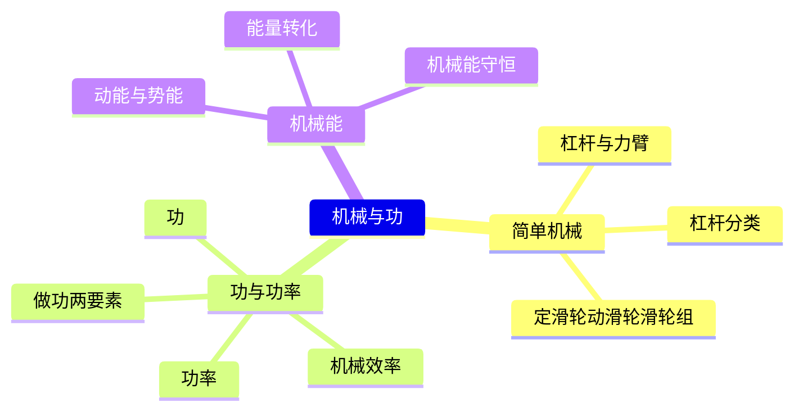
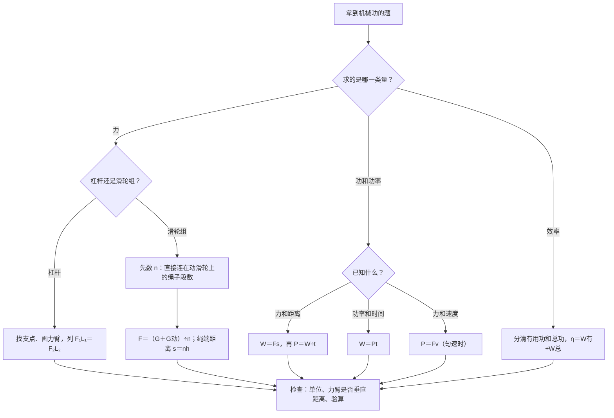

# 机械与功（详解版）

> **使用说明**：本文是详解版，从"为什么"讲起供从头自学；考前速查和掌握度跟踪在概要版：[[04-物理/知识点/03-机械与功]]。

## 0️⃣ 这章学什么 & 中考怎么考

这一章回答两个问题：**怎么用简单机械省力**（杠杆、滑轮）、**做功做得有多快**（功、功率、机械效率），最后把"运动的物体有多少能量"（机械能）讲清楚。它直接建立在 [[04-物理/知识点/02-运动与力]] 的重力、二力平衡之上。

- 学科总览定级：权重"中高"（功率计算常现）。
- 2026 真题里，**功率计算是"机器人"题块（共 12 分）的直接考点**；"列车出站动能增大"考的是机械能转化判断（概要版已核对）。
- 杠杆作图与滑轮组常在工程情境里出现；滑轮组＋机械效率的综合计算见 [[04-物理/专题/真题精讲/物-04-机械与功]]。
- 大题步骤分很严格：设→列→算→验→答，见 [[04-物理/专题/大题规范书写-设列算验答]]。

本章全景：



## 🧭 先修自检（学不下去先回到这里）

> 下面每一项都是本章的地基。做不出就先去补对应知识，硬学只会更挫败。

| # | 你应该会的 | 自查题（先做再看答案） | 答案 | 不会去哪补 |
| - | ---------- | ---------------------- | ---- | ---------- |
| 1 | 重力计算 | 质量 3 kg 的物体重力多大？（g 取 9.8 N/kg） | $G=3\times9.8=29.4\ \text{N}$ | [[04-物理/知识点详解/02-运动与力]] |
| 2 | 二力平衡 | 物体做匀速直线运动时，受的力是什么关系？ | 平衡（合力为零，如水平匀速时拉力＝摩擦力） | [[04-物理/知识点/02-运动与力]] |
| 3 | 分式移项 | $F_1L_1=F_2L_2$ 中已知 $F_2$、$L_2$、$L_1$，怎么求 $F_1$？ | $F_1=\dfrac{F_2L_2}{L_1}$（两边同除以 $L_1$） | 数学·等式变形 |
| 4 | 单位 | 1 kW 等于多少 W？ | 1000 W | [[04-物理/闪卡/物理公式速记]] |

## 🌱 概念从头讲

> 每个概念按"**为什么需要它 → 它是什么 → 符号与单位 → 容易想错的地方**"四步讲。

### 1. 杠杆与力臂（作图题高频）

- **为什么需要**：一个人撬不动的大石头，用撬棒就能撬动——人类一直在用"绕一个点转动的硬棒"放大自己的力气。
- **定义**：在力的作用下能绕**固定点**转动的硬棒叫杠杆。五个要素：**支点 O**（绕着转的点）、**动力 $F_1$**、**阻力 $F_2$**、**动力臂 $L_1$**、**阻力臂 $L_2$**。
- **力臂是什么**：支点到力的作用线的**垂直距离**。不是"支点到作用点的连线"！
- **符号/单位**：力用 N，力臂用 m。作图步骤：找支点 → 画出力的作用线（沿力的方向延长）→ 从支点向作用线画垂线，这段垂线就是力臂。
- **容易想错**：❌"力臂就是支点到力的作用点的距离" → ✅只有力**垂直于杠杆**时两者才相等；力斜着拉时，力臂会变**短**，要用更大的力才能平衡。

杠杆示意图（示意图，非严格比例）：

```
      石头压棒 F₂（阻力）
          ↓
   ═══════╬══════════════════════╬═════  撬棒
          ▲ 支点 O               ↓ 人向下压 F₁（动力）
          │
   |←L₂ 阻力臂（短）→|←————— L₁ 动力臂（长）—————→|

   L₁＞L₂，所以 F₁＜F₂：省力，但要压过更长的距离（费距离）
   力臂＝支点到力的作用线的垂直距离，不是到作用点的连线！
```

### 2. 杠杆的分类

- **为什么需要**：生活中有的杠杆省力、有的反而费力，判断类型是选择填空的常客。
- **定义**：比较动力臂和阻力臂——$L_1>L_2$：**省力杠杆**（省力费距离）；$L_1<L_2$：**费力杠杆**（费力省距离）；$L_1=L_2$：**等臂杠杆**（不省不费）。

| 类型 | 条件 | 代价 | 例子（概要版） |
| ---- | ---- | ---- | -------------- |
| 省力杠杆 | $L_1>L_2$ | 费距离 | 撬棒 |
| 费力杠杆 | $L_1<L_2$ | 费力 | 筷子、钓鱼竿 |
| 等臂杠杆 | $L_1=L_2$ | 不省不费 | 天平 |

- **容易想错**：❌"省力杠杆连功都省了" → ✅**功的原理：使用任何机械都不省功**。省力必费距离，乘起来（力×距离）不会变少。

### 3. 定滑轮、动滑轮、滑轮组

- **为什么需要**：升旗时往下拉绳、工地吊料要省力——滑轮就是"会转的杠杆"。
- **定义**：
  - **定滑轮**（轴固定不动）：只改变力的方向，**不省力**，实质是等臂杠杆。
  - **动滑轮**（轴随物体一起动）：省一半力，费一倍距离，实质是动力臂为阻力臂 2 倍的杠杆。
  - **滑轮组**：定、动滑轮组合，既省力又能（部分）改变方向。
- **符号/单位**：不计绳重和摩擦时，拉力 $F=\dfrac{G+G_{动}}{n}$；绳端移动距离 $s=nh$。$n$＝**直接连在动滑轮上**（托着动滑轮）的绳子段数。
- **容易想错**：❌"数绳子段数时把绕过定滑轮的那段也算进去" → ✅只数"托着动滑轮"的段数；数完可以检验一下：$s=nh$，绳端移动距离一定是物体升高距离的 n 倍。

滑轮组绕线示意（示意图，非严格比例，n＝2）：

```
   绳子自由端 → F（人拉）
                 \
                  \
               ┌────┴────┐
               │ 定滑轮   │ ← 只改变方向，不省力
               └────┬────┘
                    │
               ┌────┴────┐
               │ 动滑轮   │ ← 省一半力，费一倍距离
               └────┬────┘
                    ▼
                  重物 G

   n＝2：直接连在动滑轮上的绳子段数（图中托着动滑轮的有 2 段）
```

### 4. 功

- **为什么需要**："我用了很大力气但东西没挪动"——物理上这不算做功。物理学用"功"来记录"力实实在在干了多少活"。
- **定义**：做功有两个要素，缺一不可：**有力作用在物体上**＋**物体沿力的方向移动了距离**。$W=Fs$。
- **符号/单位**：$W$（J，焦耳）、$F$（N）、$s$（m，沿力方向的距离）。
- **不做功的三种情况**（必背）：

| 情况 | 例子 | 为什么不做功 |
| ---- | ---- | ------------ |
| 有力无距离 | 推墙、推箱子没推动 | s＝0 |
| 有距离无力 | 关引擎后靠惯性滑行 | 没有力作用在物体上 |
| 力与距离垂直 | 提着水桶水平走 | 移动方向上没有力的分量 |

- **容易想错**：❌"只要用了力就是做了功" → ✅必须沿力方向挪了距离。提着水桶水平走：提力竖直向上、移动水平，垂直→提力不做功。

### 5. 功率

- **为什么需要**：同样搬 100 块砖，快的机器半小时、慢的机器一天——做的功一样多，但"快慢"不同，描述快慢的就是功率。
- **定义**：单位时间内所做的功，$P=\dfrac{W}{t}$；匀速运动时也可以用 $P=Fv$。
- **符号/单位**：$P$（W，瓦特）、$W$（J）、$t$（s）。1 kW＝1000 W。
- **容易想错**：❌"功率大的人做功多" → ✅还差一个时间：$W=Pt$，做功多少要看功率**和**时间；功率只说"做功快慢"。

### 6. 机械效率

- **为什么需要**：用滑轮组提重物，你做的功有一部分"白费"在提动滑轮、克服摩擦上——衡量"白费得少不少"的就是机械效率。
- **定义**：有用功占总功的比例，$\eta=\dfrac{W_{有}}{W_{总}}$。提重物时：有用功＝直接把重物提起来需要的功（$W_{有}=Gh$）；总功＝拉力实际做的功（$W_{总}=Fs$）。
- **符号/单位**：$\eta$ 没有单位，常用百分数表示，**总小于 1**。
- **容易想错**：❌"越省力的机械效率越高" → ✅省力与否和效率无关；效率只看"白白浪费的功"有多少。这部分主要出现在滑轮组综合计算里，完整题链见 [[04-物理/专题/真题精讲/物-04-机械与功]]。

### 7. 机械能

- **为什么需要**：流动的水能发电、下落的球会越滚越快——"运动"和"举高"本身就是能量，这能量还能互相转化。
- **定义**：
  - **动能**：物体由于运动具有的能量，与**质量、速度**有关。
  - **重力势能**：物体由于被举高具有的能量，与**质量、高度**有关。
  - **弹性势能**：发生弹性形变的物体具有的能量。
  - **机械能＝动能＋势能**。
- **转化实例**：滚摆下降（重力势能→动能）、单摆、蹦床。2026 真题"列车出站动能增大"：质量不变、速度增大→动能增大（概要版已核对）。
- **机械能守恒条件**：只有重力（或弹力）做功，即**不计空气阻力和摩擦**时，动能和势能相互转化，机械能总量保持不变。
- **容易想错**：❌"动能和势能转化时机械能一定守恒" → ✅有摩擦、空气阻力时，一部分机械能会变成内能（发热），机械能变少——只有"不计阻力"才守恒。

## 🧮 公式逐个拆解

### 公式 1：杠杆平衡条件 $$F_1L_1=F_2L_2$$

| 符号 | 含义 | 单位 |
| ---- | ---- | ---- |
| $F_1$ | 动力 | N |
| $L_1$ | 动力臂（支点到动力作用线的垂直距离） | m |
| $F_2$ | 阻力 | N |
| $L_2$ | 阻力臂 | m |

- 成立条件/适用范围：杠杆处于平衡（静止或匀速转动）。
- 常用变形：$F_1=\dfrac{F_2L_2}{L_1}$；$L_1=\dfrac{F_2L_2}{F_1}$（求哪个量，把它单独移到等号一边）。
- 最小例子：阻力 300 N，阻力臂 0.3 m，动力臂 1.5 m，动力多大？
  $$F_1=\dfrac{F_2L_2}{L_1}=\dfrac{300\times0.3}{1.5}=\dfrac{90}{1.5}=60\ \text{N}$$
  算给你看：300×0.3＝90；90÷1.5＝60。验算：1.5×60＝90＝300×0.3，两边相等，对。

### 公式 2：$$W=Fs$$

| 符号 | 含义 | 单位 |
| ---- | ---- | ---- |
| $W$ | 功 | J |
| $F$ | 力 | N |
| $s$ | 沿力的方向移动的距离 | m |

- 成立条件/适用范围：s 必须是**沿力方向**的距离；力与距离垂直时 W＝0。
- 常用变形：$s=\dfrac{W}{F}$；$F=\dfrac{W}{s}$。
- 最小例子：用 50 N 的水平拉力沿拉力方向把箱子拖动 2 m，拉力做功多少？
  $$W=Fs=50\times2=100\ \text{J}$$
  算给你看：50×2＝100。答：100 J。

### 公式 3：$$P=\dfrac{W}{t}=Fv$$

| 符号 | 含义 | 单位 |
| ---- | ---- | ---- |
| $P$ | 功率 | W |
| $W$ | 功 | J |
| $t$ | 时间 | s |
| $F$ | 力（沿运动方向） | N |
| $v$ | 速度（匀速时用） | m/s |

- 成立条件/适用范围：$P=\dfrac{W}{t}$ 通用；$P=Fv$ 用于匀速运动（或求平均功率时用平均速度）。
- 常用变形：$W=Pt$（2026 机器人题块"恒定功率"类题目的钥匙）；$t=\dfrac{W}{P}$。
- 最小例子：汽车以 20 m/s 匀速行驶，牵引力 2000 N，发动机功率多大？
  $$P=Fv=2000\times20=40000\ \text{W}=40\ \text{kW}$$
  算给你看：2000×20＝40000；40000÷1000＝40。答：40 kW。

### 公式 4：滑轮组 $$F=\dfrac{G+G_{动}}{n},\qquad s=nh$$

| 符号 | 含义 | 单位 |
| ---- | ---- | ---- |
| $F$ | 绳端拉力 | N |
| $G$ | 物重 | N |
| $G_{动}$ | 动滑轮重 | N |
| $n$ | 承重绳段数（直接连在动滑轮上的段数） | 无单位 |
| $s$ | 绳端移动距离 | m |
| $h$ | 物体升高的距离 | m |

- 成立条件/适用范围：**不计绳重和摩擦**（题目一般会写明；不写明、给了实际拉力的，用 $W_{总}=Fs$ 硬算，见机械效率）。
- 常用变形：$G_{动}=nF-G$；$h=\dfrac{s}{n}$。
- 最小例子：物重 200 N，动滑轮重 40 N，n＝2，物体升高 3 m。求拉力和绳端移动距离。
  $$F=\dfrac{G+G_{动}}{n}=\dfrac{200+40}{2}=120\ \text{N},\qquad s=nh=2\times3=6\ \text{m}$$
  算给你看：200＋40＝240；240÷2＝120。答：拉力 120 N，绳端移动 6 m。

### 公式 5：机械效率 $$\eta=\dfrac{W_{有}}{W_{总}}$$

| 符号 | 含义 | 单位 |
| ---- | ---- | ---- |
| $\eta$ | 机械效率 | 无单位（用百分数） |
| $W_{有}$ | 有用功（提升重物时＝Gh） | J |
| $W_{总}$ | 总功（拉力做的功＝Fs） | J |

- 成立条件/适用范围：任何机械；$\eta$ 恒小于 1（总要有额外功）。
- 常用变形：$W_{有}=\eta W_{总}$；滑轮组额外功 $W_{额}=W_{总}-W_{有}$（不计绳重摩擦时 $W_{额}=G_{动}h$，可以用来验算）。
- 最小例子：有用功 300 J，总功 400 J，机械效率多大？
  $$\eta=\dfrac{W_{有}}{W_{总}}=\dfrac{300}{400}=75\%$$
  算给你看：300÷400＝0.75＝75%。答：75%。

### 功、功率、机械效率速查对比

| 量 | 公式 | 单位 | 回答的问题 |
| ---- | ---- | ---- | ---------- |
| 功 $W$ | $W=Fs$ | J | 一共干了多少活 |
| 功率 $P$ | $P=W/t=Fv$ | W | 干活有多快 |
| 机械效率 $\eta$ | $\eta=W_{有}/W_{总}$ | 无（百分数） | 干的活里有多少是"白费"的 |

## 🪜 例题阶梯

> 三级台阶，每一级都要动笔跟着算，不许只看。

### 第 1 级 · 入门（照着模仿）

> **题目**：用撬棒撬石头，拉力始终垂直于撬棒。已知阻力 200 N，阻力臂 0.15 m，动力臂 0.6 m，求动力。
>
> **每一步为什么这么做**：
> - 第一步：识别——"绕支点转动＋给出两个力臂"→杠杆平衡问题，用 $F_1L_1=F_2L_2$。
> - 第二步：变形移项，把要求的 $F_1$ 单独放一边：$F_1=\dfrac{F_2L_2}{L_1}$。
> - 第三步：代入数字，先乘后除；最后把结果代回原式验算。
>
> **完整解答**：
> $$F_1=\dfrac{F_2L_2}{L_1}=\dfrac{200\times0.15}{0.6}=\dfrac{30}{0.6}=50\ \text{N}$$
> 算给你看：200×0.15＝30；30÷0.6＝50。
> 验算：$L_1F_1=0.6\times50=30=200\times0.15=F_2L_2$，平衡成立。
> 答：动力为 50 N。

### 第 2 级 · 标准（中考中档）

> **题目**：小明用 100 N 的水平拉力，把箱子沿水平地面匀速拉动 10 m，用时 20 s。求：（1）拉力做的功；（2）拉力的功率；（3）重力做了多少功；（4）箱子受到的摩擦力。
>
> **读题→翻译成物理语言**："水平拉力＋水平移动"→W=Fs 有戏；"竖直的重力＋水平移动"→垂直，重力不做功；"匀速"→二力平衡，摩擦力＝拉力。
>
> **每一步为什么这么做**：
> - 第一步：功只认"沿力方向走过的距离"，水平拉力配水平位移 10 m，直接乘。
> - 第二步：有了功和时间，功率用定义式除一下。
> - 第三步：检查重力这一问——提力是竖直的，移动是水平的，方向垂直，属于"力与距离垂直不做功"。
> - 第四步：匀速直线运动 → 合力为零 → 水平方向上摩擦力与拉力平衡，大小相等。
>
> **完整解答**：
> （1）$W=Fs=100\times10=1000\ \text{J}$
> （2）$P=\dfrac{W}{t}=\dfrac{1000}{20}=50\ \text{W}$
> （3）重力竖直向下，箱子水平移动，力与距离垂直，重力做功为 0 J。
> （4）箱子匀速运动 → 二力平衡 → $f=F=100\ \text{N}$。
> 验算：100×10＝1000；1000÷20＝50，都对。
> 答：拉力做功 1000 J；功率 50 W；重力不做功；摩擦力 100 N。

### 第 3 级 · 提高（与压轴/综合题接轨）

> **题目**：用滑轮组（n＝3，不计绳重和摩擦）匀速提升重 270 N 的物体，动滑轮重 30 N，物体升高 2 m。求：（1）拉力 F；（2）绳端移动距离 s；（3）拉力做的总功；（4）有用功；（5）机械效率；（6）额外功。
>
> **思路从哪来**：滑轮组题的第一步永远是**数 n**（直接连在动滑轮上的绳子段数）；然后记住两条路——总功走"拉力×绳端距离"，有用功走"物重×升高高度"；最后用额外功互验。卡住时先问：n 是几？$W_{有}$ 是哪段？
>
> **完整解答**（按"设列算验答"示范）：
> - （1）设拉力为 F。根据滑轮组拉力公式（不计绳重和摩擦）：
>   $$F=\dfrac{G+G_{动}}{n}=\dfrac{270+30}{3}=100\ \text{N}$$
>   验：100×3＝300＝270＋30，对。
> - （2）$s=nh=3\times2=6\ \text{m}$（绳端距离是物体升高距离的 3 倍，别忘了乘 n）。
> - （3）总功：$W_{总}=Fs=100\times6=600\ \text{J}$。
> - （4）有用功（目的只是把重物提上去）：$W_{有}=Gh=270\times2=540\ \text{J}$。
> - （5）机械效率：$\eta=\dfrac{W_{有}}{W_{总}}=\dfrac{540}{600}=90\%$。
> - （6）额外功：$W_{额}=W_{总}-W_{有}=600-540=60\ \text{J}$。
>   验算：不计绳重和摩擦时，额外功应该全部来自提动滑轮，$G_{动}h=30\times2=60\ \text{J}$——两个算法结果一样，整题自洽。
> - 答：拉力 100 N；绳端移动 6 m；总功 600 J；有用功 540 J；机械效率 90%；额外功 60 J。
>
> **和标准题的差别**：标准题一条公式走到底；这题要先数 n，再"两条路"分别算功，最后互相验证——这个"验"正是 [[04-物理/专题/大题规范书写-设列算验答]] 要求的步骤分来源。更综合的版本（含摩擦、求动滑轮重）见 [[04-物理/专题/真题精讲/物-04-机械与功]]。

## 🗺️ 解题流程图



## 🔥 易错点：为什么会错

| ❌ 常见错误想法 | 为什么会这样想 | ✅ 正确理解 / 自救方法 |
| -------------- | -------------- | ---------------------- |
| 力臂＝支点到作用点的连线 | "两点连线"是直觉 | 力臂是支点到力的作用线的**垂直距离**；力斜拉时力臂变短 |
| 功率大＝做功多 | 两个词听起来像 | 还差时间：$W=Pt$；功率只说"快慢" |
| 滑轮组 n 数错 | 把绕过定滑轮的绳子也算进去 | 只数**直接连在动滑轮上**的段数；用 s＝nh 反向检验 |
| 匀速拉动时拉力和摩擦力分不清 | 都说"匀速受力平衡" | 水平匀速：拉力＝摩擦力（二力平衡）；竖直匀速提升：拉力由滑轮组公式给——先看清"水平还是竖直" |
| 机械能转化就守恒 | 只记得"守恒"两个字 | 条件是**不计空气阻力和摩擦**；有阻力时机械能变小 |
| 省力机械能省功 | "省力就是赚" | 功的原理：任何机械都不省功；省力必费距离 |
| 绳端距离忘乘 n | 把 s 当成 h | s＝nh；算完看一眼：绳端移动距离必须比物体升高距离大 |

## ✅ 自测清单（能独立做到才打勾）

- [ ] 1. 能不看书画出杠杆五要素并说出力臂的准确定义
- [ ] 2. 能给撬棒、筷子、钓鱼竿、天平归类省力/费力/等臂
- [ ] 3. 能数对滑轮组的 n，并默写 $F=\dfrac{G+G_{动}}{n}$、$s=nh$ 及适用条件
- [ ] 4. 能背出"不做功的三种情况"并各举一个例子
- [ ] 5. 能独立做出例题阶梯第 1、2 级，并说清每一步的依据
- [ ] 6. 能独立做滑轮组综合题（第 3 级），并用额外功验算
- [ ] 7. 能判断动能、势能的变化（如"列车出站动能增大"）并说出依据
- [ ] 8. 能说出机械能守恒的条件，以及"功率大≠做功多"的原因

## 🔗 关联

- 概要版：[[04-物理/知识点/03-机械与功]]（掌握度在这边更新）
- 前置知识：[[04-物理/知识点/02-运动与力]]（重力、二力平衡）
- 后续/综合应用：[[04-物理/知识点/07-电功率与家庭电路]]（功率概念同源：都是"做功快慢"）
- 相关专题：[[04-物理/专题/真题精讲/物-04-机械与功]]（杠杆、滑轮组效率、功功率三连题） · [[04-物理/专题/大题规范书写-设列算验答]]
- 公式速记：[[04-物理/闪卡/物理公式速记]]（杠杆、功功率、滑轮组三张卡）
