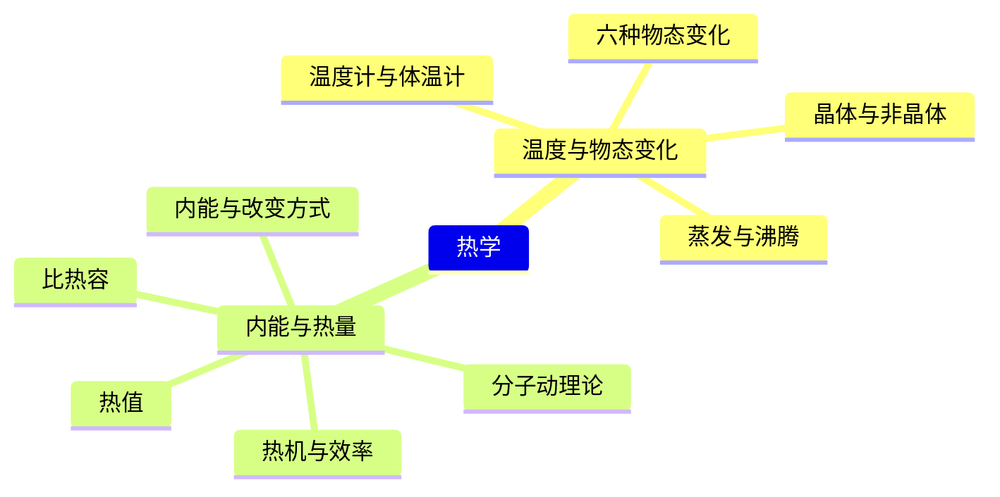
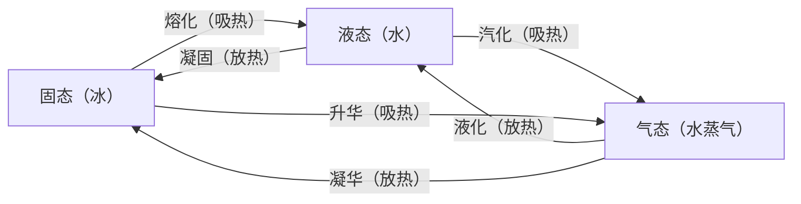
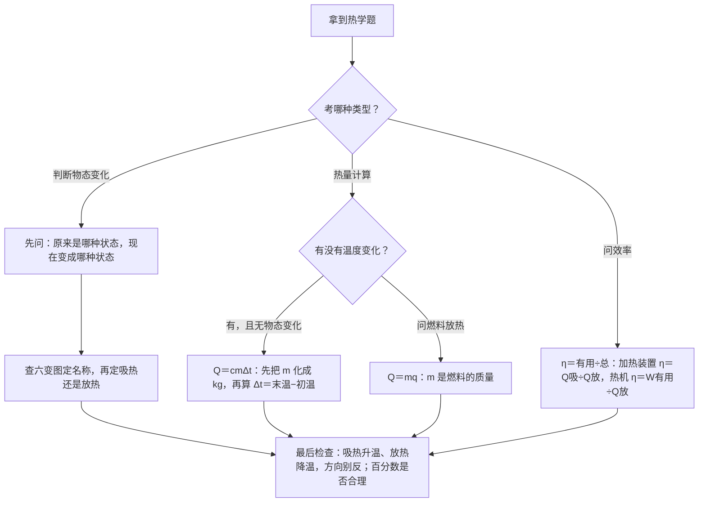

# 热学（详解版）

> **使用说明**：本文是详解版，从"为什么"讲起供从头自学；考前速查和掌握度跟踪在概要版：[[04-物理/知识点/04-热学]]。

## 0️⃣ 这章学什么 & 中考怎么考

这一章回答两个问题：**物质的状态怎么变、变的时候吸热还是放热**（六种物态变化）；**热量怎么计算**（比热容、热值、效率）。前一半是概念辨析，后一半是纯计算，两部分都常在生活情境里考。

- 学科总览定级：权重"中"（比热容计算＋物态变化）。
- 2026 真题"工程与实践"题块（共 18 分）考了**热熔胶的物态变化＋比热容计算**（概要版已核对）——一道题同时用本章两大块，这就是热学题的标准形态。
- 与 [[04-物理/知识点/08-磁与能源信息]] 的能源效率相衔接；"电熨斗"题块（10 分）是电与热结合的情境，见 [[04-物理/专题/真题精讲/物-13-2026真题-电熨斗]]。
- 计算题按"设→列→算→验→答"写步骤，见 [[04-物理/专题/大题规范书写-设列算验答]]。

本章全景：

## 🧭 先修自检（学不下去先回到这里）

> 下面每一项都是本章的地基。做不出就先去补对应知识，硬学只会更挫败。

| # | 你应该会的 | 自查题（先做再看答案） | 答案 | 不会去哪补 |
| - | ---------- | ---------------------- | ---- | ---------- |
| 1 | 质量单位换算 | 500 g 等于多少 kg？ | 0.5 kg（除以 1000）——**Q=cmΔt 里的 m 必须是 kg** | [[04-物理/知识点详解/02-运动与力]] |
| 2 | 温度差计算 | 从 20℃ 升到 100℃，Δt 是多少？ | 100−20＝80℃（末温减初温） | 本文 🧮 公式 1 |
| 3 | 科学记数法乘法 | $4.2\times10^{3}\times0.5$ 等于多少？ | $2.1\times10^{3}$（4.2×0.5＝2.1，指数不变） | 数学·科学记数法 |
| 4 | 除法与百分数 | $4.2\times10^{5}\div1.2\times10^{6}$ 等于多少？ | 0.35＝35%（42÷120＝0.35） | 数学·百分数 |

## 🌱 概念从头讲

> 每个概念按"**为什么需要它 → 它是什么 → 符号与单位 → 容易想错的地方**"四步讲。

### 1. 温度与温度计

- **为什么需要**："有点烫""有点凉"说不准，物理要把冷热变成**数字**，这个数就是温度。
- **定义**：温度表示物体的冷热程度。常用温度计的原理：**液体热胀冷缩**。使用规范三条：**液泡全部浸入**被测液体、**示数稳定后再读数**、**液泡不碰容器壁和底**。
- **体温计**：量程 35～42℃，有**缩口**（一个极细的窄道），水银升上去缩不回来——所以**可以离开人体读数**，但**用前要先甩**。
- **容易想错**：❌"体温计不甩直接测第二个低温的人" → ✅不甩的话水银降不回 35℃ 以下，测出来只会**偏高**（虚高）；用前甩一甩，让它回到 35℃ 以下再测。

### 2. 六种物态变化（本章第一根支柱）

- **为什么需要**：冰、水、水蒸气之间的每次"变身"都伴随吸热或放热，判断对变身名称和吸放热方向，是热学概念题的全部内容。
- **定义**：三态之间共有六条"变身路线"，一张图看全（判断口诀：先问"原来什么状态"，再问"变成什么状态"，然后查图）：

| 过程 | 吸/放热 | 例子（概要版） |
| ---- | ---- | ---- |
| 熔化 ↔ 凝固 | 吸 ↔ 放 | 冰化水、热熔胶受热变液 |
| 汽化（蒸发＋沸腾）↔ 液化 | 吸 ↔ 放 | 汗液蒸发降温、"白气"＝液化 |
| 升华 ↔ 凝华 | 吸 ↔ 放 | 樟脑丸变小、霜、窗花（内侧） |

- **符号/单位**：无公式；关键是"状态对状态"的判断。
- **容易想错**：❌"'白气'是水蒸气" → ✅**水蒸气是看不见的**！你看到的"白气"是水蒸气遇冷**液化**成的小水滴（雾状）。凡是你"看得见"的白雾，一律是液化。❌"窗花在玻璃外侧" → ✅窗花是室内温暖水蒸气遇到冷玻璃**凝华**成的，在**内侧**。

### 3. 晶体与非晶体

- **为什么需要**：冰化成水时温度停在 0℃ 不动——这个"奇怪"现象是晶体特有的，也是常考判断题。
- **定义**：**晶体**有固定熔点（冰的熔点 0℃），熔化过程**吸热但温度不变**；**非晶体**没有熔点，边熔化边升温（如蜡、玻璃、沥青）。
- **容易想错**：❌"吸热就一定升温" → ✅晶体熔化、液体沸腾时，吸的热用来"打散"结构，温度保持不变——**温度不变≠不吸热**。

### 4. 蒸发与沸腾（汽化的两种方式）

- **为什么需要**：同样是"水变水蒸气"，晒衣服和烧开水走的路线不同，考试爱混着考。
- **定义**：

| 对比项 | 蒸发 | 沸腾 |
| ---- | ---- | ---- |
| 发生温度 | 任何温度下都能发生 | 必须达到沸点 |
| 发生部位 | 只在液体**表面** | 表面和**内部同时**发生 |
| 剧烈程度 | 缓慢 | 剧烈 |
| 有无致冷效果 | 蒸发吸热，有致冷作用（出汗降温） | 沸腾时持续吸热但温度不变 |

- **沸腾的两个条件**：达到沸点＋**继续吸热**——缺一不可。
- **容易想错**：❌"水到了 100℃ 就算沸腾了，可以停止加热" → ✅停止加热就不满足"继续吸热"，沸腾立刻停止；温度停在沸点但必须一直给热。

### 5. 分子动理论与扩散

- **为什么需要**：热的本质是分子运动，理解了分子，内能、热传递才有根。
- **定义**：分子动理论三条：物质由分子组成，分子在**不停地做无规则运动**，分子之间有**间隙**、存在**引力和斥力**。**扩散现象**（温度越高扩散越快）证明了分子的运动。
- **容易想错**：❌"扫地时灰尘飞扬是扩散现象" → ✅灰尘是肉眼可见的小颗粒，是宏观运动；扩散指**分子**（比如闻到花香、糖溶在水里），分子小到看不见。

### 6. 内能与改变内能的两种方式

- **为什么需要**：物体变热变冷、温度变化，背后都是内能在进出——它是热量计算的"账本"。
- **定义**：内能是物体内**所有**分子动能和分子势能的总和。改变内能的两种方式：**做功**（摩擦生热、压缩气体）和**热传递**（热量从高温传到低温），两者效果**等效**。
- **容易想错**：❌"0℃ 的冰没有内能" → ✅分子永不停息地运动，任何温度的物体都有内能；温度低只说明分子平均动能小。❌"内能只能靠热传递改变" → ✅搓手取暖就是靠做功。

顺带把三个最容易搅浑的词分清楚：

| 词 | 一句话定义 | 关键区别 | 打个比方 |
| ---- | ---- | ---- | ---- |
| 温度 | 物体的冷热程度 | 描述"状态"，用温度计测 | 水位有多高 |
| 内能 | 物体内所有分子动能＋分子势能 | 物体"拥有"的能量 | 水库里存的水 |
| 热量 | 热传递过程中转移的能量 | 描述"过程"，只能说"吸收/放出"，不能说"物体含有多少热量" | 从水库里流出的水 |

### 7. 比热容（本章第二根支柱）

- **为什么需要**：同样晒太阳，沙滩烫脚、海水凉快——不同物质"存热的能力"不同，这个能力就是比热容。
- **定义**：**单位质量**的某种物质，温度升高 1℃ 所吸收的热量。水的比热容大：$c_{水}=4.2\times10^{3}\ \text{J/(kg·℃)}$——所以水能调节气候、能当冷却剂。
- **符号/单位**：$c$，单位 J/(kg·℃)。
- **容易想错**：❌"质量越大，比热容越大" → ✅比热容是物质的**属性**，跟质量、吸放热多少都无关（就像密度不随质量变）；同种物质比热容是定值，不同物质一般不同。

### 8. 热值

- **为什么需要**：比较两种燃料"耐不耐烧"，要看每千克燃料能放出多少热——热值。
- **定义**：1 kg 某种燃料**完全燃烧**放出的热量，用 $q$ 表示，单位 J/kg。放热 $Q=mq$。
- **容易想错**：❌"烧得多的燃料热值大" → ✅热值是燃料的属性，只由燃料种类决定，与烧多少无关。

### 9. 热机与效率

- **为什么需要**：汽车发动机把内能变成机械能，"转换得划不划算"要用效率衡量，这也和能源问题相连。
- **定义**：热机把**内能转化为机械能**。四冲程：吸气、压缩、做功、排气，其中**做功冲程**对外做功（内能→机械能）。**热机效率** $\eta=\dfrac{W_{有用}}{Q_{放}}$：有用的机械能占燃料放出总热量的比例，总小于 1。
- **容易想错**：❌"技术进步后热机效率能到 100%" → ✅总有废气和摩擦损耗，效率永远小于 100%。

## 🧮 公式逐个拆解

### 公式 1：热量计算 $$Q=cm\Delta t$$

| 符号 | 含义 | 单位 |
| ---- | ---- | ---- |
| $Q$ | 吸收或放出的热量 | J |
| $c$ | 比热容（水 4.2×10³） | J/(kg·℃) |
| $m$ | 质量（**必须换算成 kg**） | kg |
| $\Delta t$ | 温度变化量：升温时＝末温−初温 | ℃ |

- 成立条件/适用范围：只适用于**没有物态变化**的升温/降温阶段（正在熔化或沸腾时不能用，因为温度不变、但还在吸热）。
- 常用变形：
  - 吸热：$Q_{吸}=cm(t_{末}-t_{初})$；
  - 放热：$Q_{放}=cm(t_{初}-t_{末})$——降温时"末温−初温"是负的，**取绝对值**，方向别反。
- 最小例子：2 kg 水从 20℃ 加热到 30℃，吸收多少热量？
  $$Q=cm\Delta t=4.2\times10^{3}\times2\times(30-20)=4.2\times10^{3}\times2\times10=8.4\times10^{4}\ \text{J}$$
  算给你看：4.2×10³×2＝8.4×10³；8.4×10³×10＝8.4×10⁴。答：8.4×10⁴ J。

### 公式 2：燃料放热 $$Q=mq$$

| 符号 | 含义 | 单位 |
| ---- | ---- | ---- |
| $Q$ | 完全燃烧放出的热量 | J |
| $m$ | 燃料质量 | kg |
| $q$ | 热值（题目会给） | J/kg |

- 成立条件/适用范围：**完全燃烧**；m 用 kg。
- 常用变形：$m=\dfrac{Q}{q}$；$q=\dfrac{Q}{m}$。
- 最小例子：热值 2.8×10⁷ J/kg 的某种燃料，完全燃烧 0.5 kg，放出多少热量？
  $$Q=mq=0.5\times2.8\times10^{7}=1.4\times10^{7}\ \text{J}$$
  算给你看：0.5×2.8＝1.4，指数不变。答：1.4×10⁷ J。

### 公式 3：效率 $$\eta=\dfrac{W_{有用}}{Q_{放}}$$

| 符号 | 含义 | 单位 |
| ---- | ---- | ---- |
| $\eta$ | 效率 | 无单位（用百分数） |
| $W_{有用}$ | 有效利用的能量（热机＝机械能；加热装置＝水吸收的热量） | J |
| $Q_{放}$ | 燃料完全燃烧放出的总能量 | J |

- 成立条件/适用范围：一切"能量转化/转移"装置；$\eta$ 恒小于 1。
- 常用变形：$W_{有用}=\eta Q_{放}$；加热装置中 $\eta=\dfrac{Q_{吸}}{Q_{放}}$（有用的就是被水吸收的那份，思路与热机效率完全一样：有用÷总）。
- 最小例子：某热机做的有用功为 2.8×10⁶ J，燃料放出 1.4×10⁷ J，效率多大？
  $$\eta=\dfrac{W_{有用}}{Q_{放}}=\dfrac{2.8\times10^{6}}{1.4\times10^{7}}=0.2=20\%$$
  算给你看：28÷140＝0.2。答：20%。

### 三条公式怎么配合（速查）

| 题目问什么 | 用哪条公式 | 注意 |
| ---- | ---- | ---- |
| 水升温/降温吸放多少热 | $Q=cm\Delta t$ | m 化 kg；Δt＝末−初，放热取绝对值 |
| 燃料放多少热 | $Q=mq$ | 完全燃烧；m 是**燃料**的质量 |
| 划不划算 / 效率 | $\eta=\dfrac{有用}{Q_{放}}$ | 分子分母**类别要配对**（热对热、功对热） |

## 🪜 例题阶梯

> 三级台阶，每一级都要动笔跟着算，不许只看。

### 第 1 级 · 入门（照着模仿）

> **题目**：用热熔胶枪时，固态胶条受热变成液体（①），挤到纸上放热重新变硬（②）；嘴边冒出"白气"（③）；冬天教室窗玻璃内侧出现窗花（④）。说出①②③④各是什么物态变化、吸热还是放热。
>
> **每一步为什么这么做**：
> - 每一小问都走同一条路：先问"**原来什么状态、现在什么状态**"，再查六变图定名称，最后定吸放热。
> - ③ 要先过一道"打假"：看得见的"白气"不是水蒸气，是液化成的小水滴。
> - ④ 要问"水蒸气从哪来"：教室内空气温暖、水蒸气多，遇到冷玻璃直接变固态——发生在**内侧**。
>
> **完整解答**：
> ① 固态→液态：**熔化**，吸热（2026 真题热熔胶情境同款）。
> ② 液态→固态：**凝固**，放热。
> ③ "白气"是水蒸气遇冷**液化**成的小水滴，放热。
> ④ 室内水蒸气遇到冷玻璃**凝华**成固态小冰晶，放热，所以在玻璃**内侧**。

### 第 2 级 · 标准（中考中档）

> **题目**：把 0.5 kg 水从 20℃ 加热到 100℃，水吸收多少热量？[$c_{水}=4.2\times10^{3}\ \text{J/(kg·℃)}$]
>
> **读题→翻译成物理语言**：质量、初温、末温都给了，整个过程水保持液态（没有物态变化）→ 直接用 $Q=cm\Delta t$。
>
> **每一步为什么这么做**：
> - 第一步：检查单位。0.5 kg 已经是 kg，比热容单位是 J/(kg·℃)，匹配，不用换算——如果题目给的是"500 g"，这里必须先化成 0.5 kg。
> - 第二步：算 Δt＝100−20＝80℃，别拿两个温度直接相乘。
> - 第三步：代入，先算系数乘质量，再乘温差，最后验数量级。
>
> **完整解答**：
> $$Q=cm\Delta t=4.2\times10^{3}\times0.5\times(100-20)$$
> 分步算给你看：4.2×10³×0.5＝2.1×10³；2.1×10³×80＝1.68×10⁵。
> 验：0.5 kg 水升 1℃ 吸 2100 J，升 80℃ 就是 2100×80＝1.68×10⁵ J，一致。
> 答：水吸收 1.68×10⁵ J 的热量。

### 第 3 级 · 提高（与压轴/综合题接轨）

> **题目**：用热值 3.0×10⁷ J/kg 的某种燃料加热 2 kg 水，燃料完全燃烧了 0.04 kg，水从 20℃ 升到 70℃。求：（1）水吸收的热量；（2）燃料放出的热量；（3）该加热装置的效率（水吸收的热量占燃料放出热量的比例）。
>
> **思路从哪来**：三个小问各配一条公式——吸热用 $Q_{吸}=cm\Delta t$，放热用 $Q_{放}=mq$，效率用"有用÷总"。这正是 2026 真题"工程与实践"比热容计算的同型结构（概要版已核对）。卡住时先列"已知量清单"，缺什么找什么。
>
> **完整解答**（按"设列算验答"示范）：
> - （1）设水吸收的热量为 $Q_{吸}$。根据热量公式：
>   $$Q_{吸}=cm\Delta t=4.2\times10^{3}\times2\times(70-20)=4.2\times10^{5}\ \text{J}$$
>   算给你看：4.2×10³×2＝8.4×10³；8.4×10³×50＝4.2×10⁵。
> - （2）设燃料放出的热量为 $Q_{放}$。根据燃料放热公式：
>   $$Q_{放}=mq=0.04\times3.0\times10^{7}=1.2\times10^{6}\ \text{J}$$
>   算给你看：0.04×3＝0.12，即 0.12×10⁷＝1.2×10⁶。
> - （3）$\eta=\dfrac{Q_{吸}}{Q_{放}}=\dfrac{4.2\times10^{5}}{1.2\times10^{6}}=0.35=35\%$
> - 验：35%＜100%，合理；没被水吸收的热量散失到了空气和容器上，这正是"效率小于 1"的原因。
> - 答：水吸收 4.2×10⁵ J；燃料放出 1.2×10⁶ J；该装置的效率为 35%。
>
> **和标准题的差别**：标准题只用一条公式；这题三条公式串成一条链（放热→吸热→效率），还要检查分子分母"类别配对"。更进一步的能源效率话题在 [[04-物理/知识点/08-磁与能源信息]]。

## 🗺️ 解题流程图

## 🔥 易错点：为什么会错

| ❌ 常见错误想法 | 为什么会这样想 | ✅ 正确理解 / 自救方法 |
| -------------- | -------------- | ---------------------- |
| "白气"是水蒸气 | 白雾看起来像"气" | **水蒸气看不见**；看得见的"白气"是液化成的小水滴，放热 |
| 温度不变＝不吸热 | "没有温度变化就没热量进出" | 晶体熔化、液体沸腾时吸热但温度不变；热量藏在"变身"里 |
| Δt 算反 / 不取绝对值 | 公式里写 Δt 就随手代了 | 升温 Δt＝末温−初温；降温算"放出的热量"时取绝对值 |
| 比热容随质量变大 | "东西多存热多" | 比热容是物质**属性**，与质量、吸放热无关；"东西多存热多"体现在 Q=cmΔt 的 m 上 |
| 体温计不甩直接用 | 觉得"温度计都一样" | 体温计有缩口，水银只上不下；用前必须甩回 35℃ 以下，否则读数虚高 |
| 效率可以到 100% | 想着"技术总会进步" | 总有散失和额外消耗，效率恒小于 1；算出 100% 以上必是算错 |

## ✅ 自测清单（能独立做到才打勾）

- [ ] 1. 能默画六种物态变化图（三态＋六条箭头＋吸放热），并用它做出第 1 级例题
- [ ] 2. 能解释"白气不是水蒸气""窗花在内侧"
- [ ] 3. 能说出晶体熔化的特点（吸热但温度不变）和沸腾的两个条件
- [ ] 4. 能默写 $Q=cm\Delta t$、$Q=mq$、$\eta=\dfrac{W_{有用}}{Q_{放}}$，说清每个符号和单位
- [ ] 5. 能把质量换算成 kg 后独立完成第 2 级比热容计算
- [ ] 6. 能独立完成第 3 级"放热→吸热→效率"三连计算并验算
- [ ] 7. 能说出水的比热容大带来的两个应用（调节气候、冷却剂）
- [ ] 8. 能说出本章至少 3 个易错点及正确的自救方法

## 🔗 关联

- 概要版：[[04-物理/知识点/04-热学]]（掌握度在这边更新）
- 前置知识：[[04-物理/知识点/02-运动与力]]（单位换算基本功）
- 后续/综合应用：[[04-物理/知识点/08-磁与能源信息]]（能源与效率） · [[04-物理/专题/真题精讲/物-13-2026真题-电熨斗]]（电与热结合的情境题块）
- 相关专题：[[04-物理/专题/大题规范书写-设列算验答]]（热学计算题的步骤规范）
- 公式速记：[[04-物理/闪卡/物理公式速记]]（比热容、热值两张卡）
