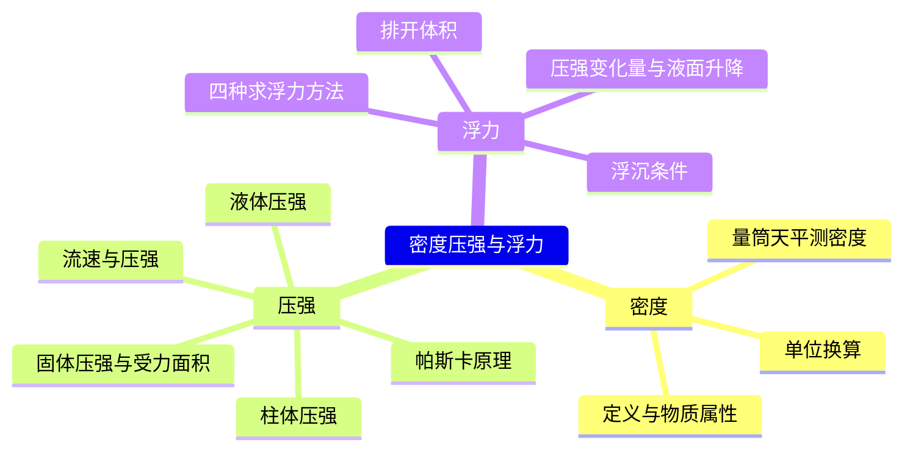
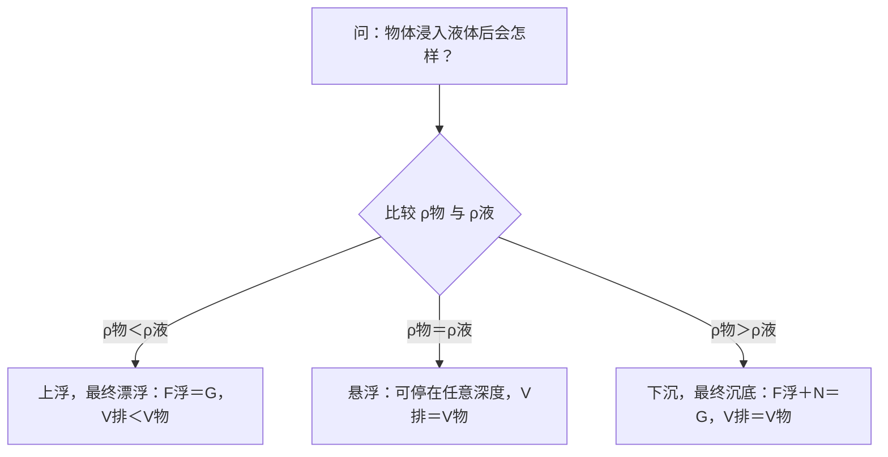
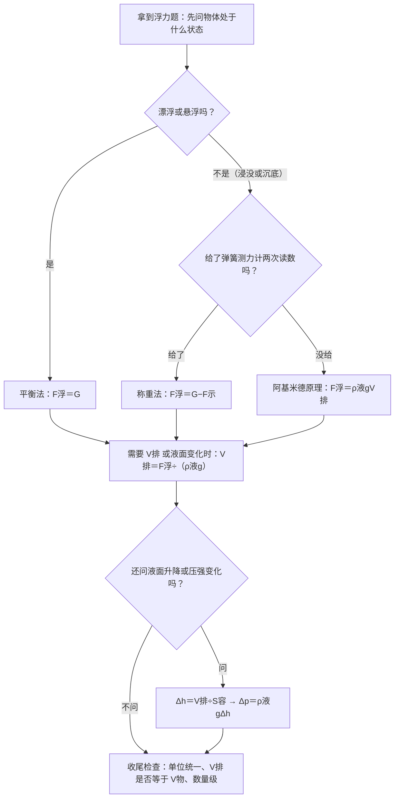

---
tags:
  - 知识点详解
  - 物理
学科: 物理
章节: 九年级·密度压强浮力
考频: 高
来源: 沪教版物理九年级 + 老师纪要（浮力=力学核心难点）+ 2026 真题
概要版: "[[04-物理/知识点/05-密度压强与浮力]]"
updated: 2026-10-28
---

# 密度、压强与浮力（详解版）

> **使用说明**：本文是详解版，从"为什么"讲起供从头自学；考前速查和掌握度跟踪在概要版：[[04-物理/知识点/05-密度压强与浮力]]。

## 0️⃣ 这章学什么 & 中考怎么考

这一章回答三个问题：**这块东西是什么做的**（密度）；**压力把表面压得有多"狠"**（压强）；**浸在水里的东西受多大托力、会不会沉**（浮力）。密度是工具，压强是主干，浮力是"压强＋受力分析"的综合应用——上海卷常把三块串在同一道大题里。

- 学科总览把本章定级为"高★"，老师纪要点名："浮力题目难度加大，已成为区分学生能力的关键题型"（见 [[04-物理/学科总览]]）；力学板块在中考物理约占 35%。
- 2026 真题最后一个题块就是"研究浮力"实验（9 分，概要版已核对）；选择题考过圆柱体"切割叠放"（同型套路见 [[04-物理/专题/压强浮力-上海特色题型]]）。
- 常见题型：浮力称重法实验链、柱体压强与压强变化量计算、液面升降判断。大题按"设→列→算→验→答"写步骤，见 [[04-物理/专题/大题规范书写-设列算验答]]。

本章全景：



## 🧭 先修自检（学不下去先回到这里）

> 下面每一项都是本章的地基。做不出就先去补对应知识，硬学只会更挫败。

| # | 你应该会的 | 自查题（先做再看答案） | 答案 | 不会去哪补 |
| - | ---------- | ---------------------- | ---- | ---------- |
| 1 | 重力公式 $G=mg$ | 质量 0.5 kg 的物体重多少？（$g=9.8\ \text{N/kg}$） | $G=0.5\times9.8=4.9\ \text{N}$ | [[04-物理/知识点/02-运动与力]] |
| 2 | 压强定义式 | $F=20\ \text{N}$ 压在 $0.01\ \text{m}^2$ 上，压强多大？ | $p=20\div0.01=2000\ \text{Pa}$ | [[04-物理/知识点/02-运动与力]] |
| 3 | 体积单位换算 | 50 cm³ 等于多少 m³？ | $5\times10^{-5}\ \text{m}^3$（cm³→m³ 乘 $10^{-6}$） | 本文 🌱 第 1 节 |
| 4 | 二力平衡 | 漂浮的木块受哪两个力？什么关系？ | 重力与浮力，等大、反向（二力平衡） | [[04-物理/知识点/02-运动与力]] |

## 🌱 概念从头讲

> 每个概念按"**为什么需要它 → 它是什么 → 符号与单位 → 容易想错的地方**"四步讲。

### 1. 密度：物质"有多密"

- **为什么需要**：相同体积的铁块比木块重得多。要比较"哪种物质更重"，不能比质量（体积不一样），也不能只比体积，只能比"**单位体积的质量**"——这就是密度。
- **定义**：某种物质**单位体积的质量**，$\rho=\dfrac{m}{V}$。密度是**物质的属性**：与质量、体积、形状都无关。
- **符号/单位**：$\rho$，单位 $\text{kg/m}^3$；常用 $\text{g/cm}^3$。**必背**：$\rho_水=1.0\times10^3\ \text{kg/m}^3=1\ \text{g/cm}^3=1\ \text{g/mL}$（即 1 cm³ 的水恰好 1 g）。
- **单位换算怎么来的**：$1\ \text{g/cm}^3=\dfrac{10^{-3}\ \text{kg}}{10^{-6}\ \text{m}^3}=10^3\ \text{kg/m}^3$。g 比 kg 小 1000 倍，cm³ 比 m³ 小 $10^6$ 倍，一除正好剩 $10^3$。
- **容易想错**：❌"一杯水倒掉一半，密度变一半" → 质量和体积同时减半，比值不变 → ✅密度不变（水还是水）。❌"冰化成水密度不变" → 质量不变，密度变大（约 0.9→1.0 g/cm³），所以体积变小。

### 2. 用天平和量筒测密度（实验）

- **为什么需要**：不规则物体（小石块）量不出长宽高，体积要靠"排水法"间接测——这是测密度实验的核心，也是 5 月实验操作考的重点之一（见 [[04-物理/专题/实验操作考点-物理]]）。
- **定义**：天平测质量 $m$；量筒里先装适量水读 $V_1$，放入物体（完全浸没、不碰壁不碰底）读 $V_2$，物体体积 $V=V_2-V_1$；最后 $\rho=\dfrac{m}{V}$。
- **顺序**：**先测质量、再测体积**；量筒读数视线与凹液面底部相平。
- **容易想错**：❌先把石块放进水里再捞出来称质量 → 石块沾水，$m$ 偏大 → $\rho$ 偏大。✅记住顺序"先干后湿"。

### 3. 固体压强：关键的"受力面积"

- **为什么需要**：书包背带做得宽才不勒肩——压力相同时，接触面积越大压强越小。压强描述"压力的作用效果"。
- **定义**：物体**单位面积**上受到的压力，$p=\dfrac{F}{S}$。$F$ 是压力（垂直压在表面上的力），$S$ 是**受力面积**（真正互相挤压的接触面积）。
- **符号/单位**：$p$，单位帕斯卡（Pa），$1\ \text{Pa}=1\ \text{N/m}^2$。物体静止在**水平面**上、只受重力和支持力时 $F=G$；在斜面上 $F\ne G$。
- **容易想错**：❌"受力面积就是物体的底面积" → 叠放时，上面的物体压下面的物体，受力面积是两者中**较小的那个接触面**。✅做题先问一句："真正压在一起的面积是哪一块？"

### 4. 液体压强：只看密度和深度

- **为什么需要**：水坝为什么上窄下宽？因为越深的地方水压越大。要算液体内部某一点的压强，得用专门的公式。
- **定义**：液体内部深度 $h$ 处的压强 $p=\rho gh$。**只由液体密度 $\rho$ 和深度 $h$ 决定**，与液体的总重、体积、容器形状都无关——帕斯卡裂桶实验：几杯水灌进细长管，就能压裂木桶。
- **符号/单位**：$h$ 是**深度**：从**自由液面**竖直向下量到该点的距离（不是"离底的高度"）。
- **容易想错**：❌"一桶水的压强比一杯水大" → 同种液体、同一深度，压强一样 → ✅只认 $\rho$ 和 $h$。❌把"离底的高度"当深度 → 深度永远从液面往下数。

### 5. 柱体压强：上海卷的"快速通道"

- **为什么需要**：均匀实心柱体（圆柱、长方体）放在水平面上时，不用先求压力再求压强，可以一步到位 $p=\rho gh$——上海特色大题（切割、叠放、放入液体）几乎都建立在这个公式上。
- **推导**（看懂就不怕忘）：
  $$p=\dfrac{F}{S}=\dfrac{G}{S}=\dfrac{mg}{S}=\dfrac{\rho Vg}{S}=\dfrac{\rho Shg}{S}=\rho gh$$
- **适用条件**：**均匀实心柱体＋放在水平面上**。锥形、球形不能这么套。
- **容易想错**：❌看到固体就套 $\rho gh$ → 先看形状是不是柱体；不是柱体就老老实实用 $p=\dfrac{F}{S}$。

### 6. 帕斯卡原理与流体压强

- **为什么需要**：液压千斤顶用小力顶起汽车，地铁站台划着安全线——都是这一节的道理。
- **定义**：①**帕斯卡原理**：加在**密闭液体**上的压强，能够大小不变地被液体向各个方向传递（液压机）；②**流体压强与流速**：流速**大**的地方压强**小**。
- **容易想错**：❌"风把屋顶掀翻是因为风压得紧" → 屋顶上方空气流速大、压强小，屋内压强大，把屋顶"顶"上去。✅这类判断题就一句话："哪边流速大，哪边压强小"，再比两边压强。

### 7. 浮力：水面为什么能托起轮船

- **为什么需要**：钢铁的密度比水大，轮船却浮着；人在死海里沉不下去。要解释"浮与沉"，必须引入浮力。
- **定义**：浸在液体（或气体）中的物体，受到液体（气体）对它**竖直向上**的托力，叫浮力。本质是液体对物体**上、下表面的压力差**：$F_浮=F_{向上}-F_{向下}$（压力差法）。
- **符号/单位**：$F_浮$，单位 N，方向竖直向上。
- **容易想错**：❌"下沉的物体不受浮力" → ✅只要浸在液体里就受浮力；沉底是因为 $F_浮<G$。沉底的物体受**三个力**：重力、浮力、容器底支持力 $N$，满足 $G=F_浮+N$。

漂浮与沉底受力（示意图，非严格比例）：

```
      ↑ F浮
      │
    ┌───┐
    │木块│   漂浮：只受 F浮 与 G，二力平衡 → F浮 ＝ G
    └───┘
～～～～～～～～～ 水面

      ↑ F浮
      │
～～｜石块｜～～～ 石块浸没在水面以下
    └──┬──┘
       │ ↑ N（容器底支持力）
═══════╧═══════ 容器底
       ↓ G
沉底：F浮 ＋ N ＝ G → F浮 ＜ G
```

### 8. 四种求浮力的方法（按题选）

考试不是"会一个公式走天下"，而是**看题目给了什么，选最省力的方法**：

| 方法 | 公式 | 适用场合 | 一句话特征 |
| ---- | ---- | -------- | ---------- |
| 称重法 | $F_浮=G-F_示$ | 弹簧测力计实验（2026 真题"研究浮力"） | 给了"空气中读数＋浸入后读数" |
| 阿基米德原理 | $F_浮=\rho_液 g V_排$ | 通用，计算题主力 | 知道（或能求）排开液体体积 |
| 压力差法 | $F_浮=F_{向上}-F_{向下}$ | 理论解释浮力来源 | 考"浮力本质是什么" |
| 平衡法 | $F_浮=G$ | **漂浮或悬浮**静止时 | 题目说"漂浮／悬浮" |

- **容易想错**：❌"阿基米德原理只对水适用" → ✅对任何液体、甚至气体都适用（飞艇靠空气浮力升空）。

### 9. 浮沉条件：一张表定乾坤

| 状态 | 力的关系 | 密度关系 | 体积关系 |
| ---- | ---- | ---- | ---- |
| 漂浮 | $F_浮=G$ | $\rho_物<\rho_液$ | $V_排<V_物$ |
| 悬浮 | $F_浮=G$ | $\rho_物=\rho_液$ | $V_排=V_物$（可停任意深度） |
| 下沉（沉底） | $F_浮<G$ | $\rho_物>\rho_液$ | $V_排=V_物$（浸没） |
| 上浮（动态过程） | $F_浮>G$ | $\rho_物<\rho_液$ | 出水前 $V_排=V_物$ |

- **重要结论**：物体**浸没后**继续下移，$V_排$ 不变 → **浮力不变**（2026 真题填空考点：浸没后浮力与深度无关）。
- **容易想错**：❌"越深压强越大，所以越深浮力越大" → 深度影响的是液体**压强**，不影响浮力；浸没后 $V_排$ 已经定死。

浮沉判断的决策路径：



### 10. $V_排$ 与 $V_物$：本章第一易错

- **为什么需要**：浮力计算错得最多的就是这两个量混用，值得单独一节。
- **定义**：$V_排$＝物体**排开液体**的体积＝物体**浸入液体部分**的体积。**浸没**时 $V_排=V_物$；**漂浮**时 $V_排<V_物$。
- **最小例子**：木块 $V_物=100\ \text{cm}^3$ 漂浮在水面上，浸入部分 $V_排=60\ \text{cm}^3$，它受的浮力是多少？
  $$F_浮=\rho_水 g V_排=1000\times9.8\times6\times10^{-5}=0.588\ \text{N}$$
  算给你看：60 cm³＝$6\times10^{-5}$ m³；$9800\times6\times10^{-5}=0.588$。**不能**代 100 cm³ 进去。
- **容易想错**：❌漂浮物体也拿 $V_物$ 算浮力 → 那算出来的是"假设全浸没"的浮力，偏大。✅先判断状态，再定 $V_排$。

## 🧮 公式逐个拆解

> 每个公式都必须能回答四件事：每个符号是什么？单位是什么？什么时候能用？怎么变形？

### 公式 1：密度 $$\rho=\dfrac{m}{V}$$

| 符号 | 含义 | 单位 |
| ---- | ---- | ---- |
| $\rho$ | 密度 | $\text{kg/m}^3$（或 $\text{g/cm}^3$） |
| $m$ | 质量 | kg（用 g/cm³ 时是 g） |
| $V$ | 体积 | m³（用 g/cm³ 时是 cm³） |

- 成立条件：同种物质、状态不变。
- 常用变形：$m=\rho V$（已知密度和体积求质量）；$V=\dfrac{m}{\rho}$（间接测体积）。
- 最小例子：一块金属 $m=54\ \text{g}$，$V=20\ \text{cm}^3$，它可能是什么金属？
  $$\rho=\dfrac{m}{V}=\dfrac{54}{20}=2.7\ \text{g/cm}^3=2.7\times10^3\ \text{kg/m}^3$$
  算给你看：54÷20＝2.7。对照密度表，2.7 g/cm³ 是铝。

### 公式 2：固体压强 $$p=\dfrac{F}{S}$$

| 符号 | 含义 | 单位 |
| ---- | ---- | ---- |
| $p$ | 压强 | Pa |
| $F$ | 压力 | N |
| $S$ | 受力面积 | m² |

- 成立条件/适用范围：固体对支撑面的压强；水平面上静止时 $F=G$。
- 常用变形：$F=pS$；$S=\dfrac{F}{p}$。面积换算：$1\ \text{cm}^2=10^{-4}\ \text{m}^2$。
- 最小例子：棱长 10 cm 的正方体（$m=2\ \text{kg}$）放在水平桌面上，对桌面的压强多大？
  $$G=mg=2\times9.8=19.6\ \text{N},\qquad S=0.1\times0.1=0.01\ \text{m}^2$$
  $$p=\dfrac{F}{S}=\dfrac{19.6}{0.01}=1960\ \text{Pa}$$
  算给你看：0.1×0.1＝0.01；19.6÷0.01＝1960（除以 0.01 等于乘 100）。

### 公式 3：液体压强 $$p=\rho gh$$

| 符号 | 含义 | 单位 |
| ---- | ---- | ---- |
| $p$ | 深度 $h$ 处的液体压强 | Pa |
| $\rho$ | **液体**的密度 | kg/m³ |
| $g$ | 9.8 N/kg（上海常取 9.8） | N/kg |
| $h$ | 深度（自由液面竖直往下） | m |

- 成立条件/适用范围：密度均匀的液体；$h$ 从**自由液面**算起。均匀实心柱体放在水平面上也适用（第 5 节推导）。
- 常用变形：求液体对容器底的压力 $F=pS$——**先算压强，再算压力**，顺序别反（上海卷经典陷阱）；柱体知道压强反求高度 $h=\dfrac{p}{\rho g}$。
- 最小例子：水面下 0.5 m 处水的压强？
  $$p=\rho_水 gh=1000\times9.8\times0.5=4900\ \text{Pa}$$
- 最小例子 2（柱体）：密度 $0.6\times10^3\ \text{kg/m}^3$、高 0.2 m 的木柱放在水平地面上，对地压强？
  $$p=\rho gh=600\times9.8\times0.2=1176\ \text{Pa}$$
  算给你看：600×9.8＝5880；5880×0.2＝1176。

### 公式 4：阿基米德原理 $$F_浮=\rho_液 g V_排$$

| 符号 | 含义 | 单位 |
| ---- | ---- | ---- |
| $F_浮$ | 浮力 | N |
| $\rho_液$ | **液体**的密度（不是物体的！） | kg/m³ |
| $g$ | 9.8 N/kg | N/kg |
| $V_排$ | 排开液体的体积 | m³ |

- 成立条件/适用范围：任何液体（气体也适用）、任何浸入状态。
- 常用变形：$V_排=\dfrac{F_浮}{\rho_液 g}$；$\rho_液=\dfrac{F_浮}{gV_排}$。
- 最小例子：$V_物=100\ \text{cm}^3$ 的物体**浸没**在水中，浮力多大？（浸没 → $V_排=V_物=10^{-4}\ \text{m}^3$）
  $$F_浮=1000\times9.8\times10^{-4}=0.98\ \text{N}$$
  算给你看：$1000\times10^{-4}=0.1$；$0.1\times9.8=0.98$。

### 公式 5：称重法 $$F_浮=G-F_示$$

| 符号 | 含义 | 单位 |
| ---- | ---- | ---- |
| $G$ | 物体在空气中的读数（＝重力） | N |
| $F_示$ | 物体浸入液体后的读数 | N |

- 成立条件：弹簧测力计两次读数都稳定；物体不碰容器壁和底（实验高频扣分点，见 [[04-物理/专题/实验操作考点-物理]]）。
- 推论（值得背）：同一物体浸没在水中时，$\rho_物=\dfrac{G}{G-F_示}\cdot\rho_水$——例题阶梯第 1 级会算一遍，就是这个式子的来历。
- 最小例子：$G=4.9\ \text{N}$，浸没后 $F_示=2.94\ \text{N}$：$F_浮=4.9-2.94=1.96\ \text{N}$。

### 公式 6：平衡法 $$F_浮=G$$

- 成立条件：**只**适用于漂浮或悬浮（静止、只受重力和浮力两个力）。
- 最小例子：漂浮的木块重 5.88 N → $F_浮=5.88\ \text{N}$；若还要求 $V_排$：
  $$V_排=\dfrac{F_浮}{\rho_水 g}=\dfrac{5.88}{9800}=6\times10^{-4}\ \text{m}^3=600\ \text{cm}^3$$
  算给你看：5.88÷9.8＝0.6；0.6÷1000＝6×10⁻⁴ m³；乘 $10^6$ 换回 cm³ 就是 600。

### 常量与单位换算速查表

| 量 | 数值 | 备注 |
| ---- | ---- | ---- |
| $\rho_水$ | $1.0\times10^3\ \text{kg/m}^3=1\ \text{g/cm}^3$ | 必背 |
| $g$ | 9.8 N/kg | 上海卷常取 9.8，有时给 10，以题目为准 |
| $1\ \text{cm}^3$ | $10^{-6}\ \text{m}^3$ | cm³→m³ 乘 $10^{-6}$ |
| $1\ \text{cm}^2$ | $10^{-4}\ \text{m}^2$ | 面积换算是"平方关系"，别和体积混 |

## 🪜 例题阶梯

> 三级台阶，每一级都要动笔跟着算，不许只看。

### 第 1 级 · 入门（照着模仿）——称重法测浮力

> **题目**：石块挂在弹簧测力计下，空气中读数 $4.9\ \text{N}$；把石块**浸没**在水中，读数 $2.94\ \text{N}$（$g=9.8\ \text{N/kg}$，$\rho_水=1.0\times10^3\ \text{kg/m}^3$）。求：①浮力；②石块体积；③石块密度。（2026 真题"研究浮力"实验同型，题块 9 分）
>
> **每一步为什么这么做**：
> - 第一步：识别模型——题目给了"空气中读数＋浸入后读数"，这是**称重法**，用 $F_浮=G-F_示$。
> - 第二步：求体积。浸没 → $V_排=V_物$，所以用阿基米德原理反推：$V_排=\dfrac{F_浮}{\rho_水 g}$。
> - 第三步：求密度。质量用 $m=\dfrac{G}{g}$（$G=mg$ 的变形），再用 $\rho=\dfrac{m}{V}$。
> - 第四步：验算合理性——石块密度应大于水，且是 $10^3$ 量级。
>
> **完整解答**：
> ① $F_浮=G-F_示=4.9-2.94=1.96\ \text{N}$
> ② 浸没时 $V_物=V_排$：
> $$V_排=\dfrac{F_浮}{\rho_水 g}=\dfrac{1.96}{1000\times9.8}=\dfrac{1.96}{9800}=2\times10^{-4}\ \text{m}^3$$
> 算给你看：1.96÷9.8＝0.2；0.2÷1000＝2×10⁻⁴ m³＝200 cm³。
> ③ $m=\dfrac{G}{g}=\dfrac{4.9}{9.8}=0.5\ \text{kg}$
> $$\rho_石=\dfrac{m}{V}=\dfrac{0.5}{2\times10^{-4}}=2.5\times10^3\ \text{kg/m}^3$$
> 验算：$2.5\times10^3>1.0\times10^3$，石块确实下沉 ✓。
> 答：$F_浮=1.96\ \text{N}$；$V_石=2\times10^{-4}\ \text{m}^3$；$\rho_石=2.5\times10^3\ \text{kg/m}^3$。

### 第 2 级 · 标准（中考中档）——液体对容器底的压强与压力

> **题目**：水平桌面上有一底面积 $S=0.02\ \text{m}^2$ 的圆柱形容器（柱形容器），装深 0.3 m 的水。求：①水对容器底的压强；②水对容器底的压力；③水的重力，并比较②③。（$g=9.8\ \text{N/kg}$）
>
> **读题→翻译成物理语言**："水对容器底"＝液体压强问题 → **先压强（$p=\rho gh$）后压力（$F=pS$）**；"水的重力"＝先算水的体积和质量 $m=\rho V$，再 $G=mg$。
>
> **每一步为什么这么做**：
> - 第一步：液体对容器底，永远先算压强再算压力。若反过来"先压力后压强"，在非柱形容器里会出错——这是上海卷经典陷阱（概要版易错点原话："顺序别反"）。
> - 第二步：$h=0.3\ \text{m}$ 就是水深（从液面到容器底），直接代公式。
> - 第三步：压力用 $F=pS$，$S$ 取容器底面积。
> - 第四步：水的体积 $V=Sh$（柱形容器特有），再算质量与重力。
>
> **完整解答**：
> ① $p=\rho_水 gh=1000\times9.8\times0.3=2940\ \text{Pa}$
> ② $F=pS=2940\times0.02=58.8\ \text{N}$
> ③ $V=Sh=0.02\times0.3=6\times10^{-3}\ \text{m}^3$；$m=\rho_水 V=1000\times6\times10^{-3}=6\ \text{kg}$
> $G=mg=6\times9.8=58.8\ \text{N}$
> 比较：②＝③，恰好相等。**这不是巧合**：柱形容器侧壁竖直，水对侧壁无竖直方向的作用力，水对底的压力就等于水重。口大底小或口小底大的容器两者就不相等——所以"先压强后压力"永远稳妥。
> 答：2940 Pa；58.8 N；58.8 N，二者相等（柱形容器特例）。

### 第 3 级 · 提高（与压轴／综合题接轨）——柱体放入液体的压强变化量

> **题目**：水平桌面上圆柱形容器底面积 $S_容=100\ \text{cm}^2$，盛深 0.2 m 的水。将重 $4.9\ \text{N}$、底面积 $50\ \text{cm}^2$、高 16 cm 的实心均匀柱体 A 竖直缓慢放入水中，水未溢出，A 不触底。求：①A 的密度，并判断 A 的浮沉状态；②A 静止后，水对容器底压强的变化量 $\Delta p$。（$g=9.8\ \text{N/kg}$）
>
> **思路从哪来**：卡住时先看这句——这类题（上海特色大题"物体放入液体"，见 [[04-物理/专题/压强浮力-上海特色题型]] 模型三）固定三步走：**先定浮沉 → 再求 $V_排$ → 最后算液面变化**。压强变化量永远围绕"液面升了多少"来做。
>
> **完整解答**：
> ① 先把 A 的数据换成国际单位：$S_A=50\ \text{cm}^2=5\times10^{-3}\ \text{m}^2$，
> $V_A=S_A h_A=5\times10^{-3}\times0.16=8\times10^{-4}\ \text{m}^3$
> $m_A=\dfrac{G}{g}=\dfrac{4.9}{9.8}=0.5\ \text{kg}$；$\rho_A=\dfrac{m_A}{V_A}=\dfrac{0.5}{8\times10^{-4}}=625\ \text{kg/m}^3$
> $\rho_A<\rho_水$ → A **漂浮**。
> ② 漂浮 → 用平衡法：$F_浮=G=4.9\ \text{N}$。
> $$V_排=\dfrac{F_浮}{\rho_水 g}=\dfrac{4.9}{9800}=5\times10^{-4}\ \text{m}^3$$
> 液面上升量（注意除以**容器**底面积——液面在整个容器里升，不是只在 A 底下升）：
> $$\Delta h=\dfrac{V_排}{S_容}=\dfrac{5\times10^{-4}}{0.01}=0.05\ \text{m}$$
> $$\Delta p=\rho_水 g\Delta h=1000\times9.8\times0.05=490\ \text{Pa}$$
> **另法验证**（柱形容器、未溢出、不触底的条件下）：容器底压力变化量 $\Delta F=F_浮=4.9\ \text{N}$，则
> $\Delta p=\dfrac{\Delta F}{S_容}=\dfrac{4.9}{0.01}=490\ \text{Pa}$ ✓ 两条路答案一致。
> **验算合理性**：A 浸入深度 $=\dfrac{V_排}{S_A}=\dfrac{5\times10^{-4}}{5\times10^{-3}}=0.1\ \text{m}<16\ \text{cm}$（A 没全浸，确实是漂浮）✓；水面从 0.2 m 升到 0.25 m，A 底离容器底 0.15 m（不触底）✓。
> 答：$\rho_A=625\ \text{kg/m}^3$，A 漂浮；$\Delta p=490\ \text{Pa}$。
>
> **和入门题的差别**：入门题把"两个读数"直接递到你手上；这题要自己判断浮沉状态（决定用平衡法还是阿基米德原理），还要选对面积（$\Delta h$ 除以容器底面积，不是 A 的底面积）——这两个"选对"正是大题的区分点。

## 🗺️ 解题流程图



## 🔥 易错点：为什么会错

| ❌ 常见错误想法 | 为什么会这样想 | ✅ 正确理解 / 自救方法 |
| -------------- | -------------- | ---------------------- |
| 漂浮时用 $V_物$ 算浮力 | "阿基米德原理代个体积就行" | 代入的是 $V_排$：浸没才等于 $V_物$，漂浮时更小。先判状态再定 $V_排$ |
| "越深浮力越大" | 深处压强大，直觉迁移过去 | 浸没后 $V_排$ 不变 → 浮力不变（2026 真题填空考点） |
| 液体题先算压力再算压强 | 习惯了 $F=pS$ | 液体一般"先 $p=\rho gh$ 后 $F=pS$"；水平面上的固体才是"先 $F=G$ 后 $p=F/S$" |
| 密度随质量、体积变 | 只看到公式里有 $m$、$V$ | $\rho$ 是物质属性：$m$、$V$ 同比例变，比值不变；变的只是状态（如冰化水） |
| cm³ 忘换算成 m³ | 换算不熟 | $1\ \text{cm}^3=10^{-6}\ \text{m}^3$；代入公式前先把所有量统一成国际单位 |
| $\Delta F=F_浮$ 到处乱用 | 背了结论没看条件 | "柱形容器＋未溢出＋不触底"时 $\Delta F=G_排$ 才成立；通用做法是先算 $\Delta h$ 再算 $\Delta p$ |
| 液体压强与液体重有关 | "水多压力大" | 只看 $\rho$ 和 $h$（帕斯卡裂桶：几杯水压裂木桶） |
| 变阻器/题目给 g＝10 仍代 9.8 | 背熟了 9.8 | $g$ 以题目给定为准；上海常取 9.8，有时给 10 |

## ✅ 自测清单（能独立做到才打勾）

- [ ] 1. 能不看书说出密度的定义，并解释"倒掉一半水，密度为什么不变"
- [ ] 2. 能默写 1 g/cm³ → 1000 kg/m³ 的换算推导过程（不是死记结果）
- [ ] 3. 能说出天平＋量筒测密度的正确顺序，并解释顺序错了会怎么错
- [ ] 4. 能默写 6 个公式（密度、固体压强、液体压强、阿基米德、称重法、平衡法），说清每个符号的单位
- [ ] 5. 能独立做出例题第 1 级（称重法三连问）
- [ ] 6. 能独立做出第 2 级，并说清为什么液体要"先压强后压力"
- [ ] 7. 能独立做出第 3 级，并用两种方法互相验证 $\Delta p$
- [ ] 8. 能背出浮沉条件表，用 $\rho_物$ 与 $\rho_液$ 判断浮沉，并说出"浸没后浮力与深度无关"
- [ ] 9. 能说出本章 3 个易错点及自救方法

## 🔗 关联

- 概要版：[[04-物理/知识点/05-密度压强与浮力]]（掌握度在这边更新）
- 前置知识：[[04-物理/知识点/02-运动与力]]（重力、二力平衡、压强初步）
- 后续/综合应用：[[04-物理/专题/压强浮力-上海特色题型]]（切割叠放、压强变化量大题套路） · [[04-物理/专题/实验操作考点-物理]]（测密度、探究浮力实验）
- 真题精讲：[[04-物理/专题/真题精讲/物-05-密度压强浮力综合]] · [[04-物理/专题/真题精讲/物-15-2026真题-研究浮力]]
- 公式速记：[[04-物理/闪卡/物理公式速记]]（阿基米德原理、称重法、浸没后浮力不变都在闪卡里）
