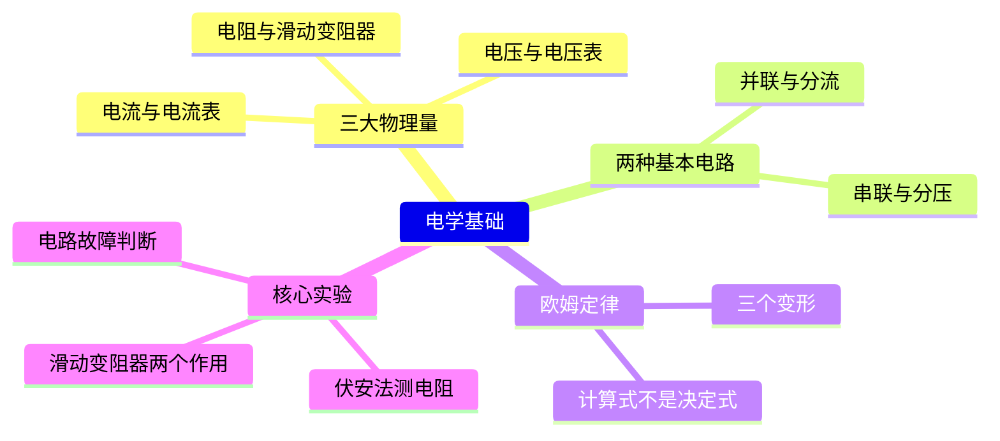
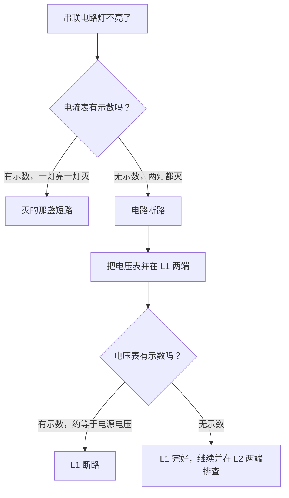
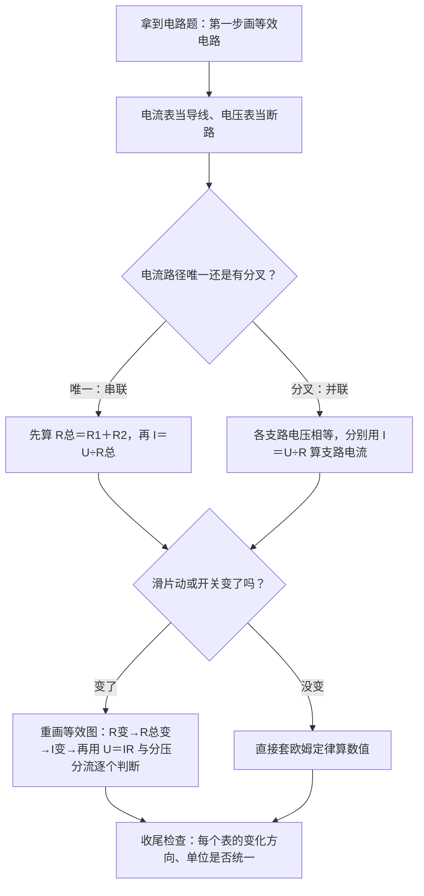

---
tags:
  - 知识点详解
  - 物理
学科: 物理
章节: 九年级·电学基础
考频: 高
来源: 沪教版物理九年级 + 老师纪要（电学四大题型）+ 2026 真题
概要版: "[[04-物理/知识点/06-电学基础]]"
updated: 2026-10-28
---

# 电学基础：电流、电压、电阻与欧姆定律（详解版）

> **使用说明**：本文是详解版，从"为什么"讲起供从头自学；考前速查和掌握度跟踪在概要版：[[04-物理/知识点/06-电学基础]]。

## 0️⃣ 这章学什么 & 中考怎么考

这一章回答三个问题：**电流是什么、在电路里怎么"跑"**（电流）；**是什么在推动它跑**（电压）；**导体为什么会让它跑得慢**（电阻）——最后由欧姆定律 $I=\dfrac{U}{R}$ 把三者拴在一起。后面所有电学内容（电功率、家庭电路、动态电路、故障判断）都站在这一章的地基上。

- 学科总览：**电学约占中考物理 40%**，是最大板块（见 [[04-物理/学科总览]]）。2026 真题"测量电阻"题块（8 分）＝伏安法＋故障判断，全部用本章知识（概要版已核对）。
- 老师钦定的"电学四大题型"——电路动态分析、电路故障判断、电学计算、方法策略——地基全在这一章（见 [[04-物理/专题/电学四大题型]]）。
- 题型：欧姆定律计算、串并联电路分析、动态电路（滑片移动判断电表变化）、伏安法测电阻实验、故障判断选择题。

本章全景：



## 🧭 先修自检（学不下去先回到这里）

> 下面每一项都是本章的地基。做不出就先去补对应知识，硬学只会更挫败。

| # | 你应该会的 | 自查题（先做再看答案） | 答案 | 不会去哪补 |
| - | ---------- | ---------------------- | ---- | ---------- |
| 1 | 单位换算（毫→标准） | 500 mA 等于多少 A？ | 0.5 A（除以 1000） | 本文 🌱 第 2 节 |
| 2 | 分数加法 | $\dfrac{1}{6}+\dfrac{1}{3}$ 等于多少？ | $\dfrac{3}{6}=\dfrac{1}{2}$（并联总电阻天天用） | 数学·分数运算 |
| 3 | 比例化简 | 2:4 和 10:20 是同一个比吗？ | 是，都等于 1:2（分压分流就靠它） | 数学·比例 |
| 4 | 小数除法 | 6÷30 等于多少？ | 0.2（欧姆定律的基本功） | 数学·小数除法 |

## 🌱 概念从头讲

> 每个概念按"**为什么需要它 → 它是什么 → 符号与单位 → 容易想错的地方**"四步讲。

### 1. 电路与三种状态

- **为什么需要**：一切电学题的前提是看懂电路——电流从哪来、往哪走、在哪里分叉。
- **定义**：电路由**电源、用电器、开关、导线**组成。三种状态：**通路**（正常工作）、**断路／开路**（某处断开，没有电流）、**短路**（电流不经过用电器、直接"抄近路"回到电源——电源短路电流过大，会烧坏电源）。
- **容易想错**：❌"短路就是断路" → 意思完全相反：断路是"路断了、没电流"；短路是"抄了近路、电流过大"。后面的故障判断全靠分清这两个词。

### 2. 电流 I：电流的强弱

- **为什么需要**：灯亮不亮、电能表走不走，取决于电流的强弱，要有一个量来描述它。
- **定义**：电流表示电流强弱。符号 $I$，单位安培（A）；$1\ \text{A}=1000\ \text{mA}$。方向规定为正电荷定向移动的方向（电源外部：从正极流向负极）。
- **电流表使用四条**（必背）：①**串联**接入电路；②电流"+"进"−"出；③选对量程（0～0.6 A 每小格 0.02 A；0～3 A 每小格 0.1 A）；④**绝不能直接接电源两端**。
- **容易想错**：❌"电流表像电压表一样并联就行" → 电流表内部相当于一根导线；并联会把被测元件**短路**，直接并在电源两端就是电源短路——烧表。

### 3. 电压 U：推动电流的"水压"

- **为什么需要**：水流靠水压推，电流靠电压推。**有电压，才可能有电流**；电压是"因"，电流是"果"。
- **定义**：电压是使电路中形成电流的原因。符号 $U$，单位伏特（V）；$1\ \text{kV}=1000\ \text{V}$，$1\ \text{V}=1000\ \text{mV}$。常记两个数：家庭电路 220 V；一节干电池 1.5 V。
- **电压表使用三条**：①**并联**在被测元件两端；②选量程（0～3 V 每小格 0.1 V；0～15 V 每小格 0.5 V）；③**可以直接接在电源两端**测电源电压（它相当于断路，不会烧）。
- **容易想错**：❌"电压表串进电路也无所谓" → 电压表相当于**断路**，串联后电路几乎没有电流：灯不亮、电流表无示数，但电压表读数≈电源电压。看到"电压表有示数、其他都不工作"，就要想到这一点。

### 4. 电阻 R：导体自己的"阻碍"

- **为什么需要**：同样的电压，接细铁丝电流小、接粗铜丝电流大——导体自己会"拖后腿"，这个属性就是电阻。
- **定义**：导体对电流的阻碍作用。符号 $R$，单位欧姆（Ω）。
- **决定因素**（口诀"材长截温"）：**材料、长度**（越长越大）、**横截面积**（越粗越小）、**温度**。电阻是导体本身的属性，**不随 U、I 改变**。
- **滑动变阻器**：靠改变接入电路的**电阻线长度**来变阻。接法口诀"**一上一下**"：

| 接法 | 效果 |
| ---- | ---- |
| 一上一下 | 正常变阻 ✓（滑片移动→接入长度变→R 变） |
| 同上（两根都接上面两个接线柱） | 电阻≈0，相当于一根导线 |
| 同下（两根都接下面两个接线柱） | 接入全部电阻，相当于定值电阻，滑片白移 |

- **容易想错**：❌"$R=\dfrac{U}{I}$，所以 $U$ 越大 $R$ 越大" → $R=\dfrac{U}{I}$ 只是**计算式**（用两个表"量"出来），不是**决定式**；$U$ 增大时 $I$ 同比例增大，比值不变。✅决定 $R$ 的只有"材长截温"。

### 5. 串联电路：一条路走到黑

- **为什么需要**：开关和灯就是串联的（开关断开灯就灭）；串联分压是动态电路、变阻器问题的核心工具。
- **特点**（背熟）：
  - 电流处处相等：$I=I_1=I_2$
  - 总电压等于各部分电压之和：$U=U_1+U_2$
  - 总电阻 $R=R_1+R_2$（越串越大）
  - **分压**：$\dfrac{U_1}{U_2}=\dfrac{R_1}{R_2}$——电阻大的分得电压多

```
   ┌────/ 开关 ────┐        （示意图，非严格比例；/＝开关）
   │               │
  [R1]            [R2]
   │               │
   └───── 电源 ────┘
   电流路径唯一：I 处处相等
```

- **最小例子**：$R_1=10\ \Omega$、$R_2=20\ \Omega$ 串联接在 6 V 电源上：$R_总=30\ \Omega$，$I=\dfrac{6}{30}=0.2\ \text{A}$，$U_1=IR_1=2\ \text{V}$，$U_2=4\ \text{V}$。验证分压比：$2:4=10:20=1:2$ ✓。

### 6. 并联电路：分叉各走各的

- **为什么需要**：家里的电器全是并联——关掉台灯，冰箱照常工作（各支路互不影响）。
- **特点**（背熟）：
  - 各支路两端电压相等：$U=U_1=U_2$
  - 干路电流等于支路电流之和：$I=I_1+I_2$
  - 总电阻：$\dfrac{1}{R}=\dfrac{1}{R_1}+\dfrac{1}{R_2}$（总电阻**比任何一条支路都小**）
  - **分流**：$\dfrac{I_1}{I_2}=\dfrac{R_2}{R_1}$——电阻小的分得电流多

```
   ┌────/ 开关 ────┬──────────┐   （示意图，非严格比例）
   │               │          │
  [R1]            [R2]        │
   │               │          │
   └───── 电源 ────┴──────────┘
   电流在节点分叉，两支路电压相等
```

- **最小例子**：$6\ \Omega$ 与 $3\ \Omega$ 并联：$\dfrac{1}{R}=\dfrac{1}{6}+\dfrac{1}{3}=\dfrac{1}{2}$ → $R=2\ \Omega$（比 3 Ω 还小 ✓）。两电阻并联速算：$R=\dfrac{R_1R_2}{R_1+R_2}=\dfrac{18}{9}=2\ \Omega$。

### 7. 串并联对比速查表

| 项目 | 串联 | 并联 |
| ---- | ---- | ---- |
| 电流 | $I=I_1=I_2$ | $I=I_1+I_2$ |
| 电压 | $U=U_1+U_2$ | $U=U_1=U_2$ |
| 电阻 | $R=R_1+R_2$，越串越大 | $\dfrac{1}{R}=\dfrac{1}{R_1}+\dfrac{1}{R_2}$，比任一支路小 |
| 比例关系 | 分压 $\dfrac{U_1}{U_2}=\dfrac{R_1}{R_2}$ | 分流 $\dfrac{I_1}{I_2}=\dfrac{R_2}{R_1}$ |
| 一个用电器坏了 | 整条电路都停 | 其他支路照常 |
| 生活原型 | 开关与灯 | 家里各个电器 |

### 8. 欧姆定律：全章的"总开关"

- **为什么需要**：$I$、$U$、$R$ 三个量各管各的没法解题，欧姆定律把它们拴在一起——已知两个就能求第三个。
- **定义**：同一导体中的电流，跟这段导体两端的电压成正比，跟这段导体的电阻成反比：
  $$I=\dfrac{U}{R}$$
- **符号/单位**：$I$（A）、$U$（V）、$R$（Ω）。三个量必须**同一段导体、同一时刻**（同体性、同时性）。
- **常用变形**：$U=IR$（已知电流求电压）；$R=\dfrac{U}{I}$（伏安法测电阻的原理）。
- **容易想错**：❌"电压为零时电阻也为零" → 电阻是属性，$R=\dfrac{U}{I}$ 只是算出它的数值；没有电压，电阻照样在。

### 9. 电路识别三板斧（等效电路）

1. **化简**：把电流表当**导线**、电压表当**断路**（直接擦掉），画出等效简化图。
2. **判串并**：电流从正极出发，路径唯一 → 串联；有分叉 → 并联。
3. **再重画**：滑片移动、开关通断、换电表位置之后，**重新画等效图**再分析——动态分析的第一步永远是重画。

### 10. 伏安法测电阻（中考实验核心）

- **为什么需要**：电阻看不见摸不着，怎么测？欧姆定律给了办法：量出 $U$ 和 $I$，一除就是 $R$。
- **原理**：$R=\dfrac{U}{I}$。电路组成：电源＋开关＋待测电阻＋电流表（串联）＋电压表（并在待测电阻两端）＋滑动变阻器（串联）。
- **滑动变阻器的两个作用**（必背）：①**保护电路**（闭合开关前滑片移到阻值最大处）；②**改变待测电阻两端的电压和电流**，实现多次测量取平均，减小偶然误差。
- **容易想错**：❌"闭合开关前滑片随便放" → 必须在最大阻值处（高频扣分点，见 [[04-物理/专题/实验操作考点-物理]]）。变阻器规格怎么选（2026 真题考点"由分压范围倒推"），见 [[04-物理/专题/电学四大题型]] 题型四。

### 11. 电路故障判断（入门版）

串联电路只有两种故障：**断路**和**短路**。判断决策图：



- **答题句式**（照着写，见 [[04-物理/专题/电学四大题型]]）："电压表并在 L1 两端无示数，并在 L2 两端有示数且接近电源电压，故 L2 断路。"——只答"断路／短路"不指明元件＝不得分。

## 🧮 公式逐个拆解

> 每个公式都必须能回答四件事：每个符号是什么？单位是什么？什么时候能用？怎么变形？

### 公式 1：欧姆定律 $$I=\dfrac{U}{R}$$

| 符号 | 含义 | 单位 |
| ---- | ---- | ---- |
| $I$ | 电流 | A |
| $U$ | 导体两端电压 | V |
| $R$ | 导体电阻 | Ω |

- 成立条件：三个量必须同一段导体、同一时刻；单位统一成 V、A、Ω 再代入。
- 常用变形：$U=IR$；$R=\dfrac{U}{I}$（计算式，不是决定式）。
- 最小例子：$U=6\ \text{V}$，$R=30\ \Omega$：$I=\dfrac{6}{30}=0.2\ \text{A}$。

### 公式 2：串联总电阻与分压 $$R=R_1+R_2,\qquad \dfrac{U_1}{U_2}=\dfrac{R_1}{R_2}$$

- 成立条件：串联电路。
- 常用变形：$U_1=\dfrac{R_1}{R_1+R_2}\times U$（已知总电压直接按比例分）。
- 最小例子：$10\ \Omega$ 与 $20\ \Omega$ 串联接 6 V：$R=30\ \Omega$，$I=0.2\ \text{A}$，$U_1=0.2\times10=2\ \text{V}$，$U_2=0.2\times20=4\ \text{V}$。检查：$2+4=6$ ✓，$U_1:U_2=1:2=R_1:R_2$ ✓。

### 公式 3：并联总电阻与分流 $$\dfrac{1}{R}=\dfrac{1}{R_1}+\dfrac{1}{R_2},\qquad \dfrac{I_1}{I_2}=\dfrac{R_2}{R_1}$$

- 成立条件：并联电路。
- 常用变形：两电阻速算 $R=\dfrac{R_1R_2}{R_1+R_2}$。
- 最小例子：$6\ \Omega$ 与 $3\ \Omega$ 并联接 6 V：$R=\dfrac{6\times3}{6+3}=2\ \Omega$；干路 $I=\dfrac{6}{2}=3\ \text{A}$；$I_1=\dfrac{6}{6}=1\ \text{A}$，$I_2=\dfrac{6}{3}=2\ \text{A}$。检查：$1+2=3$ ✓；$I_1:I_2=1:2=R_2:R_1$ ✓（注意：分流比和分压比是"反"的）。

### 电表与仪表速查表

| 物理量 | 符号 | 单位 | 仪表 | 接法 | 关键使用要点 |
| ------ | ---- | ---- | ---- | ---- | ------------ |
| 电流 | I | A | 电流表 | **串联** | "＋"进"−"出；不超量程；**不能直接接电源两端** |
| 电压 | U | V | 电压表 | **并联** | 不超量程；**可直接测电源电压** |
| 电阻 | R | Ω | 伏安法（无独立仪表） | — | 导体属性，与 U、I 无关 |

### 读数量程速查表

| 电表 | 量程 | 每小格（分度值） |
| ---- | ---- | ---------------- |
| 电流表 | 0～0.6 A | 0.02 A |
| 电流表 | 0～3 A | 0.1 A |
| 电压表 | 0～3 V | 0.1 V |
| 电压表 | 0～15 V | 0.5 V |

- 读数三步：先看**量程** → 算**分度值** → 数格数。量程选大了读数不精确，选小了可能烧表。

## 🪜 例题阶梯

> 三级台阶，每一级都要动笔跟着算，不许只看。

### 第 1 级 · 入门（照着模仿）——欧姆定律＋单位换算

> **题目**：某导体两端电压 3 V 时，通过它的电流为 150 mA。①它的电阻多大？②电压升到 6 V 时，电流多大？电阻变了吗？
>
> **每一步为什么这么做**：
> - 第一步：**单位换算**。公式要求 A，题目给 mA：150 mA＝0.15 A（除以 1000）。这是本章最容易白丢分的一步，动笔先换算。
> - 第二步：求电阻用 $R=\dfrac{U}{I}$。
> - 第三步：电压加倍后，电阻是导体属性——**不变**；电流用 $I=\dfrac{U}{R}$ 重算。
>
> **完整解答**：
> ① $I=150\ \text{mA}=0.15\ \text{A}$，$R=\dfrac{U}{I}=\dfrac{3}{0.15}=20\ \Omega$
> 算给你看：3÷0.15＝300÷15＝20。
> ② 电阻不变，仍为 $20\ \Omega$；$I'=\dfrac{6}{20}=0.3\ \text{A}$
> 电压翻倍，电流翻倍（正比关系），电阻纹丝不动。
> 答：①$20\ \Omega$；②0.3 A，电阻不变。

### 第 2 级 · 标准（中考中档）——伏安法测电阻的数据处理

> **题目**：伏安法测电阻，三次实验数据如下（电流表用 0～0.6 A 量程）：U₁＝1.5 V、I₁＝0.16 A；U₂＝2.5 V、I₂＝0.25 A；U₃＝3.5 V、I₃＝0.34 A。求待测电阻（保留一位小数）。
>
> **读题→翻译成物理语言**：三组数据＝做三次 $R=\dfrac{U}{I}$，再取平均。真实数据会有微小出入（读数误差），所以才要"多次测量取平均减小偶然误差"——这正是滑动变阻器第二个作用的用途。
>
> **每一步为什么这么做**：
> - 第一步：每一组**单独**算 $R$。别把 U 加起来除以 I 加起来——那样没有任何物理意义。
> - 第二步：除不尽时按题目要求保留位数。
> - 第三步：三个 R 取算术平均。
>
> **完整解答**：
> 第 1 组：$R_1=\dfrac{1.5}{0.16}=9.375\approx9.4\ \Omega$（算给你看：150÷16＝9.375）
> 第 2 组：$R_2=\dfrac{2.5}{0.25}=10.0\ \Omega$
> 第 3 组：$R_3=\dfrac{3.5}{0.34}\approx10.3\ \Omega$（算给你看：350÷34≈10.29）
> 平均：$R=\dfrac{9.4+10.0+10.3}{3}=\dfrac{29.7}{3}=9.9\ \Omega$
> 答：待测电阻约 $9.9\ \Omega$。（2026 真题"测量电阻"题块 8 分，最后一步就是这种"数据处理求 R"。）

### 第 3 级 · 提高（与压轴／综合题接轨）——动态电路分析

> **题目**：电源电压 6 V，定值电阻 $R_1=10\ \Omega$ 与滑动变阻器 $R_2$（0～20 Ω）**串联**。电压表并在 $R_1$ 两端，电流表串联在电路中。滑片移动使 $R_2$ 接入阻值从 10 Ω 变为 15 Ω。①两个电表的读数各变为多少？②分别说明变大还是变小；③若电压表改并在 $R_2$ 两端，它的示数怎么变？
>
> **思路从哪来**：卡住时先看这句——动态分析固定流程（见 [[04-物理/专题/电学四大题型]] 题型一）：**滑片动 → R₂ 变 → R总 变 → I 变 → 逐个表判断**。判断电压用 $U=IR$（串联电流处处相等）或"串联分压：电阻大的分得多"。
>
> **完整解答**：
> ① $R_2=10\ \Omega$ 时：$R_总=20\ \Omega$，$I=\dfrac{6}{20}=0.3\ \text{A}$，$U_1=IR_1=0.3\times10=3\ \text{V}$，$U_2=6-3=3\ \text{V}$。
> $R_2=15\ \Omega$ 时：$R_总=25\ \Omega$，$I=\dfrac{6}{25}=0.24\ \text{A}$，$U_1=0.24\times10=2.4\ \text{V}$，$U_2=6-2.4=3.6\ \text{V}$。
> 检查：两种情况下 $U_1+U_2$ 都等于 6 V ✓（串联电压规律）。
> ② 变化表：

| 电表 | R₂＝10 Ω 时 | R₂＝15 Ω 时 | 变化 |
| ---- | ---- | ---- | ---- |
| 电流表 | 0.3 A | 0.24 A | 变小 |
| 电压表（并 R₁） | 3 V | 2.4 V | 变小 |

> 逻辑链：$R_2$ 增大 → $R_总$ 增大 → $I$ 减小 → $U_1=IR_1$ 减小；$R_2$ 分得的电压 $U_2=U-U_1$ 增大（串联分压：谁的电阻大，谁分得多）。
> ③ 电压表改并 $R_2$：读数从 3 V 增大到 3.6 V，**变大**。同一个滑片动作，电压表位置不同，结论相反——这就是"换电表位置"考点的陷阱所在。
>
> **和入门题的差别**：入门题是"给两个数求第三个"；这题要先重画等效电路、走因果链，还要逐个表、逐个状态汇报——这正是四大题型里"电路动态分析"的答题节奏。

## 🗺️ 解题流程图



## 🔥 易错点：为什么会错

| ❌ 常见错误想法 | 为什么会这样想 | ✅ 正确理解 / 自救方法 |
| -------------- | -------------- | ---------------------- |
| 电流表并联在灯两端 | "电表哪里都能接" | 电流表＝导线：并联会短路该灯；直接并电源＝电源短路，烧表 |
| 电压表串联进电路 | 担心并联"短路"记反了 | 电压表＝断路：串联后电路不通、灯不亮，电压表读数≈电源电压 |
| R 随 U、I 变 | 把 $R=\dfrac{U}{I}$ 当决定式 | R 是导体属性（材长截温）；U 增大 I 同比例增大，比值不变 |
| 并联总电阻算成 $R_1+R_2$ | 串并规律记串了 | 并联 $\dfrac{1}{R}=\dfrac{1}{R_1}+\dfrac{1}{R_2}$，总电阻比任一支路**小**（6 Ω∥3 Ω＝2 Ω） |
| 滑变"同上同下"照接 | "两根都接上就行" | 只有一上一下才变阻；同上≈导线，同下＝定值 |
| 读数不先看量程 | 急着数格子 | 0～0.6 A 分度 0.02 A、0～3 A 分度 0.1 A；先量程后读数 |
| mA 忘换成 A | 换算意识弱 | 见到 mA 先除以 1000，写在这一步旁边再往下做 |
| 故障只答"断路" | 答题不完整 | 必须指明哪个元件断路／短路＋证据（电压表哪次有示数），见 [[04-物理/专题/电学四大题型]] |

## ✅ 自测清单（能独立做到才打勾）

- [ ] 1. 能说出断路和短路的区别，并解释为什么电源短路危险
- [ ] 2. 能背出电流表、电压表的接法，以及"能不能直接接电源两端"
- [ ] 3. 能说出电阻的四个决定因素，并解释 $R=\dfrac{U}{I}$ 为什么不是决定式
- [ ] 4. 能默写串并联全部规律（含分压、分流比例）
- [ ] 5. 能用"一上一下"判断滑变三种接法的效果
- [ ] 6. 能独立做出例题第 1 级（含 mA→A 换算）
- [ ] 7. 能独立做出第 2 级（三组数据求平均）
- [ ] 8. 能独立做出第 3 级动态电路，并逐表说明变大／变小
- [ ] 9. 能说出滑动变阻器在伏安法实验中的两个作用
- [ ] 10. 能照着故障决策图写出规范的故障判断答题句式

## 🔗 关联

- 概要版：[[04-物理/知识点/06-电学基础]]（掌握度在这边更新）
- 后续/综合应用：[[04-物理/知识点/07-电功率与家庭电路]]（在欧姆定律上叠加 P 和 W）
- 相关专题：[[04-物理/专题/电学四大题型]]（动态、故障、计算、方法策略） · [[04-物理/专题/实验操作考点-物理]]（伏安法是操作考重点）
- 真题精讲：[[04-物理/专题/真题精讲/物-06-欧姆定律综合]] · [[04-物理/专题/真题精讲/物-07-探究电路与故障]] · [[04-物理/专题/真题精讲/物-14-2026真题-测量电阻]]（题块 8 分）
- 公式速记：[[04-物理/闪卡/物理公式速记]]（欧姆定律、串并联规律、"一灯灭一灯亮"故障判断都在闪卡里）
