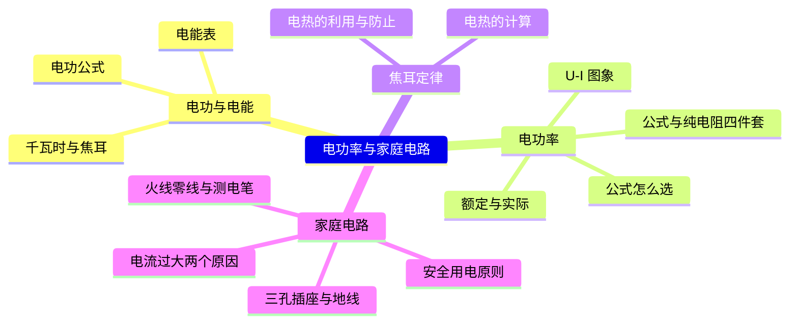
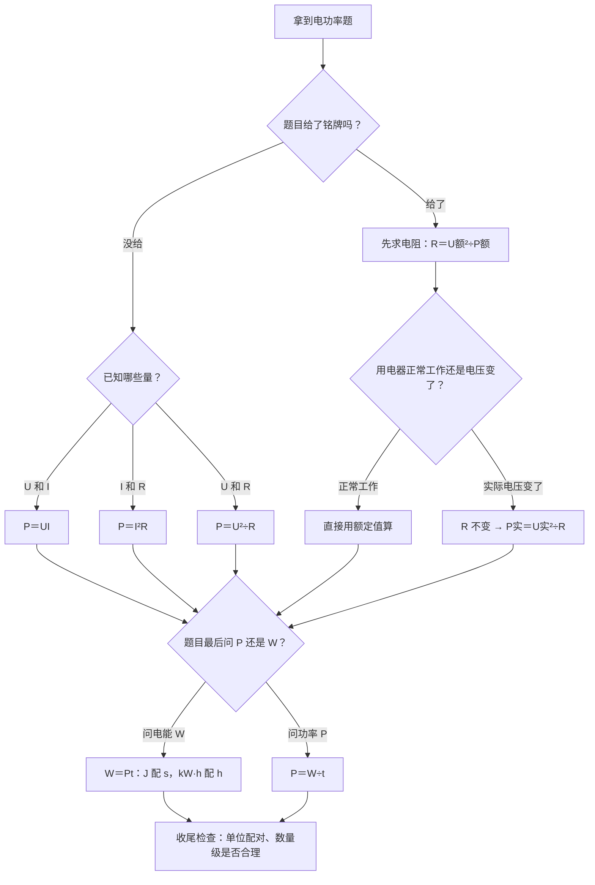

---
tags:
  - 知识点详解
  - 物理
学科: 物理
章节: 九年级·电功率
考频: 高
来源: 沪教版物理九年级 + 2026 真题"电熨斗"题块
概要版: "[[04-物理/知识点/07-电功率与家庭电路]]"
updated: 2026-10-28
---

# 电功率与家庭电路（详解版）

> **使用说明**：本文是详解版，从"为什么"讲起供从头自学；考前速查和掌握度跟踪在概要版：[[04-物理/知识点/07-电功率与家庭电路]]。

## 0️⃣ 这章学什么 & 中考怎么考

这一章回答两个问题：**用电器"吃电"有多快、一共吃了多少**（电功率与电能）；**家里的电是怎么安全地送进每个插座的**（家庭电路与安全用电）。它是电学计算的重头——在欧姆定律（[[04-物理/知识点/06-电学基础]]）之上叠加 P 和 W 两个量。

- 2026 真题"电熨斗"题块（10 分）：铭牌读数、电能计算、U-I 图象求电阻、双电阻丝组合（概要版已核对）——本章就是它的知识底座，精讲见 [[04-物理/专题/真题精讲/物-13-2026真题-电熨斗]]。
- 电学计算是老师钦定四大题型之三（见 [[04-物理/专题/电学四大题型]]）；大题按"设→列→算→验→答"写步骤，见 [[04-物理/专题/大题规范书写-设列算验答]]。
- 家庭电路部分以选择、填空的情境辨析为主：火线零线、测电笔、三孔插座、跳闸原因。

本章全景：

## 🧭 先修自检（学不下去先回到这里）

> 下面每一项都是本章的地基。做不出就先去补对应知识，硬学只会更挫败。

| # | 你应该会的 | 自查题（先做再看答案） | 答案 | 不会去哪补 |
| - | ---------- | ---------------------- | ---- | ---------- |
| 1 | 功率单位换算 | 1.5 kW 等于多少 W？ | 1500 W（乘 1000） | 本文 🧮 单位换算速查表 |
| 2 | 电能单位换算 | 2 kW·h 等于多少 J？ | $2\times3.6\times10^6=7.2\times10^6\ \text{J}$ | 本文 🌱 第 1 节 |
| 3 | 时间换算 | 90 min 等于多少 h？多少 s？ | 1.5 h；5400 s | 本文 🧮 单位换算速查表 |
| 4 | 欧姆定律 | U＝220 V，R＝44 Ω，I 多大？ | $I=\dfrac{220}{44}=5\ \text{A}$ | [[04-物理/知识点/06-电学基础]] |
| 5 | 平方数 | 220 的平方是多少？ | 48400（本章反复出现，建议记住） | 数学·乘方 |

## 🌱 概念从头讲

> 每个概念按"**为什么需要它 → 它是什么 → 符号与单位 → 容易想错的地方**"四步讲。

### 1. 电功（电能）W：用了多少电

- **为什么需要**：电表上的数字每个月都在涨——电器工作要"吃电"，吃了多少要能算出来。
- **定义**：电流做功的过程，就是**电能转化为其他形式能**的过程（电灯→光和内能；电动机→机械能）。电流做了多少功，就消耗了多少电能：
  $$W=UIt$$
- **符号/单位**：$W$，单位焦耳（J）；生活中用千瓦时（kW·h，俗称"1 度电"）。换算的来历：$1\ \text{kW·h}=1000\ \text{W}\times3600\ \text{s}=3.6\times10^6\ \text{J}$。
- **容易想错**：❌"1 kW·h＝1000 J" → kW·h 是"功率×时间"的单位：1000 W 的电器用 1 小时（3600 秒），一共 3.6×10⁶ J。

### 2. 电功率 P：吃电有多快

- **为什么需要**：同样烧一壶水，电磁炉 5 分钟、小电炉半小时——"做功的快慢"要用功率描述。
- **定义**：单位时间消耗的电能：
  $$P=\dfrac{W}{t}=UI$$
- **符号/单位**：$P$，单位瓦特（W）；$1\ \text{kW}=1000\ \text{W}$。
- **纯电阻电路四件套**（纯电阻＝电能全部变成内能，如电炉、电熨斗、白炽灯）：
  $$P=UI=I^2R=\dfrac{U^2}{R}=\dfrac{W}{t}$$
  四个式子等价，**已知哪两个量就用哪条**（见 🧮 公式选择表）。
- **容易想错**：❌"灯的亮度由额定功率决定" → 亮度由**实际功率**决定。接在低于额定电压的电路里，实际功率变小，灯就变暗。

### 3. 额定 vs 实际：铭牌上的数只是"标准工况"

- **为什么需要**："220 V 100 W"是灯泡的"身份证"，但它只在 220 V 下才是 100 W；电压一变，功率跟着变。
- **定义**：**额定电压**＝正常工作的电压；**额定功率**＝在额定电压下消耗的功率。两者都刻在铭牌上，**不随使用情况变**。**实际功率**随实际电压变。
- **怎么变**：电阻 $R$ 不变（由铭牌算出），实际电压改变时：
  $$P_实=P_额\times\left(\dfrac{U_实}{U_额}\right)^2$$
- **容易想错**：❌"电压减半，功率减半" → 忘了平方！电压减半 → 电流也减半 → $P=UI$ 减为原来的**四分之一**。

### 4. 电能表：家里的"电的计数器"

- **为什么需要**：电能表测的就是 $W$，考题常拿它的参数做文章。
- **定义**：参数"3000 r/kW·h"意思是：每消耗 1 kW·h 电能，铝盘转 3000 圈。转 $n$ 圈消耗电能：
  $$W=\dfrac{n}{3000}\ \text{kW·h}$$
- 另一种用法：读示数，月底示数减月初示数＝本月用电量。
- **容易想错**：❌"转 150 圈＝150 kW·h" → 要**除以** 3000，不是乘。转得越多用得越多，但每圈只代表 $\dfrac{1}{3000}$ kW·h。

### 5. 焦耳定律：电热

- **为什么需要**：任何导体通电都会发热（导线也会！），发热多少要能算——导线太细或电流太大时发热过多会起火，这正是家庭电路"总功率过大"危险的根源。
- **定义**：电流通过导体产生的热量跟电流的**二次方**成正比，跟导体的电阻成正比，跟通电时间成正比：
  $$Q=I^2Rt$$
  这是**通用式**（任何电路都成立）。纯电阻电路里电能全部变热：$Q=W=UIt=I^2Rt$。
- **利用与防止**：利用——电饭锅、电熨斗、电热毯（电热器）；防止——电脑散热孔、电视机散热窗、电动机里的散热风扇。
- **容易想错**：❌"电压高热量就大（直接下结论）" → 热量由 $I^2Rt$ 决定；电压高是通过"电流变大"才导致热量变大，说原因要说到 $I$ 这一环。

### 6. 家庭电路：电是怎么安全进家的

- **组成顺序**（背）：进户线 → 电能表 → 总开关 → 保险装置 → 用电器／插座。
- **火线与零线**：火线对地 220 V，零线对地 0 V。**测电笔**：手触**笔尾**金属体（绝不能碰笔尖！），氖管发光＝接触的是火线。
- **三孔插座**：上孔接**地线**。金属外壳电器（洗衣机、冰箱）必须用三孔——万一外壳带电，电流走地线，不走人体。
- **保险丝**：用**电阻率大、熔点低**的铅锑合金。电流过大时它先熔断、切断电路。**绝不能用铜丝、铁丝代替**（熔点太高，起不到保护作用）。
- **电流过大的两个原因**（必背）：①**短路**；②**总功率过大**——并联的电器越多，$P_总=P_1+P_2+\cdots$ 越大，由 $I=\dfrac{P_总}{U}$，干路电流越大。
- **安全原则**：不接触低压带电体，不靠近高压带电体。
- **容易想错**：❌"开关接在零线上也一样" → 开关必须接**火线**：断开后灯座不带电才安全；接零线时灯虽灭了，灯座仍带电，换灯泡会触电。

### 7. U-I 图象：从图里读出电阻

- **为什么需要**：2026 真题"电熨斗"题块考了 U-I 图象求电阻——图象题的钥匙是"取点算"，不是背斜率结论。
- **定义**：定值电阻的 U-I 图线是**过原点的直线**。同样电压下电流越大，电阻越小，图线越"陡"。做法：在图线上取**两个点**读出 $(U,I)$，用 $R=\dfrac{U}{I}$ 算。
- **容易想错**：❌横轴纵轴不看清楚 → 先确认横轴是 I 还是 U（两种图都会出现），再取点；直接取点算 $R=\dfrac{U}{I}$ 最稳，不用纠结"斜率等于 R 还是 1/R"。

## 🧮 公式逐个拆解

> 每个公式都必须能回答四件事：每个符号是什么？单位是什么？什么时候能用？怎么变形？

### 公式 1：电功 $$W=UIt$$

| 符号 | 含义 | 单位 |
| ---- | ---- | ---- |
| $W$ | 电功（消耗的电能） | J |
| $U$ | 电压 | V |
| $I$ | 电流 | A |
| $t$ | 时间 | **s** |

- 成立条件/适用范围：任何电路都成立（电能是否全变成热不影响 W 的定义）。
- 常用变形：$W=Pt$；纯电阻时 $W=I^2Rt=\dfrac{U^2}{R}t$。
- 最小例子：$U=220\ \text{V}$，$I=0.5\ \text{A}$，工作 1 min：
  $$W=UIt=220\times0.5\times60=6600\ \text{J}$$
  算给你看：220×0.5＝110；110×60＝6600。**注意 t 用秒**——"1 min 忘了×60"是高频错误。

### 公式 2：电功率 $$P=\dfrac{W}{t}=UI$$（纯电阻另有 $$P=I^2R=\dfrac{U^2}{R}$$）

| 符号 | 含义 | 单位 |
| ---- | ---- | ---- |
| $P$ | 电功率 | W |
| $W$ | 电能 | J（配 s）或 kW·h（配 h） |
| $t$ | 时间 | s 或 h（必须与 W 的单位配对） |
| $U$ / $I$ / $R$ | 电压／电流／电阻 | V / A / Ω |

- 成立条件：$I^2R$、$\dfrac{U^2}{R}$ 两式只对**纯电阻电路**直接用；任何电路求功率都可以用 $P=UI$。
- 公式选择表（已知什么用什么）：

| 已知量 | 用哪个 |
| ------ | ------ |
| U 和 I | $P=UI$ |
| I 和 R | $P=I^2R$ |
| U 和 R | $P=\dfrac{U^2}{R}$ |
| W 和 t | $P=\dfrac{W}{t}$ |

- 最小例子：某用电器 $U=220\ \text{V}$、$R=484\ \Omega$：
  $$P=\dfrac{U^2}{R}=\dfrac{220^2}{484}=\dfrac{48400}{484}=100\ \text{W}$$

### 公式 3：焦耳定律 $$Q=I^2Rt$$

- 成立条件：任何电路通用。
- 常用变形：纯电阻时 $Q=W=UIt$。
- 最小例子：$I=2\ \text{A}$ 通过 $R=10\ \Omega$ 的电阻，通电 1 min：
  $$Q=I^2Rt=2^2\times10\times60=4\times10\times60=2400\ \text{J}$$
  算给你看：2²＝4；4×10＝40；40×60＝2400。

### 公式 4：实际功率 $$P_实=P_额\times\left(\dfrac{U_实}{U_额}\right)^2$$

- 成立条件：纯电阻、电阻不变。
- 来源：由铭牌得 $R=\dfrac{U_额^2}{P_额}$ 且 $R$ 不变，$P_实=\dfrac{U_实^2}{R}$，两式一除就得上式。
- 最小例子："220 V 100 W"的灯接在 110 V 上：
  $$P_实=100\times\left(\dfrac{110}{220}\right)^2=100\times0.25=25\ \text{W}$$
  电压减半，功率只剩四分之一。

### 公式 5：电能表读数 $$W=\dfrac{n}{3000}\ \text{kW·h}$$（参数为 3000 r/kW·h 时）

- 条件：电能表参数不同就照比例替换。
- 最小例子：转 150 圈：$W=\dfrac{150}{3000}=0.05\ \text{kW·h}$，换成焦耳：
  $0.05\times3.6\times10^6=1.8\times10^5\ \text{J}$

### 单位换算速查表（本章命根子）

| 换算 | 结果 | 口诀 |
| ---- | ---- | ---- |
| 1 kW·h | $3.6\times10^6$ J | kW·h→J 乘 $3.6\times10^6$；J→kW·h 除以 $3.6\times10^6$（大单位数值小） |
| 1 kW | 1000 W | 乘 1000 |
| 1 h | 3600 s | ×3600 |
| 1 min | 60 s；$x$ min＝$\dfrac{x}{60}$ h | 分钟化小时除以 60 |
| 配对规则 | J 配 s；kW·h 配 h | 单位配错，全题报废 |

## 🪜 例题阶梯

> 三级台阶，每一级都要动笔跟着算，不许只看。

### 第 1 级 · 入门（照着模仿）——铭牌求 I 和 R

> **题目**：某电水壶铭牌"额定电压 220 V、额定功率 880 W"。正常工作时：①通过它的电流多大？②它的电阻多大？
>
> **每一步为什么这么做**：
> - 第一步："正常工作"＝实际电压＝额定电压 220 V，直接用额定值算，不用打折。
> - 第二步：已知 U 和 P，求 I 用 $I=\dfrac{P}{U}$（由 $P=UI$ 变形）。
> - 第三步：求 R 用 $R=\dfrac{U^2}{P}$（由 $P=\dfrac{U^2}{R}$ 变形）——铭牌题的固定套路。
>
> **完整解答**：
> ① $I=\dfrac{P}{U}=\dfrac{880}{220}=4\ \text{A}$
> ② $R=\dfrac{U^2}{P}=\dfrac{220^2}{880}=\dfrac{48400}{880}=55\ \Omega$
> 验算：$I^2R=4^2\times55=16\times55=880\ \text{W}=P$ ✓。
> 答：4 A；55 Ω。

### 第 2 级 · 标准（中考中档）——电能表＋功率

> **题目**：某电暖器接在 220 V 电路工作，家中电能表标着"3000 r/kW·h"，10 min 内铝盘转了 600 圈。①消耗的电能是多少 kW·h、多少 J？②电暖器的实际功率多大？
>
> **读题→翻译成物理语言**：圈数 → 电能（除以 3000）；电能＋时间 → 功率（相除）。陷阱全在单位：J 配 s，kW·h 配 h。
>
> **每一步为什么这么做**：
> - 第一步：转 600 圈 → $W=\dfrac{600}{3000}$ kW·h，再换算成 J。
> - 第二步：时间 10 min＝600 s（用 J 求功率就必须配秒）。
> - 第三步：$P=\dfrac{W}{t}$。
> - 第四步：数量级检查——家用电暖器一般一千瓦上下，答案应在这个范围。
>
> **完整解答**：
> ① $W=\dfrac{600}{3000}=0.2\ \text{kW·h}$；$0.2\times3.6\times10^6=7.2\times10^5\ \text{J}$
> ② $t=10\ \text{min}=600\ \text{s}$，$P=\dfrac{W}{t}=\dfrac{7.2\times10^5}{600}=1200\ \text{W}$
> 答：0.2 kW·h（7.2×10⁵ J）；1200 W。

### 第 3 级 · 提高（与压轴／综合题接轨）——双电阻丝调温（电熨斗同型）

> **题目**：电熨斗额定电压 220 V，内部有两根电热丝 $R_1=R_2=48.4\ \Omega$，可通过开关切换三种接法：①只用 $R_1$；②$R_1$ 与 $R_2$ 串联；③$R_1$ 与 $R_2$ 并联。求三种接法的电功率，并指出对应高、中、低温档。（同型改编题：方法与 2026 真题"电熨斗"题块一致，数字为自编）
>
> **思路从哪来**：卡住时先看这句——所有"多档位"题的本质都是**同一个电源电压、不同的总电阻**：$P=\dfrac{U^2}{R}$，R 越小 P 越大。所以只需算出三种接法的 $R_总$，再各除一次。
>
> **完整解答**：
> ① 只用 $R_1$：$P_1=\dfrac{U^2}{R_1}=\dfrac{48400}{48.4}=1000\ \text{W}$
> ② 串联：$R_串=48.4+48.4=96.8\ \Omega$，$P_串=\dfrac{48400}{96.8}=500\ \text{W}$
> ③ 并联：$R_并=\dfrac{48.4}{2}=24.2\ \Omega$，$P_并=\dfrac{48400}{24.2}=2000\ \text{W}$
> 验算：48.4×1000＝48400 ✓；96.8×500＝48400 ✓；24.2×2000＝48400 ✓。
> 档位：**并联 2000 W＝高温档**（电阻最小）；**单丝 1000 W＝中温档**；**串联 500 W＝低温档**（电阻最大）。
> 答：并联 2000 W＞单丝 1000 W＞串联 500 W；对应高、中、低温档。
>
> **和入门题的差别**：入门题铭牌直接给了 P；这题要自己组合电阻（串并三态），还要按 $P=\dfrac{U^2}{R}$ 排出档位高低——这正是 2026"电熨斗"题块"双电阻丝组合"一问的思路。

## 🗺️ 解题流程图

## 🔥 易错点：为什么会错

| ❌ 常见错误想法 | 为什么会这样想 | ✅ 正确理解 / 自救方法 |
| -------------- | -------------- | ---------------------- |
| kW·h 和 J 换算方向搞反 | $3.6\times10^6$ 太大，不知道乘还是除 | 大单位数值小：kW·h→J 乘 $3.6\times10^6$，J→kW·h 除以 $3.6\times10^6$ |
| 分钟直接当代入 t | 忘了统一单位 | J 配 s、kW·h 配 h；10 min＝600 s＝$\dfrac{1}{6}$ h |
| 实际功率硬套额定值 | 只背 $P=UI$ 没看电压条件 | 电压变了先由铭牌求 R，再 $P_实=\dfrac{U_实^2}{R}$ |
| "电压减半功率减半" | 忘了平方关系 | 电压减半→电流减半→P 变为四分之一（$P\propto U^2$） |
| 保险丝用铜丝代替 | "能导电就行" | 保险丝靠"先熔断"保护：电阻率大、熔点低；铜丝熔点高，电路烧了它还没断 |
| 并联电器越多越没事 | "多插几个插座而已" | 并联总功率相加变大，干路 $I=\dfrac{P_总}{U}$ 变大 → 跳闸／起火 |
| 开关接零线 | 火线零线不分 | 开关必须接火线：断开后灯座不带电才安全 |
| 灯的亮度看额定功率 | 铭牌数字显眼 | 亮度由**实际功率**决定 |
| 电能表圈数忘了除以 3000 | "转得多就用得多"直觉 | 每圈只是 $\dfrac{1}{3000}$ kW·h：$W=\dfrac{n}{3000}$ |

## ✅ 自测清单（能独立做到才打勾）

- [ ] 1. 能默写 1 kW·h＝3.6×10⁶ J 的推导过程
- [ ] 2. 能背出纯电阻四件套，并给"已知 U 和 R"选对公式
- [ ] 3. 能由铭牌算出 I 和 R（独立做出第 1 级例题）
- [ ] 4. 能用电能表圈数算电能和功率（独立做出第 2 级例题）
- [ ] 5. 能做双电阻丝三档题并排出档位高低（第 3 级例题）
- [ ] 6. 能说清"电压减半，功率变为四分之一"的原因
- [ ] 7. 能说出家庭电路组成顺序、测电笔用法、三孔插座上孔接什么
- [ ] 8. 能说出电流过大的两个原因及各自原理
- [ ] 9. 能说出保险丝的材料特点及为什么不能用铜丝代替
- [ ] 10. 能说出本章 3 个易错点及自救方法

## 🔗 关联

- 概要版：[[04-物理/知识点/07-电功率与家庭电路]]（掌握度在这边更新）
- 前置知识：[[04-物理/知识点/06-电学基础]]（欧姆定律、串并联、伏安法）
- 相关专题：[[04-物理/专题/电学四大题型]]（电学计算＝题型三） · [[04-物理/专题/大题规范书写-设列算验答]]
- 真题精讲：[[04-物理/专题/真题精讲/物-08-电功率综合]] · [[04-物理/专题/真题精讲/物-13-2026真题-电熨斗]]
- 公式速记：[[04-物理/闪卡/物理公式速记]]（电功率四公式、1 kW·h＝3.6×10⁶ J、火线零线 220 V 都在闪卡里）
