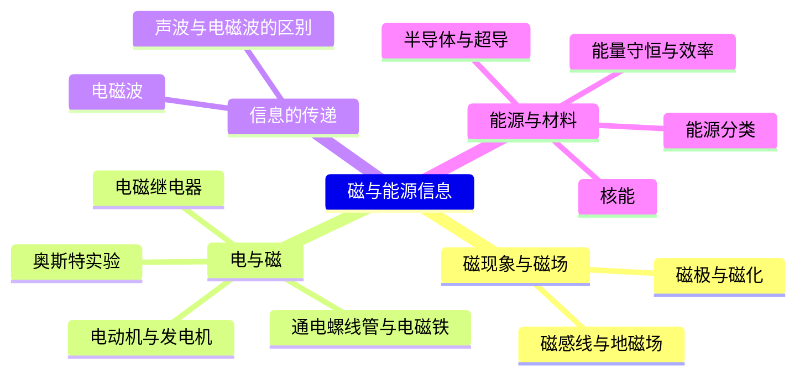
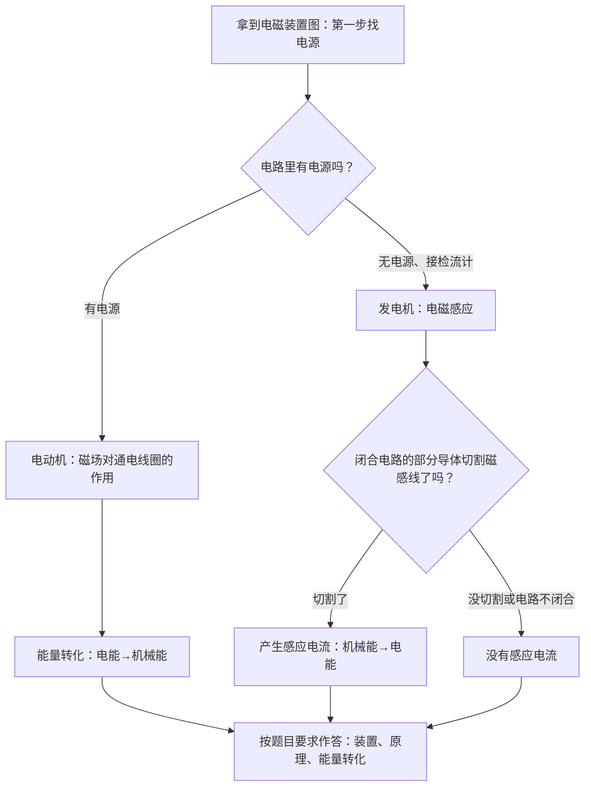

---
tags:
  - 知识点详解
  - 物理
学科: 物理
章节: 九年级·磁与能源信息
考频: 中低
来源: 沪教版物理九年级 + 2026 真题
概要版: "[[04-物理/知识点/08-磁与能源信息]]"
updated: 2026-10-28
---

# 磁、能源与信息（详解版）

> **使用说明**：本文是详解版，从"为什么"讲起供从头自学；考前速查和掌握度跟踪在概要版：[[04-物理/知识点/08-磁与能源信息]]。

## 0️⃣ 这章学什么 & 中考怎么考

这一章是"概念送分模块"，回答四个问题：**磁是什么、怎么用**（磁现象、电磁铁、电动机与发电机）；**电磁波是什么**（信息传递）；**能源怎么分类**；**能量转化的效率怎么算**。计算量很小，拼的是"分类清晰＋判断准确"。

- 学科总览定级"中低"（概念送分），但送分要拿稳——2026 真题考了能源分类（可再生能源）与电磁波信号（"机器人马拉松接收电磁波"，概要版已核对）。
- 题型：选择题、填空题为主——判断电动机／发电机、能源归类、电磁波 vs 声波。唯一的常考计算是效率 $\eta$（可能与热学、电学结合成小计算题）。
- 与前章联系：电动机／发电机的判断建立在电路认知上（[[04-物理/知识点/06-电学基础]]）；效率计算会用到热学公式 $Q=cm\Delta t$（[[04-物理/知识点/04-热学]]）。

本章全景：



## 🧭 先修自检（学不下去先回到这里）

> 下面每一项都是本章的地基。做不出就先去补对应知识，硬学只会更挫败。

| # | 你应该会的 | 自查题（先做再看答案） | 答案 | 不会去哪补 |
| - | ---------- | ---------------------- | ---- | ---------- |
| 1 | 认电路：找电源 | 给你一张装置图，判断电动机还是发电机，第一步看什么？ | 先找**有没有电源**：有电源＝电动机；无电源接检流计＝发电机 | [[04-物理/知识点/06-电学基础]] |
| 2 | 能量转化常识 | 电动机工作时消耗什么能、输出什么能？ | 消耗电能，输出机械能 | 本文 🌱 第 5 节 |
| 3 | 科学记数法 | $3\times10^8$ 写成普通数字是多少？ | 300000000（小数点右移 8 位） | 数学·科学记数法 |
| 4 | 百分数 | 800÷1000 写成百分数是多少？ | 80%（效率计算天天用） | 数学·百分数 |

## 🌱 概念从头讲

> 每个概念按"**为什么需要它 → 它是什么 → 符号与单位 → 容易想错的地方**"四步讲。

### 1. 磁体与磁极

- **为什么需要**：指南针、冰箱贴、电磁起重机，都从"磁"开始；而"电与磁的关系"是本章的主线。
- **定义**：物体能吸引铁、钴、镍等物质的性质叫**磁性**，具有磁性的物体叫**磁体**。磁体上磁性最强的部位叫**磁极**（两端最强、中间最弱）：自由静止时指北的一端叫 **N 极**，指南的一端叫 **S 极**。磁极间相互作用：**同名相斥、异名相吸**。使原来没有磁性的物体获得磁性叫**磁化**。
- **符号/单位**：本章没有计算量，重点是术语准确。
- **容易想错**：❌"磁体中间磁性最强" → 两端最强、中间几乎没有磁性（拿条形磁铁吸回形针试过就知道：中间吸不住）。

### 2. 磁场与磁感线

- **为什么需要**：磁极没有接触也能互相吸引排斥，说明磁体周围存在一种看不见的物质——磁场；考试要考你"怎么描述"它。
- **定义**：磁体周围存在**磁场**，磁场对放入其中的磁体有力的作用。**磁感线**是描述磁场的**模型**（画出来的辅助线）：磁体**外部**磁感线从 **N 极出发回到 S 极**；磁感线上任意一点的切线方向＝放在该点的小磁针 N 极的指向。磁感线越密的地方磁性越强。
- **地磁场**：地球本身是个大磁体。**地理南极附近是地磁 N 极，地理北极附近是地磁 S 极**——所以小磁针（指南针）的 N 极指北，靠的是"异名相吸"。
- **容易想错**：❌"磁感线是真实存在的线" → **磁场真实存在**，磁感线是人为画的**模型**，实际并不存在——这个辨析考试专门考。

条形磁体磁感线（示意图，非严格比例）：

```
      ↑ ↑ ↑ ↑ ↑ ↑
    ┌─────────────────┐
    │ S             N │ ──→
    └─────────────────┘
      ↓ ↓ ↓ ↓ ↓ ↓

    磁体外部：磁感线从 N 极出发，绕一圈回到 S 极
    两端磁感线最密 → 磁性最强；中间稀疏 → 磁性最弱
```

### 3. 电生磁：奥斯特实验、通电螺线管与电磁铁

- **为什么需要**：奥斯特实验第一次发现"电能让磁针动起来"，从此电和磁连成一家；电磁铁、继电器、电动机都由此而来。
- **定义**：
  - **奥斯特实验**：通电导线周围存在磁场（**电流的磁效应**）。
  - **通电螺线管**：通电后的螺线管，外部磁场与条形磁体相似。极性用**安培定则（右手螺旋定则）**判断：右手四指沿电流方向弯曲，**大拇指指向 N 极**。
  - **电磁铁**：带铁芯的通电螺线管。磁性强弱与**电流大小、线圈匝数、有无铁芯**有关——电流越大、匝数越多、有铁芯，磁性越强。
  - **电磁继电器**：利用电磁铁做成的开关：用**低压控制电路**控制**高压工作电路**，实现自动控制、远距离控制。
- **容易想错**：❌"电磁铁磁性强弱与铁芯无关" → 铁芯被磁化后磁场大大增强——"有无铁芯"正是三因素之一。

电磁继电器的工作过程（文字示意图）：

```
［控制电路：低压电源＋开关＋电磁铁］
        │ 开关闭合 → 电磁铁有了磁性
        ↓
    吸下衔铁 → 触点接通
        ↓
［工作电路：高压电源＋电动机］→ 电动机开始工作
        │ 开关断开 → 电磁铁失去磁性
        ↓ 弹簧把衔铁拉回 → 工作电路断开

（价值：人只碰低压的开关，就能安全地控制高压电路）
```

### 4. 磁生电：发电机与电磁感应

- **为什么需要**：家里的电从发电厂来——发电机把机械能变成电能，靠的是法拉第的发现。
- **定义**：**电磁感应**：**闭合电路**的**一部分导体**在磁场中做**切割磁感线**运动时，导体中产生**感应电流**（法拉第发现）。能量转化：机械能→电能。
- **三个关键词**（缺一不可）：闭合电路、部分导体、切割磁感线。
- **容易想错**：❌"导体在磁场里动就有电" → 必须**切割**磁感线：顺着磁感线方向平移不叫切割，没有电流。

### 5. 电动机 vs 发电机：一张表分清

| 项目 | 电动机 | 发电机 |
| ---- | ---- | ---- |
| 原理 | 通电线圈在磁场中**受力转动** | **电磁感应** |
| 图上特征 | 电路里**有电源** | **无电源**，接检流计／灵敏电流计 |
| 能量转化 | 电能→机械能 | 机械能→电能 |
| 生活原型 | 电风扇、电动车 | 发电厂、手摇发电机 |

- **判断口诀**：看图**先找电源**——有电源的是"用电的"（电动机），无电源的是"发电的"（发电机）。
- **容易想错**：❌"发电机是先有电才能转" → 正相反：先有机械运动（切割磁感线），才"生出"电。

### 6. 电磁波与信息传递

- **为什么需要**：手机、Wi-Fi、卫星导航，信息都靠电磁波传递；2026 真题"机器人马拉松接收电磁波信号"考的就是这个常识。
- **定义**：电磁波可以在**真空中传播**，不需要介质；真空中速度 $c=3\times10^8\ \text{m/s}$（等于光速——光本身就是电磁波）。
- **应用**：无线电广播、手机通信、Wi-Fi、微波、卫星导航等。
- **容易想错**：❌"电磁波像声音一样要靠空气传" → 恰好相反：**声波需要介质**（真空不传声），**电磁波不需要**。宇航员在太空面对面说话听不见，要靠无线电（电磁波）。

声波 vs 电磁波对比表：

| 项目 | 声波 | 电磁波 |
| ---- | ---- | ---- |
| 传播是否需要介质 | **需要**（真空不传声） | **不需要**（真空可传） |
| 真空中的速度 | 无法传播 | $3\times10^8\ \text{m/s}$ |
| 常见例子 | 说话、声呐（水中） | 手机、Wi-Fi、卫星导航、广播 |
| 太空通话 | 行不通 | 靠它（无线电） |

### 7. 能源分类

- **为什么需要**：2026 真题直接考了分类；这也是"碳中和"时代的基本常识。
- **分类一（按能否再生）**：

| 类别 | 成员 | 判断依据 |
| ---- | ---- | ---- |
| 可再生能源 | 风能、水能、太阳能、生物质能 | 短期内能从自然界持续得到 |
| 不可再生能源 | 煤、石油、天然气、核能 | 用一点少一点 |

- **分类二（按是否加工转换）**：**一次能源**＝直接来自自然界（煤、风能、太阳能）；**二次能源**＝由一次能源加工转换而来（**电能**是最典型的二次能源）。
- **容易想错**：❌"核能是可再生能源" → 核燃料（铀矿）挖完就没了，属**不可再生**。❌"电能是一次能源" → 电能是加工转换来的，是二次能源。

### 8. 核能与能量守恒

- **核能**：原子核发生变化时释放的巨大能量。**裂变**＝重核分裂成中等质量的核（核电站——链式反应**可控**）；**聚变**＝轻核聚合（氢弹、太阳内部——目前人类还无法可控地用于发电）。
- **能量守恒定律**：能量既不会凭空产生、也不会凭空消灭，只会从一种形式**转化**为另一种形式，或从一个物体**转移**到另一个物体，总量保持不变。
- **但转化有效率**：转化过程中总有一部分能量变成无用的形式（如摩擦生热、向空气散热），所以效率 $\eta<100\%$——"守恒"和"有用"是两回事。

### 9. 材料：导体、绝缘体、半导体、超导

- **导体**：容易导电（金属、石墨、人体、大地）；**绝缘体**：不容易导电（橡胶、玻璃、塑料）。
- **半导体**：导电能力介于导体和绝缘体之间（硅、锗）。**二极管**由半导体做成，具有**单向导电性**（只允许电流一个方向通过；发光二极管就是 LED）。
- **超导**：某些材料温度降到足够低时，电阻变为**零**——电流通过不再发热，输电没有热损耗（节能）。这就是"超导输电"考点想说的一句话。

### 10. 本章"人物·实验·发明"速查表

这类概念题经常以"谁发现了什么／这是什么应用"的形式出现，集中背一遍：

| 名字／装置 | 一句话贡献／用途 |
| ---------- | ---------------- |
| 奥斯特实验 | 通电导线周围有磁场（电流磁效应，"电生磁"） |
| 法拉第 | 电磁感应（"磁生电"）→ 发电机 |
| 安培定则 | 右手判断通电螺线管的 N 极 |
| 电磁铁 | 电流大小、匝数、有无铁芯决定磁性强弱 |
| 电磁继电器 | 低压控制高压，自动控制 |
| 电动机 | 通电线圈在磁场中受力转动（有电源） |
| 发电机 | 电磁感应（无电源） |
| 二极管 | 半导体，单向导电 |

## 🧮 公式逐个拆解

> 本章公式只有效率一个常考，外加两个必背常数。

### 公式 1：效率 $$\eta=\dfrac{W_{有用}}{W_{总}}\times100\%$$

| 符号 | 含义 | 单位 |
| ---- | ---- | ---- |
| $\eta$ | 效率 | 无单位，用 % 表示 |
| $W_{有用}$ | 有用的那部分能量（"你要的"） | J |
| $W_{总}$ | 消耗的总能量（"你付的"） | J |

- 成立条件/适用范围：任何能量转化装置（电动机、热水器、发动机都适用）；分子分母单位必须相同。
- 常用变形：$W_{有用}=\eta W_{总}$；$W_{总}=\dfrac{W_{有用}}{\eta}$。
- 为什么永远小于 100%：总有一部分能量变成无用形式（摩擦、散热）。
- 最小例子：电动机消耗电能 1000 J，输出机械能 800 J：
  $$\eta=\dfrac{800}{1000}\times100\%=80\%$$
  分子是"你要的"（机械能），分母是"你付的"（电能），别放反。

### 常数速查表

| 常数 | 数值 | 用在哪 |
| ---- | ---- | ---- |
| 电磁波（光）速 $c$ | $3\times10^8\ \text{m/s}$ | 真空中传播；光也是电磁波 |
| 家庭电路电压 | 220 V | 火线对地 220 V、零线对地 0 V |

## 🪜 例题阶梯

> 三级台阶，每一级都要动笔跟着算，不许只看。

### 第 1 级 · 入门（照着模仿）——能源分类

> **题目**：把下列能源分为两类并说出依据：风能、煤、太阳能、核能、水能。
>
> **每一步为什么这么做**：
> - 第一步：认出考点——"分类题"，问的是可再生／不可再生（2026 真题考过）。
> - 第二步：逐个判断"用完还能不能马上再来"：风、太阳、水 → 大自然持续供应 → 可再生；煤、核燃料 → 采完就没了 → 不可再生。
> - 第三步：检查题目有没有混进"一次／二次"的分类（电能不在名单里，这道题没挖这个坑；如果出现电能，要单独说明它是二次能源）。
>
> **完整解答**：可再生能源：风能、太阳能、水能；不可再生能源：煤、核能。依据：能否在短期内从自然界持续得到。

### 第 2 级 · 标准（中考中档）——电动机还是发电机

> **题目**：甲、乙两个装置：甲图电路中有电源，线圈放在磁场里；乙图电路中没有电源，接了一个灵敏电流计，导体棒放在磁场中。分别判断装置名称、原理和能量转化。
>
> **读题→翻译成物理语言**：判断装置只看一个特征——**有没有电源**（先修自检第 1 条）。
>
> **每一步为什么这么做**：
> - 第一步：找电源。甲有电源 → 电动机（用电工作）；乙无电源、接检流计 → 发电机（发电）。
> - 第二步：对号入座原理：电动机＝通电线圈在磁场中受力转动；发电机＝电磁感应。
> - 第三步：能量转化顺着"谁消耗、谁输出"说：电动机电能进、机械能出；发电机机械能进、电能出。
>
> **完整解答**：甲＝电动机，原理是通电线圈在磁场中受力转动，电能→机械能；乙＝发电机，原理是电磁感应，机械能→电能。

### 第 3 级 · 提高（与综合题接轨）——效率计算（跨章：电＋热）

> **题目**：某电热水器把 20 kg 水从 20 ℃ 加热到 50 ℃，消耗电能 $3.6\times10^6\ \text{J}$（正好 1 度电）。$c_水=4.2\times10^3\ \text{J/(kg·℃)}$。求：①水吸收的热量；②该热水器的效率。
>
> **思路从哪来**：卡住时先看这句——效率题分子是"有用的能量"。烧水时"有用"＝水吸收的热量 $Q=cm\Delta t$（热学公式，见 [[04-物理/知识点/04-热学]]），"总"＝消耗的电能。
>
> **完整解答**：
> ① $Q=cm\Delta t=4.2\times10^3\times20\times(50-20)=4.2\times10^3\times20\times30=2.52\times10^6\ \text{J}$
> 算给你看：$4.2\times10^3\times20=8.4\times10^4$；$8.4\times10^4\times30=2.52\times10^6$。
> ② $$\eta=\dfrac{Q_吸}{W}\times100\%=\dfrac{2.52\times10^6}{3.6\times10^6}\times100\%=70\%$$
> 验算：2.52÷3.6＝0.7 ✓；70%＜100%，合理。
> 答：水吸热 $2.52\times10^6\ \text{J}$；效率 70%。剩下 30% 的能量散失到空气和热水器壳体上——这正是"能量守恒但效率不满"的活例子。
>
> **和入门题的差别**：入门题两个数一除就完；这题"有用的能量"要自己先用热学公式算出来——跨章组合（电＋热＋效率）是综合题的标准姿势。

## 🗺️ 解题流程图



## 🔥 易错点：为什么会错

| ❌ 常见错误想法 | 为什么会这样想 | ✅ 正确理解 / 自救方法 |
| -------------- | -------------- | ---------------------- |
| 分不清电动机和发电机 | 两图都是"线圈＋磁铁" | 看图先找电源：有电源＝电动机；无电源接检流计＝发电机 |
| "磁感线真实存在" | 图上画满了线 | 磁场真实存在；磁感线是画出来的**模型** |
| 核能算可再生能源 | "核能很先进" | 核燃料（铀矿）用完就没了：不可再生 |
| 电磁波传播需要介质 | 和声波混为一谈 | 电磁波真空可传（$c=3\times10^8\ \text{m/s}$）；声波必须介质 |
| "导体在磁场中动就有感应电流" | 少了条件意识 | 必须同时满足：闭合电路＋部分导体＋**切割**磁感线 |
| 效率可能大于 100% | "多快好省"的错觉 | 总能量里只有一部分有用：$\eta$ 永远小于 100% |
| 地磁场方向记反 | "地理北极就是 N 极" | 地理**南极**附近是地磁 N 极、地理北极附近是地磁 S 极 |
| 聚变也能建核电站 | 核电站、氢弹混着记 | 裂变可控（核电站）；聚变目前不可控（氢弹、太阳） |

## ✅ 自测清单（能独立做到才打勾）

- [ ] 1. 能说出磁极间作用规律，并指出磁体哪里磁性最强
- [ ] 2. 能描述条形磁体磁感线的方向，并说明"磁场真实存在、磁感线是模型"
- [ ] 3. 能用安培定则（右手）判断通电螺线管的 N 极
- [ ] 4. 能用"找电源"一秒判断电动机／发电机，并说出原理与能量转化（独立做出第 2 级例题）
- [ ] 5. 能说出电磁波与声波在"要不要介质"上的区别，并解释太空为什么靠无线电通话
- [ ] 6. 能给 10 种能源分类（可再生／不可再生），并说出电能是二次能源
- [ ] 7. 能说出裂变与聚变各是什么、各用在哪
- [ ] 8. 能独立做出效率计算（第 3 级例题），说清分子分母各是什么
- [ ] 9. 能说出本章 3 个易错点及自救方法

## 🔗 关联

- 概要版：[[04-物理/知识点/08-磁与能源信息]]（掌握度在这边更新）
- 前置知识：[[04-物理/知识点/06-电学基础]]（电路认知） · [[04-物理/知识点/04-热学]]（效率计算用到 $Q=cm\Delta t$）
- 相关专题：[[04-物理/专题/真题精讲/物-09-能源信息与电磁]] · [[04-物理/专题/真题精讲/物-12-2026真题-机器人]]（2026 真题"机器人马拉松接收电磁波"）
- 公式速记：[[04-物理/闪卡/物理公式速记]]（光速、家用电压在"关键常数"一栏）
