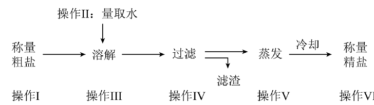

# 化-02 真题精讲 · 实验操作与提纯

> **教材对照**：旧教材专题 1.2（走进化学实验室）、1.3（物质的提纯）→ **新教材专题 1~2**，见 [[05-化学/学科总览]]。

**1.**（基本操作正误·原卷例 3＋变式 4-3）

（1）下列有关仪器使用或用途的叙述中正确的是（　）
- （A）试管：加热时所盛液体体积不超过试管容积的 2/3
- （B）胶头滴管：向试管中滴加液体时应将胶头滴管伸入试管内
- （C）酒精灯：熄灭酒精灯时可用嘴吹灭
- （D）玻璃棒：常用作搅拌、过滤或转移液体

（2）下列化学实验的基本操作，其中正确的是（　）
- （A）用托盘天平准确称取 9.56 g 固体
- （B）用镊子夹取碳酸钠粉末小心送入试管中
- （C）把胶头滴管伸入试管中滴加液体防止溅出
- （D）用 10 mL 量筒量取 9.6 mL 水

> [!tip]- 💡 思路导航
> 操作正误判断的钥匙是每个操作背后的**数字与器具匹配**：试管液体上限、天平精度、量筒量程选择、滴管与镊子的分工。逐项用"标准数值＋标准器具"对照排除。

> [!success]- ✅ 详解 · 评分点 · 易错 · 关联
> **详解**：（1）试管加热时液体**不超过容积的 1/3**（防沸溅），A 给的 2/3 错；胶头滴管应**悬空在试管口正上方**，不可伸入触碰内壁，B 错；酒精灯**用灯帽盖灭**，不可嘴吹，C 错；玻璃棒用于溶解时搅拌、过滤时引流、蒸发时搅拌、转移固体，D 正确 → **选 D**。
> （2）托盘天平只能读准到 **0.1 g**，称不出 9.56 g，A 错；粉末用药匙（或纸槽），镊子夹块状固体，B 错；C 与（1）的 B 同错；量取 9.6 mL 应选量程略大于体积的 **10 mL 量筒**（一次量完、误差最小），D 正确 → **选 D**。
>
> **评分点**：正误题逐项要落"数字＋理由"，只写"错"不给满分。
>
> **易错**：题源例 3 的 A 项 OCR 分数有缺损，此处按"2/3"转录（正确值应为 **1/3**，故 A 是错误项）；若你手上原题印的是 1/3，则该题有两个正确项，需以老师口径为准。⚠️ 待核对（原 PDF 图文版未复核）。
>
> **关联**：[[05-化学/专题/实验操作考点-化学]]（5 月实验考 5 分的考点清单）。

**2.**（粗盐提纯·原卷变式 5-2＋变式 5-3）

（1）粗盐提纯的实验中，相关说法正确的是（　）
- （A）为加快溶解速度，溶解时用多些水
- （B）过滤时用玻璃棒搅拌
- （C）过滤可以除去粗盐中的所有杂质
- （D）蒸发至大量固体出现时熄灭酒精灯

（2）各小组按下列流程提纯粗盐（操作 Ⅰ~Ⅵ），提纯产率（精盐质量/粗盐质量×100%）及评价如下：1 组 75%（偏低）、2 组 83%（偏高）、3 组 88%（偏高）、4 组 72%（偏低）。对原因分析正确的是（　）（填编号）

- （A）第 1 组：烧杯里的食盐未溶解完就开始过滤
- （B）第 2 组：蒸发时，有固体物质飞溅
- （C）第 3 组：滤液浑浊就开始蒸发
- （D）第 4 组：蒸发后，精盐中还有水分

> [!tip]- 💡 思路导航
> （1）围绕"溶解—过滤—蒸发"三步，每步追问玻璃棒作用与"适量／过量"；（2）产率分析抓两头——**偏高＝精盐"多了"（混入杂质、带水）或粗盐"少了"，偏低＝精盐损失**（未溶完就过滤、飞溅、转移残留）。

> [!success]- ✅ 详解 · 评分点 · 易错 · 关联
> **详解**：（1）溶解用水要**适量**（水过多蒸发耗时，过少溶不完），A 错；过滤时玻璃棒**引流**，搅拌会弄破滤纸，B 错；过滤只除**难溶性**杂质，可溶性杂质（MgCl₂、CaCl₂ 等）仍在，C 错；蒸发到**出现大量固体时停止加热**，用余热蒸干，防止固体飞溅，D 正确 → **选 D**。
> （2）产率 = 精盐/粗盐×100%。A 未溶完就过滤 → 部分 NaCl 随滤渣丢掉 → 偏低，与第 1 组相符 ✓；B 固体飞溅 → 精盐损失 → 偏低，第 2 组却偏高 ✗；C 滤液浑浊（含泥沙）就蒸发 → 精盐混入杂质变"多" → 偏高，与第 3 组相符 ✓；D 精盐带水 → 偏高，第 4 组却偏低 ✗ → **选 AC**。
>
> **评分点**：产率分析必须写"操作 → 质量怎么变 → 偏高/偏低"的因果链，只答"偏高/偏低"不得分。
>
> **易错**：产率分析口诀——**偏"高"查杂质和水，偏"低"查损失**（未溶完、飞溅、转移残留、过滤前未充分冷却）；玻璃棒四次作用要分得清：溶解搅拌（加速溶解）、过滤引流、蒸发搅拌（防局部过热飞溅）、转移固体（转移，非"蘸取"）。
>
> **关联**：[[05-化学/专题/真题精讲/化-09-制气与还原实验]]（操作顺序题的进阶版）。

**3.**（事故处理与药品取用·原卷例 1＋变式 1-2）

（1）下列有关化学实验室安全规则的表述，不正确的是（　）
- （A）易燃、易爆的药品要远离火源
- （B）实验过程中要将实验用品按顺序摆放整齐
- （C）加热操作中不要将试管口朝向自己或他人
- （D）为了节约，实验剩余药品要放回原瓶

（2）加热过程中不慎把酒精灯碰倒，洒出的酒精在桌面上燃烧起来，简便合理的灭火措施是（　）
- （A）用嘴吹灭
- （B）先移走其他仪器及药品，然后再用灭火器灭火
- （C）赶快向桌面上洒水
- （D）立即用湿抹布扑盖

> [!tip]- 💡 思路导航
> 题（1）考"三不一要"（不触嘴、不放回、不倒回，剩药交老师）；题（2）选"隔绝氧气＋降温、且简便"的方案，逐项想"这么做后果是什么"。

> [!success]- ✅ 详解 · 评分点 · 易错 · 关联
> **详解**：（1）剩余药品**不能放回原瓶**（会污染整瓶试剂），应放入指定容器，D 错误 → **选 D**；A、B、C 均为规范。
> （2）判断→依据→回扣情境：**选湿抹布扑盖（D）**。依据是灭火需同时考虑原理与可行性：湿抹布既能**隔绝氧气**又能**降温**到着火点以下。回扣情境——嘴吹会补充氧气更危险（A 错），洒水使酒精稀释流散反而扩大火面（C 错），火势小而局促不必动用灭火器（B 繁琐）→ D 最简便合理。
>
> **易错**："三不一要"：不闻（扇闻）、不尝、不放回原瓶、剩余药品交给老师；加热后试管要**冷却后**再冲洗。酒精灯相关三条：两查（灯芯、酒精不超容积 2/3）、两禁（禁止吹灭、禁止对燃）、一不可（不可用酒精灯引燃另一盏）。检查气密性通用套路："手捂（或热毛巾捂）→ 导管口有气泡 → 松手 → 导管内回升一段水柱"，两个现象都要写。
>
> **关联**：[[05-化学/知识点/专题1-2-化学之门与实验探究]]。

## ✅ 答案速查

| 题 | 答案 |
| ---- | ---- |
| 1 | （1）D　（2）D |
| 2 | （1）D　（2）AC |
| 3 | （1）D　（2）D |

## 🔗 关联

- [[05-化学/知识点/专题1-2-化学之门与实验探究]]
- [[05-化学/专题/实验操作考点-化学]]（5 月实验考 5 分的考点清单）
- [[05-化学/专题/真题精讲/化-09-制气与还原实验]]（操作顺序题的进阶版）
