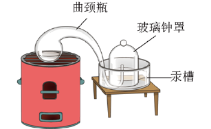

# 化-03 真题精讲 · 空气与氧气

> **教材对照**：旧教材专题 2.1、2.2 → **新教材专题 3**（空气、氧气、二氧化碳）＋专题 5（微粒观点），见 [[05-化学/学科总览]]。

**1.**（空气成分测定·拉瓦锡实验·原卷例 2＋变式 2-1）　拉瓦锡的经典实验装置如图（钟罩＋曲颈甑加热汞）：

（1）不属于使用汞的优点的是（　）
- （A）汞为液态，加热条件下只与氧气反应且生成物为固体
- （B）时间足够长，能将密闭装置中的氧气几乎耗尽
- （C）无法观察装置中气体体积的变化
- （D）得到的氧化汞粉末加热生成的气体体积＋剩余气体体积＝原空气体积

（2）关于该实验的说法不正确的是（　）
- （A）汞在加热条件下，只和氧气反应
- （B）实验中可观察到玻璃钟罩中液面上升
- （C）该实验说明氧气约占空气总体积的 1/5
- （D）将曲颈甑中的汞换成木炭也能测定空气中氧气的含量

> [!tip]- 💡 思路导航
> 测定氧气含量选药品的两条标准——**只与氧气反应、生成物不是气体**；拉瓦锡实验的定量闭环（汞 → 氧化汞 → 分解出同体积气体）说明消耗的正是氧气。逐项对照这两条，再看"能不能观察体积变化"。

> [!success]- ✅ 详解 · 评分点 · 易错 · 关联
> **详解**：（1）汞的优点：液态易接触、只耗氧、生成氧化汞是固体（不补充气体）、分解氧化汞可"还回"同体积气体验证定量关系——A、B、D 均为优点；C"无法观察气体体积变化"与事实相反（钟罩刻度正为观察液面/体积）→ **选 C**。
> （2）判断→依据→回扣情境：**选 D（不能换木炭）**。依据：木炭燃烧 $C+O_2\xrightarrow{\text{点燃}}CO_2$，生成物是**气体**，装置内压强几乎不变，水不倒吸，测不出氧气体积。回扣情境——汞只与氧气反应且生成固体，钟罩内减小的体积＝氧气体积（约为 1/5），液面上升可见（A、B、C 均正确）。
>
> **易错**：测氧气含量代换药品三条件：只耗氧气、生成物非气体、足量；铁锈蚀法、红磷法都满足，木炭、硫（生成气体）不满足。空气成分按体积分数：N₂ 78%、O₂ 21%、稀有气体 0.94%、CO₂ 0.03%，"最多且化学性质不活泼"指向 N₂。
>
> **关联**：[[05-化学/知识点/专题3-空气氧气与二氧化碳]]。

**2.**（氧气的性质·原卷例 1＋变式 1-2）

（1）氧气是空气的主要成分之一，下列说法不正确的是（　）
- （A）O₂ 可以从空气中分离
- （B）液态的 O₂ 是一种淡蓝色液体
- （C）液态的 O₂ 具有可燃性
- （D）O₂ 在医疗上可用以供给呼吸

（2）下列说法正确的是（　）
- （A）工业上用分离液态空气法制氧气，依据氮气与氧气的密度不同
- （B）鱼类能在水中生活，证明氧气易溶于水
- （C）氧气在降温加压条件下可以变成淡蓝色液体
- （D）氧气具有可燃性

> [!tip]- 💡 思路导航
> 抓"**助燃 ≠ 可燃**"这一最高频混淆：氧气支持燃烧但自身不燃烧；分离液态空气的依据是沸点不是密度；"鱼能活"与溶解性的关系要辨析清楚。

> [!success]- ✅ 详解 · 评分点 · 易错 · 关联
> **详解**：（1）液氧**助燃**（支持燃烧）而**不可燃**，C 颠倒 → **选 C**；分离液态空气、淡蓝色液氧、供给呼吸均正确。
> （2）A 错：分离液态空气利用的是**沸点**不同（N₂ -195.8℃ 先汽化，O₂ -183℃）；B 错：鱼能生存恰恰说明氧气**不易溶于水**但可溶；D 错：氧气有助燃性、无可燃性；C 正确 → **选 C**。
>
> **易错**：**助燃性与可燃性**是最高频混淆：氧气、CO₂ 都"不可燃"，氧气"助燃"、CO₂ "既不可燃也不助燃（一般）"。"氧气不易溶于水"与"鱼能活"并不矛盾——溶得少也够呼吸，选项用"证明易溶"设陷阱。
>
> **关联**：[[05-化学/专题/真题精讲/化-09-制气与还原实验]]（氧气制取的操作与计算）。

**3.**（催化剂·原卷例 7＋变式 7-1）

（1）下列关于催化剂的说法正确的是（　）
- （A）催化剂在化学反应前后的质量和化学性质都不变
- （B）催化剂一定能加快化学反应的速率
- （C）加入催化剂能增加生成物的质量
- （D）不加入催化剂化学反应就不能发生

（2）实验室用一定质量的氯酸钾和二氧化锰混合物加热制氧气，二氧化锰在化学反应前后（　）
- （A）质量略减少
- （B）物理性质和化学性质改变
- （C）所含元素的化合价改变
- （D）在固体混合物中的质量分数增大

> [!tip]- 💡 思路导航
> 催化剂"**一变两不变**"：改变速率（可快可慢），质量与化学性质不变。第（2）问先看固体总质量怎么变（O₂ 逸出变小），再推 MnO₂ 的质量分数。

> [!success]- ✅ 详解 · 评分点 · 易错 · 关联
> **详解**：（1）判断→依据→回扣：**选 A**。催化剂定义是"能改变（加快或减慢）反应速率，而本身的**质量**和**化学性质**在反应前后不变"。B 错在"一定加快"（也可减慢）；C 错：不改变生成物质量；D 错：不加催化剂 H₂O₂ 也能分解，只是慢。回扣情境：MnO₂ 对 H₂O₂ 分解、KClO₃ 分解均起加快作用且反应前后质量不变。
> （2）$2KClO_3\xrightarrow[\Delta]{MnO_2}2KCl+3O_2\uparrow$，MnO₂ 作催化剂：质量不变、化学性质不变（A、B、C 均错）；但固体总质量因 O₂ 逸出而**减小**，MnO₂ 质量不变 → 它在剩余固体中的**质量分数增大** → **选 D**。
>
> **评分点**：催化剂答题模板——**一变（速率）两不变（质量、化学性质）**；"物理性质不变"是错误表述（颗粒大小等物理性质可能变）。
>
> **易错**：用微粒观点理解"催化剂不改变产量"：它只降低反应的"门槛"，不改变化学变化的计量关系，见 [[05-化学/知识点/专题5-物质的微观构成]]。
>
> **关联**：[[05-化学/专题/真题精讲/化-09-制气与还原实验]]（KClO₃ 制氧的计算版）。

**制氧路线对照**：工业制氧＝分离液态空气（利用沸点不同，物理变化）；实验室三条路线＝加热 KClO₃（MnO₂ 催化）、加热 KMnO₄（试管口放棉花）、H₂O₂ 溶液加 MnO₂（不需加热）；"必须含氧元素的反应物、必须加热、必须催化剂、必须排水收集"四个"必须"全是错误说法，任一项出现即排除。

（补充）氧气性质实验的现象关键词：木炭——发出白光；硫——蓝紫色火焰（空气中淡蓝色）；铁丝——火星四射、生成黑色固体；红磷——大量白烟。"烟"是固体小颗粒、"雾"是小液滴，混写即错。

## ✅ 答案速查

| 题 | 答案 |
| ---- | ---- |
| 1 | （1）C　（2）D |
| 2 | （1）C　（2）C |
| 3 | （1）A　（2）D |

## 🔗 关联

- [[05-化学/知识点/专题3-空气氧气与二氧化碳]]
- [[05-化学/专题/真题精讲/化-09-制气与还原实验]]（氧气制取的操作与计算）
- [[05-化学/知识点/专题5-物质的微观构成]]（用微粒观点解释催化剂不改变产量）
