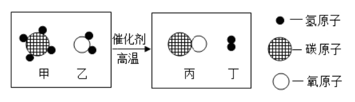

# 化-04 真题精讲 · 质量守恒与方程式

> **教材对照**：旧教材专题 2.3 → **新教材专题 6**（化学变化及其表示）＋专题 5（微观构成），见 [[05-化学/学科总览]]。

**1.**（守恒解释·原卷例 5＋变式 5-1）

（1）下列说法能用质量守恒定律解释的是（　）
- （A）mg 水受热变为 mg 的水蒸气
- （B）62 g 磷和 80 g 氧气恰好完全反应生成 142 g 五氧化二磷
- （C）拧开盛酒精的瓶盖一段时间后质量变小
- （D）20 g 食盐溶于 80 g 水得到 100 g 食盐水

（2）酒精（C₂H₆O）在空气中燃烧，不可能生成的是（　）
- （A）SO₂
- （B）CO₂
- （C）CO
- （D）H₂O

> [!tip]- 💡 思路导航
> 四句话只有一句讲化学变化，先筛"是不是化学变化"，再验数量是否自洽——守恒定律的适用范围是**化学变化**。第（2）问改用**元素观**：反应物没有的元素，产物中不可能出现。

> [!success]- ✅ 详解 · 评分点 · 易错 · 关联
> **详解**：（1）质量守恒定律适用于**化学变化**。A 汽化、C 挥发、D 溶解都是物理变化，不在定律范围内；B 是化学变化且数量自洽 → **选 B**。验证：62 g P = 2 mol，80 g O₂ = 2.5 mol；由 $4P+5O_2\xrightarrow{\text{点燃}}2P_2O_5$，2 mol P 恰需 2.5 mol O₂，生成 1 mol P₂O₅ = 142 g，且 62 + 80 = 142，账目吻合。
> （2）反应物 C₂H₆O 与 O₂ 中只含 C、H、O 三种元素，由元素种类不变，不可能生成含硫的 SO₂ → **选 A**（缺氧时不完全燃烧可能得 CO，可以生成）。
>
> **评分点**：用守恒解释题先筛"是不是化学变化"——物理变化谈守恒属于概念性失分（阅卷按 0 分处理）。
>
> **易错**：元素"不可能生成"类题只看元素种类，与含量多少无关。
>
> **关联**：[[05-化学/专题/真题精讲/化-10-微观意义与计算]]（元素观的计算版）。

**2.**（微观图示·原卷变式 7-2）　甲烷在高温和催化剂条件下可以与水蒸气反应产生一氧化碳和氢气，微观示意图如下，回答下列问题：

（1）甲、乙、丙、丁中属于氧化物的是＿＿＿＿＿＿＿＿。
（2）该化学反应前后没有发生改变的是（　）
- （A）元素的质量
- （B）物质的种类
- （C）原子的个数
- （D）原子的种类
（3）写出该反应的化学方程式：＿＿＿＿＿＿＿＿。

> [!tip]- 💡 思路导航
> 微观图示题考"分子 → 原子 → 新分子"的实质与守恒：先由图中每种分子的原子构成写出化学式并配平；"六不变"（元素三项＋原子三项）直接对照选项；写方程式后按"写、配、标、查"自检。

> [!success]- ✅ 详解 · 评分点 · 易错 · 关联
> **详解**：（1）氧化物＝两种元素组成且其一为氧的**化合物**：乙（H₂O）、丙（CO）→ 填 **乙和丙（H₂O、CO）**。
> （2）化学反应"六不变"中属于本题选项的：元素质量（A）、原子个数（C）、原子种类（D）不变；物质种类一定变（B 错）→ **选 ACD**。
> （3）甲烷与水蒸气在高温、催化剂下生成 CO 和 H₂：$$CH_4+H_2O\xrightarrow[\text{催化剂}]{\text{高温}}CO+3H_2\uparrow$$
> 配平检查：C 1=1，H 4+2=6=3×2，O 1=1 ✓。微观意义：每 1 个 CH₄ 分子与 1 个 H₂O 分子在高温和催化剂条件下反应，生成 1 个 CO 分子和 3 个 H₂ 分子。
>
> **评分点**：微观图示题先删去两边**相同的分子**再数个数比，别把未反应的多余分子算进方程式；微观意义表述要落到"每 1 个……分子"的量词上。
>
> **易错**：由图写化学式看"一个分子含几个什么原子"，别把原子个数当成分子个数。
>
> **关联**：[[05-化学/专题/真题精讲/化-10-微观意义与计算]]（微观图示＋计算的综合版）· [[05-化学/知识点/专题6-化学变化及其表示]]。

**3.**（方程式正误·原卷例 7＋变式 7-2）

（1）氯酸钾与二氧化锰混合制取氧气，化学方程式书写正确的是（　）
- （A）$KClO_3\xrightarrow[\Delta]{MnO_2}KCl+O_2\uparrow$
- （B）$2KClO_3\xrightarrow[\Delta]{MnO_2}KCl+3O_2$
- （C）$2KClO_3\xrightarrow[\Delta]{MnO_2}3KCl+2O_2\uparrow$
- （D）$2KClO_3\xrightarrow[\Delta]{MnO_2}2KCl+3O_2\uparrow$

（2）下列化学方程式书写正确的是（　）
- （A）$H_2CO_3=H_2O+CO_2$
- （B）$S+O_2\xrightarrow{\text{点燃}}SO_2\uparrow$
- （C）$3Fe+2O_2=Fe_3O_4$
- （D）$H_2+CuO\xrightarrow{\Delta}Cu+H_2O$

> [!tip]- 💡 思路导航
> 方程式正误题按"写、配、标、查"四步逐项检查：化学式错、未配平、缺条件、错标"↑"是四大错因。B 选项的"↑"陷阱——反应物中已有气体。

> [!success]- ✅ 详解 · 评分点 · 易错 · 关联
> **详解**：（1）逐项四查：A 未配平（左右 O 不等）；B 未配平（K 不等）且未标"↑"；C 化学式系数错（KCl 应为 2、配不平）；D 化学式、配平、条件、"↑"全对 → **选 D**。
> （2）A 缺"↑"（CO₂ 常温下是气体且从溶液中逸出，应写 $H_2CO_3=H_2O+CO_2\uparrow$）；B 错在"↑"：**反应物中已有气体 O₂，生成物 SO₂ 不标"↑"**；C 缺条件"点燃"；D 化学式、配平、条件均正确，H₂O 不标"↑" → **选 D**。
>
> **评分点**：方程式检查四步固定顺序：化学式 → 配平 → 条件 → 状态符号；漏条件（点燃/Δ/高温/催化剂）与漏"↑"是默写扣分大户。
>
> **易错**："↑"规则：生成物是气体**且反应物中无气体**时才标；"↓"规则：溶液中生成不溶固体才标（干态反应如 CO 还原 Fe₂O₃ 的 CO₂ 不标）。
>
> **关联**：[[05-化学/闪卡/化学方程式与化合价默写]]（每周默写任务源，配平不能错）· [[05-化学/专题/真题精讲/化-11-化合价与方程式书写]]（方程式正误的配平专练）。

## ✅ 答案速查

| 题 | 答案 |
| ---- | ---- |
| 1 | （1）B　（2）A |
| 2 | （1）乙、丙（H₂O、CO）　（2）ACD　（3）CH₄+H₂O --高温/催化剂--> CO+3H₂↑ |
| 3 | （1）D　（2）D |

## 🔗 关联

- [[05-化学/知识点/专题6-化学变化及其表示]]
- [[05-化学/闪卡/化学方程式与化合价默写]]（每周默写任务源，配平不能错）
- [[05-化学/专题/真题精讲/化-11-化合价与方程式书写]]（方程式正误的配平专练）
