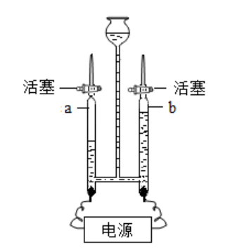
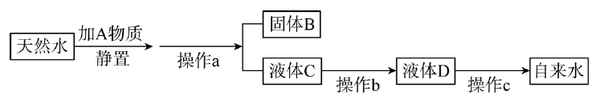

# 化-05 真题精讲 · 水与净化

> **教材对照**：旧教材专题 3.1 → **新教材专题 4**（水的性质与组成），见 [[05-化学/学科总览]]。

**1.**（电解水·原卷例 2＋变式 2-3）

（1）电解水生成氢气和氧气，说法正确的是（　）
- （A）水由氢气和氧气组成
- （B）生成氢气和氧气的体积比为 2:1
- （C）生成氢气和氧气的质量比为 1:16
- （D）正极产生的气体能燃烧

（2）空间站中可通过电解水获得氧气。如图是电解水的实验装置，通电一段时间后切断电源，若水的质量减少了 18 g，请根据化学方程式计算生成 O₂ 的物质的量。

> [!tip]- 💡 思路导航
> 电解水定性判断＋一段计算，钥匙是"**正氧负氢、氢二氧一**"。体积比 2:1 是气体体积账；质量比 1:8 是质量账，两本账不能混；"水的组成"要说**元素**。计算按"设列算答"：18 g 水 → 物质的量 → 方程式计量数比 → O₂ 的物质的量。

> [!success]- ✅ 详解 · 评分点 · 易错 · 关联
> **详解**：（1）A 错：水是纯净物，由**氢元素和氧元素**组成（说"由氢气和氧气组成"就变成混合物了）；B 对：$V(H_2):V(O_2)=2:1$；C 错：质量比 = 4:32 = **1:8**（体积比才是 2:1）；D 错：正极产 O₂，**助燃**不可燃 → **选 B**。
> （2）设生成 O₂ 的物质的量为 x。18 g 水的物质的量 = 18 g ÷ 18 g/mol = 1 mol。$2H_2O\xrightarrow{\text{通电}}2H_2\uparrow+O_2\uparrow$，计量数比 2:1，列式 2/1 = 1/x，解得 x = **0.5 mol**。答：生成 O₂ 0.5 mol（同时生成 H₂ 1 mol，质量 2 g；O₂ 质量 16 g，与 18 g − 2 g = 16 g 自洽）。
>
> **易错**：电解水两本账不要混——**体积比 H₂:O₂ = 2:1，质量比 H₂:O₂ = 1:8**；实际实验中体积比常**略大于 2:1**：氧气在水（或酸性液）中溶解得比氢气多、部分氧气与电极反应。描述组成用"元素"、描述构成用"分子/原子"："水由氢元素、氧元素组成"✓，"水由 2 个氢原子和 1 个氧原子构成"✗（那是一个水分子）。计算题缺"设、列、答"任何一步都要扣过程分；物质的量计算必须先换算 mol 再用计量数比。
>
> **关联**：[[05-化学/知识点/专题4-水的性质与组成]]（水的组成与电解）、[[05-化学/专题/真题精讲/化-10-微观意义与计算]]（"设列算答"的同类计算）。

**2.**（净水方法与硬水软水·原卷变式 1-2＋变式 1-3）

（1）城市用的自来水取自于自然界，其净化过程如图所示：

①操作 a 为＿＿＿＿＿＿＿＿，液体 C 仍然浑浊的原因可能是＿＿＿＿＿＿＿＿（写一个）；
②操作 b 主要吸附水中的一些异味和色素，应选用的物质是＿＿＿＿＿＿＿＿；
③生活中常用＿＿＿＿＿＿＿＿的方法来降低水的硬度。

（2）有关水净化说法中错误的是（　）
- （A）加入活性炭可以除去水中的色素和异味
- （B）通过蒸发和冷凝可以得到蒸馏水
- （C）过滤可以除去天然水中的可溶性物质
- （D）常通入氯气，是为了杀死水中的微生物

> [!tip]- 💡 思路导航
> 净水流程题＋概念判断，钥匙是"**每种方法除什么、除不掉什么**"。过滤只截**不溶性**杂质；活性炭靠**吸附**除色素异味；降低硬度＝减少可溶性钙镁化合物。①按流程图填操作名与异常原因（看"固体 B／液体 C"被分开这一步）；②逐项找反例判断正误。

> [!success]- ✅ 详解 · 评分点 · 易错 · 关联
> **详解**：（1）①操作 a 是**过滤**（图中把固体 B 与液体 C 分开，分离不溶性固体与液体）；滤液仍浑浊的原因：**滤纸破损**（或液面高于滤纸边缘、仪器不干净）。②选**活性炭**（疏松多孔，吸附色素异味）。③生活中用**煮沸**降低水的硬度（Ca²⁺、Mg²⁺ 转化为沉淀析出；实验室用蒸馏）。
> （2）逐项判断：A、B、D 均正确；过滤只能截留**不溶性**杂质，可溶性物质穿过滤纸 → C 错误 → **选 C**。
>
> **易错**：净化效果排序（由低到高）：沉淀 < 过滤 < 吸附 < **蒸馏**；只有蒸馏得到的是纯净物，其余都是混合物。明矾净水的原理是溶于水生成胶状物**吸附悬浮杂质使其沉降**——与活性炭的"吸附色素异味"一字之差，答题时写出各自对象。
>
> **关联**：[[05-化学/知识点/专题4-水的性质与组成]]（净水四法）、[[05-化学/知识点/专题7-溶液]]（硬水软水与溶解度的衔接）。

**速记（净化四法）**：沉淀（静置/明矾吸附沉降）→ 过滤（除不溶物）→ 吸附（活性炭除色味）→ 蒸馏（除所有杂质，得纯净物）；自来水通氯气（或 ClO₂）＝杀菌消毒，属化学变化。

## 📌 延伸：水的化学性质四条（方程式随默写）

- 通电分解：$2H_2O\xrightarrow{\text{通电}}2H_2\uparrow+O_2\uparrow$（分解反应）
- 与 CO₂ 化合：$CO_2+H_2O=H_2CO_3$（紫色石蕊遇之变红）
- 与生石灰化合：$CaO+H_2O=Ca(OH)_2$（放热，煮鸡蛋实验；化合反应）
- 与无水硫酸铜化合：$CuSO_4+5H_2O=CuSO_4\cdot 5H_2O$（白色变蓝色，用于**检验水**）

**一句话定位**：电解水证"组成"（氢、氧两种元素），无水硫酸铜证"存在"，净水四法证"分离"——三件事在中考卷里各占一空，别互相串场。

**硬水 vs 软水**：含较多可溶性钙、镁化合物的水是硬水。区分方法：取样加入等量**肥皂水**振荡，泡沫少、浮渣多的是硬水。软化的本质是减少 Ca²⁺、Mg²⁺：生活中煮沸（水壶里白色水垢即 CaCO₃ 等），实验室蒸馏。

（补充）蒸馏装置要点：温度计水银球位于支管口处、冷凝水**下进上出**、烧瓶内加碎瓷片防暴沸——三处细节是蒸馏题的固定采分点。

## 🔗 关联

- [[05-化学/知识点/专题4-水的性质与组成]]
- [[05-化学/知识点/专题7-溶液]]（硬水软水与溶解度的衔接）
- [[05-化学/专题/真题精讲/化-10-微观意义与计算]]（"设列算答"的同类计算）
