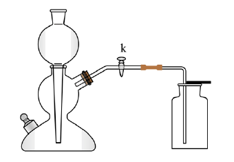

# 化-08 真题精讲 · 二氧化碳制取

> **教材对照**：旧教材专题 4.3 → **新教材专题 3**（空气、氧气、二氧化碳），见 [[05-化学/学科总览]]。

**1.**（装置选择·启普原理·原卷例 2）　用如图所示的装置制取二氧化碳，相关分析正确的是（　）

- （A）以碳酸钙粉末和稀盐酸为原料
- （B）用该方法收集二氧化碳是因为其能溶于水
- （C）用燃着的木条放入瓶内以检验气体是否收集满
- （D）关闭 k，若固液不分离，可能是某种反应物已消耗完

> [!tip]- 💡 思路导航
> 带隔板的制气装置考的是**启普发生器原理**——"随开随用、随关随停"，三前提缺一不可：块状固体＋液体反应、不需加热、固液能分离。药品（块状？）→ 收集原因（密度？溶解性？）→ 验满位置（瓶口？瓶内？）→ 固液不分离的异常归因，逐项判断。

> [!success]- ✅ 详解 · 评分点 · 易错 · 关联
> **详解**：A 错：启普发生器要求**块状**大理石，粉末会漏下隔板、无法实现固液分离（且反应过快难控制）；B 错：CO₂ 能溶于水恰恰是**不能**用排水法的原因；能收集是因为 CO₂ **密度比空气大**（向上排空气法）；C 错：验满的木条应**平放在瓶口**，伸入瓶内只能证明瓶中有 CO₂、不能证明已满；D 对：固液不分离的另一可能是**药品耗尽**（或装置漏气、止水夹未关严）→ **选 D**。
>
> **评分点**：启普原理要写出"气压压液"的动态过程；验满位置（瓶口）一字之差就是采分点。
>
> **易错**：启普类装置还要求**块状固体 + 不需加热 + 气体较易收集**；隔板用有孔**铁**片则 Fe＋2HCl=FeCl₂+H₂↑，引入 H₂ 使气体不纯，是装置选择题的经典错误项；关闭止水夹后若"固液不分离"，除药品耗尽外还有两种可能：装置**漏气**（压强升不上去）、止水夹**未关严**——归因题至少备两条。
>
> **关联**：[[05-化学/专题/真题精讲/化-31-气体制备与实验探究]]（启普原理同型题）· [[05-化学/专题/真题精讲/化-09-制气与还原实验]]（O₂/CO₂ 制取组合）。

**2.**（方程式、收集与验满·原卷例 3/变式 1-2）

（1）实验室用大理石和稀盐酸制取二氧化碳，化学方程式是＿＿＿＿＿＿＿＿；收集二氧化碳的方法是＿＿＿＿＿＿＿＿；将燃着的木条伸入盛有二氧化碳的集气瓶中，现象是＿＿＿＿＿＿＿＿，由此＿＿＿＿＿＿＿＿（选填"能"或"不能"）判断集气瓶中已集满二氧化碳。
（2）用带止水夹的简易启普发生器制 CO₂，反应未停止前关闭止水夹，除了有气泡产生外，还可观察到的现象是＿＿＿＿＿＿＿＿；其原理是＿＿＿＿＿＿＿＿。

> [!tip]- 💡 思路导航
> 方程式＋收集＋验满的操作表述题，位置词（瓶口／瓶内）是采分点：验满答"燃着木条**放在瓶口**、木条熄灭"，检验答"通入澄清石灰水变浑浊"，两者不可互换。关止水夹后按"气体排不出 → 压强增大 → 液体被压回长颈漏斗 → 固液分离 → 反应停止"的因果链写现象。

> [!success]- ✅ 详解 · 评分点 · 易错 · 关联
> **详解**：（1）方程式：
> $$CaCO_3+2HCl=CaCl_2+H_2O+CO_2\uparrow$$
> 收集方法：**向上排空气法**（CO₂ 密度比空气大、能溶于水，不宜排水法）。
> 将燃着的木条伸入瓶中：木条**熄灭**；**不能**判断集满——瓶内中部本来就不支持燃烧，只有**瓶口**的木条熄灭才能证明气体已充满全瓶。
> （2）判断→依据→回扣情境：现象是**试管（容器）内液面下降、长颈漏斗（球形漏斗）内液面上升，固液分离后气泡逐渐停止**。依据是：关闭止水夹后气体无路排出，容器内气压增大，把液体压回长颈漏斗，液面降到隔板以下。回扣情境：反应物脱离接触，反应自行停止；重新打开止水夹，气体排出、压强减小，液体回落淹没固体，反应又开始——这正是启普发生器"随开随用、随关随停"的原理。
>
> **评分点**：现象描述写"液面升降＋固液分离"两个动作，只写"反应停止"不得全分；长颈漏斗下端必须**液封**（插入液面以下），否则气体从漏斗口逸出。
>
> **易错**：**验满 vs 检验**两句话不能互换位置；制得的 CO₂ 常带 HCl 气体和水蒸气：先通过**饱和碳酸氢钠溶液**除 HCl，再通过**浓硫酸**干燥，顺序不能颠倒（先除杂后干燥）；用浓盐酸制得的 CO₂ 通入石灰水常"不变浑浊"：挥发出的 HCl 先与 Ca(OH)₂ 反应（或溶解 CaCO₃）——改用**稀盐酸**即可；排空气法收集 CO₂ 时导管要**伸到集气瓶底**，集满后**正放**桌面（密度比空气大），与 H₂（倒放）相反。
>
> **关联**：[[05-化学/专题/实验操作考点-化学]]（气体制取是 5 月实验考核心）。

**药品选择对照（三"不"的原因）**

| 药品 | 能否用 | 原因 |
| ---- | ---- | ---- |
| 块状大理石＋稀盐酸 | ✓ 标准药品 | 反应速率适中，便于收集 |
| 稀硫酸 | ✗ | 生成微溶的 CaSO₄ 覆盖在大理石表面，反应渐渐停止 |
| 浓盐酸 | ✗ | 浓盐酸易挥发，CO₂ 中混入 HCl 气体，影响性质实验 |
| 碳酸钠粉末 | ✗ | 反应太剧烈，来不及收集 |

**变式衔接（压强传感器判启普）**：装置接压强传感器后，"关闭弹簧夹 → 压强上升 → 液面下降 → 固液分离 → 压强基本不变"对应图像的 bc 段；c 点压强骤降对应**打开弹簧夹**。题源变式 4-4、4-5 均按此判读，图像题先找"压强拐点"再对应操作。

**变式衔接（收集不满的原因）**：题源例 1 中"关闭 K₁ 后瓶内 CO₂ 实际不能集满"，装置层面的原因是导管口未伸到集气瓶**底部**（或瓶口未盖毛玻璃片留缝太大），空气排不净；改进方法是把导管伸至接近瓶底再收集。

**发生装置速配**：固体＋液体、不加热 → 锥形瓶/试管＋长颈漏斗（或分液漏斗）；固体＋固体、加热 → 大试管口略向下倾斜（如 KClO₃、KMnO₄ 制 O₂）。CO₂ 与 H₂（Zn＋稀硫酸）同属固液常温型，**装置可通用**，只是收集与验满方法不同。

**CO₂ 与 O₂ 对比一记**：验满——O₂ 用带火星木条放瓶口（复燃），CO₂ 用燃着木条放瓶口（熄灭）；检验——O₂ 带火星木条伸入瓶内，CO₂ 通入澄清石灰水；收集——都可用向上排空气法（密度都比空气大），O₂ 还能排水法，CO₂ 不能（能溶于水且与水反应）。

## ✅ 答案速查

| 题 | 答案 |
| ---- | ---- |
| 1 | D |
| 2 | （1）方程式 CaCO₃+2HCl=CaCl₂+H₂O+CO₂↑；向上排空气法；木条熄灭；不能　（2）液面下降/长颈漏斗液面上升、固液分离、反应停止 |

## 🔗 关联

- [[05-化学/知识点/专题3-空气氧气与二氧化碳]]
- [[05-化学/专题/实验操作考点-化学]]（气体制取是 5 月实验考核心）
- [[05-化学/专题/真题精讲/化-09-制气与还原实验]]（O₂/CO₂ 制取与还原实验的组合）
