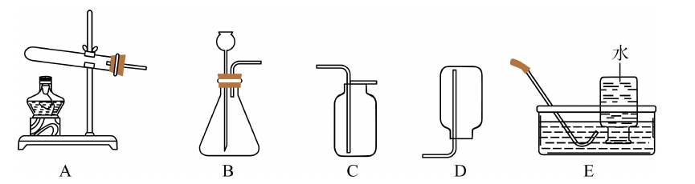
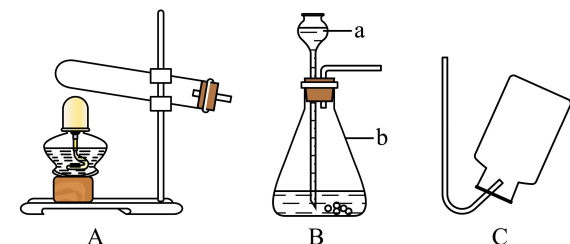
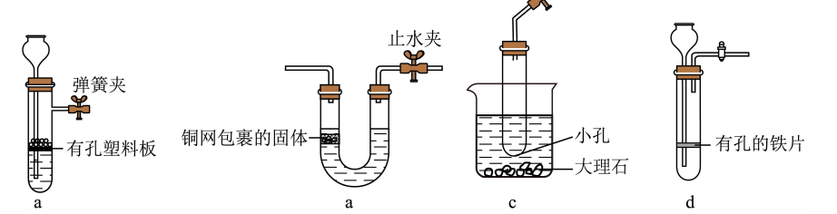
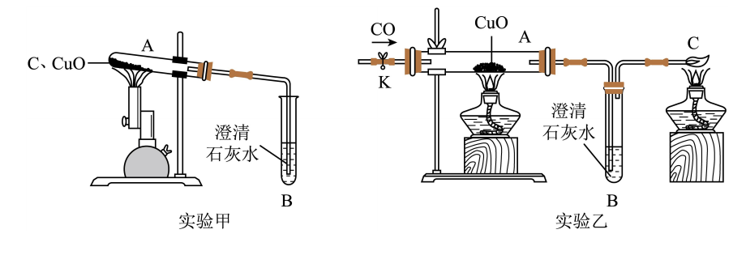

# 化-09 真题精讲 · 制气与还原实验

> **教材对照**：制气部分 → **新教材专题 3**（O₂/CO₂）；还原氧化铜 → **新教材专题 6**（化学变化及其表示）＋专题 9，见 [[05-化学/学科总览]]。

**1.**（固体加热制 O₂·2023 宝山期末第 5 题）　下列实验装置为制取气体的常见装置（部分夹持仪器省略）：

（1）实验室用氯酸钾和二氧化锰共热制取氧气，选用的发生装置是＿＿＿＿＿＿＿＿（选填编号）；写反应的化学方程式；该反应的基本类型是＿＿＿＿＿＿＿＿。
（2）实验中反应消耗 0.02 mol 氯酸钾，理论上可生成氧气多少克？（根据化学方程式计算）

> [!tip]- 💡 思路导航
> 发生装置由**反应物状态＋反应条件**决定：KClO₃ 与 MnO₂ 都是固体且需加热 → 固固加热型。方程式按"写、配、标、查"默写；物质的量计算直接用计量数比 2KClO₃ ↔ 3O₂，"设列算答"写全。

> [!success]- ✅ 详解 · 评分点 · 易错 · 关联
> **详解**：（1）选 **A**（固体加热型）。
> $$2KClO_3\xrightarrow[\Delta]{MnO_2}2KCl+3O_2\uparrow$$
> "一变多" → **分解反应**（MnO₂ 是催化剂，写条件不写作反应物）。
> （2）解：设生成 O₂ 的物质的量为 x。$$2KClO_3\xrightarrow[\Delta]{MnO_2}2KCl+3O_2\uparrow$$
> $$2\text{ mol}\qquad\qquad\quad 3\text{ mol}$$
> $$0.02\text{ mol}\qquad\qquad x$$
> 列式：2/3 = 0.02/x，x = 0.03 mol；m(O₂) = 0.03 mol × 32 g/mol = **0.96 g**。答：生成氧气 0.96 g。
>
> **评分点**：物质的量计算必须先统一到 mol 再用计量数比；"设、列、算、答"缺一不可。
>
> **易错**：方程式条件勿混：KClO₃ 用"Δ"；MnO₂ 写在条件位置不写作反应物。
>
> **关联**：[[05-化学/专题/真题精讲/化-03-空气与氧气]]（催化剂与制氧路线）。

**2.**（固液常温制气与启普装置·2024 浦东新模拟第 1 题）　结合装置图回答问题：

（1）用 B 装置（固液常温型）制取氧气，相关的反应方程式为＿＿＿＿＿＿＿＿。
（2）若要制取 0.96 g 氧气，理论上需要氯酸钾的物质的量是多少？
（3）实验室制取 CO₂ 的化学方程式为＿＿＿＿＿＿＿＿，验满的方法及现象是＿＿＿＿＿＿＿＿；能用于制备 CO₂ 且符合启普发生器工作原理的发生装置是＿＿＿＿＿＿＿＿（从 a、b、c、d 中选择）。

> [!tip]- 💡 思路导航
> H₂O₂ 与 MnO₂ 固液常温反应 → B 装置；启普发生器三要素——块状固体、不需加热、有隔板可实现固液分离，拿着这三条去筛 a~d 四套装置（看谁"关止水夹能把液体压离固体"）。

> [!success]- ✅ 详解 · 评分点 · 易错 · 关联
> **详解**：（1）$$2H_2O_2\xrightarrow{MnO_2}2H_2O+O_2\uparrow$$（分解反应，MnO₂ 催化）
> （2）解：0.96 g O₂ 的物质的量 = 0.96 ÷ 32 = 0.03 mol。设需 KClO₃ 物质的量为 y，由 2KClO₃ → 3O₂ 得 y = 0.03 × 2/3 = **0.02 mol**。答：0.02 mol。
> （3）$CaCO_3+2HCl=CaCl_2+H_2O+CO_2\uparrow$；验满：**将燃着的木条平放在集气瓶口，木条熄灭说明已集满**。启普装置选 **a**（试管内有孔塑料板承载块状固体＋弹簧夹，关夹后气压把液体压回长颈漏斗实现固液分离；d 的有孔铁片会与盐酸反应生成 H₂ 使气体不纯，b、c 不能关夹断液——按卷面装置标注作答）。
>
> **评分点**：启普装置选择题要写出"关止水夹 → 液体被压回 → 固液分离 → 反应停止"的依据，只写字母不给满分。
>
> **易错**：有孔**铁**片（d 类装置）是经典错误项：Fe＋2HCl=FeCl₂+H₂↑；验满位置在瓶口不在瓶内。
>
> **关联**：[[05-化学/专题/真题精讲/化-08-二氧化碳制取]]（启普原理细节与药品三"不"）。

**3.**（CO/C 还原 CuO 的操作与产物检验·2023 嘉定一模第 19 题）　用碳、一氧化碳分别与氧化铜反应制取铜，实验装置如下图：

（1）【碳还原】A 处（C + CuO 高温）的现象是＿＿＿＿＿＿＿＿；写出反应的化学方程式。
（2）【CO 还原·开始】正确操作顺序是（　）
a．通入一氧化碳一段时间　　b．点燃 A 处酒精灯（加热）
c．点燃 C 处酒精灯（尾气点燃）　　d．检验导管口处气体纯度
（3）【CO 还原·结束】正确顺序是（　）
a．熄灭 A 处酒精灯　　b．熄灭 C 处酒精灯
c．继续通入一氧化碳直到玻璃管冷却至室温　　d．关闭 K 处止水夹
（4）加热前先通一会儿 CO（或 H₂）的目的是＿＿＿＿＿＿＿＿；CO 装置有尾气处理而 H₂ 装置没有，原因是＿＿＿＿＿＿＿＿；两装置检验生成物的方式不同：CO 用澄清石灰水且试管水平，H₂ 用无水硫酸铜且试管口略向下倾斜，原因是＿＿＿＿＿＿＿＿。

> [!tip]- 💡 思路导航
> CO／C 还原 CuO 的操作排序题，钥匙是十六字诀"**先通后点、先熄后停、早出晚归、迟到早退**"。所有"为什么先通气"＝排空气防爆；所有"为什么后停气"＝防灼热铜被氧化；尾气灯先点后熄是因为 CO 有毒。

> [!success]- ✅ 详解 · 评分点 · 易错 · 关联
> **详解**：（1）现象：**黑色粉末逐渐变红**，$C+2CuO\xrightarrow{\text{高温}}2Cu+CO_2\uparrow$。
> （2）排序逻辑：CO 可燃，须先**通 CO 排空气（a）**→ 尾气管处**验纯（d）**→ 先点燃**尾气处理的酒精灯（c）**（防止随后排出的 CO 污染空气）→ 最后**点燃加热的酒精灯（b）**。→ **a d c b**。
> （3）结束时：先**熄灭加热灯（a）**→ **继续通 CO 至冷却（c）**（防止灼热的铜重新被氧化）→ **关闭止水夹断气（d）**→ 最后**熄灭尾气灯（b）**（断气后无 CO 可烧）。→ **a c d b**。
> （4）先通气目的：**排尽装置内的空气，防止 CO（或 H₂）与空气混合加热时发生爆炸**。尾气差异：**CO 有毒**，未反应的 CO 不能排入空气，须点燃（或收集）；**H₂ 无毒**，燃烧产物是水，可不用尾气处理。检验产物差异：CO＋CuO 生成 **CO₂ 气体**，用澄清石灰水检验，装置可水平；H₂＋CuO 生成**水**（$H_2+CuO\xrightarrow{\Delta}Cu+H_2O$），用**无水硫酸铜**（变蓝）检验，且试管口须略向下倾斜，防止冷凝水倒流使热试管炸裂。
>
> **评分点**：两条排序合起来记："**氢气（CO）早出晚归，酒精灯迟到早退**"；尾气灯与加热灯的先后——开始**先点尾气灯**，结束**后熄尾气灯**，阅卷按"每个先后 1 分"给分；验纯必须在**点燃（加热）前**，简答需写明"防止爆炸"四个字。
>
> **易错**：装置差异题按"性质决定装置"作答：毒性→尾气；产物状态（气体/液体）→检验试剂与试管倾角，三点齐写才满分。
>
> **关联**：[[05-化学/专题/真题精讲/化-16-实验探究与评价]]（CO 产物探究与混合气体验证）· [[05-化学/知识点/专题6-化学变化及其表示]]（还原反应的方程式表达）。

## 📌 附：三大气体发生／收集速配表

| 气体 | 反应原理 | 发生装置 | 收集 | 验满/检验 |
| ---- | ---- | ---- | ---- | ---- |
| O₂（KClO₃/KMnO₄） | 固＋固加热 | 试管口略向下倾斜、试管口放棉花（KMnO₄） | 排水（较纯）或向上排空气（较干） | 带火星木条**伸入瓶内**复燃 |
| O₂（H₂O₂＋MnO₂） | 固＋液常温 | 锥形瓶＋长颈/分液漏斗 | 同上 | 同上 |
| CO₂ | 大理石＋稀盐酸 | 固＋液常温（可用启普型） | 向上排空气法 | 燃着木条放**瓶口**熄灭；检验用澄清石灰水 |
| H₂ | Zn＋稀硫酸 | 固＋液常温 | 向下排空气法或排水法 | 点燃验纯后淡蓝色火焰 |

装置选择两问定型：一问"状态＋条件"定发生装置，二问"密度＋溶解性（＋是否与水反应）"定收集装置。

## ✅ 答案速查

| 题 | 答案 |
| ---- | ---- |
| 1 | A；2KClO₃ --MnO₂/Δ--> 2KCl+3O₂↑；分解反应；0.96 g |
| 2 | 2H₂O₂ --MnO₂--> 2H₂O+O₂↑；0.02 mol；验满：燃着木条放瓶口熄灭；选 a |
| 3 | （1）黑色粉末逐渐变红　（2）adcb　（3）acdb　（4）排空气防爆；CO 有毒须尾气处理；产物气体/液体决定检验方式与试管倾角 |

## 🔗 关联

- [[05-化学/专题/实验操作考点-化学]]（本讲是它的题化版）
- [[05-化学/专题/真题精讲/化-08-二氧化碳制取]]（CO₂ 制取细节）
- [[05-化学/知识点/专题6-化学变化及其表示]]（还原反应的方程式表达）
