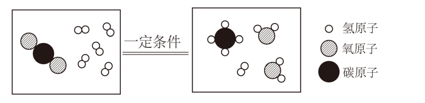

# 化-10 真题精讲 · 微观意义与计算

> **教材对照**：微观意义与物质的量 → **新教材专题 5**（物质的微观构成）＋专题 6（化学变化及其表示），见 [[05-化学/学科总览]]。

**1.**（微观意义与计算·2024 闵行阶段第 30 题（3））　神舟十四号载人飞船的安全返回，标志着我国的航天科技水平已处于世界领先地位。目前空间站内，利用航天员呼吸产生的 CO₂ 进行化学反应，实现氧循环。其反应的微观示意图如下：

（1）写出该反应的化学方程式；从微观角度说明它的意义。
（2）0.1 mol CO₂ 的质量是多少克？约含多少个二氧化碳分子？每消耗 0.1 mol CO₂ 会产生多少摩尔水？

> [!tip]- 💡 思路导航
> 微观示意图＋物质的量三连算，钥匙是"配平后的计量数比＝分子个数比＝物质的量之比"。由图中每种分子的原子构成写化学式 → 配平 → 微观意义用"每 1 个……与 4 个……反应生成……"句式；计算走 m = n×M、N = n×6.02×10²³。

> [!success]- ✅ 详解 · 评分点 · 易错 · 关联
> **详解**：（1）由图各分子构成写出并配平：
> $$CO_2+4H_2\xrightarrow{\text{一定条件}}CH_4+2H_2O$$
> （C 1=1，O 2=2，H 8=4+4 ✓）
> 微观意义：该反应表示**每 1 个 CO₂ 分子与 4 个 H₂ 分子在一定条件下反应，生成 1 个 CH₄ 分子和 2 个 H₂O 分子**；反应的微观实质是分子分成原子（C、H、O），原子重新组合成新分子，反应前后原子种类、数目不变。
> （2）解：m(CO₂) = 0.1 mol × 44 g/mol = **4.4 g**；分子数 = 0.1 × 6.02×10²³ = **6.02×10²² 个**。
> 由方程式 CO₂ : H₂O = 1 : 2，每消耗 0.1 mol CO₂ 产生 **0.2 mol** 水。答：4.4 g；6.02×10²² 个；0.2 mol。
>
> **评分点**：微观意义表述模板："每 1 个某分子与 n 个某分子反应，生成……"，漏"每"或漏"个"都会被扣；计算题四步（设、列、算、答）齐全才有过程分。
>
> **易错**：用物质的量解题时**先统一到 mol** 再用计量数比，直接拿质量列比例是常见失分点。
>
> **关联**：[[05-化学/知识点/专题5-物质的微观构成]]· [[05-化学/专题/真题精讲/化-04-质量守恒与方程式]]（微观图示定性版）。

**2.**（计算·设列算答·2022 黄浦二模第 26 题）　我国 3000 多年前就将孔雀石与木炭混合加热炼铜，过程中生成的氧化铜再与木炭反应得到铜。氧化铜与木炭反应的现象是＿＿＿＿＿＿＿＿；若参加反应的氧化铜为 800 g，能生成多少摩尔铜？（根据化学方程式计算）
（2）赭石的主要成分是氧化铁（Fe₂O₃），其中铁元素的化合价为＿＿＿＿＿＿＿＿，铁元素的质量分数为＿＿＿＿＿＿＿＿。

> [!tip]- 💡 思路导航
> 古代炼铜情境的计算题，考"设列算答"全过程＋化合价与元素质量分数：先把 800 g CuO 换算成 10 mol，再用 C＋2CuO → 2Cu 的计量数比得铜；Fe₂O₃ 中 O 定 −2 价、代数和为零。

> [!success]- ✅ 详解 · 评分点 · 易错 · 关联
> **详解**：现象：**黑色固体逐渐变红**（C 黑、Cu 红）。
> 解：设生成铜的物质的量为 x。$$C+2CuO\xrightarrow{\text{高温}}2Cu+CO_2\uparrow$$
> n(CuO) = 800 g ÷ 80 g/mol = 10 mol。
> $$2\text{ mol CuO}\to2\text{ mol Cu}，故 x = 10 mol，m(Cu)=10\times64=640\text{ g}$$
> 答：能生成铜 10 mol（640 g）。
> （2）Fe₂O₃ 中 O 为 −2 价，由代数和为零：2x + 3×(−2) = 0，得铁为 **+3 价**；铁元素质量分数 = $\dfrac{56\times2}{56\times2+16\times3}\times100\%=\dfrac{112}{160}\times100\%=$ **70%**。
>
> **评分点**：物质的量计算先换算 mol 再按计量数比列比例；质量分数要写"相对原子质量 × 个数"的分式过程。
>
> **易错**：摩尔质量带单位 g/mol，式量不带单位，两者数值相等——"摩尔质量是 32"这种写法不严谨。
>
> **关联**：[[05-化学/知识点/专题5-物质的微观构成]]· [[05-化学/专题/真题精讲/化-13-化学计算进阶]]（同题源进阶余额）。

**3.**（说理题·2023 闵行二模第 31 题）　自来水生产中加入活性炭利用其吸附性除去异味，属于物理变化；加入二氧化氯（ClO₂）杀菌消毒，其制取的一种原理是：Cl₂ + 2NaClO₂ = 2ClO₂ + 2X。
（1）请推断 X 的化学式，并说明理由。
（2）科学家利用新型催化剂将 CO₂ 转化为甲醇（CH₃OH）：甲醇的摩尔质量是＿＿＿＿＿＿＿＿；1 mol CH₃OH 中约含多少个碳原子？该反应（CO₂ + 3H₂ → CH₃OH + H₂O）中 CO₂ 与 H₂ 的分子个数比是＿＿＿＿＿＿＿＿。

> [!tip]- 💡 思路导航
> 由守恒推化学式的**说理题**，必须用"判断→依据→回扣情境"三段式：把方程式两边每种原子各数一遍，差额除以 X 的系数 2，即得每个 X 的原子构成。

> [!success]- ✅ 详解 · 评分点 · 易错 · 关联
> **详解**：（1）说理三段式——判断：**X 为 NaCl**。依据：化学反应前后原子的种类和数目不变。反应前：Cl 2＋2 = 4 个、Na 2 个、O 2×2 = 4 个；反应后已知部分（2ClO₂）含 Cl 2 个、O 4 个，故 2X 中共含 Na 2 个、Cl 2 个，即每个 X 含 1 个 Na、1 个 Cl。回扣情境：NaCl 与方程式左右原子账目完全吻合，推断成立。
> （2）CH₃OH 摩尔质量 = 12＋1×4＋16 = **32 g/mol**；1 mol CH₃OH 含 1 mol 碳原子 ≈ **6.02×10²³ 个**；CO₂ : H₂ = **1 : 3**（计量数比即分子个数比）。
>
> **评分点**：三段式缺一不可——只有判断没有依据只得一半分；守恒推化学式数原子时**别漏系数**（如 2X 就是两份 X）。
>
> **易错**：活性炭吸附是物理变化（分子本身没变），消毒、燃烧是化学变化，一句话判断要能说清"有无新物质生成"。
>
> **关联**：[[05-化学/专题/说理题方法]]（"判断→依据→回扣情境"的方法总纲）· [[05-化学/专题/真题精讲/化-17-说理题专练]]。

**物质的量三级换算（本讲全在用它）**

| 量 | 公式 | 本讲实例 |
| ---- | ---- | ---- |
| 质量 ↔ 物质的量 | m = n × M | 0.1 mol CO₂ = 4.4 g；10 mol Cu = 640 g |
| 微粒数 ↔ 物质的量 | N = n × 6.02×10²³ | 0.1 mol CO₂ 含 6.02×10²² 个分子 |
| 方程式计量数比 | n 之比＝计量数之比 | CO₂:H₂O = 1:2；KClO₃:O₂ = 2:3 |

## ✅ 答案速查

| 题 | 答案 |
| ---- | ---- |
| 1 | CO₂+4H₂ --一定条件--> CH₄+2H₂O；4.4 g；6.02×10²² 个；0.2 mol |
| 2 | 黑色固体逐渐变红；10 mol（640 g）；+3 价；70% |
| 3 | X = NaCl（三段式说理）；32 g/mol；6.02×10²³ 个；1:3 |

## 🔗 关联

- [[05-化学/知识点/专题5-物质的微观构成]]
- [[05-化学/知识点/专题6-化学变化及其表示]]
- [[05-化学/专题/说理题方法]]（"判断→依据→回扣情境"的方法总纲）
- [[05-化学/专题/真题精讲/化-04-质量守恒与方程式]]（守恒的定律层表达）
