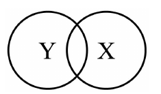
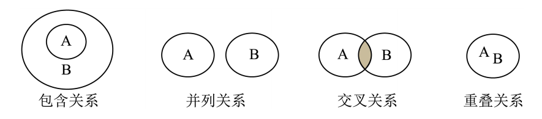

# 化-15 真题精讲 · 分类与 Venn 图进阶

> **教材对照**：新教材专题 5（物质分类）＋专题 8（酸碱盐初步），见 [[05-化学/学科总览]]。Venn 三型速查见 [[化-12-概念辨析与分类]]。

**1.**（2024·浦东一模）　如图表示 X 和 Y 的相互关系，表中符合图示关系的是（　）

| 选项 | A | B | C | D |
| ---- | ---- | ---- | ---- | ---- |
| X | 含氧化合物 | 单质 | 浓溶液 | 混合物 |
| Y | 氧化物 | 纯净物 | 饱和溶液 | 化合物 |

- （A）A
- （B）B
- （C）C
- （D）D

> [!tip]- 💡 思路导航
> 图中 X、Y 两圈**部分重叠**（交叉关系）——判据是"有的 X 是 Y、有的不是"。逐项问"这两组概念是交叉吗"：包含关系（如氧化物 ⊂ 含氧化合物）与并列关系（如混合物与化合物）都不符，只有"两个维度互不决定"的组合才是交叉。

> [!success]- ✅ 详解 · 评分点 · 易错 · 关联
> **详解**：
> - A：氧化物 = 两种元素其中一种是氧的**化合物** → 氧化物全部属于含氧化合物，是**包含关系**（Y ⊂ X），不是交叉。✗
> - B：单质只是纯净物的一部分（纯净物 ⊃ 单质），也是**包含关系**。✗
> - C：浓溶液与饱和溶液互不决定——存在"稀的饱和溶液"（如低温下饱和石灰水）和"浓的不饱和溶液"，是**交叉关系**。✓
> - D：混合物与化合物是并列关系（纯净物分单质与化合物）。✗
> - **答案：C**（题源解析版同此：饱和溶液和浓溶液属于交叉关系，故选 C。）
>
> **评分点**：判断交叉要举出"两个都满足"和"只满足其一"的例子——"浓的饱和溶液""稀的不饱和溶液"都存在。
>
> **易错**：**两维度概念天然交叉**：浓/稀（浓度）与饱和/不饱和（是否饱和）互不决定；此题旧版笔记曾按"X 包含 Y"记答案 A，经与题源解析版核对已更正为 C——Venn 题先看清两圈是包含还是重叠再动笔。
>
> **关联**：[[05-化学/知识点/专题7-溶液]]（饱和与浓稀两维度）· [[化-12-概念辨析与分类]]（Venn 三型速查表）。

**2.**（2023·黄浦一模）　有关碱性氧化物的说法正确的是（　）
- （A）均能与水反应
- （B）均能与酸反应
- （C）含有金属元素
- （D）含有氢、氧元素

> [!tip]- 💡 思路导航
> 碱性氧化物的定义——**能与酸反应生成盐和水的氧化物**（都是金属氧化物）。"均"字类选项找反例：CuO、Fe₂O₃ 不溶于水也不与水反应；Na₂O 里没有氢。

> [!success]- ✅ 详解 · 评分点 · 易错 · 关联
> **详解**：
> - A：CuO、Fe₂O₃ 等不与水反应（可溶性碱对应的才反应，如 Na₂O+H₂O→2NaOH）。✗
> - B：碱性氧化物 + 酸 → 盐 + 水（定义，如 CuO+2HCl=CuCl₂+H₂O）。**✓**
> - C：碱性氧化物一定是金属氧化物，必含金属元素。**✓**
> - D：Na₂O 不含氢 → "均含氢、氧元素" ✗（含氧对，含氢错）。
> - **答案：B、C**（不定项；单选卷优先 B——定义直接给出的性质）
>
> **易错**：**"均"字选项找反例**：碱性氧化物里 CuO 不与水反应、Na₂O 不含氢——两个"均"全靠反例击破。
>
> **关联**：[[05-化学/知识点/专题8-酸碱盐]]。

**3.**（浦东阶段练习）　化学概念在逻辑上存在包含、并列、交叉等关系，下列说法正确的是（　）

- （A）氧化反应与分解反应属于交叉关系
- （B）单质与游离态属于重叠关系
- （C）混合物与溶液属于交叉关系
- （D）化合物与氧化物属于包含关系

> [!tip]- 💡 思路导航
> 三种关系的判据——包含（Y 全在 X 里）、交叉（有的 X 是 Y、有的不是）、并列（互不相容）。每组找"两个都满足的例子"和"只满足其一的例子"：两者都有 → 交叉；只有前者 → 包含。

> [!success]- ✅ 详解 · 评分点 · 易错 · 关联
> **详解**：
> - A：C+O₂→CO₂ 既是氧化反应又是化合反应（非分解）；2H₂O→2H₂↑+O₂↑ 是分解反应但不是氧化反应——**有共同部分、各有独有部分 → 交叉**。**✓**
> - B："游离态/化合态"描述的是**元素**的存在形态，单质是**物质**类别——"游离态"不属于单质这个概念圈，二者不是同一维度的重叠。✗（元素以游离态存在时组成的物质是单质，但概念本身不同维度）
> - C：溶液都是混合物 → 包含（溶液 ⊂ 混合物），不是交叉。✗
> - D：氧化物是两种元素其一为氧的化合物 → 氧化物全在化合物圈内，包含成立。**✓**
> - **答案：A、D**
>
> **易错**：**不同维度不成关系**：单质（物质）与游离态（元素形态）、氧化反应（是否得氧的过程）与分解反应（反应类型个数）——先分清概念维度再谈关系。
>
> **关联**：[[05-化学/知识点/专题5-物质的微观构成]]· [[05-化学/知识点/专题1-2-化学之门与实验探究]]。

（补充）**多选取舍**：上海不定项漏选得部分分，C/D 双对的组合别只写一个。

## ✅ 答案速查

| 题 | 答案 |
| ---- | ---- |
| 1 | C（交叉关系；旧版记 A 已更正） |
| 2 | B、C（单选取 B） |
| 3 | A、D |

## 🔗 关联

- [[05-化学/知识点/专题5-物质的微观构成]] · [[05-化学/知识点/专题8-酸碱盐]] · [[05-化学/知识点/专题1-2-化学之门与实验探究]]
- 同类题：[[化-12-概念辨析与分类]]（v1，含 Venn 三型速查表）
