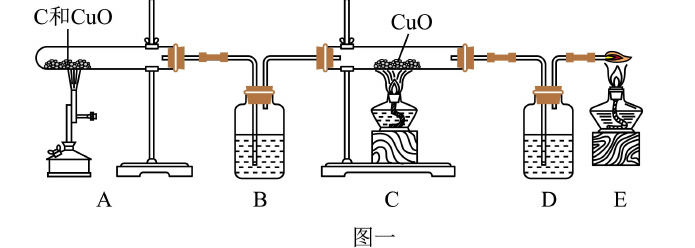
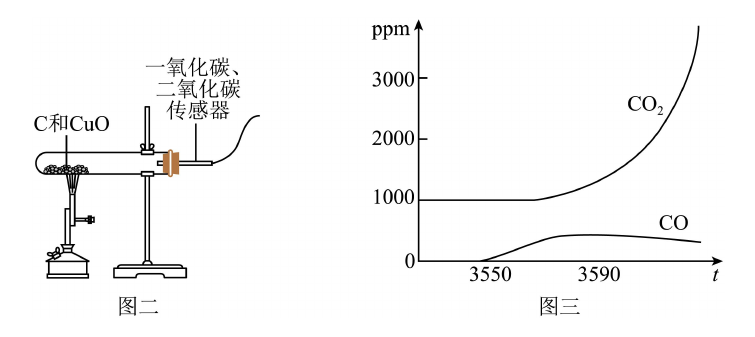
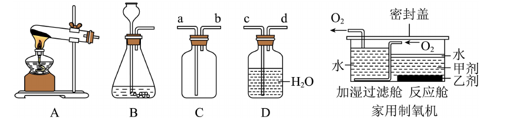
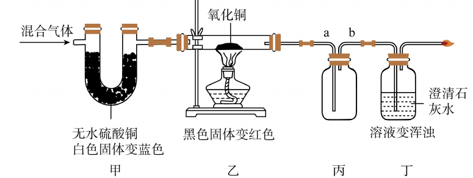

# 化-16 真题精讲 · 实验探究与评价

> **教材对照**：新教材专题 2（实验探究）+ 专题 3（O₂/CO₂）+ 专题 9（碳及其氧化物、燃烧），实验规范见 [[05-化学/专题/实验操作考点-化学]]。

**1.**（2024·奉贤一模·探究碳与氧化铜反应的气体产物）
甲组用图一装置进行实验（装置 B、D 内均是足量澄清石灰水）：

（1）A 处加热一段时间后，试管中的现象是＿＿＿＿＿＿＿＿。
（2）B 处石灰水的作用是＿＿＿＿＿＿＿＿，反应的化学方程式是＿＿＿＿＿＿＿＿。
（3）D 处出现＿＿＿＿＿＿＿＿现象，证明气体产物中有 CO。
乙组用传感器测得 CO、CO₂ 体积分数随时间变化：

（4）初始时 CO₂ 体积分数不为 0，原因是＿＿＿＿＿＿＿＿。
（5）老师指出 CO 不一定是木炭与氧化铜反应产生的，可能的原因是＿＿＿＿＿＿＿＿。

> [!tip]- 💡 思路导航
> 这是"产物是否含 CO"的探究——核心是**先除尽 CO₂ 再检验其还原产物**：逐个装置问"检什么、除什么"，"足量"二字提示了双重任务；传感器题的异常读数先想**空气**。

> [!success]- ✅ 详解 · 评分点 · 易错 · 关联
> **详解**：（1）A 处：**黑色粉末逐渐变红**（CuO→Cu，放出气体）。
> （2）B 处足量石灰水：**检验并完全除去气体中的 CO₂**，防止干扰后续对 CO 的检验；$CO_2+Ca(OH)_2=CaCO_3\downarrow+H_2O$。
> （3）D 处**澄清石灰水变浑浊**：B 已除尽 CO₂，D 中新的 CO₂ 只能来自 C 中 CO 还原 CuO（$CO+CuO\xrightarrow{\Delta}Cu+CO_2$）→ 证明有 CO。
> （4）**装置内原有空气含 CO₂**（反应尚未开始时已被检出）。
> （5）高温下**碳会与装置内的 CO₂（或 O₂）反应生成 CO**（$C+CO_2\xrightarrow{\text{高温}}2CO$）——所以 CO 不能确证为"木炭与氧化铜反应"的直接产物。
>
> **评分点**：**"检验并除尽"双功能要写全**：只写"检验 CO₂"会丢一半分——"足量"二字就是为"除尽"服务的；CO 的证据链要把"因为 B 已除尽 CO₂"这半句写上。
>
> **易错**：异常现象归因：开头"不为 0"先想**空气**（空气里有 CO₂ 和 O₂）——这是传感器类实验的通用答案。
>
> **关联**：[[05-化学/专题/真题精讲/化-09-制气与还原实验]]（CO 还原 CuO 操作顺序）· [[05-化学/专题/说理题方法]]。

**2.**（2024·浦东一模·家用制氧机）　人类离不开氧气，获得氧气的方法有多种：

（1）反应舱内第一步：过碳酸钠分解生成碳酸钠和过氧化氢；第二步：过氧化氢在二氧化锰催化下分解。写出第二步的化学方程式＿＿＿＿＿＿＿＿。
（2）实验室用甲剂、乙剂和水制氧气，发生装置应选＿＿＿＿＿＿＿＿（选填"A"或"B"）。
（3）反应舱内产生的氧气经过加湿过滤舱后变得更湿润。利用装置 C 和 D 也能收集到更湿润的氧气，其连接顺序是＿＿＿＿＿＿＿＿（用 a、b、c、d 表示）。
（4）市场另一类制氧机利用**分子筛**加压吸附氮气得到高纯度氧气，该过程属于＿＿＿＿＿＿＿＿变化。

> [!tip]- 💡 思路导航
> 固液常温制气 + **洗气瓶"长进短出"** + 变化类型判断：湿润氧气 = 让气体穿过水（洗气）；分子筛只"吸走"氮气，没有新物质。看图定接口：C 盛水洗气要长管进短管出。

> [!success]- ✅ 详解 · 评分点 · 易错 · 关联
> **详解**：（1）$2H_2O_2\xrightarrow{MnO_2}2H_2O+O_2\uparrow$
> （2）**B**（固液不加热型——过碳酸钠溶解+催化分解都在常温进行；A 是固体加热型）。
> （3）让氧气**穿过水层**：C 瓶**长管进气、短管出气**，出气再从 D 短管进（D 收集）——即 **c → d → a → b**（按卷面接口字母 a、b、c、d 对应"洗气长进短出、收集短进长出"作答）。
> （4）分子筛只吸附氮气，无新物质生成 → **物理变化**。
>
> **评分点**：接口顺序必须写依据——"洗气长进短出、排水（集气）短进长出"，只写字母串不给满分。
>
> **易错**：**洗气 vs 排水**别背反：洗气长进短出；排水收集短进长出——按目的选规则；**"物理/化学"判断落点**：吸附、溶解、分离（分子筛、分离液态空气）都是物理变化。
>
> **关联**：[[05-化学/专题/真题精讲/化-08-二氧化碳制取]]（发生装置选择）。

**3.**（2023·闵行一模·验证混合气体组成）　某混合气体可能含 CO、CO₂、水蒸气中的一种或几种。为验证其组成，先通会儿氮气，然后点燃酒精灯并通入混合气体（夹持仪器已省略，假设气体均吸收完全）：

（1）先通氮气的目的是＿＿＿＿＿＿＿＿。
（2）装置中检验 CO₂ 发生反应的化学方程式＿＿＿＿＿＿＿＿。
（3）由实验现象可以确定混合气体中**一定含有**的气体是＿＿＿＿＿＿＿＿（按你设计的现象链作答）。
（4）对于"可能存在"物质的判断，在不改变装置的前提下，你的方法是＿＿＿＿＿＿＿＿。

> [!tip]- 💡 思路导航
> 混合气体验证题的规矩——**互不干扰、按序检验**：先验水、再验 CO₂、最后验 CO（验 CO 前必须除尽原 CO₂）。氮气是"惰性开关"：排空装置，防止空气中的 CO₂/水蒸气造成假阳性。

> [!success]- ✅ 详解 · 评分点 · 易错 · 关联
> **详解**：（1）**排尽装置内的空气**，防止空气中的 CO₂ 和水蒸气干扰检验（造成假阳性）。
> （2）$CO_2+Ca(OH)_2=CaCO_3\downarrow+H_2O$
> （3）现象链（示例）：无水硫酸铜变蓝 → 一定有**水蒸气**；第一个石灰水变浑浊 → 一定有 **CO₂**；黑色 CuO 变红、其后石灰水变浑浊 → 一定有 **CO**。（按卷面给定现象对应作答）
> （4）**称量法**：称量各吸收装置（装有无水硫酸铜/石灰水/NaOH 溶液的干燥管、洗气瓶）反应前后的质量，由增重定量判断"可能存在"的物质是否真的存在。
>
> **评分点**：先通氮气/空气的题目目的固定套路 = "排尽装置内（空气/原有气体），防止干扰"；"一定含有"必须挂现象链，裸写气体名不给满分。
>
> **易错**：验 CO 前必须先除尽原 CO₂，否则后面的石灰水变浑浊无法归因——与题 1 的"检验并除尽"同一逻辑。
>
> **关联**：[[05-化学/专题/真题精讲/化-17-说理题专练]]（题 1 即本题第（1）问的说理版）· [[05-化学/知识点/专题3-空气氧气与二氧化碳]]。

## ✅ 答案速查

| 题 | 关键答案 |
| ---- | ---- |
| 1 | 黑色变红；检验并除尽 CO₂：CO₂+Ca(OH)₂=CaCO₃↓+H₂O；D 变浑浊；空气含 CO₂；C+CO₂→2CO |
| 2 | 2H₂O₂→MnO₂ 2H₂O+O₂↑；B；c→d→a→b（洗气长进短出）；物理变化 |
| 3 | 排尽空气防干扰；CO₂+Ca(OH)₂=CaCO₃↓+H₂O；按现象链定"一定含有"；称量吸收装置增重 |

## 🔗 关联

- [[05-化学/知识点/专题9-10-反应调控与化学社会]]（碳与 CO）· [[05-化学/知识点/专题3-空气氧气与二氧化碳]] · [[05-化学/专题/说理题方法]]
- 同类题：[[化-09-制气与还原实验]]（v1，装置选择与操作顺序）
