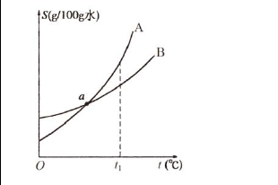
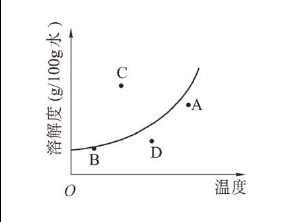

# 化-22 真题精讲 · 溶解度与曲线

> **教材对照**：旧教材专题 3"走进溶液世界"（3.2 溶液：物质的溶解度）→ **新教材专题 7 溶液**（溶解度与溶解度曲线），见 [[05-化学/学科总览]]。

**1.**（溶解度概念）

（1）0℃ 时，8 g 某物质溶于 7 g 水中恰好形成饱和溶液，该物质的溶解度为＿＿＿＿＿＿＿＿。
- （A）8 g/100 g 水
- （B）32 g/100 g 水
- （C）24.2 g/100 g 水
- （D）114.2 g/100 g 水

（2）改错："20℃ 时，100 g 水中溶解了 30 g 氯化钠，所以 20℃ 时氯化钠的溶解度是 30 g。"请指出错误并改正。

> [!tip]- 💡 思路导航
> 溶解度定义四要素——一定温度、100 g 溶剂、饱和状态、单位克：先按比例把"8 g 溶于 7 g"折算成"100 g 水中溶多少"，再对选项；改错题对照四要素找缺失项。

> [!success]- ✅ 详解 · 评分点 · 易错 · 关联
> **详解**：（1）设 0℃ 时该物质的溶解度为 S。7 g 水恰好溶 8 g 达饱和，同温度下饱和溶液的"溶质 : 水"配比恒定：
> $$\frac{8\text{ g}}{7\text{ g}}=\frac{S}{100\text{ g}}\ \Rightarrow\ S=\frac{8\times 100}{7}\approx 114.3\text{ g/100 g 水}$$
> 对照选项选 **D**（题源给 114.2，系截断误差，见易错区）。
> （2）三段式：**判断**——原说法错误。**依据**——溶解度四要素中"饱和状态"缺失：30 g 只是实际溶解的量，20℃ 时 100 g 水中也许还能继续溶氯化钠；"溶解了 30 g"≠"最多能溶 30 g"。**回扣情境**——改正为：20℃ 时氯化钠在 100 g 水中**达到饱和状态**时所溶解的质量，才是该温度下的溶解度。
>
> **易错**：⚠️ **题源勘误**：8÷7×100＝114.285…，四舍五入应为 **114.3**；题源选项与答案给"114.2"（截断误差）。本题为选择题选 D 仍正确；若考试填数值，按选项体系照抄时注意此出入。溶解度四要素（温度、100 g 溶剂、饱和、克）缺一即错；见到"溶解了 30 g"先问"饱和了吗"。
>
> **关联**：[[05-化学/知识点/专题7-溶液]]（概要版）／[[05-化学/知识点详解/专题7-溶液]]（详细版）· [[05-化学/专题/真题精讲/化-21-饱和溶液与转化]]（饱和判定是本讲的前置概念）

**2.**（双路径巧算溶解度）某温度下有硝酸钾溶液一份：若蒸发掉 40 g 水再恢复到原温度，溶液恰好饱和；若在原溶液中加入 12 g 硝酸钾固体，充分搅拌后仍有 4 g 不溶解。则该温度下硝酸钾的溶解度为＿＿＿＿＿＿＿＿。
- （A）30 g/100 g 水
- （B）20 g/100 g 水
- （C）16 g/100 g 水
- （D）8 g/100 g 水

> [!tip]- 💡 思路导航
> 两条"通向饱和"的路——蒸水或加溶质（注意加 12 g 有 4 g 没溶，实溶要打折）：两个饱和状态一对比，多出的水恰好"多溶"的那部分溶质，按 100 g 水的比例折算。

> [!success]- ✅ 详解 · 评分点 · 易错 · 关联
> **详解**：加 12 g 有 4 g 未溶 → 实际只溶解 12−4＝**8 g**，且加完后溶液已饱和。设原溶液含水 m g、溶质 a g，两条路径各得到一个饱和状态：
> - 路径一（蒸发 40 g 水）：(m−40) g 水中溶 a g——饱和；
> - 路径二（加入 8 g 溶质）：m g 水中溶 (a+8) g——饱和。
> 同温度下饱和溶液的"水与溶质"配比固定，两饱和状态相比，多出的 40 g 水恰好多溶解 8 g 溶质：
> $$\frac{8\text{ g}}{40\text{ g}}=\frac{S}{100\text{ g}}\ \Rightarrow\ S=20\text{ g/100 g 水}$$
> 选 **B**。
>
> **易错**：实溶量是 12−4＝8 g，直接拿 12 g 去列式就错；双路径巧算的经典模型——**同一温度下，两个饱和状态相差的溶剂与溶质恰好按 S:100 配比**。
>
> **关联**：[[05-化学/知识点/专题7-溶液]] · [[05-化学/专题/真题精讲/化-23-溶质质量分数与计算]]（饱和溶液质量分数＝S/(100+S)，两讲互为表里）

**3.**（曲线与数据判读）下图是 A、B 两种固体物质的溶解度曲线：

（1）在 a 点时，A 的溶解度＿＿＿＿＿＿＿＿B 的溶解度（选填">""<"或"="）；

（2）t₁℃ 时，A、B 两饱和溶液各 100 g 分别蒸发掉 10 g 水，析出晶体较多的是＿＿＿＿＿＿＿＿；

（3）下图是某固态物质的溶解度曲线，判断该溶液在 A、B、C、D 四种状态时，属于不饱和状态的是＿＿＿＿＿＿＿＿，属于饱和状态的是＿＿＿＿＿＿＿＿。

（4）打开汽水瓶盖，汽水会自动喷出来，说明气体在水中的溶解度与＿＿＿＿＿＿＿＿有关；汽水冰镇后气泡更少，说明气体的溶解度随温度升高而＿＿＿＿＿＿＿＿；

（5）氯化铝的溶解度：0℃ 43.9 g → 100℃ 49.0 g（均指 100 g 水中）。由数据判断：溶解度随温度升高而＿＿＿＿＿＿＿＿（填"增大""减小"或"不变"），且受温度影响＿＿＿＿＿＿＿＿，若氯化铝中混有少量难溶性泥沙，提纯宜采用＿＿＿＿＿＿＿＿结晶。

> [!tip]- 💡 思路导航
> 曲线题三板斧——找交点、比高低、定点定状态：交点处两者相等；饱和溶液蒸发等量水，析出量只看该温度下溶解度谁大；点与曲线的位置关系定"饱和／不饱和"。气体两问分别问"开瓶瞬间什么变了""冰镇改变了什么"；数据题把首尾溶解度相减看"受温度影响大不大"。

> [!success]- ✅ 详解 · 评分点 · 易错 · 关联
> **详解**：（1）a 点是两曲线的交点，交点处两物质溶解度相等 → **=**。
> （2）饱和溶液蒸发 10 g 水，析出量＝10 g×S/100 g，只由**该温度下的溶解度**决定，与溶液总质量（各 100 g 是干扰信息）无关；题源原图中 t₁ 虚线处 A 的曲线在 B 上方（S_A＞S_B）→ 析出较多的是 **A**。
> （3）对照题源原图：**A、D 两点在曲线下方 → 不饱和**；**B 点在曲线上、C 点在曲线上方 → 饱和**（C 状态还应有未溶固体存在）。
> （4）开瓶 → 瓶内压强骤减 → CO₂ 溶解度减小而喷出：与**压强**有关；冰镇后气泡少 → 温度低溶得多 → 气体溶解度随温度升高而**减小**。
> （5）43.9→49.0 g，从 0℃ 到 100℃ 仅增大 5.1 g：随温度升高而**增大**，但受温度影响**很小** → 提纯宜用**蒸发**结晶（先溶解、过滤除泥沙，再蒸发）。
>
> **评分点**：（3）判状态必须写"点相对曲线的位置"依据——"在曲线上／上方／下方"一句话就是给分点；（2）要点明"析出量与溶液总质量无关"。
>
> **易错**：曲线上方＝饱和（有过剩固体）、下方＝不饱和——把"上方"当成不饱和是最常见错误。题源注：题 3（3）旧稿曾按"P₁~P₄ 四点模型"文字重构（原卷图 OCR 丢失），现随题源原图回填为 A/B/C/D 四点（P₁↔B、P₂↔C、P₃/P₄↔A、D），结论不变；题 3（1）（2）旧稿"a 点对应 t₂℃"为重构记号，原图未标 t₂，以图上 t₁ 虚线读数为准。
>
> **关联**：[[05-化学/知识点/专题7-溶液]] · [[05-化学/专题/真题精讲/化-21-饱和溶液与转化]]（结晶方法选择的铺垫）

**4.**（析出量计算＋提纯说理）60℃ 时硝酸钾的溶解度为 110 g/100 g 水，20℃ 时为 31.6 g/100 g 水。

（1）将 210 g 60℃ 的硝酸钾饱和溶液降温到 20℃，能析出硝酸钾晶体多少克？（按"设列算答"规范书写）

（2）降温过滤后所得 20℃ 滤液是＿＿＿＿＿＿＿＿溶液（填"饱和"或"不饱和"）；

（3）说理：硝酸钾中混有少量氯化钠，为什么用降温结晶提纯？若反过来是氯化钠中混有少量硝酸钾，蒸发结晶时为什么不宜把水彻底蒸干？

> [!tip]- 💡 思路导航
> 降温析出量的标准算式链——先按"水与饱和溶液的固定配比"分清 210 g 里水和溶质各多少，再算"降温后还能溶多少"，相减即析出量。提纯说理按"变化大降温、杂质留母液"展开，"不蒸干"的理由想"水分没了杂质会怎样"。

> [!success]- ✅ 详解 · 评分点 · 易错 · 关联
> **详解**：（1）解：设能析出硝酸钾晶体的质量为 y。
> 60℃ 饱和溶液中水与溶液的质量比为 100:(100+110)＝100:210，故 210 g 饱和溶液中：
> m(水)＝210 g×100/210＝**100 g**，m(KNO₃)＝210−100＝**110 g**。
> 降温到 20℃，100 g 水最多溶解 KNO₃ 31.6 g，则
> y＝110−31.6＝**78.4 g**。
> 答：能析出硝酸钾晶体 78.4 g。
> （2）滤液与析出晶体共存 → **饱和**溶液。
> （3）三段式：**判断**——KNO₃ 溶解度随温度变化大、NaCl 变化小，提纯 KNO₃ 宜降温结晶。**依据**——高温配成饱和溶液后降温，KNO₃ 大量结晶析出，而量少且受温度影响小的 NaCl 仍溶解在母液中；过滤即可分离。**回扣情境**——若提纯 NaCl（混少量 KNO₃）则反过来用蒸发结晶，且蒸发至**大量晶体析出即停止加热**、靠余热蒸干：若彻底蒸干，水分消失后 KNO₃ 也会一并析出混入产品。
>
> **评分点**：降温析出计算三步走——**定溶剂 → 定原溶质 → 减新溶解度**；"设列算答"四步齐全才给满过程分。
>
> **易错**：误把 210 g 当水的质量、忘记"减"是两大失分点；题 4 为经典配套计算（题源该小问无对应原题），数据与《物质的溶解度①②》课后练习体系自洽。提纯口诀：**变化大降温、变化小蒸发；提谁看谁，杂质留母液**；"不蒸干"既防杂质析出又防晶体飞溅。
>
> **关联**：[[05-化学/知识点/专题7-溶液]] · [[05-化学/知识点/专题4-水的性质与组成]]（水作溶剂的背景）· [[05-化学/专题/真题精讲/化-23-溶质质量分数与计算]]（两讲互为表里）

## ✅ 答案速查

| 题 | 答案 |
| ---- | ---- |
| 1 | （1）D（精确值≈114.3，题源给 114.2）　（2）错在未保证饱和状态，应为"饱和时 100 g 水中最多溶解的量" |
| 2 | B（S＝8/40×100＝20 g/100 g 水） |
| 3 | （1）=　（2）A　（3）不饱和 A、D；饱和 B、C　（4）压强；减小　（5）增大；很小；蒸发 |
| 4 | （1）78.4 g　（2）饱和　（3）见详解三段式 |
