# 化模26-嘉定 · 2026 嘉定一模精讲 · 水 / 芒硝西瓜霜 / 二氧化碳 / 土壤 / 火炬燃料

> 嘉定卷为综合测试样卷的**化学部分**（全卷 135 分、120 分钟，化学 50 分），按"情境题块"命题，题号全卷连续（1~27），含**不定项**（第 3、5、12、23(3) 题）。相对原子质量：C-12、H-1、O-16。**卷末附参考答案，已与独立推演逐项核对，全部一致**。卷面插图（电解水装置、生命吸管、制硝流程、溶解度表、西瓜霜制法、碳捕集装置、pH 曲线等 12 幅）已按 150dpi 页图原样裁切嵌入题干。

## 题块一 · 关于水的研究（12 分 · 第 1~7 题）

科学家们通过一系列经典实验逐步揭开了水的组成之谜：

实验①：1783 年，卡文迪许将氢气和氧气混合后盛在干燥、洁净的玻璃瓶中，当用电火花点火时发出爆鸣声，且玻璃瓶内壁上出现了液滴，经检验是水。

实验②：1785 年，拉瓦锡将水蒸气通过一根灼热的铁管，在出口处得到了氢气，铁管内壁生成黑色的四氧化三铁。

实验③：1789 年，德穆和特鲁斯维克通过静电装置发电首次将水电解成气体。

**1.** 铁的元素符号是＿＿＿＿＿＿＿＿。
- （A）Mg
- （B）Ag
- （C）Fe
- （D）He

> [!tip]- 💡 思路导航
> 元素符号的书写规范是"一大二小"，拿这条规则逐个核对四种候选，再对号入座各是哪种元素。

> [!success]- ✅ 详解 · 评分点 · 易错 · 关联
> **详解**：选 **C**。铁的元素符号为 **Fe**；Mg 是镁、Ag 是银、He 是氦，均不符合题意。

**2.** 保持水的化学性质的微观粒子是＿＿＿＿＿＿＿＿。
- （A）水分子
- （B）氢原子
- （C）氢分子
- （D）氧原子

> [!tip]- 💡 思路导航
> 水是由分子构成的物质——由分子构成的物质，保持其化学性质的最小粒子是谁？直接对号"分子是保持物质化学性质的最小粒子"。

> [!success]- ✅ 详解 · 评分点 · 易错 · 关联
> **详解**：选 **A**。水由水分子构成，**分子是保持物质化学性质的最小粒子**，故保持水的化学性质的粒子是水分子；氢原子、氢分子、氧原子都不对应"水"这种物质。
>
> **易错**：别选"氢原子"——原子是化学变化中的最小粒子，不是保持化学性质的粒子。

**3.**（不定项）实验①~③涉及的各种物质中，属于氧化物的是＿＿＿＿＿＿＿＿。
- （A）氧气
- （B）水
- （C）四氧化三铁
- （D）氮气

> [!tip]- 💡 思路导航
> 氧化物=**两种**元素组成、其中一种是氧元素的**化合物**。单质直接排除，再把每种物质"数一数元素种类"即可。

> [!success]- ✅ 详解 · 评分点 · 易错 · 关联
> **详解**：选 **BC**。水（H₂O）、四氧化三铁（Fe₃O₄）都由两种元素组成且含氧元素，是氧化物；氧气是单质；氮气未在实验中涉及且本身不是氧化物。
>
> **易错**："含氧"不等于"氧化物"——还必须是**两种元素**组成的化合物；O₂ 虽含氧但是单质。

**4.** 实验②涉及的化学反应属于＿＿＿＿＿＿＿＿（填化学反应的基本类型）。

> [!tip]- 💡 思路导航
> 实验②是"水蒸气＋灼热铁→氢气＋四氧化三铁"：单质＋化合物→新化合物＋新单质，对号四大基本反应类型。

> [!success]- ✅ 详解 · 评分点 · 易错 · 关联
> **详解**：填**置换反应**。3Fe+4H₂O(气) --高温--> Fe₃O₄+4H₂，反应物与生成物均为"单质＋化合物"，符合置换反应特征。
>
> **关联**：[[05-化学/知识点/专题6-化学变化及其表示]]（基本反应类型）。

**5.**（不定项）图 1 是 1864 年一篇文献中所绘制的处于工作状态的电解水装置示意图。有关说法正确的是＿＿＿＿＿＿＿＿。
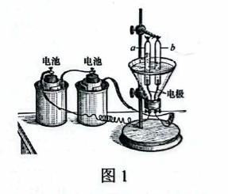

- （A）电解水的化学方程式：2H₂O --通电--> 2H₂↑+O₂↑
- （B）与 b 管电极相连的是电池的负极
- （C）a 与 b 管内收集到的气体质量比约为 1:2
- （D）a 管中的气体能使带火星的木条复燃

> [!tip]- 💡 思路导航
> 电解水口诀"正氧负氢、氢二氧一"指的是**体积**比——a 管气体约为 b 管一半，先定 a、b 各是什么气体，再逐项核对方程式、电极与"质量比/体积比"一字之差。

> [!success]- ✅ 详解 · 评分点 · 易错 · 关联
> **详解**：选 **ABD**。a 管气体约为 b 管一半，a 管为氧气、b 管为氢气。A 方程式书写正确；B 氢气连负极，b 管连**负极**，正确；D a 管氧气能使带火星木条复燃，正确；C 错——a:b 的**体积**比约为 1:2，**质量**比应为 8:1。
>
> **易错**："体积比 1:2"与"质量比 8:1"是电解水计算最高频陷阱，审题先圈"质量"还是"体积"。
>
> **关联**：[[05-化学/知识点/专题4-水的性质与组成]]（电解水实验）。

**6.** 自然界的水一般需要通过净化方可成为饮用水，"生命吸管"可以将自然界的水快速净化为饮用水，主要构造如图 2 所示。生命吸管中活性炭的主要作用是＿＿＿＿＿＿＿＿。
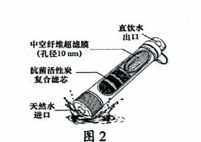

> [!tip]- 💡 思路导航
> 活性炭疏松多孔，联想它净水时的"招牌本领"——针对水中的色素和异味。

> [!success]- ✅ 详解 · 评分点 · 易错 · 关联
> **详解**：填**吸附水中的色素和异味**。活性炭具有疏松多孔结构，能吸附色素和异味。
>
> **关联**：[[05-化学/知识点/专题4-水的性质与组成]]（水的净化、活性炭吸附）。

**7.** 海水中的主要成分是氯化钠，钠离子的直径约为 0.2 nm，推测"生命吸管"能否淡化海水，请说明理由。

> [!tip]- 💡 思路导航
> 先做单位换算（1 μm＝1000 nm）再比较：超滤膜孔径与钠离子直径谁大谁小？"筛孔"比"待筛颗粒"还大，拦得住吗？

> [!success]- ✅ 详解 · 评分点 · 易错 · 关联
> **详解**：**判断**——不能淡化海水。**依据**——超滤膜孔径 10 nm（0.01 μm＝10 nm），远大于钠离子直径 0.2 nm。**回扣**——钠离子能自由穿过膜孔、无法被截留，不能除去海水中的氯化钠，故不能淡化海水。
>
> **评分点**：必须完成 **μm→nm 单位换算**（0.01 μm＝10 nm）再比较，只说"孔径大"没有数字支撑会被扣分。
>
> **关联**：[[05-化学/知识点/专题4-水的性质与组成]]（净化水的方法、膜分离）。

## 题块二 · 芒硝制西瓜霜（10 分 · 第 8~15 题）

古人以天然盐卤水（主要含氯化钠、硫酸钠等）为原料，采用"滩田法"制取芒硝（硫酸钠晶体），制取流程如图 3 所示；图 4 是 NaCl 和 Na₂SO₄ 的溶解度表。
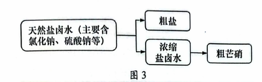

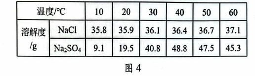

**8.** 20℃，Na₂SO₄ 的溶解度为 19.5 g，表示＿＿＿＿＿＿＿＿。
- （A）20℃，100 g 溶液中有 19.5 g Na₂SO₄
- （B）20℃，100 g 水中有 19.5 g Na₂SO₄
- （C）20℃，100 g 水中最多溶解 19.5 g Na₂SO₄
- （D）100 g 水中最多溶解 19.5 g Na₂SO₄

> [!tip]- 💡 思路导航
> 溶解度定义四要素："（该温度下）""100 g 水""最多（饱和）"，缺一条就是错项——逐项找缺失要素。

> [!success]- ✅ 详解 · 评分点 · 易错 · 关联
> **详解**：选 **C**。溶解度＝一定温度下、100 g 溶剂（水）中达到饱和状态时溶解的最大质量。A 混淆"溶液/溶剂"；B 缺"最多（饱和）"；D 缺温度。
>
> **关联**：[[05-化学/知识点/专题7-溶液]]（溶解度概念）。

**9.** t℃ 时，NaCl 与 Na₂SO₄ 的溶解度恰好相同，确定 t℃ 可能处于的温度范围＿＿＿＿＿＿＿＿℃。

> [!tip]- 💡 思路导航
> 读图 4 两行数据找"大小反转"的区间：20℃ 时谁小、30℃ 时谁大？交点必然落在两者之间的温度带。

> [!success]- ✅ 详解 · 评分点 · 易错 · 关联
> **详解**：填 **20~30**。20℃ 时 Na₂SO₄（19.5 g）＜NaCl（35.9 g），30℃ 时 Na₂SO₄（40.8 g）＞NaCl（36.1 g），两曲线交点落在 20~30℃ 之间。
>
> **易错**：Na₂SO₄ 溶解度在 40℃ 后随温度升高反降，别凭"硫酸钠一直更大"的直觉作答。

**10.** 20℃，将 40 g NaCl 固体加入到 100 g 水中，充分溶解，所得溶液质量为＿＿＿＿＿＿＿＿g。

> [!tip]- 💡 思路导航
> 先查 20℃ NaCl 的溶解度，判断 40 g 能否全溶；问的是"溶液"质量，不是溶质质量。

> [!success]- ✅ 详解 · 评分点 · 易错 · 关联
> **详解**：填 **135.9**。20℃ NaCl 溶解度 35.9 g，40 g 固体只能溶解 35.9 g，剩余 4.1 g 未溶；溶液质量＝100 g＋35.9 g＝135.9 g。
>
> **易错**：结果给**溶液**质量（135.9 g）不是溶质质量；漏加 100 g 水是最常见失分。

**11.** 根据图 3 分析，下列说法正确的是＿＿＿＿＿＿＿＿。
- （A）得到的粗盐中可能含 Na₂SO₄
- （B）浓缩盐卤水中的溶质只有 Na₂SO₄
- （C）浓缩盐卤水一定是硫酸钠的饱和溶液
- （D）最终获得的粗芒硝为纯净物

> [!tip]- 💡 思路导航
> 流程图里"分出粗盐"和"浓缩盐卤水"两步各藏一个考点：盐卤水里本来有什么？"一定/只有/纯净物"这类绝对化措辞要逐个用反例检验。

> [!success]- ✅ 详解 · 评分点 · 易错 · 关联
> **详解**：选 **A**。析出粗盐时少量 Na₂SO₄ 可能夹带析出；浓缩液中 NaCl 仍在，B 错；"一定饱和"过于绝对，只有晶体析出时才饱和，C 错；粗芒硝含杂质，是混合物，D 错。
>
> **易错**："可能"类选项天然难驳倒，"一定/只有"类选项找一个反例即可排除——方向别搞反。

**12.**（不定项）现有 40℃ 的 Na₂SO₄ 和 NaCl 的两种不饱和溶液，下列描述正确的是＿＿＿＿＿＿＿＿。
- （A）上述溶液中，Na₂SO₄ 的质量一定大于 NaCl 的质量
- （B）上述 NaCl 溶液的溶质质量分数一定不可能是 36.4%
- （C）将上述 Na₂SO₄ 溶液降温到 20℃ 时，一定变为饱和溶液
- （D）将上述 NaCl 溶液升温到 60℃ 时，一定仍为不饱和溶液

> [!tip]- 💡 思路导航
> "一定"句各找一个反例即可破：溶质质量与溶解度是两回事；40℃ NaCl 饱和溶液的质量分数有上限；"很稀的溶液"是万能反例。

> [!success]- ✅ 详解 · 评分点 · 易错 · 关联
> **详解**：选 **BD**。A 溶质质量未知（还与溶液总量有关），无法比较，错；B 对——40℃ NaCl 饱和溶液质量分数上限＝36.4/(100+36.4)≈26.7%，永远达不到 36.4%；C 错——原溶液很稀时降温至 20℃ 仍不饱和；D 对——NaCl 溶解度随升温增大，不饱和溶液升温后更加不饱和。
>
> **易错**："一定"句各找一个反例即可破：很稀的溶液降温后仍不饱和（C 错）、NaCl 升温只会更不饱和（D 对），方向别记反。

西瓜霜是一味中药，制作的原料是新鲜西瓜和芒硝。制作方法：①西瓜洗净切片；②一层西瓜片、一层芒硝交替放入没有釉质的瓦罐中（芒硝会促使西瓜细胞液渗出）；③盖上盖子，密封放在阴凉、通风处 2~3 周，瓦罐外面形成白霜。
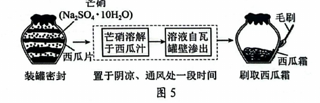

**13.** 西瓜霜中含有锌元素，锌元素在元素周期表中的信息如右图所示，下列说法中错误的是＿＿＿＿＿＿＿＿。
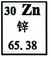
- （A）锌元素的原子序数为 30
- （B）锌原子的核外电子数为 30
- （C）锌原子的相对原子质量为 30
- （D）锌原子的核电荷数为 30

> [!tip]- 💡 思路导航
> 元素周期表一格四个数：左上角原子序数、符号下方元素名称、最下方相对原子质量；"原子序数＝核电荷数＝质子数＝核外电子数"这条等式链先摆出来。

> [!success]- ✅ 详解 · 评分点 · 易错 · 关联
> **详解**：选 **C**。锌的相对原子质量是 65.38，30 是原子序数；原子序数＝核电荷数＝核外电子数＝30，A、B、D 均正确。
>
> **关联**：[[05-化学/知识点/专题2-构成物质的微观粒子]]（元素周期表信息）。

**14.** 通风可加速水分蒸发，水变为水蒸气后分子间的间隙变＿＿＿＿＿＿＿＿（填"大"或"小"）。

> [!tip]- 💡 思路导航
> 液态→气态，分子本身不变，变的是分子间间隔——往哪个方向变？

> [!success]- ✅ 详解 · 评分点 · 易错 · 关联
> **详解**：填**大**。水由液态变为气态，分子数目与分子本身不变，分子间间隔显著变大。

**15.** 将瓦罐置于阴凉处有利于西瓜霜（主要成分芒硝）析出，请依据图 4 和图 5 分析原因。

> [!tip]- 💡 思路导航
> 析晶原因答"双因素"：一条从溶解度表找（温度→溶解度），一条从制法环境找（通风→溶剂→浓度），两条合起来才完整。

> [!success]- ✅ 详解 · 评分点 · 易错 · 关联
> **详解**：**判断**——阴凉处利于芒硝析出。**依据**——由图 4 知 Na₂SO₄ 溶解度随温度降低而减小，阴凉处温度低、溶解度小；同时通风加速水分蒸发，溶液浓度增大。**回扣**——"降温减小溶解度＋蒸发增浓度"共同使溶液达到过饱和，芒硝结晶析出形成白霜。
>
> **评分点**：只答"溶解度减小"得一半分，"通风蒸发、增大浓度"是题干明示的第二条得分点。
>
> **关联**：[[05-化学/知识点/专题7-溶液]]（结晶方法、蒸发结晶）。

## 题块三 · 认识二氧化碳（15 分 · 第 16~21 题）

二氧化碳在大气中的含量是相对稳定的，但随着全球经济的发展，含碳燃料的消耗激增，大气中二氧化碳含量持续上升，导致温室效应加剧。为减缓全球变暖趋势，我国力争在 2030 年前实现碳达峰，2060 年前实现碳中和。

**16.** CO₂ 中碳元素的化合价为＿＿＿＿＿＿＿＿价。
- （A）+1
- （B）+2
- （C）+4
- （D）−4

> [!tip]- 💡 思路导航
> 化合物中各元素正负化合价代数和为零，氧通常显 −2 价，一个 CO₂ 里有两个氧。

> [!success]- ✅ 详解 · 评分点 · 易错 · 关联
> **详解**：选 **C**。O 共 −4，代数和为零，则 C＝+4。
>
> **关联**：[[05-化学/知识点/专题5-化学用语与化合价]]（化合价规则）。

**17.** 下列说法错误的是＿＿＿＿＿＿＿＿。
- （A）CO₂ 能与水反应，可生产碳酸饮料
- （B）CO₂ 参与光合作用，可用作气体肥料
- （C）干冰升华会吸热，可用于人工降雨
- （D）CO₂ 密度大于空气，可用于灭火

> [!tip]- 💡 思路导航
> "性质→用途"要成完整因果链：CO₂ 灭火靠的是哪两条性质？只写物理性质那条，因果链完整吗？

> [!success]- ✅ 详解 · 评分点 · 易错 · 关联
> **详解**：选 **D**。灭火主要利用 CO₂ **不燃烧、不支持燃烧**且密度大于空气（物理覆盖），"密度大于空气"只是辅助条件，单列因果链不完整，说法错误；A、B、C 的性质—用途对应均正确。
>
> **易错**：本题选"错误"项——密度大确实与灭火有关，但缺"不燃烧也不支持燃烧"这一根本性质，因果不完整。

**18.** 要实现"碳达峰""碳中和"的目标，可以从源头上减少 CO₂ 排放：请写出一条具体措施＿＿＿＿＿＿＿＿。

> [!tip]- 💡 思路导航
> "源头"减排=少排：化石燃料是 CO₂ 的主要来源，从"少烧"和"换能源"两个方向任答一条。

> [!success]- ✅ 详解 · 评分点 · 易错 · 关联
> **详解**：答**减少化石燃料（煤、石油、天然气）的使用**（或开发太阳能、风能等清洁能源，合理即可）。

碳捕集是实现"碳中和"的措施之一，采用化学吸收法可实现二氧化碳的"捕集"。为比较"捕捉"效果，设计如图 6 所示实验，甲、乙、丙注射器内的试剂分别是水、饱和氢氧化钙溶液、饱和氢氧化钠溶液，测得烧瓶内压强与时间的关系如图 7 所示。
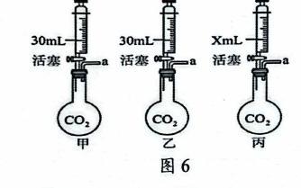

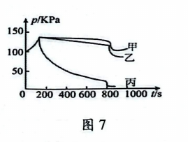

**19.** 钠离子的符号是＿＿＿＿＿＿＿＿。
- （A）Na
- （B）Na⁺
- （C）Na₂
- （D）$\overset{+1}{Na}$

> [!tip]- 💡 思路导航
> 离子符号：电荷数标在元素符号**右上角**、"先数后号"；D 项那种标在正上方的写法是另一类符号（化合价），别混。

> [!success]- ✅ 详解 · 评分点 · 易错 · 关联
> **详解**：选 **B**。钠离子符号为 Na⁺，1 个单位正电荷标在右上角；D 是化合价标注方式，C 是化学式写法，均不对。
>
> **关联**：[[05-化学/知识点/专题5-化学用语与化合价]]（离子符号与化合价标注辨析）。

**20.**（1）图 6 中，丙中 X 的数值应为＿＿＿＿＿＿＿＿，写出丙中发生的反应的化学方程式＿＿＿＿＿＿＿＿；
（2）请从验证生成物的角度设计方案证明丙中物质发生了化学反应；
（3）分析图 7 可知"捕捉"二氧化碳效果最好的是＿＿＿＿＿＿＿＿（填装置序号），你的判断依据是＿＿＿＿＿＿＿＿。

| 操作 | 现象 | 结论 |
| ---- | ---- | ---- |
| 取样于试管中，加入足量＿＿＿＿＿＿＿＿ | ＿＿＿＿＿＿＿＿ | 丙中物质发生了化学反应 |

> [!tip]- 💡 思路导航
> （1）X 是对照实验的控制变量——与甲、乙的注入量对比即得；丙中 NaOH 吸收 CO₂ 生成碳酸钠。（2）题目限定"从生成物角度"：检出碳酸根才是化学变化的证据，走"加酸看气泡"或"加钙/钡盐看沉淀"。（3）效果最好看图 7 中哪条曲线压强降得最狠。

> [!success]- ✅ 详解 · 评分点 · 易错 · 关联
> **详解**：（1）**X＝30**（控制变量：与甲、乙等体积对比，都注入 30 mL）；丙中反应：$CO_2+2NaOH=Na_2CO_3+H_2O$（守恒 ✓）。
> （2）取反应后溶液于试管中，加入足量**稀盐酸**｜**有气泡产生**｜证明溶液中含 Na₂CO₃，即 CO₂ 与 NaOH 发生了反应（或加足量 CaCl₂ 溶液，产生白色沉淀，结论同）。
> （3）三段式：**判断**——丙（饱和 NaOH 溶液）效果最好。**依据**——图 7 中丙曲线压强下降幅度最大、最终压强最低，说明丙吸收的 CO₂ 最多。**回扣**——NaOH 易溶于水、溶液浓度远大于微溶的 Ca(OH)₂，同体积吸收更多。
>
> **评分点**：（1）X＝30 是"控制变量"的必然要求，写 20 或 40 说明没读懂对照设计；（2）不能只答"气体减少"（物理），题目限定**从生成物角度**：检出 CO₃²⁻ 才是化学变化的证据，加酸要写"足量"。
>
> **关联**：[[05-化学/知识点/专题3-空气氧气与二氧化碳]]（CO₂ 的化学吸收）、[[05-化学/知识点/专题8-酸碱盐]]（碳酸盐检验）。

**21.** 实验室用块状石灰石和稀盐酸反应制取 CO₂，从 A~F 中选择一组制取装置＿＿＿＿＿＿＿＿（填编号）；用 G 装置收集 CO₂，气体从＿＿＿＿＿＿＿＿（填"m"或"n"）端通入，用此装置收集二氧化碳，检验 CO₂ 收集满的方法。（写明操作、现象和结论）
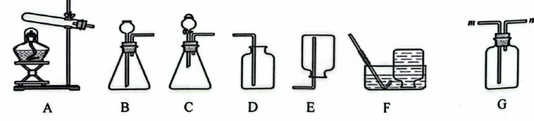

> [!tip]- 💡 思路导航
> 块状固体＋液体、不加热→对号发生装置类型，再按 CO₂ 密度大于空气选收集方法；G 双管瓶按"长进短出"进气，验满在**出气口**做文章。

> [!success]- ✅ 详解 · 评分点 · 易错 · 关联
> **详解**：选 **BD**。固液常温制气选 B（长颈漏斗装置，管口伸入液面下可液封），CO₂ 密度大于空气、向上排空气收集选 D；C 装置漏斗颈短、无法形成液封，气体会从漏斗逸出。气体从 **m** 端（长管）通入，沉在瓶底向上排走空气；验满：**将燃着的木条放在 n 端管口，若木条熄灭，则证明已收集满**。
>
> **评分点**：验满必须"位置（n 端口）＋操作（燃着木条）＋现象（熄灭）＋结论"齐全，放瓶内就变成检验而不是验满。
>
> **关联**：[[05-化学/知识点/专题3-空气氧气与二氧化碳]]（CO₂ 制取、装置选择与验满）。

## 题块四 · 土壤酸碱性的调节（5 分 · 第 22~23 题）

探究土壤酸碱性对不同植物生长的影响，为农业生产提供科学依据。以下为测定某地区土壤酸碱度的流程图：
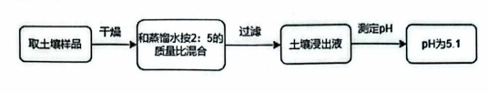

**22.** 几种植物生长适宜的 pH 范围如下表所示，其中适合在此土壤种植的是＿＿＿＿＿＿＿＿。

| 植物 | 小麦 | 棉花 | 茶树 | 甘草 |
| ---- | ---- | ---- | ---- | ---- |
| 适宜范围（pH） | 6.0~7.0 | 6.0~6.8 | 5.0~5.5 | 7.2~8.5 |

> [!tip]- 💡 思路导航
> 流程图末端的"pH 为 5.1"就是判据：拿 5.1 逐个去套四种植物的适宜区间，落在区间内才能种。

> [!success]- ✅ 详解 · 评分点 · 易错 · 关联
> **详解**：填**茶树**（pH 5.1 落在 5.0~5.5 内，其余三种植物的适宜范围均不含 5.1）。
>
> **关联**：[[05-化学/知识点/专题8-酸碱盐]]（溶液酸碱性与 pH）。

**23.** 长期施用一些化肥会造成土壤酸化，实验室用稀硫酸模拟酸性土壤浸出液，用熟石灰进行调节，借助 pH 传感器测得实验过程中溶液 pH 的变化如图 8 所示。
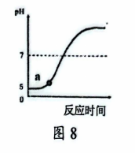

（1）该实验涉及的反应的化学方程式为＿＿＿＿＿＿＿＿；

（2）在反应过程中可以观察到的现象有＿＿＿＿＿＿＿＿。
- （A）溶液温度升高
- （B）产生气泡
- （C）溶液变红
- （D）溶液温度降低

（3）（不定项）取 a 点时的溶液，分别加入下列物质，能产生气泡的是＿＿＿＿＿＿＿＿。
- （A）碳酸钠
- （B）镁
- （C）氧化铜
- （D）氯化钡

> [!tip]- 💡 思路导航
> 熟石灰是碱、稀硫酸是酸——先写出中和反应方程式；中和反应的热效应定（2）；（3）的关键是先判 a 点成分：pH 仍小于 7，说明谁过量？"产生气泡"必须找与酸反应出气体的物质。

> [!success]- ✅ 详解 · 评分点 · 易错 · 关联
> **详解**：（1）$H_2SO_4+Ca(OH)_2=CaSO_4+2H_2O$（H：2+2＝2+2×2，S：1＝1，O：4+2＝4+2 ✓）。
> （2）选 **A**：中和反应**放热**，溶液温度升高；无气体、未加指示剂不会变红。
> （3）选 **AB**：a 点 pH＜7，硫酸过量，溶液含 H₂SO₄ 与 CaSO₄——A 碳酸钠与稀硫酸反应生成 CO₂ 气泡；B 镁与稀硫酸反应生成 H₂ 气泡；C 氧化铜虽与酸反应但无气体；D 氯化钡生成硫酸钡沉淀，无气泡。
>
> **易错**：（2）没加石蕊就不存在"变红"，别把"酸使石蕊变红"的结论无中生有地搬进现象；（3）先判 a 点成分再选答案，跳过"pH＜7→酸过量"这步，容易漏选或错选 CD。
>
> **关联**：[[05-化学/知识点/专题8-酸碱盐]]（中和反应及应用）。

## 题块五 · 火炬燃料的变迁（8 分 · 第 24~27 题）

随着科技的发展，火炬燃料的种类发生了变迁，图 9 列出了火炬燃料变迁的部分时间轴。
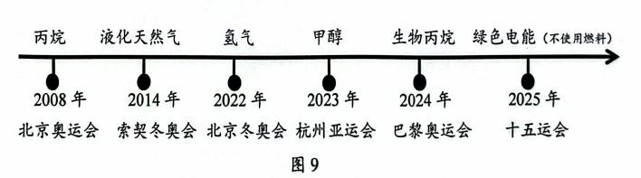

**24.** 下列属于化学变化的是＿＿＿＿＿＿＿＿。
- （A）天然气液化
- （B）氢气燃烧
- （C）酒精挥发
- （D）工业制氧气

> [!tip]- 💡 思路导航
> 化学变化的判据是"有无新物质生成"：液化、挥发、分离液态空气都只是状态或聚集形式变了，燃烧呢？

> [!success]- ✅ 详解 · 评分点 · 易错 · 关联
> **详解**：选 **B**。氢气燃烧生成水，有新物质生成，是化学变化；天然气液化、酒精挥发是状态变化，工业制氧气（分离液态空气）无新物质生成，均为物理变化。
>
> **关联**：[[05-化学/知识点/专题1-物质的变化与性质]]（物理变化与化学变化）。

**25.** 丙烷（C₃H₈）中碳元素的质量分数为＿＿＿＿＿＿＿＿。

> [!tip]- 💡 思路导航
> 元素质量分数＝（该元素相对原子质量×个数）/相对分子质量：先算 C₃H₈ 的相对分子质量，再算 3 个碳原子的贡献。

> [!success]- ✅ 详解 · 评分点 · 易错 · 关联
> **详解**：w(C)＝12×3/(12×3+1×8)×100%＝36/44×100%≈**81.8%**。
>
> **易错**：相对分子质量是 44（36+8），别漏氢的 8。

**26.** 甲醇（CH₃OH）可由氢气和空气中的 CO₂ 合成。化学方程式：aCO₂+bH₂ --一定条件--> cCH₃OH+dH₂O。可以用等式表示化学计量数 a~d 之间存在的质量守恒关系。根据碳原子守恒得到：a＝c，还可以根据＿＿＿＿＿＿＿＿守恒得到：＿＿＿＿＿＿＿＿。

> [!tip]- 💡 思路导航
> 质量守恒的实质是反应前后各原子个数相等：碳已用掉，剩下氢、氧两条路线任选一条，两边分别数原子个数（计量数×原子个数）列等式。

> [!success]- ✅ 详解 · 评分点 · 易错 · 关联
> **详解**：根据**氢（或氧）原子**守恒得到：2b＝4c+2d（或 2a＝c+d）。
>
> **评分点**：两组守恒关系**写一条即可**，系数落在"计量数×原子个数"上：氢是 2b＝4c+2d（两边同除以 2 化简成 b＝2c+d 也对，直接写 b＝4c+2d 就错了）；氧是 2a＝c+d。
>
> **关联**：[[05-化学/知识点/专题6-化学变化及其表示]]（质量守恒定律）。

**27.** 天然气的主要成分是甲烷，燃烧 32 g 甲烷理论上会产生多少克二氧化碳？（根据化学方程式列式计算）

> [!tip]- 💡 思路导航
> 方程式计算"设—列—算—答"四步走：先写配平的燃烧方程式，找 CH₄ 与 CO₂ 的质量比 16:44，代入 32 g 求未知量。

> [!success]- ✅ 详解 · 评分点 · 易错 · 关联
> **详解**：解：设产生二氧化碳的质量为 x。
> $CH_4+2O_2\xrightarrow{\text{点燃}}CO_2+2H_2O$
> 16 : 44＝32 g : x，x＝32 g×44/16＝**88 g**。
> 答：理论上产生 88 g 二氧化碳。
>
> **易错**：设的量 x 必须带单位 g、比例式上下单位一致、答句完整；甲烷与 CO₂ 的质量比是 16:44，不是 12:44。
>
> **关联**：[[05-化学/知识点/专题6-化学变化及其表示]]（化学方程式计算）、[[化-13-化学计算进阶]]。

## ✅ 答案速查

| 题 | 答案 |
| ---- | ---- |
| 1~4 | C；A；BC；置换反应 |
| 5~7 | ABD；吸附色素和异味；不能（孔径 10 nm≫Na⁺ 0.2 nm，无法截留） |
| 8~12 | C；20~30；135.9 g；A；BD |
| 13~15 | C；大；降温减小溶解度＋通风蒸发增浓，共同促进析出 |
| 16~21 | C；D；见详解；B；30；CO₂+2NaOH＝Na₂CO₃+H₂O；加盐酸冒气泡（或加钙盐出沉淀）；丙（压强降得最低）；BD；m；燃着木条放 n 端口熄灭则满 |
| 22~27 | 茶树；H₂SO₄+Ca(OH)₂＝CaSO₄+2H₂O；A；AB；B；81.8%；氢（氧）原子守恒：2b＝4c+2d（或 2a＝c+d）；88 g |

## 🔗 关联

- [[05-化学/知识点/专题4-水的性质与组成]]（电解水、水的净化）· [[05-化学/知识点/专题7-溶液]]（溶解度表、结晶、饱和质量分数）· [[05-化学/知识点/专题3-空气氧气与二氧化碳]]（CO₂ 性质、制取与验满）· [[05-化学/知识点/专题6-化学变化及其表示]]（质量守恒、计量数关系）
- [[05-化学/知识点/专题9-10-反应调控与化学社会]]（碳中和、燃料变迁）· [[化-10-微观意义与计算]] · [[化-13-化学计算进阶]] · 同系列：[[化模26-徐汇-上]] · [[化模26-奉贤]]
